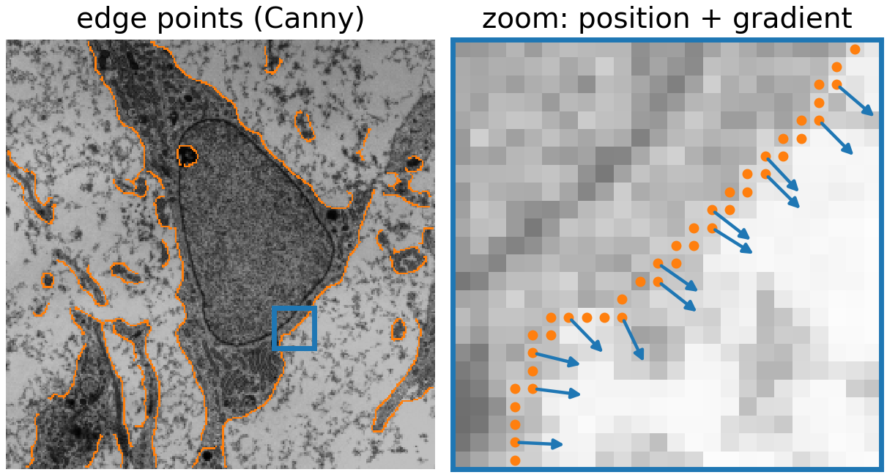
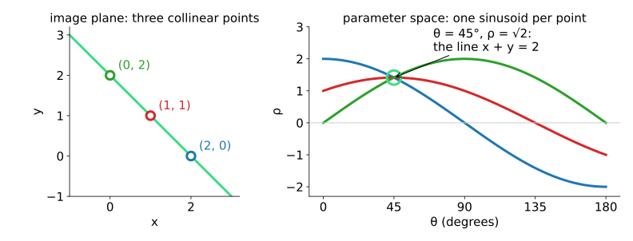
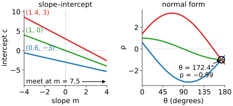
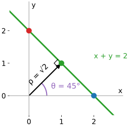
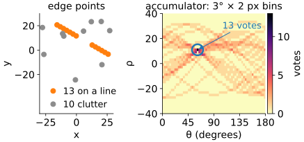
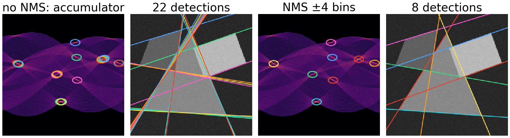
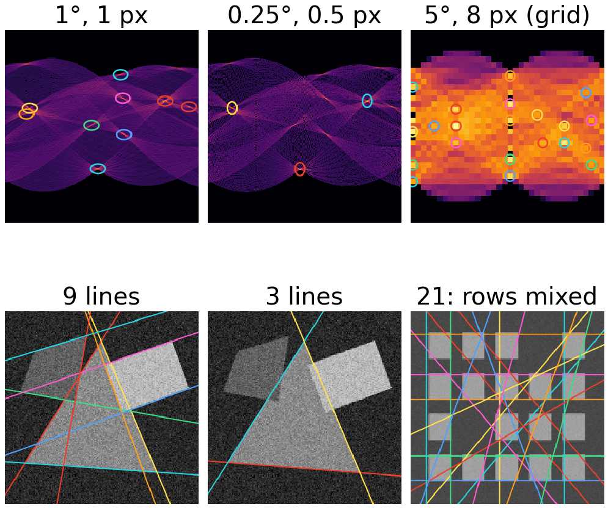
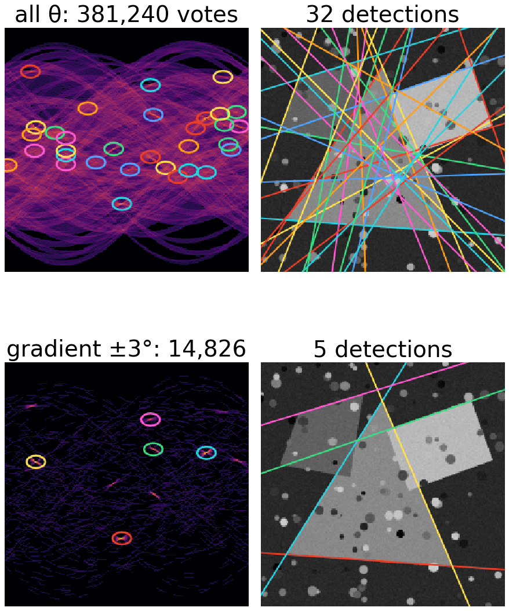
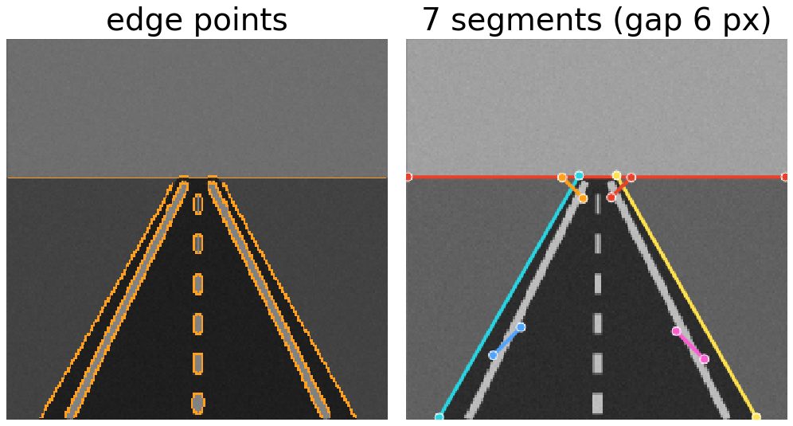
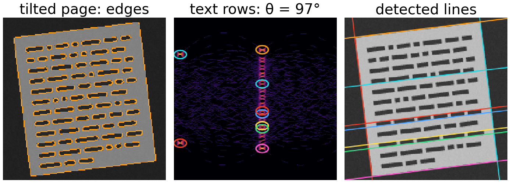

## About this lecture

An edge detector gives a cloud of edge points. Some of them lie on straight lines, with gaps, among clutter. How do we find those lines, all of them, at once? The Hough transform (Hough, 1962; Duda & Hart, 1972) turns the question around: **every point votes for all lines that pass through it**.

- **Duality**: a point in the image is a curve in the space of line parameters; the curves of collinear points meet in one point.
- Why slope and intercept fail, and the **normal form** $(\theta, \rho)$ that works.
- The **accumulator**: votes, peaks, and the choice of bin size and threshold.
- Using the **gradient direction**, finding **segments**, and three applications.

*Slides titled **The math** give the formulas and proofs; the ideas are complete without them.*

::: notes
First unit of the Hough day. Prerequisite: Canny from the edges day (recalled on the next slide, not re-taught). Coordinates in this unit: origin at the image centre, y up, as on the [Radon day](../radon/lec.qmd), so angles turn counter-clockwise on the screen.
:::

## Recall: edge points from Canny

:::: {.columns}
::: {.column width="48%"}
The edges day turned an image into thin edges in four steps: **smooth** (σ), take the **gradient**, keep only the maxima across the edge (**non-maximum suppression**), and link with two thresholds (**hysteresis**). See [Edges, Gaussian derivatives and Canny](../canny/lec.qmd).

For this day the result is a **list of edge points**: each with a position $(x_i, y_i)$, a **direction** $\theta_i$ (the gradient, perpendicular to the edge) and a strength.

- Thin edges: one point per pixel along the edge, so a line of length $L$ gives about $L$ points.
- The direction will save a lot of work later in this unit.
:::
::: {.column width="52%"}
{width="100%" fig-alt="Left: an electron micrograph with its Canny edge points in orange. Right: a zoom on a short piece of membrane: each edge point is a dot, and its gradient direction is an arrow perpendicular to the edge."}

[Micrograph: mesenchymal stem cell, Robert M. Hunt, CC BY 3.0, via Wikimedia Commons.]{style="font-size: 0.55em; color: #666"}
:::
::::

## One point, many lines

Through a single point pass infinitely many lines. Each line is described by **two numbers** (for example an angle and a distance). So the set of all lines through the point is a **curve** in the plane of those two numbers: the **parameter space**.

- Two points: two curves. They cross where the parameters describe a line through **both** points: the one line through them.
- Three **collinear** points: three curves through **one common point**.
- Many points on a line, plus clutter: many curves crossing in one place, the others spread out.

**Detecting a line = finding where many curves meet.**

## Duality: points become curves

{width="92%" fig-align="center"}

Left: three points on the line $x + y = 2$. Right: one curve per point. All three pass through $\theta = 45°$, $\rho = \sqrt2$, which are the two numbers of that line.

## Try it: points and their curves

```{=html}
<link rel="stylesheet" href="../demos/dist/demo.css">
<div data-demo="houghdual" data-preset="three"></div>
<script src="../demos/dist/houghdual.js"></script>
```

::: notes
Tour: "three collinear points" is the figure: the curves meet in the green ring at θ = 45°, ρ = 1.41. Drag one point off the line: the crossing splits into three pairwise crossings (grey dots). "two points": any two points give one crossing, the line through them (always "collinear"). Click anywhere in parameter space: the red dashed line in the image is the line with those parameters. "two lines": six points, three on each of two lines: two triple crossings, and the mixed pairs give scattered crossings. Then "towards vertical" (next slide). Finally "noisy collinear" and "coarse bins": the curves almost meet; binning collects them into one cell with 6 of 6 votes.
:::

## Why not slope and intercept?

:::: {.columns}
::: {.column width="44%"}
The obvious parameters: $y = mx + c$. Each point $(x_i, y_i)$ gives $c = y_i - m x_i$, a **straight line** in the $(m, c)$ plane. A nice picture, but:

- A **vertical** line has $m = \infty$: it is not in the $(m, c)$ plane at all.
- A nearly vertical line has a huge $m$ and a huge $c$: the crossing runs off any finite grid.
- So $(m, c)$ cannot be a finite grid of bins, which is what we want to count votes in.

In the demo, preset **towards vertical**: three points on a steep line; in slope–intercept form their lines meet at $m = 7.5$, outside the panel.
:::
::: {.column width="56%"}
{width="100%" fig-alt="The three points (0.6, −3), (1, 0), (1.4, 3) on a steep line. Left: in the slope–intercept plane their three lines run nearly parallel and meet only at m = 7.5, c = −7.5, off the panel. Right: in the normal form their sinusoids meet inside the bounded range, at θ = 172.4°, ρ = −0.99."}
:::
::::

## The normal form

:::: {.columns}
::: {.column width="62%"}
Describe a line by its **normal**: the unit vector $(\cos\theta, \sin\theta)$ perpendicular to it, and its signed **distance** $\rho$ from the origin. A point lies on the line when its projection onto the normal is $\rho$:

$$\rho = x\cos\theta + y\sin\theta, \qquad \theta \in [0^\circ, 180^\circ), \quad |\rho| \le \tfrac12\,\text{image diagonal}.$$

- **Bounded**: every line, vertical ones included, has a $\theta$ in $[0°, 180°)$ and a finite $\rho$.
- For a fixed point, $\rho$ as a function of $\theta$ is a **sinusoid**.

Worked example, points $(2, 0)$, $(1, 1)$, $(0, 2)$:

| θ | 0° | 45° | 90° | 135° |
|---|---|---|---|---|
| $(2, 0)$ | 2 | 1.41 | 0 | −1.41 |
| $(1, 1)$ | 1 | 1.41 | 1 | 0 |
| $(0, 2)$ | 0 | 1.41 | 2 | 1.41 |

Only at 45° do all three agree: the line $x\cos 45° + y\sin 45° = \sqrt2$, i.e. $x + y = 2$.
:::
::: {.column width="38%"}
{width="100%" fig-alt="The line x + y = 2 through the points (2, 0), (1, 1) and (0, 2). Its normal from the origin meets it at a right angle at (1, 1): the normal has angle θ = 45° and length ρ = √2."}
:::
::::

## The math: sinusoids and their crossings {.math}

- The curve of a point $(x, y)$ is $\rho(\theta) = x\cos\theta + y\sin\theta = A\cos(\theta - \varphi)$ with amplitude $A = \sqrt{x^2 + y^2}$ (the distance of the point from the origin) and phase $\varphi = \operatorname{atan2}(y, x)$ (its polar angle).
- Two points: $x_1\cos\theta + y_1\sin\theta = x_2\cos\theta + y_2\sin\theta$ gives $(x_1 - x_2)\cos\theta + (y_1 - y_2)\sin\theta = 0$: the normal $(\cos\theta, \sin\theta)$ is perpendicular to $\mathbf p_1 - \mathbf p_2$, so $\theta$ is the normal direction of the line through the points, and $\rho = x_1\cos\theta + y_1\sin\theta$.
- In $[0°, 180°)$ the two sinusoids cross exactly once (unless the points coincide): one line through two points.
- $(\theta + 180°, -\rho)$ is the same line as $(\theta, \rho)$; that is why half a turn suffices, and why the accumulator wraps around at its left and right edges with $\rho$ mirrored.

## The accumulator: voting

:::: {.columns}
::: {.column width="46%"}
Make parameter space a **grid of bins** $(\theta_j, \rho_k)$, all set to zero. For every edge point and every $\theta_j$: compute $\rho = x\cos\theta_j + y\sin\theta_j$ and add **one vote** to the bin $(\theta_j, \rho)$.

- Each point draws its sinusoid into the grid.
- A line with $L$ edge points gives a bin with about $L$ votes: a **peak**. The vote count is roughly the **length** of the line in pixels.
- **Gaps do not matter**: votes from the pieces of a dashed line simply add up in the same bin. Neither does the order of the points.
- Clutter votes for random bins and raises the **floor** of the accumulator.
:::
::: {.column width="54%"}
{width="100%" fig-alt="Left: 13 edge points on a line with a gap in the middle, and 10 clutter points. Right: the accumulator with 3° by 2 pixel bins; each point has drawn a sinusoid of votes, and the bin at θ = 60° collects 13 votes, one from every point on the line, gap or not."}

The 13 points of the dashed line give one bin with 13 votes; no other bin gets more than 7.
:::
::::

## Peaks: threshold and non-maximum suppression

A line rarely gives a single bin: noise and the finite grid spread its votes over a small **cluster** of neighbouring bins.

- **Threshold**: keep bins with at least $t$ votes, roughly "lines at least $t$ pixels long".
- **Non-maximum suppression** in parameter space: keep a bin only if it is the largest in a window around it. Without it, one line gives a cluster of near-identical detections.
- The same idea as NMS across an edge ([the edges day](../canny/lec.qmd)), and as regional maxima ([the morphology day](../morph-reconstruct/lec.qmd)): local maxima above a level.

{width="88%" fig-align="center" fig-alt="Stills from the demo below, scene 'shapes', threshold 40. Without NMS, the accumulator has rings on several neighbouring bins around each peak, giving 22 detections in bundles of nearly identical lines; with NMS in a window of plus or minus 4 bins, one ring per peak and 8 detections."}

## Try it: line detection

```{=html}
<link rel="stylesheet" href="../demos/dist/demo.css">
<div data-demo="houghlines" data-preset="clean"></div>
<script src="../demos/dist/houghlines.js"></script>
```

::: notes
Panels: edge points (orange), the accumulator (θ across 0–180°, ρ up; brightness = square root of the votes), detected lines. Tour: "clean lines": 815 edge points, 180 votes each (146,700 in total), 8 peaks above 40; the strongest has 114 votes (the long side of the triangle). Click an edge point: its sinusoid in the accumulator. Click a bright spot in the accumulator: that line appears dashed on the image. "no NMS: clusters": 22 detections instead of 8, bundles of nearly identical lines. Then threshold: 30 gives 11 lines (all sides), 60 gives 3. "bins too fine" and "bins too coarse" on the next slide.
:::

## Bin size: resolution against noise

:::: {.columns}
::: {.column width="52%"}
- **Too coarse** ($\Delta\theta = 5°$, $\Delta\rho = 8$ px): nearby lines fall in the same bin and **merge**; the angle is only known to a few degrees.
- **Too fine** ($\Delta\theta = 0.25°$, $\Delta\rho = 0.5$ px): the votes of one slightly noisy line spread over many bins; the peak **dissolves** below the threshold.
- Rule of thumb: $\Delta\rho \approx 1$ px, and $\Delta\theta$ such that the far end of a line moves by about one pixel. For a 192 × 192 image (half diagonal 136 px) that is about 0.4°; 1° is a common choice.
- Noise in the edge positions **widens** the peak; clutter (texture, other objects) **raises the floor**.

In the demo, with noise 18: default bins find 9 lines (strongest peak 110 votes); "bins too fine" finds 3 (strongest 63). "Bins too coarse" on the window grid gives 21 detections that mix neighbouring rows.
:::
::: {.column width="48%"}
{width="100%" fig-alt="Demo stills, accumulators on top and detected lines below. Left, noise 18 with 1 degree by 1 pixel bins: 9 lines. Middle, the same image with 0.25 degree by 0.5 pixel bins: the peaks dissolve into many fine curves and only 3 lines pass the threshold. Right, the window grid with 5 degree by 8 pixel bins: big blocky bins, 21 detections that cut across the rows of windows."}
:::
::::

## The math: what the accumulator computes {.math}

- With bins of width $\Delta\rho$, the accumulator is a sum over edge points of an indicator:
  $$H(\theta_j, \rho_k) = \sum_i \big[\, |x_i\cos\theta_j + y_i\sin\theta_j - \rho_k| < \tfrac12\Delta\rho \,\big].$$
- Cost: $N_\text{edge} \cdot N_\theta$ votes, independent of the number of lines. Memory: $N_\theta \cdot N_\rho$ bins.
- Angle precision of a segment of length $L$ whose end points are uncertain by $\sigma$ pixels: about $\sigma\sqrt2 / L$ radians. For $L = 100$, $\sigma = 0.5$: 0.007 rad = 0.4°. Bins much finer than this split the peak; much coarser bins throw precision away.
- A peak can be refined below the bin size: fit a parabola to the peak bin and its neighbours, or refit a line to the points that voted for it (the RANSAC unit).

## Use the gradient direction

:::: {.columns}
::: {.column width="56%"}
The gradient of an edge point is the **normal** of the edge, so $\theta_i$ is already known from Canny (up to 180°: the sign of the gradient does not matter for a line).

- Vote only at $\theta \approx \theta_i$: one bin, or a small window of a few degrees for the uncertainty of the direction.
- Votes per point: from $N_\theta$ (180) to a handful (7 for a window of ±3° with 1° bins).
- Clutter votes no longer pile up by chance: a random edge point votes only for lines that are **perpendicular to its gradient**.

Demo, preset "gradient voting": the cluttered scene goes from 381,240 votes and 32 detections (most of them false) to 14,826 votes and 5 detections.
:::
::: {.column width="44%"}
{width="100%" fig-alt="Demo stills of the cluttered shapes scene. Top: voting at all angles fills the accumulator with crossing sinusoids and gives 32 detections, most of them false. Bottom: gradient voting leaves only short arcs and clear peaks, and 5 detections, the sides of the shapes."}
:::
::::

## From lines to segments

:::: {.columns}
::: {.column width="52%"}
A peak is an **infinite** line. To find where it actually is:

1. Collect the edge points within about a pixel of the line.
2. Sort them along the line.
3. Split where two consecutive points are more than a gap $g$ apart.
4. Keep the pieces longer than $L_\text{min}$.

The gap $g$ decides whether a dashed lane marking is one segment or many; $L_\text{min}$ removes short accidental alignments. Image libraries that return "line segments" from a Hough transform do this.
:::
::: {.column width="48%"}
{width="100%" fig-alt="Demo still, preset 'segments with gaps': a road with two lane lines and a dashed centre line. Left: the edge points. Right: 7 detected segments with their end points: the horizon, the outer edges of both lane lines, and shorter pieces where an edge is interrupted."}
:::
::::

## Applications

- **Roads and buildings**: lane markings, kerbs, window rows. Long straight edges with gaps; segments with a gap tolerance. (Demo: "segments with gaps".)
- **Deskewing** a scanned page or a tilted micrograph: the text lines all share one $\theta$. Sum the (squared) votes of each column of the accumulator; the largest column is the tilt. (Demo: "deskew the page": $\theta = 97.0°$, a tilt of 7.0°.)
- **Filaments**: microtubules, actin stress fibres, collagen: straight segments in a cluttered, noisy image. Gradient voting and segments. (Demo: "filaments".) Curved filaments need a different tool: the ridge (Hessian) filters of the [edges day](../hessian/lec.qmd).

{width="56%" fig-align="center" fig-alt="Demo still, preset 'deskew the page': the edge points of a page tilted by 7 degrees; the accumulator, where the peaks of the text rows lie in one column at θ = 97 degrees (two more at the far left are the side borders of the page); and the detected lines along the text rows and the page border."}

## Link: the Radon transform

The Radon transform integrates an image along every line $x\cos\theta + y\sin\theta = \rho$: one number per $(\theta, \rho)$. Apply it to a **binary edge image** (1 on edge pixels, 0 elsewhere) and each line integral counts the edge pixels on that line: exactly the Hough accumulator, apart from how a line is discretised.

- Same parameters and layout: $\theta \in [0°, 180°)$ across, signed $\rho$; a single point gives a sinusoid in both.
- The Radon day uses the transform for **reconstruction** (tomography: recover the image from its line integrals); here we only look for its **peaks**. See [Projections and the sinogram](../radon/lec.qmd).

## The math: point–line duality {.math}

In homogeneous coordinates a point is $\mathbf x = (x, y, 1)^\top$ and a line is $\mathbf l = (a, b, c)^\top$, the set $\{ax + by + c = 0\}$. A point lies on a line when

$$\mathbf l^\top \mathbf x = 0,$$

which is **symmetric** in $\mathbf l$ and $\mathbf x$: the lines through a fixed point form a line in the space of $\mathbf l$'s, and the points on a fixed line form a line in the space of $\mathbf x$'s. The line through two points is $\mathbf l = \mathbf x_1 \times \mathbf x_2$; the point where two lines meet is $\mathbf x = \mathbf l_1 \times \mathbf l_2$. The normal form is the choice $(a, b, c) = (\cos\theta, \sin\theta, -\rho)$, which removes the arbitrary scale of $\mathbf l$ and keeps the parameters bounded. (Homogeneous coordinates return in the 3D graphics day.)

## Summary

- A point in the image is a **curve** in parameter space; collinear points give curves through **one point**.
- Use the **normal form** $\rho = x\cos\theta + y\sin\theta$: bounded, every line included, a point becomes a sinusoid.
- **Vote** into an accumulator; lines are **peaks** (height ≈ length). Gaps do not matter.
- **Threshold + NMS** in parameter space; choose bins of about 1 px and a fraction of a degree to a degree.
- **Gradient voting** cuts the votes per point from 180 to a few and suppresses clutter.
- Peaks are infinite lines; **segments** come from the points along them.
