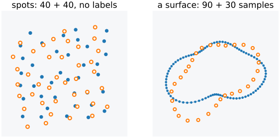
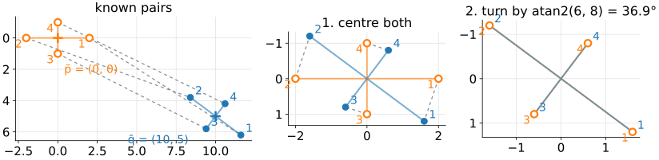
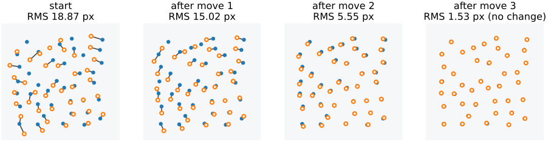
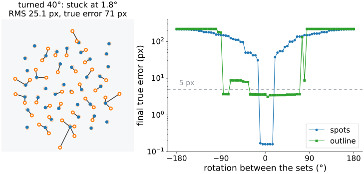
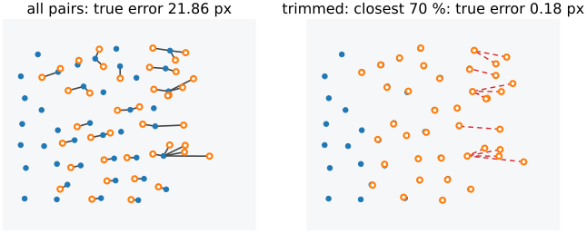
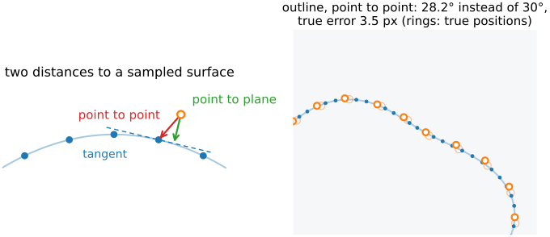

## About this lecture

The [previous unit](../feature-alignment/lec.qmd) aligned two images from **matched** keypoints. Often there is nothing to match: just two clouds of points, and no way to tell which point belongs to which.

- **The problem**: point sets without correspondences (spots, centroids, surfaces).
- **Known pairs**: the best rotation and shift in closed form (centroids, then one angle).
- **ICP**: guess the pairs by nearest neighbours, solve, repeat. Why it converges, and where to.
- **A good start**, **outliers** and **trimmed ICP**, **surfaces** and point-to-plane.

*Slides titled **The math** give the formulas and proofs; the ideas are complete without them.*

::: notes
Notation: the moving set m_i (orange, n points), the fixed set f_j (blue), a rigid transform T = (R, t), R the rotation by θ. With y down, a positive θ turns clockwise on screen (the course convention). Demo numbers: 40 spots at least 30 px apart, moving set turned by 10° about the field centre and shifted by (12, −8) px, noise 1 px, seed 1. Procrustes is owned by shape-models/ (snakes day), the Hungarian algorithm by object-eval/ and track-linking/; this unit uses them as forward references.
:::

## Two point sets, no labels

:::: {.columns}
::: {.column width="50%"}
- **Spots in two channels**: beads imaged in red and green; the channels are shifted and slightly turned (chromatic aberration, camera mounting).
- **Cell centroids at two time points**: the stage moved and turned; a few cells left, a few came in.
- **Correlative light and electron microscopy**: the same nuclei, or the same surface, found in two modalities that look nothing alike.

A point is only a **position**: no descriptor to match, so the ratio test and RANSAC of the [last units](../feature-matching/lec.qmd) have nothing to work on.
:::
::: {.column width="50%"}
{fig-alt="Left: 40 blue dots (fixed set) and 40 orange rings (moving set), the orange set turned by 10 degrees and shifted, with no lines telling which ring belongs to which dot. Right: a blob-shaped outline sampled at 90 blue points and 30 orange points on a turned and shifted copy of it." width="100%"}
:::
::::

## If we knew the pairs

{fig-alt="Three panels. Known pairs: an orange cross of four points at the origin and a blue copy turned and moved to (10, 5), numbered pairs joined by dotted lines. Centre both: both crosses centred at the origin, the blue one still turned. Turn by atan2(6, 8) = 36.9 degrees: the orange cross lies on the blue one." width="88%" fig-align="center" .nostretch}

Pairs $\mathbf p_i \leftrightarrow \mathbf q_i$ known: the best rigid transform (least squares) in two steps.

1. **Centre**: the shift brings the centroid $\bar{\mathbf p}$ onto $\bar{\mathbf q}$.
2. **Turn**: over the centred points, $S_\text{dot} = \sum \mathbf p_i\cdot\mathbf q_i$ ("how much they agree") and $S_\text{cross} = \sum (p_x q_y - p_y q_x)$ ("how much $\mathbf q$ is turned past $\mathbf p$"); the angle is $\theta = \operatorname{atan2}(S_\text{cross}, S_\text{dot})$. Above: $S_\text{dot} = 8$, $S_\text{cross} = 6$, $\theta = 36.9°$, shift $(10, 5)$, residual 0.

## No SVD needed in 2D

- A **similarity** (with scale): the same sums, $a = S_\text{dot}/\sum|\mathbf p_i|^2$, $b = S_\text{cross}/\sum|\mathbf p_i|^2$, the matrix $\begin{pmatrix} a & -b\\ b & a\end{pmatrix}$: scale $\sqrt{a^2 + b^2}$, angle $\operatorname{atan2}(b, a)$.
- This is **Procrustes analysis**, which aligns landmark shapes in [shape models](../shape-models/lec.qmd), and the similarity fit of the [previous unit](../feature-alignment/lec.qmd).
- **Translation only**: the difference of the centroids. **Affine**: linear least squares (previous unit).
- In 3D the angle becomes a rotation matrix, found by an SVD (next slide). Either way: **one formula, no iteration**, once the pairs are known.

## The math: the best rigid transform {.math}

Minimise $E(R, \mathbf t) = \sum_i |R\mathbf p_i + \mathbf t - \mathbf q_i|^2$ over rotations $R$ and shifts $\mathbf t$.

- $\partial E/\partial\mathbf t = 0$: $\mathbf t = \bar{\mathbf q} - R\bar{\mathbf p}$. With centred points $\mathbf p_i' = \mathbf p_i - \bar{\mathbf p}$, $\mathbf q_i' = \mathbf q_i - \bar{\mathbf q}$: $E = \sum|\mathbf p_i'|^2 + \sum|\mathbf q_i'|^2 - 2\sum\mathbf q_i'^\top R\mathbf p_i'$, so **maximise** $\sum\mathbf q_i'^\top R\mathbf p_i'$.
- **2D**: $R = \begin{pmatrix}\cos\theta & -\sin\theta\\ \sin\theta & \cos\theta\end{pmatrix}$ gives $\sum\mathbf q'^\top R\mathbf p' = S_\text{dot}\cos\theta + S_\text{cross}\sin\theta$, largest at $\theta = \operatorname{atan2}(S_\text{cross}, S_\text{dot})$.
- **Any dimension** (Kabsch, Umeyama): $\sum\mathbf q_i'^\top R\mathbf p_i' = \operatorname{tr}(R^\top C)$ with the cross-covariance $C = \sum\mathbf q_i'\mathbf p_i'^\top = U\Sigma V^\top$. The maximum over rotations is $R = U\,\mathrm{diag}(1, \dots, 1, \det UV^\top)\,V^\top$ (the last sign forbids a reflection).
- **Similarity**: scale $s = \operatorname{tr}(\Sigma D)/\sum|\mathbf p_i'|^2$ with $D$ that diagonal sign matrix.

## Guess the pairs, solve, repeat

{fig-alt="Four panels of the same 40 blue spots and 40 orange rings, each orange ring joined to its nearest blue spot. Start: RMS 18.87 px, many rings joined to the wrong spot. After move 1: RMS 15.02 px. After move 2: RMS 5.55 px, most rings joined to their own spot. After move 3: RMS 1.53 px, every ring on its spot, no change any more." width="100%"}

**Iterative closest point** (Besl and McKay, Chen and Medioni, 1992): pair every orange point with the **nearest** blue one; fit the best transform to these pairs; move; pair again. Wrong pairs at the start, but most of them point **roughly the right way**, so the move helps and the next pairs are better.

## ICP as pseudocode

```
T = the start transform (no motion, or the centroids matched)
repeat:
    for every moving point m:                          # 1. match
        j(m) = index of the fixed point nearest to T(m)
    keep the pairs (m, f_j(m))                         #    (trimmed: only the closest ones)
    T = the best transform for the kept pairs          # 2. move: centroids + atan2 (or SVD)
until the pairs no longer change
```

- Per iteration: $n \cdot m$ distances by brute force; a **k-d tree** of the fixed set makes it about $n\log m$ ([matching: speed](../feature-matching/lec.qmd#/speed)).
- The fit is always to the **original** moving points: $T$ is the whole transform, not a correction.

::: notes
The coding exercise (keypoints/src/icp/ in the course code download) implements the centroid, the closed-form rigid fit, the nearest neighbour, one trimmed ICP step and the loop, checked against the by-hand exercises, and aligns the centroids of synthetic nuclei at two time points.
:::

## Try it: ICP step by step

```{=html}
<link rel="stylesheet" href="../demos/dist/demo.css">
<div data-demo="icp" data-preset="close"></div>
<script src="../demos/dist/icp.js"></script>
```

::: notes
"1. match" draws the nearest-neighbour pairs, "2. move" fits and moves. Close start (10°): RMS 18.87 → 15.02 → 5.55 → 1.53 px, converged after 3 moves, true error 0.16 px (the 1 px noise). The right plot: the final true error for every rotation between the sets: only −10° to 15° (in steps of 5°) converge. Turned 40°: stuck at 1.8°, RMS 25.1 px, true error 71 px.
:::

## Why it stops, and where

- Each half-step can only **lower** the sum of squared distances: re-pairing picks the nearest partner (never worse than the old one), the fit picks the best transform for the pairs (never worse than the old transform).
- There are finitely many ways to pair the points, so the pairs stop changing: ICP always **converges**.
- But to the nearest **local minimum**: a pairing that is self-consistent but wrong. Same story as [k-means](../kmeans/lec.qmd): assign to the nearest, refit, repeat.
- The **RMS does not tell** you which: a wrong local minimum of evenly spread spots still has many short pairs. Check the result some other way (overlay, a held-out landmark, the number of close pairs).

## The math: ICP minimises one energy {.math}

$$E(T, j) = \sum_i |T(\mathbf m_i) - \mathbf f_{j(i)}|^2 \quad\text{over the transform } T \text{ and the pairing } j.$$

- **Match**: for fixed $T$, each term is minimised separately by $j(i) = \arg\min_k |T(\mathbf m_i) - \mathbf f_k|$: $E$ cannot increase.
- **Move**: for fixed $j$, the closed form minimises $E$ over $T$: $E$ cannot increase.
- $E \ge 0$ decreases monotonically and takes finitely many values at the moments the pairing changes, so the pairing becomes constant after finitely many steps; then $T$ is fixed (**coordinate descent**, like k-means and EM).
- Convergence near the solution is only **linear**, and slow when the sets can slide along each other (surfaces); point-to-plane (below) is much faster there.

## A good start matters

:::: {.columns}
::: {.column width="42%"}
- Spots about 30 px apart: ICP finds the right answer only if the sets start within **about 15°** of each other (right, blue). A turn moves the outer points by more than half the spacing, and they pair with the wrong neighbours.
- A distinctive outline converges from much further (green): its shape pulls in one direction.
- Ways to a good start: **match the centroids** (removes a large shift); the **principal axes** ([PCA](../pca/lec.qmd)) for the rotation; try **several start angles** and keep the lowest RMS; a few **features + RANSAC** or a few **manual landmarks** ([previous unit](../feature-alignment/lec.qmd)), then ICP to refine.
:::
::: {.column width="58%"}
{fig-alt="Left: the spots after ICP from a 40 degree turn: stuck at 1.8 degrees, every orange ring joined to a wrong blue spot, faint rings showing the true positions; RMS 25.1 px, true error 71 px. Right: final true error (log scale) against the rotation between the sets from minus 180 to 180 degrees: for spots below 1 px only from minus 10 to 15 degrees, above 30 px elsewhere; for the outline about 3.5 px from minus 30 to 70 degrees, large elsewhere." width="100%"}
:::
::::

## Outliers and partial overlap

:::: {.columns}
::: {.column width="45%"}
Fields of view rarely overlap fully: cells leave and enter, the EM section covers part of the light image. Plain ICP pairs **every** point, and the points without a partner pull the fit sideways (least squares again, as in the [previous unit](../feature-alignment/lec.qmd)).

**Trimmed ICP**: use only the closest fraction of the pairs, e.g. 70 % when about 70 % of the points are seen in both sets. Demo, 30 % unpaired: all pairs 21.9 px true error; keep 70 %: **0.18 px**.

Other remedies: drop pairs longer than a distance $d_\text{max}$; keep only **mutual** nearest neighbours ([matching](../feature-matching/lec.qmd)); down-weight long pairs (robust weights).
:::
::: {.column width="55%"}
{fig-alt="Left: all pairs: the orange set includes points beyond the right edge of the blue set; they are joined to blue spots on the edge and drag the whole set right and turn it: true error 21.86 px. Right: trimmed, closest 70 percent: the unpaired points are left out (red dashed lines) and the rest lie on their spots: true error 0.18 px." width="100%"}
:::
::::

## Try it: partial overlap

```{=html}
<link rel="stylesheet" href="../demos/dist/demo.css">
<div data-demo="icp" data-preset="overlap"></div>
<script src="../demos/dist/icp.js"></script>
```

::: notes
30 % of the points without a partner (the moving field misses the left part and sees extra spots on the right). Keep 100 %: true error 21.86 px. Keep 90 %: 10.72; 80 %: 3.82; 70 %: 0.18 (6 moves); 60 %: 0.49; 50 %: 0.60; 40 %: 17.08 (too few pairs to pin the rotation; wrong minimum). Matching the centroids first makes it worse here (87.9 px): with partial overlap the centroids are not corresponding points.
:::

## The math: trimmed ICP {.math}

- Minimise over $T$, the pairing $j$ **and** a subset $S$ of $h$ moving points: $E = \sum_{i \in S}|T(\mathbf m_i) - \mathbf f_{j(i)}|^2$ (Chetverikov et al., 2002).
- Match step: for fixed $T$, the best $j$ is the nearest neighbour and the best $S$ the $h$ smallest distances (any other choice of $h$ terms is at least as large). The fit step is unchanged. So $E$ still decreases monotonically and the trimmed ICP converges.
- $h$ too large: unpaired points stay in and bias $T$. $h$ too small: too few pairs to fix $T$ well, and more local minima. The fraction can itself be chosen by minimising $E(h)/h^{1+\lambda}$ (a penalty for small $h$).
- A distance cut-off $d_\text{max}$ is the same idea with a fixed distance instead of a fixed count; it should shrink as the alignment improves.

## Nearest or one-to-one?

- Nearest-neighbour pairing is **many-to-one**: two orange points may share one blue point. That is harmless at the end (each has its own) and helpful at the start (it is cheap, and it works with different numbers of points).
- **One-to-one** pairing with the smallest total distance is the assignment problem, solved by the **Hungarian algorithm** ([tracking](../track-linking/lec.qmd), [matching objects](../object-eval/lec.qmd)). It can replace step 1 when both sets contain the same objects; it costs $n^3$ per iteration and still forces points without a partner onto someone.
- The pairing after ICP is itself a result: spots in two channels within a few px of each other, cells linked between two time points (then [tracking](../track-linking/lec.qmd) takes over).

## Surfaces: point to point or point to plane?

:::: {.columns}
::: {.column width="45%"}
Two samplings of one **surface** (or outline) have no exact partners: a moving sample lies between two fixed samples.

- **Point to point** pulls it onto a fixed sample, so the whole set **slides** along the surface: in the demo the outline ends at 28.2° instead of 30°, true error 3.5 px, and it takes 19 moves.
- **Point to plane**: measure the distance to the **tangent** line (plane in 3D) at the matched point. Sliding along the surface costs nothing, so the sampling no longer biases the fit, and convergence is much faster.
- It needs a **normal** at each fixed point (from its neighbours on the surface).
:::
::: {.column width="55%"}
{fig-alt="Left: a curved surface sampled at five blue points, an orange point above it between two samples; a red arrow to the nearest sample (point to point) and a green arrow perpendicular to the dashed tangent (point to plane). Right: part of the outline after point-to-point ICP: the orange samples sit on blue samples, slightly turned from their true positions (faint rings)." width="100%"}
:::
::::

## The math: point to plane {.math}

- Minimise $\sum_i \big((R\mathbf m_i + \mathbf t - \mathbf f_{j(i)})\cdot\mathbf n_{j(i)}\big)^2$, with $\mathbf n$ the unit normal at the matched fixed point (Chen and Medioni, 1992).
- No closed form, but for a small angle $R\mathbf m \approx \mathbf m + \theta\,(-m_y, m_x)$, and each term becomes **linear** in $(\theta, t_x, t_y)$:
$$r_i = (\mathbf m_i - \mathbf f_i)\cdot\mathbf n_i + \theta\,(m_{i,x}n_{i,y} - m_{i,y}n_{i,x}) + t_xn_{i,x} + t_yn_{i,y}.$$
- So each iteration solves a $3 \times 3$ linear least-squares problem (6 × 6 in 3D), applies the small rotation exactly, and re-matches. Near the solution this behaves like Gauss–Newton: few iterations.
- Pairs whose normals all point the same way (a flat wall) leave the sliding direction undetermined: the $3 \times 3$ matrix is singular. Point to point has the same weakness, it just hides it.

## In practice

- **Channels**: beads or spots in two colours; usually a small shift, so even one nearest-neighbour pairing is right; then fit a similarity or an affine map (chromatic magnification differs).
- **Time-lapse**: centroids of nuclei, with cells entering and leaving: trimmed ICP or a distance cut-off; the pairing seeds [tracking](../track-linking/lec.qmd).
- **Correlative LM/EM**: a coarse start from a few manual landmarks, then ICP on the nuclei or on segmented surfaces (point to plane).
- **3D**: the same algorithm, with the SVD for the rotation and a k-d tree for the neighbours.
- Variants with **soft** pairings (every point pulled by all its near neighbours, weighted by distance) are smoother and also handle non-rigid deformation. Image libraries call the family "point-set registration"; ICP is the classic.

## Summary

- Two point sets **without correspondences**: spots, centroids, surfaces.
- **Known pairs**: centre, then $\theta = \operatorname{atan2}(S_\text{cross}, S_\text{dot})$; in any dimension $R$ from the SVD of the cross-covariance (Procrustes, Kabsch).
- **ICP**: pair by nearest neighbour, fit, repeat. The error never rises and the pairing stops changing, but at the **nearest local minimum**: start close (centroids, axes, a few landmarks, several start angles).
- Points without a partner bias the fit: **trimmed ICP** keeps only the closest pairs (about the overlap fraction).
- On sampled **surfaces**, point to plane removes the sliding bias and converges in few steps.
- Check the result independently: a low RMS can be a wrong minimum.
