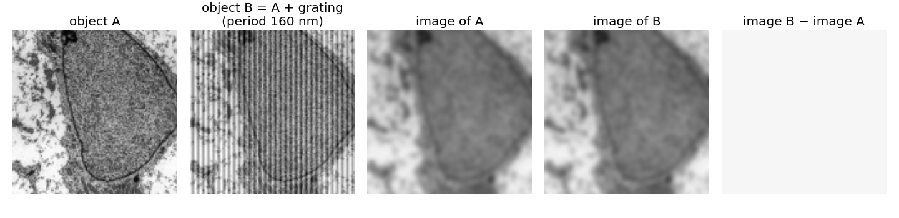
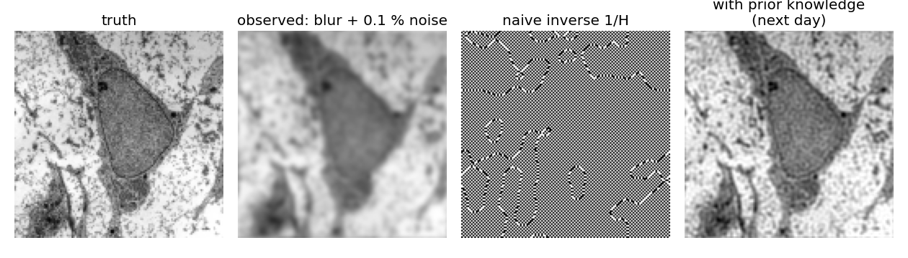

## About this lecture

We know the forward model and the PSF. Can we get the object back from the image?

- Undo the blur by **dividing by the OTF**: **inverse filtering**. Perfect without noise.
- With noise it **explodes** where the OTF is small, and has **nothing to divide** beyond the cut-off.
- **Invisible objects**: different objects can give exactly the same image.
- Blur is a **matrix**; undoing it is solving a badly **conditioned** linear system: an **ill-posed** problem.

*Slides titled **The math** give the formulas and proofs; the ideas are complete without them.*

::: notes
Short closing unit of the image formation day (about 45 minutes with the exercise). It shows why restoration needs more than the forward model, and names no cure: Wiener, Tikhonov, regularisation, Richardson–Lucy and denoisers belong to the deconvolution day (tomorrow). The demo is the deconvolution day's lab in its inverse-only mode. Notation as before: g = f ∗ h + n, G = FH + N.
:::

## The question

The forward direction is well behaved: one object gives one image. The **inverse problem** runs it backwards: from the image (and the PSF) to the object.

- Forward: object → blur → sample → add noise → image. Every step is known.
- Backward: image → ? The blur averaged neighbours together; the noise added something we do not know.
- Is there **one** object that explains the image? Can we **find** it? Does a **tiny** change in the image make a tiny change in the answer?

## Divide by H

In frequency space the blur is a multiplication: $G = F \cdot H$. So divide: $\hat F = G / H$. This is **inverse filtering**.

- Without noise, and where $H \ne 0$: $\hat F = FH/H = F$, **exactly** the object.
- Each frequency is multiplied by the **gain** $1/H$: weakly transmitted frequencies are amplified strongly.

| OTF $H$ | 1 | 0.5 | 0.1 | 0.01 |
|---|---|---|---|---|
| gain $1/H$ | 1 | 2 | 10 | 100 |
| 1 % noise becomes | 1 % | 2 % | 10 % | 100 % |

## With noise

The image is $G = FH + N$. Dividing:

$$\hat F = \frac{G}{H} = F + \frac{N}{H}.$$

- The noise is spread over **all** frequencies, about equally (white noise). The signal is not: at high frequencies $FH$ is tiny.
- Where $H$ is small, $N/H$ is huge: the restored image is dominated by **amplified noise** at the finest frequencies.

**Small example.** The blur $(1, 2, 1)/4$ multiplies the three waves of the frequency unit (constant, period 4 pixels, period 2 pixels) by **1, 0.5, 0**. The inverse multiplies them by **1, 2, ∞**. Noise at period 4 doubles; noise at period 2 cannot be divided at all.

## Try it: the inverse filter

```{=html}
<link rel="stylesheet" href="../demos/dist/demo.css">
<div data-demo="deconvlab" data-mode="inverse" data-preset="perfect"></div>
<script src="../demos/dist/deconvlab.js"></script>
```

::: notes
The deconvolution day's lab, inverse-only mode, 128 × 128 cell phantom. Panels: truth, observed, inverse-filtered, error. Plot: blue |H|, red 1/|H|, dashed the noise floor. Tour: "no noise: inverse is perfect" (Gaussian σ = 1.5 px): RMSE 6e-9 — but the readout's largest gain is 1.1e9. "0.1 % noise: inverse explodes": RMSE 4.8e4, half the pixels negative. Lower the PSF width to 0.5 px: largest gain 3, and at 0.1 % noise the inverse now beats the observed image (RMSE 0.0018 against 0.0057); at 1 % it does not (0.018 against 0.011). "Motion blur: zeros" (9 px, star, 1 % noise): RMSE 0.96, streaks along x. "An invisible grating": next slide.
:::

## Invisible objects

{width="100%"}

- A grating finer than the cut-off gives **exactly the same image** as no grating at all ($H = 0$ there).
- So adding it to **any** object changes nothing in the image: the data cannot tell these objects apart.
- No method can recover what the optics never transmitted. A restoration that shows such detail has **invented** it.

## Ill-posed

A problem is **well-posed** if an answer **exists**, is **unique**, and depends **stably** on the data. Deblurring fails all three:

- **Existence**: noise puts energy at frequencies where $H = 0$; no object, blurred, gives exactly that image.
- **Uniqueness**: invisible objects can be added freely.
- **Stability**: a tiny change in the image (noise of 0.1 %) changes the answer enormously (gains of $10^9$).

The forward model alone does not determine the object. Something else must.

## The math: blur is a circulant matrix {.math .smaller}

On a periodic 1D signal of $n$ pixels, blur by a kernel is $\mathbf g = A\mathbf f$ with a **circulant** matrix: each row is the kernel shifted by one. For $(1, 2, 1)/4$ and $n = 4$:

$$A = \frac14\begin{bmatrix} 2 & 1 & 0 & 1 \\ 1 & 2 & 1 & 0 \\ 0 & 1 & 2 & 1 \\ 1 & 0 & 1 & 2 \end{bmatrix}.$$

- Every circulant matrix has the **Fourier waves** $\mathbf w_k = (e^{2\pi i k j/n})_j$ as eigenvectors, with eigenvalues $H(k)$, the DFT of the kernel. Here $H = (1, 0.5, 0, 0.5)$ for $k = 0, 1, 2, 3$.
- So the convolution theorem **is** the diagonalisation $A = W^{-1}\,\mathrm{diag}(H)\,W$ (the DFT is a change of basis).
- For a symmetric kernel $A$ is symmetric; its singular values are $|H(k)|$. Condition number:
$$\kappa(A) = \frac{\max_k |H(k)|}{\min_k |H(k)|} = \frac{1}{\min_k |H(k)|},$$
infinite as soon as some $H(k) = 0$ (this $A$ is singular: $\mathbf w_2 = (1, -1, 1, -1)$ is in its null space).

## The math: ill-posedness {.math}

- **Hadamard** (1902): a problem is well-posed if a solution exists, is unique, and depends continuously on the data.
- For $\mathbf g = A\mathbf f$: the **null space** of $A$ (the waves with $H(k) = 0$; for a lens, all frequencies past $2\mathrm{NA}/\lambda$) can be added to any solution: **not unique**. Data with a component outside the range of $A$ have **no** exact solution.
- **Stability**: for $A(\mathbf f + \delta\mathbf f) = \mathbf g + \delta\mathbf g$ with invertible $A$,
$$\frac{\|\delta\mathbf f\|}{\|\mathbf f\|} \le \kappa(A)\,\frac{\|\delta\mathbf g\|}{\|\mathbf g\|}.$$
A relative error of $10^{-3}$ in the image can become $10^{-3}\kappa$ in the object.
- Two-pixel blurs: $\begin{bmatrix}0.75 & 0.25\\0.25 & 0.75\end{bmatrix}$ has eigenvalues 1 (sum) and 0.5 (difference), $\kappa = 2$; $\begin{bmatrix}0.55 & 0.45\\0.45 & 0.55\end{bmatrix}$ has 1 and 0.1, $\kappa = 10$. An error of 0.01 in the difference grows to 0.02 and to 0.1.

## What must we add?

{width="90%"}

The data alone cannot decide. Restoration only works if we **add what we know**:

- about the **object**: it is smooth, or mostly piecewise constant, and never negative;
- about the **noise**: how large it is, and what kind (Poisson, Gaussian).

**Tomorrow** (the deconvolution day): how to add it, and how to choose how much.

## Other forward models

The same diagnosis appears whenever we measure something through an instrument:

- **Tomography** (the Radon elective): the forward model takes line integrals instead of a convolution with a PSF; reconstructing the object from them is ill-posed in the same way.
- Missing frequencies, small gains and noise: the vocabulary of today carries over.

## Summary

- **Inverse problem**: from the image back to the object. **Inverse filter**: $\hat F = G/H$.
- Without noise and with $H \ne 0$: exact. With noise: $\hat F = F + N/H$ explodes where $H$ is small.
- Beyond the cut-off $H = 0$: **invisible objects**; nothing can bring them back.
- Blur = **circulant matrix**, eigenvectors = Fourier waves, eigenvalues = OTF; condition number $1/\min|H|$.
- **Ill-posed**: existence, uniqueness and stability all fail. We must **add knowledge** about the object and the noise: the next day.
