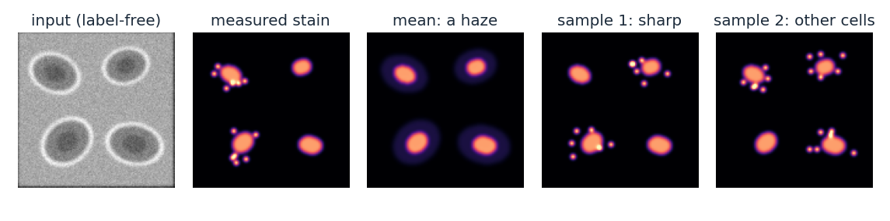
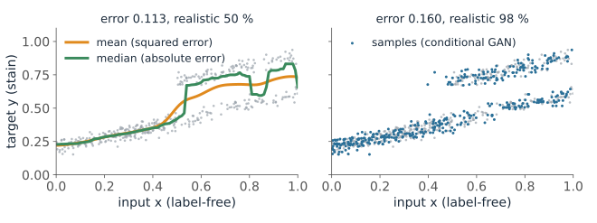
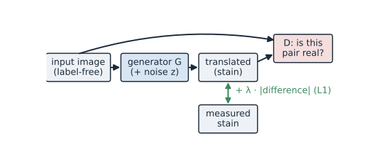
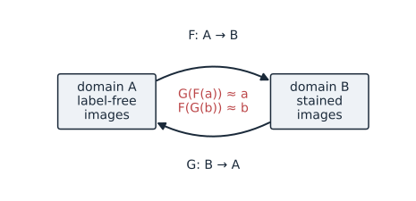
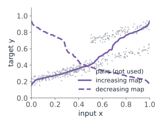
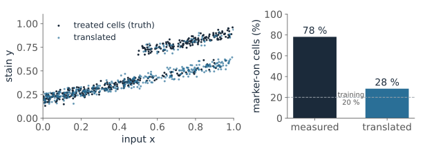

## About this lecture

*A network turns a label-free image into a "fluorescence" image that looks just like the real stain. Which parts of it can you trust?*

- **Paired** translation: a regression network, and a **conditional GAN** that adds "make it look real".
- What each loss converges to: the **mean** (blurry), the **median**, or a **sample** (sharp, but a guess).
- **Unpaired** translation with **cycle consistency**, and what it cannot know.
- **Hallucination**: plausible detail that is not in the sample, and how to check for it.

*Slides titled **The math** give the formulas and proofs; the ideas are complete without them.*

::: notes
Third unit of the day. Builds on [gan/](../gan/lec.qmd) and the U-Net ([unet/](../unet/lec.qmd)). Demo: translate1d (one pixel: input value x, target value y; the translators as they would be after perfect training; presets "target visible", "hidden marker", "sharp samples", "treated test cells", "unpaired"). The diffusion units return to generated detail: [diffusion/](../diffusion/lec.qmd) (introduction) and [diffusion-inverse/](../diffusion-inverse/lec.qmd) (virtual staining with an exact posterior).
:::

## Translating images

{fig-alt="Synthetic sketch of four cells. Input (label-free): cell outlines bright, nuclei slightly darker. Measured stain: four bright nuclei; the upper-left and lower-left cells also have bright cytoplasmic spots. Mean prediction: the nuclei, and a faint haze over every cytoplasm. Sample 1: sharp spots in the upper-right and lower-left cells. Sample 2: sharp spots in three cells, a different set." width="92%" fig-align="center"}

- **Virtual staining**: predict a fluorescence channel from a transmitted-light image; also stain-to-stain (H&E to an immunostain), **denoising**, **super-resolution**.
- Trained on **pairs** of the same field imaged both ways. Saves a channel, photodamage, a staining step.
- The nuclei are visible in the input; the spots are not. Every translator must invent them somehow (sketch above).

## Paired translation: a regression network

:::: {.columns}
::: {.column width="50%"}
A [U-Net](../unet/lec.qmd) maps the input image to the target image, trained on pairs with a pixel loss.

- **Squared error** (L2): the output converges to the **average** of all targets seen with similar inputs: the **conditional mean**.
- Where the input decides the target (nuclei): fine. Where it does not (spots on or off): a value **no real cell has** (left, orange: halfway between the branches).
- **Absolute error** (L1): the **median**: one branch or the other, jumping.
:::
::: {.column width="50%"}
{fig-alt="One pixel: input x horizontally, target y vertically, 400 training pairs (grey). For x > 0.5 the pairs split into two branches 0.3 apart (marker off and on). Left: the mean curve (orange) runs between the branches, the median (green) jumps between them; error 0.113, 50 % realistic. Right: samples of a conditional GAN (blue) lie on both branches; error 0.160, 98 % realistic." width="100%"}
:::
::::

## Conditional GANs (paired)

:::: {.columns}
::: {.column width="55%"}
**pix2pix** (Isola et al., 2017): the regression network becomes a generator, judged by a discriminator that sees **pairs**:

- $D$ gets (input, output) and says whether this is a **real pair**. So the output must look real **and** fit the input.
- Plus an L1 term that keeps the output close to the measured target.
- $D$ judges small **patches** (say 70 × 70 pixels): it checks texture and sharpness, and the L1 term the large shapes.
- Result: sharp outputs where L2 alone gives blur.
:::
::: {.column width="45%"}
{fig-alt="Diagram: the input image goes into the generator G (with noise z), which outputs the translated stain. The discriminator D receives the input image together with the translated stain and asks whether this pair is real. A green double arrow between the translated and the measured stain: plus lambda times the absolute difference (L1)." width="100%"}
:::
::::

## The math: the pix2pix objective {.math}

Input $\mathbf x$, measured target $\mathbf y$, generator $G(\mathbf x, \mathbf z)$, discriminator $D(\mathbf x, \mathbf y)$:

$$\min_G\max_D\ \mathbb E_{\mathbf x, \mathbf y}\big[\log D(\mathbf x, \mathbf y)\big] + \mathbb E_{\mathbf x, \mathbf z}\big[\log(1 - D(\mathbf x, G(\mathbf x, \mathbf z)))\big] + \lambda\,\mathbb E\,\|\mathbf y - G(\mathbf x, \mathbf z)\|_1$$

- The adversarial part is the GAN of the [first unit](../gan/lec.qmd) with the input as extra condition: at its optimum, $G(\mathbf x, \cdot)$ is distributed like $p(\mathbf y\mid\mathbf x)$.
- The L1 part alone is minimised by the conditional **median**; the sum trades sharpness against staying near the measurement ($\lambda = 100$ in the original).
- In practice the generator often ignores $\mathbf z$ and becomes nearly deterministic: one sharp guess, not a distribution.

## Three translators, one ambiguous pixel

| what the loss pulls towards | output where the input is ambiguous | error vs truth | realistic? |
|---|---|---|---|
| squared error: conditional **mean** | between the possibilities | **smallest** (0.113) | no (50 %) |
| absolute error: conditional **median** | one possibility, chosen by the majority | 0.131 | yes (99 %) |
| conditional GAN: a **sample** of $p(y\mid x)$ | a random possibility, sharp | **largest** (0.160) | yes (98 %) |

- Realism and accuracy pull in **opposite** directions where the input does not decide the target.
- A sample is exactly as plausible as a real cell, and wrong half the time in the ambiguous part.

::: notes
Numbers from the translate1d demo, preset "hidden marker" (gap 0.3, half the cells marker-on, 400 training and 400 held-out test pairs). The coding exercise (gans/src/image_translation/) gives 0.110, 0.130 and 0.155 with its own random numbers.
:::

## The math: what each loss converges to {.math}

For one input $x$, let $Y$ be the target's conditional distribution.

- $\mathbb E(Y - c)^2$ is minimised by $c = \mathbb E[Y]$ (the mean); $\mathbb E|Y - c|$ by any median of $Y$.
- A sample $\hat Y$ drawn independently from the same distribution: $\mathbb E(\hat Y - Y)^2 = 2\operatorname{Var}(Y)$, twice the mean's error $\operatorname{Var}(Y)$: a factor $\sqrt 2$ in RMSE.
- Two branches $\pm g/2$ with probability ½ each: the mean's RMSE is $g/2$, the sample's $g/\sqrt 2$. With $g = 0.3$: 0.15 and 0.21 (plus noise).

## Try it: one pixel, three translators

```{=html}
<link rel="stylesheet" href="../demos/dist/demo.css">
<div data-demo="translate1d" data-preset="hidden"></div>
<script src="../demos/dist/translate1d.js"></script>
```

::: notes
"target visible in the input" (gap 0): all three agree, errors 0.030, 0.031, 0.045 (sample = noise twice). "hidden marker": mean error 0.113 but only 50 % realistic; samples 0.160, 98 %; the spread plot jumps at x = 0.5 (0.03 to 0.14): disagreement between samples flags the ambiguous part. "treated test cells": training 20 % marker-on, test 80 %: samples say 28 %. "unpaired": the increasing and decreasing quantile maps.
:::

## Unpaired translation: cycle consistency

:::: {.columns}
::: {.column width="52%"}
Often there are no pairs: label-free images from one experiment, stained images from another.

- **CycleGAN** (Zhu et al., 2017): two generators, $F$: A → B and $G$: B → A, each with a discriminator in its target domain.
- Plus **cycle consistency**: translating there and back must return the original, $G(F(a)) \approx a$.
- Learns "what stained images look like" and a map that can be undone.
:::
::: {.column width="48%"}
{fig-alt="Diagram: domain A (label-free images) and domain B (stained images), with an arrow F from A to B above and an arrow G from B to A below; in the middle, in red, G(F(a)) approximately a and F(G(b)) approximately b." width="100%"}
:::
::::

## The math: the cycle-consistent objective {.math}

$$\mathcal L = \mathcal L_{\text{GAN}}(F, D_B) + \mathcal L_{\text{GAN}}(G, D_A) + \lambda\Big(\mathbb E_a\|G(F(a)) - a\|_1 + \mathbb E_b\|F(G(b)) - b\|_1\Big)$$

- The GAN terms make $F(a)$ distributed like the B images and $G(b)$ like the A images: they match **distributions**, not pairs.
- The cycle terms ask $F$ to be invertible. Every invertible map that matches the distributions has zero cycle loss.
- In 1D: both the increasing and the decreasing **quantile map** $y = F_B^{-1}(F_A(x))$ or $F_B^{-1}(1 - F_A(x))$ match the distributions exactly and invert exactly.

## What unpaired training cannot know

:::: {.columns}
::: {.column width="55%"}
Matching two distributions does not fix **which** input goes with **which** output.

- In the demo's one pixel, an increasing and a decreasing map are equally good by every unpaired criterion (right). Neither follows the true pairs.
- On images, a cycle-consistent network can swap structures, or hide the information it needs to undo the map as invisible low-amplitude patterns in its output (Chu et al., 2017).
- Use unpaired translation for **appearance** (style, intensity distribution), not for content you will measure.
:::
::: {.column width="45%"}
{fig-alt="The 400 training pairs (grey, not used by the unpaired translators), with the increasing quantile map (solid purple), which climbs from 0.2 to 0.9 through the middle of the data, and the decreasing quantile map (dashed purple), which falls from 0.9 to 0.2. Both map the input distribution exactly onto the target distribution." width="100%"}
:::
::::

## Hallucination

:::: {.columns}
::: {.column width="45%"}
**Hallucination**: generated detail that looks right but is not in the sample.

- A sharp translator must **invent** what its input does not show: spots, textures, fine structure beyond the resolution.
- It invents what was **typical in training**. A translator trained on normal cells paints normal cells.
- No warning sign in the image itself: hallucinations are, by construction, realistic.
:::
::: {.column width="55%"}
{fig-alt="One pixel, treated test cells: measured pairs (black) have 78 % marker-on cells (the upper branch); the translated values (blue) of the same inputs mostly lie on the lower branch. Bars: marker-on cells measured 78 %, translated 28 %; dashed line at the training share of 20 %." width="100%"}
:::
::::

- Demo, preset "treated test cells": trained where 20 % of cells are marker-on; on treated cells (78 % on) the translation reports **28 %**. The treatment effect has **vanished**, and every translated value looks real.

## How to check a translator

1. **Held-out ground truth**: image some fields both ways and compare, **with the readout you will use** (counts, intensities, areas), not just the look. Include treated conditions.
2. **Uncertainty**: run the generator with several noise values, or several trained models; where they **disagree**, the input does not decide the output (the demo's spread jumps from 0.03 to 0.14 where the marker is hidden).
3. **Never measure** on generated images without (1). Use them for display, for guiding a segmentation, or to decide where to image properly.
4. Report the method; keep and show the raw input.

## The checks as pseudocode

```
for every held-out field with input x and measured target y:
    samples = [G(x, z) for 16 noise values z]           # or 16 trained models
    spread  = standard deviation of the samples, per pixel
    error   = |mean of samples − y|, per pixel
    compare the readout (count, intensity) on y and on the samples
report: error and readout difference, per condition (control, treated)
check:  is the spread large where the error is large?
```

- A small error on **control** images says nothing about **treated** ones.

::: notes
The coding exercise (gans/src/image_translation/) computes the three translators of the demo (mean, median, sample) and the unpaired quantile map, and scores them against held-out truth in three scenarios, including the treated test cells (marker-on 78 % measured, 22 % from the samples, with its random numbers).
:::

## Summary

| Idea | In one line |
|---|---|
| Paired translation | regression on pairs: L2 → conditional mean (blur), L1 → median |
| Conditional GAN | D judges (input, output) pairs: sharp, realistic, but a guess where the input is ambiguous |
| Accuracy vs realism | the mean has the smallest error, a sample √2 times more |
| Unpaired, cycle-consistent | matches distributions; does not know which input belongs to which output |
| Hallucination | invented detail looks real; it copies what was typical in training |
| Checks | held-out truth with the real readout, per condition; disagreement between samples; never measure unvalidated |

The diffusion units return to this: [which details are real](../diffusion/lec.qmd), and [what virtual staining can know](../diffusion-inverse/lec.qmd) with an exact posterior.
