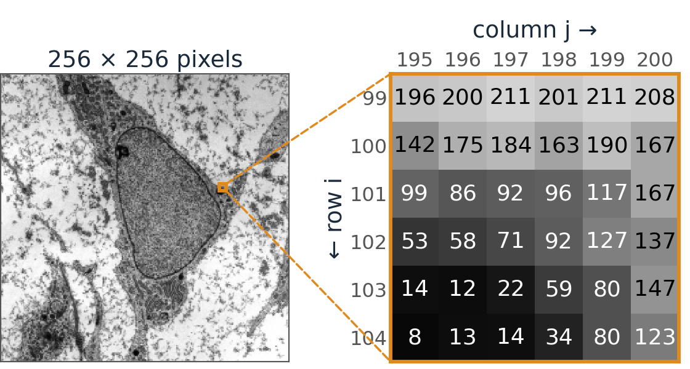
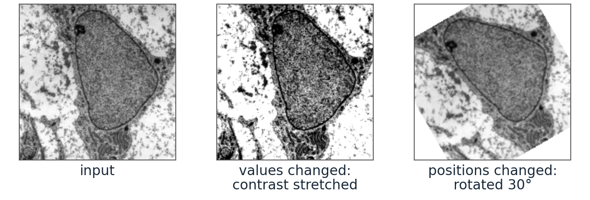
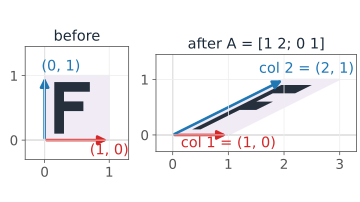
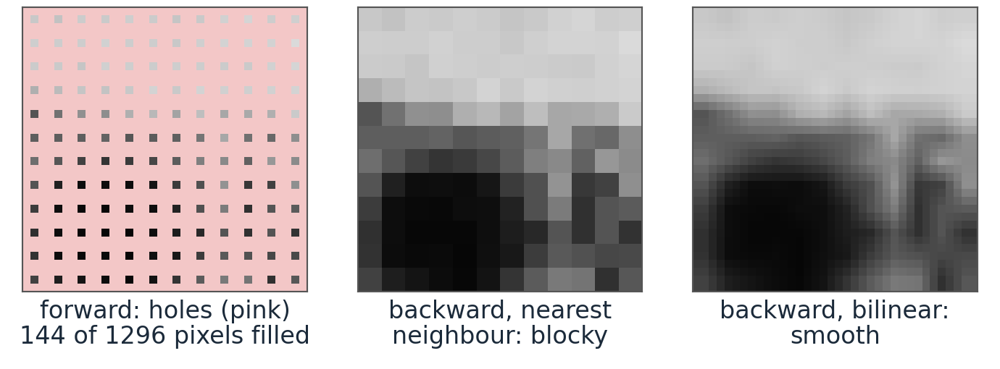
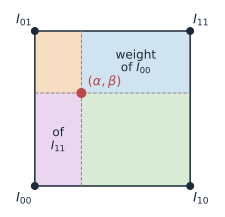
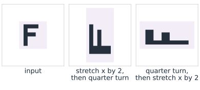

## About this lecture

- A digital image is a **function sampled on a grid**: a matrix of numbers.
- Grey levels, colour channels and bit depth.
- Moving an image around: a **geometric transform** is a matrix acting on the **coordinates**, not on the pixel values.
- Why we compute the output by going **backwards** (inverse mapping), and what **interpolation** is for.
- Adding translation: **affine** transforms and homogeneous coordinates.

Slides titled **The math** give the formulas and proofs; the ideas are complete without them.

::: notes
The whole course rests on one idea: an image is a matrix, so the tools from linear algebra and calculus apply. This first lecture sets up notation and does the simplest thing one can do with an image: move it. The students know matrices as linear maps; here the matrix maps pixel positions.
:::

## From a scene to a matrix

:::: {.columns}
::: {.column width="52%"}
A camera or microscope measures a continuous brightness and records it at a **grid of points**. The result is a matrix: the entry in row $i$, column $j$, written $I[i, j]$, is the brightness at that grid point.

$$I[i, j] = f(x_j,\, y_i), \qquad i = 1,\dots,M,\quad j = 1,\dots,N.$$
:::
::: {.column width="48%"}
{fig-alt="A 256 × 256 electron micrograph with a 6 × 6 patch at the edge of a dark structure enlarged; each enlarged pixel shows its grey level between 8 and 211, rows numbered downwards and columns to the right." width="100%"}
:::
::::

- Each entry is a **pixel** (picture element). Its value is a **grey level**, typically stored as an integer 0–255 (8 bits) or 0–65535 (16 bits, common in microscopy).
- A **colour** image is three such matrices (red, green, blue): an $M \times N \times 3$ array.
- Watch the conventions: matrices are indexed **(row, column)** from the top left; plots use **(x, y)** with y pointing up.

::: notes
Figure: the course micrograph (transmission electron micrograph of a mesenchymal stem cell, Robert M. Hunt, CC BY 3.0, via Wikimedia Commons), 8-bit grey levels; the enlarged patch is rows 99–104, columns 195–200 (counting from 1). Two things are lost when we sample: everything between the grid points (resolution) and everything between the grey levels (quantisation). Sampling comes back in the Fourier lecture, where we can say precisely what is lost. The row/column versus x/y confusion is the single most common bug in image code: row index i goes down, y goes up. Say it now, and expect to say it again.
:::

## Image operations come in two kinds

| Change the **values** | Change the **positions** |
|---|---|
| each new value is computed from the old value, or from the neighbours | each new pixel takes the value from the place it **came from** |
| contrast, thresholds, **filters** | rotate, scale, shear, **register** two images |
| next lectures | **this lecture** |
| in symbols: $I'[i,j] = g(I[i,j])$ | in symbols: $I'(\mathbf{x}) = I(T^{-1}\mathbf{x})$ |

{fig-alt="The same micrograph three times: as input, with grey levels 0.25 to 0.75 stretched to the full range (values changed), and rotated by 30 degrees (positions changed)." width="62%" fig-align="center" .nostretch}

A geometric transform keeps every grey level; it only moves them.

## Try it: transform an image

```{=html}
<link rel="stylesheet" href="../demos/dist/demo.css">
<div data-demo="matrix2x2" data-mode="image" data-a="1 0 0 1"></div>
<script src="../demos/dist/matrix2x2.js"></script>
```

::: notes
Drag the red and blue handles: they are the two columns of A. Suggested tour: Rotate 30°, then Scale (twice as wide, half as tall), then Reflect, where the F reads backwards (determinant −1). Then rotate by 180° with the slider and ask: is this a mirror image too? (No: determinant +1.) Then Collapse, and slowly pull the blue handle away from the red one: the picture is a line exactly when the columns are parallel, determinant 0. Finally Misaligned: this is what a second image of the same sample often looks like, and undoing it is image registration.
:::

## Read a matrix from its columns

:::: {.columns}
::: {.column width="60%"}
Put the origin in the centre of the image. A $2\times2$ matrix moves every point, and the picture travels along.

- **Column 1** is where the step to the right, $(1, 0)$, lands. **Column 2** is where the step up, $(0, 1)$, lands. Every other point follows: $(x, y)$ goes to $x$ times column 1 plus $y$ times column 2. That is all you need to read a matrix.
- Example: $\begin{bmatrix} 1 & 2\\ 0 & 1\end{bmatrix}$ keeps $(1, 0)$ and sends $(0, 1)$ to $(2, 1)$: every point slides sideways by twice its height. A **shear**.
- $\begin{bmatrix} 2 & 0\\ 0 & 0.5\end{bmatrix}$: twice as wide, half as tall. $\begin{bmatrix} -1 & 0\\ 0 & 1\end{bmatrix}$: mirrored left–right.
- The **determinant** is the factor by which **areas** change: 2 doubles every area; a **negative** determinant means a **mirror image**; **0** means the columns are parallel and the image is squashed onto a line.
:::
::: {.column width="40%"}
{fig-alt="A unit square with an F inside, before and after the shear with columns (1, 0) and (2, 1): the red arrow (1, 0) stays, the blue arrow (0, 1) becomes (2, 1), and the square becomes a parallelogram with the F slanted." width="100%"}
:::
::::

## The math: 2 × 2 matrices as maps of the plane {.math}

$A$ sends the point $\mathbf{x} = (x, y)$ to $A\mathbf{x}$:

$$A = \begin{bmatrix} a & b\\ c & d \end{bmatrix}, \qquad A\begin{bmatrix}1\\0\end{bmatrix} = \begin{bmatrix}a\\c\end{bmatrix} \text{ (col 1)}, \quad A\begin{bmatrix}0\\1\end{bmatrix} = \begin{bmatrix}b\\d\end{bmatrix} \text{ (col 2)}, \quad A\begin{bmatrix}x\\y\end{bmatrix} = x\begin{bmatrix}a\\c\end{bmatrix} + y\begin{bmatrix}b\\d\end{bmatrix}.$$

- Rotation by $\theta$: $\begin{bmatrix}\cos\theta & -\sin\theta\\ \sin\theta & \cos\theta\end{bmatrix}$. Scaling: $\begin{bmatrix}s_x & 0\\ 0 & s_y\end{bmatrix}$. Shear: $\begin{bmatrix}1 & k\\ 0 & 1\end{bmatrix}$.
- The unit square goes to the parallelogram spanned by the two columns, with area $|ad - bc| = |\det A|$; by linearity every area is scaled by the same factor.
- $\det A < 0$: the orientation is reversed (a **mirror image**); $\det A = 0$: the columns are linearly dependent and the image collapses onto a line.

## Computing the output: go backwards

Sending every input pixel to its new position (**forward mapping**) leaves **holes** when the image is enlarged: scale by 3, and only 1 in 9 output pixels receives a value. When it shrinks, several pixels collide.

Instead, loop over the **output** pixels and ask where each one **came from**: undo the transform, and look up the input there.

- Every output pixel gets exactly one value: no holes.
- The place it came from is almost never exactly on a pixel, so we **interpolate**:
  - **nearest neighbour**: take the closest pixel (blocky, but keeps the original values; used for label images),
  - **bilinear**: a weighted average of the 4 surrounding pixels, closer pixels weighing more (smoother; the standard choice). Halfway between a 10 and a 20 gives 15.
- This needs a way back: a transform that squashes the image onto a line (determinant 0) cannot be undone.

{fig-alt="A 12 × 12 piece of the micrograph enlarged 3 times in three ways: forward mapping fills only 144 of 1296 output pixels and leaves pink holes; backward mapping with nearest neighbour gives 3 × 3 blocks; backward with bilinear interpolation gives smooth transitions." width="46%" fig-align="center" .nostretch}

::: notes
The demo uses inverse mapping with bilinear lookup. The figure enlarges a 12 × 12 piece of the course micrograph (credit as on the first slides) by 3: forward mapping fills 144 of 36 × 36 = 1296 output pixels, 1 in 9. Bilinear interpolation is linear interpolation in x followed by linear interpolation in y; the exercise works one out by hand.
:::

## The math: inverse mapping and bilinear interpolation {.math}

**Inverse mapping.** For every output position $\mathbf{x}'$,

$$I'(\mathbf{x}') = I\!\left(A^{-1}\mathbf{x}'\right),$$

which needs $A$ to be invertible, $\det A \neq 0$.

:::: {.columns}
::: {.column width="72%"}
**Bilinear interpolation.** Let $A^{-1}\mathbf{x}'$ lie in the pixel square with corners $(0,0)$, $(1,0)$, $(0,1)$, $(1,1)$ (after shifting), at $(\alpha, \beta)$ with $0 \le \alpha, \beta \le 1$:

$$I(\alpha, \beta) \approx (1-\alpha)(1-\beta)\,I_{00} + \alpha(1-\beta)\,I_{10} + (1-\alpha)\beta\,I_{01} + \alpha\beta\,I_{11}.$$

- The four weights are non-negative and add up to 1: a weighted average.
- Each weight is the area of the rectangle **opposite** its corner (figure).
- It is linear interpolation along $x$ on both rows, then along $y$ (or the other way round: same result).
:::
::: {.column width="28%"}
{fig-alt="The unit pixel square split by the point (alpha, beta) into four rectangles; the weight of each corner value is the area of the rectangle diagonally opposite to it." width="100%"}
:::
::::

## Adding translation: affine transforms

:::: {.columns}
::: {.column width="55%"}
A $2\times2$ matrix always keeps the **origin** (the image centre) fixed. To also **shift** the image, add a translation after the matrix: an **affine** transform.

- **Rotate about another point** $\mathbf{p}$ (say, a corner): shift $\mathbf{p}$ to the origin, rotate, shift back. Example: a quarter turn about $\mathbf{p} = (2, 1)$ sends $(3, 1)$ to $(1, 0)$, then to $(0, 1)$, then to $(2, 2)$.
- **Order matters.** Stretch $x$ by 2, then rotate a quarter turn: the image ends up tall. Rotate first, then stretch $x$: it ends up wide.
- Image libraries describe such a transform by a small table of 6 numbers: the matrix and the shift (next slide).
:::
::: {.column width="45%"}
{fig-alt="An F in a square; stretching x by 2 and then turning a quarter turn gives a tall shape, turning first and then stretching gives a wide one." width="100%"}
:::
::::

## The math: homogeneous coordinates {.math}

$\mathbf{x}' = A\mathbf{x} + \mathbf{t}$ is not linear, but it becomes a single $3\times3$ matrix when every point gets an extra coordinate 1 (**homogeneous coordinates**):

$$\begin{bmatrix}x'\\ y'\\ 1\end{bmatrix} = \begin{bmatrix} a & b & t_x\\ c & d & t_y\\ 0 & 0 & 1\end{bmatrix}\begin{bmatrix}x\\ y\\ 1\end{bmatrix}.$$

- Now **composition** is matrix multiplication again: "rotate about the point $\mathbf{p}$" = $T_{\mathbf{p}}\,R\,T_{-\mathbf{p}}$, with $T_{\mathbf{p}}$ the translation by $\mathbf{p}$.
- Order matters: $RS \neq SR$ in general.
- Image libraries describe a transform by exactly this $3\times3$ (or $2\times3$) matrix.

## Summary

- An image is a sampled function, stored as a matrix $I[i, j]$ (row, column).
- A geometric transform moves **positions**, not values. The columns of the matrix tell you what it does; the determinant tells you about area and mirroring.
- Compute it **backwards**: for every output pixel, find where it came from, and interpolate between pixels.
- A shift on top of the matrix gives an **affine** transform; order matters.
- Next: change the **values** using the neighbours: filtering.
