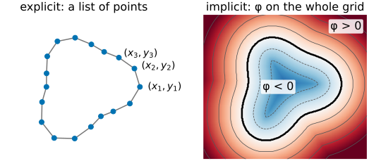
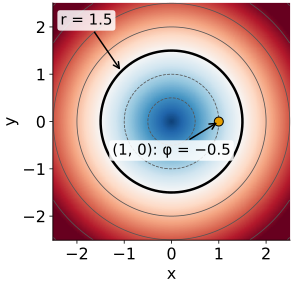
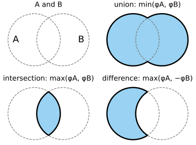
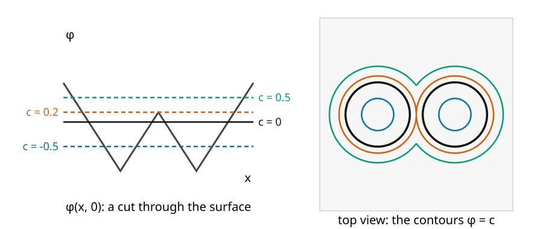
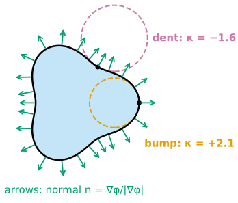
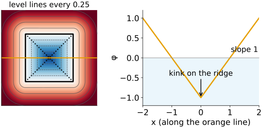
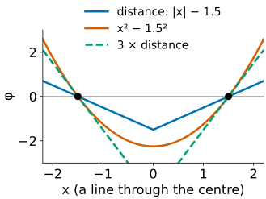
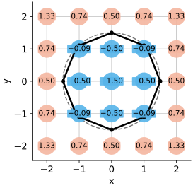

## About this lecture

A snake stores a boundary as a **list of points**. Today we store it in a completely different way: as the place where a function on the image grid is **zero**. This is the starting point of level set methods (Osher & Sethian, 1988).

- Two ways to store a curve: **explicit** (points) and **implicit** (the zero level of $\phi(x, y)$).
- Inside and outside from the **sign**; union and intersection with **min** and **max**.
- **Topology** belongs to the slice, not to the function: one contour can become two.
- **Normal** and **curvature** read directly from $\phi$.
- The **signed distance function**: the most convenient $\phi$.
- On a pixel grid, $\phi$ is just an image.

*Slides titled **The math** give the formulas and proofs; the ideas are complete without them.*

::: notes
First unit of the level-set day (elective, "Curves and energies": snakes → level sets → dynamic programming). Prerequisites: partial derivatives and the gradient; finite differences from Filtering & convolution (day 1). The distance transform is owned by the morphology day, marching squares by the marching-cubes day; both are only recalled here.
:::

## Two ways to store a curve

:::: {.columns}
::: {.column width="50%"}
**Explicit**: a list of points $(x_1, y_1), (x_2, y_2), \dots$ along the curve, or a parametric curve $\mathbf C(s)$. This is a snake.

- Easy to draw, easy to measure the length.
- But: one list is one curve. Two objects need two lists; a curve that splits needs surgery.
:::
::: {.column width="50%"}
**Implicit**: a function $\phi(x, y)$ on the whole image, and the curve is where $\phi = 0$.

- Think of a **height map**: the coastline is the zero level of the height. The map stores heights everywhere; the coast is read off where the height crosses sea level.
- We fix the sign once: $\phi < 0$ **inside**, $\phi > 0$ outside.
:::
::::

{width="62%" fig-align="center" fig-alt="The same rounded three-lobed curve stored two ways. Left: 18 points joined by straight segments, labelled (x1, y1), (x2, y2), (x3, y3). Right: a signed distance map, blue inside and red outside, with grey level lines and the curve as the black zero level."}

Same coast, two descriptions. Raise the sea level and the coastline moves, and islands may appear or merge, without anyone redrawing the coast by hand.

## Curves from formulas

| curve | $\phi(x, y)$ | inside ($\phi < 0$) |
|---|---|---|
| line | $a x + b y - c$ | one half-plane |
| circle, radius $r$ | $\sqrt{x^2 + y^2} - r$ | the disk |
| ellipse | $(x/a)^2 + (y/b)^2 - 1$ | the filled ellipse |

:::: {.columns}
::: {.column width="62%"}
- To test whether a point is inside, evaluate $\phi$ there and look at the **sign**. No search along a list of points.
- The circle: at $(1, 0)$ with $r = 1.5$, $\phi = 1 - 1.5 = -0.5$: inside, and half a unit from the edge.
- Many functions have the **same** zero set: $x^2 + y^2 - r^2$ also describes the circle. They differ away from the curve.
:::
::: {.column width="38%"}
{width="85%" fig-alt="φ = √(x² + y²) − 1.5 as a colour map, blue inside and red outside, level lines every 0.5 and the circle of radius 1.5 in black. The point (1, 0) is marked: φ = −0.5 there."}
:::
::::

## Set operations for free

:::: {.columns}
::: {.column width="55%"}
With $\phi_1$ and $\phi_2$ for two shapes (negative inside):

- **union** (inside either): $\min(\phi_1, \phi_2)$;
- **intersection** (inside both): $\max(\phi_1, \phi_2)$;
- **complement** (swap inside and outside): $-\phi$;
- difference $A \setminus B$: $\max(\phi_1, -\phi_2)$.

Two circles of radius 1 centred at $(\pm 1.2, 0)$: $\phi = \min\big(\sqrt{(x - 1.2)^2 + y^2} - 1,\ \sqrt{(x + 1.2)^2 + y^2} - 1\big)$. At the origin $\phi = 0.2$: outside both, in the gap between them.
:::
::: {.column width="45%"}
{width="100%" fig-alt="Two overlapping disks A and B (dashed outlines) and three combinations, filled blue with a black boundary: the union min(φA, φB) covers both disks, the intersection max(φA, φB) only the lens where they overlap, and the difference max(φA, −φB) is A with the bite of B removed."}
:::
::::

## Topology is a property of the slice

{width="88%"}

Cut the surface $z = \phi(x, y)$ of the two circles with horizontal planes $z = c$. Below $c = 0.2$ the cut is **two** curves, above it **one**. The function did not change at all; only the height of the cut did.

::: notes
This is the central picture of the day. Unit 2 moves the curve by changing φ a little at every step; when the zero level passes a saddle of φ, the topology of the curve changes, and nothing special has to be done. Ask: at what c do the two contours touch? (0.2, the value of φ at the saddle point, the origin.)
:::

## Try it: slicing a surface

```{=html}
<link rel="stylesheet" href="../demos/dist/demo.css">
<div data-demo="levelsurface" data-preset="split"></div>
<script src="../demos/dist/levelsurface.js"></script>
```

::: notes
Left: the surface φ as a mesh (drag to rotate; front/top/3/4 buttons), the orange plane at height c and the two contours drawn on the surface. Right: the top view, blue inside, red outside, thin level lines every 0.5, solid black φ = 0, dashed orange φ = c. Tour: "one becomes two" starts at c = 0.4 (one contour); slide c down past 0.2: two contours (the readout says 2 pieces). Then "egg crate" (sin(πx/2) sin(πy/2)): many pieces; move c and watch blobs appear and merge. Click a point in the top view to see the normal arrow and the curvature circle (next slides).
:::

## Normal and curvature, read from φ

:::: {.columns}
::: {.column width="56%"}
- The **gradient** $\nabla\phi$ points uphill, from inside to outside, and is perpendicular to the level line. So the **outward normal** is $\mathbf n = \nabla\phi / |\nabla\phi|$.
- **Curvature** $\kappa$: how fast the normals spread out as you move along the curve. A circle of radius $r$ has $\kappa = 1/r$: small circles bend a lot, a straight line has $\kappa = 0$.
- With our sign convention, $\kappa > 0$ where the inside is convex (a bump), $\kappa < 0$ in a dent.
- Both come from $\phi$ at **one** point, with derivatives: no neighbours along a list of points are needed.
:::
::: {.column width="44%"}
{width="100%" fig-alt="A three-lobed shape r = 1 + 0.2 cos 3θ with green outward normal arrows all around. At the tip of a lobe a dashed circle inside the shape fits the curve: κ = +2.1. In a dent a dashed circle outside fits it: κ = −1.6."}
:::
::::

## The math: normal and curvature {.math}

**Normal.** Along a level line $\phi(\mathbf C(s)) = c$. Differentiate with the chain rule: $\nabla\phi \cdot \mathbf C'(s) = 0$. The gradient is perpendicular to the tangent, so $\mathbf n = \nabla\phi/|\nabla\phi|$ (pointing to larger $\phi$, outward).

**Curvature** is the divergence of the unit normal field, $\nabla\cdot\mathbf v = \partial_x v_1 + \partial_y v_2$ ("how much the arrows spread out"):
$$\kappa = \nabla\cdot\frac{\nabla\phi}{|\nabla\phi|} = \frac{\phi_{xx}\phi_y^2 - 2\phi_x\phi_y\phi_{xy} + \phi_{yy}\phi_x^2}{(\phi_x^2 + \phi_y^2)^{3/2}}.$$

**Circle.** $\phi = \sqrt{x^2 + y^2} - r$, $\rho = \sqrt{x^2 + y^2}$: $\nabla\phi = (x, y)/\rho$, so $\mathbf n = (x, y)/\rho$ and $\nabla\cdot\mathbf n = \partial_x(x/\rho) + \partial_y(y/\rho) = \tfrac{y^2}{\rho^3} + \tfrac{x^2}{\rho^3} = \tfrac{1}{\rho}$. On the curve, $\kappa = 1/r$.

## Signed distance functions

The most convenient $\phi$: $|\phi(\mathbf x)|$ = the **distance** from $\mathbf x$ to the curve, with a minus sign inside.

- It is the **distance transform** of the morphology day, with a sign: distance to the boundary, negative inside the object.
- Walking straight away from the curve, $\phi$ grows by exactly 1 per unit: $|\nabla\phi| = 1$ everywhere (except on the "ridge" in the middle of a shape, where two nearest points compete).
- Then the normal is simply $\mathbf n = \nabla\phi$, and the curvature is the **Laplacian**, $\kappa = \phi_{xx} + \phi_{yy}$: the Laplacian kernel of *Filtering & convolution*.
- And $\phi$ tells you how far away the curve is, which unit 2 will use to keep time steps safe.

{width="62%" fig-align="center" fig-alt="Left: the signed distance of a square, blue inside, red outside, with level lines every 0.25; outside the corners the lines are rounded, inside they are smaller squares, and the dotted diagonals are the ridge. Right: φ along the horizontal centre line: a V with slope 1 on both sides and a kink at the centre, at φ = −1."}

## The math: why |∇φ| = 1 simplifies everything {.math}

:::: {.columns}
::: {.column width="64%"}
- If $|\nabla\phi| = 1$, then $\mathbf n = \nabla\phi$ and $\kappa = \nabla\cdot\nabla\phi = \nabla^2\phi$.
- **Not every $\phi$ with the right zero set is a distance.** For the circle, $\phi = x^2 + y^2 - r^2$ has $\nabla\phi = 2(x, y)$, so $|\nabla\phi| = 2\rho$: 3 on the curve if $r = 1.5$. Its normal and the curvature of its level lines are still correct (they do not depend on the scaling), but $\nabla^2\phi = 4$ everywhere: the Laplacian shortcut is wrong.
- Scaling $\phi$ by 3 changes nothing about the curve, $\mathbf n$ or $\kappa$; it triples $|\nabla\phi|$. Distances read from $\phi$ would be off by a factor 3.
- At corners the signed distance has kinks (inside a square, along the diagonals): there $\phi$ is not differentiable and finite differences give a huge $\kappa$.
:::
::: {.column width="36%"}
{width="100%" fig-alt="Three functions along a line through the centre of the circle of radius 1.5: the distance |x| − 1.5 (slope 1), x² − 1.5² (a parabola, slope 3 at the curve) and 3 × distance (slope 3). All three are zero at x = ±1.5."}
:::
::::

## Try it: same curve, different φ

```{=html}
<link rel="stylesheet" href="../demos/dist/demo.css">
<div data-demo="levelsurface" data-preset="samecurve"></div>
<script src="../demos/dist/levelsurface.js"></script>
```

::: notes
"same curve, different φ": circle of radius 1.5 with φ = 3d, point (1.2, −0.9) on the curve: |∇φ| = 3.00, κ = 0.67 = 1/1.5. Switch to "distance d": the black contour stays where it is, the surface becomes a cone of slope 1, |∇φ| = 1.00, κ unchanged. "d + d²/2R" is (x² + y² − R²)/(2R) for the circle: same contour, a bowl instead of a cone; click (0.6, −0.45) inside: |∇φ| = 0.50, while the distance gives 1.00; κ = 1.33 in both. Then "corner: κ blows up": square, point (1.6, −1.6) just outside a corner: κ = 7.08 (the level line is an arc of radius 0.14 around the corner). Click (1, 1) on the inside diagonal: κ is over 200, the kink of the distance function.
:::

## On a pixel grid, φ is an image

:::: {.columns}
::: {.column width="60%"}
- Store $\phi$ at the pixel centres: an image of the same size as the data, with negative values inside.
- Inside/outside of a pixel: the sign. Derivatives: differences of neighbours (*Filtering & convolution*).
- The curve itself lies **between** pixels: on every pixel edge where the sign changes, interpolate linearly to find the crossing, and join the crossings cell by cell. This is **marching squares**; the case table, the ambiguous saddle cells and the by-hand work belong to the marching-cubes day (`isocontour/`).
- Every contour drawn in today's demos is computed this way.
:::
::: {.column width="40%"}
{width="100%" fig-alt="The 5 × 5 grid of the next slide: φ = √(x² + y²) − 1.5 at x, y = −2 to 2, nine blue (negative) and sixteen red (positive) samples with their values. Black dots mark the 12 sign changes on cell edges, found by linear interpolation; joined cell by cell they give a 12-sided polygon close to the dashed true circle."}
:::
::::

## A 5 × 5 example

Sample $\phi = \sqrt{x^2 + y^2} - 1.5$ at $x, y \in \{-2, \dots, 2\}$ (rounded):

| $y \backslash x$ | −2 | −1 | 0 | 1 | 2 |
|---|---|---|---|---|---|
| 2 | 1.33 | 0.74 | 0.50 | 0.74 | 1.33 |
| 1 | 0.74 | −0.09 | −0.50 | −0.09 | 0.74 |
| 0 | 0.50 | −0.50 | **−1.50** | −0.50 | 0.50 |
| −1 | 0.74 | −0.09 | −0.50 | −0.09 | 0.74 |
| −2 | 1.33 | 0.74 | 0.50 | 0.74 | 1.33 |

- 9 pixels inside (negative). At $(1, 0)$, central differences: $\phi_x = (0.5 - (-1.5))/2 = 1$, $\phi_y = 0$: normal $(1, 0)$, exact.
- Curvature there: $\phi_{yy} = -0.09 - 2(-0.5) - 0.09 = 0.83$, so $\kappa \approx 0.83$; the exact value is $1/\rho = 1$. A coarse grid underestimates the bending of a small circle.

## Summary

- **Implicit curve**: the zero level of $\phi$ on the image grid; $\phi < 0$ inside.
- Union = **min**, intersection = **max**, complement = $-\phi$.
- **Topology is a property of the slice**: as $\phi$ or the cutting level changes, contours split and merge by themselves.
- **Normal** $\nabla\phi/|\nabla\phi|$ and **curvature** $\nabla\cdot(\nabla\phi/|\nabla\phi|)$ from local derivatives; a circle has $\kappa = 1/r$.
- **Signed distance**: $|\nabla\phi| = 1$, $\mathbf n = \nabla\phi$, $\kappa = \nabla^2\phi$; many other $\phi$ share the same zero set.
- On the grid, $\phi$ is an image and the curve is found by marching squares.
