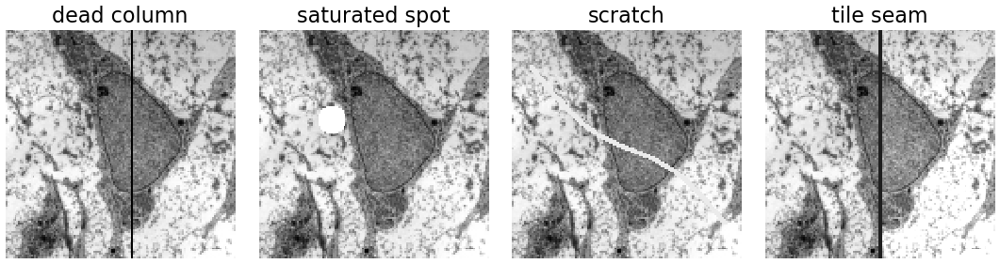
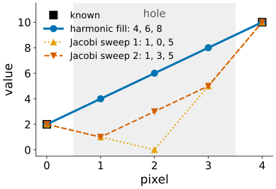
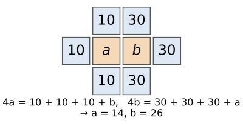
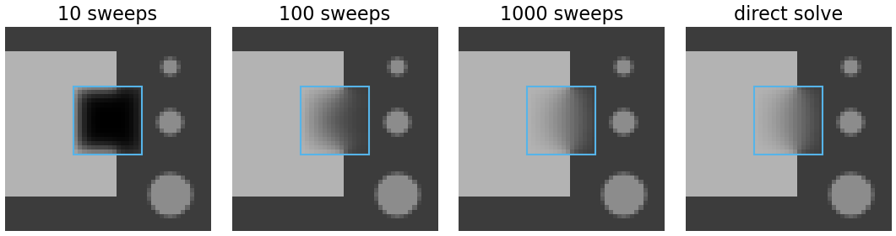
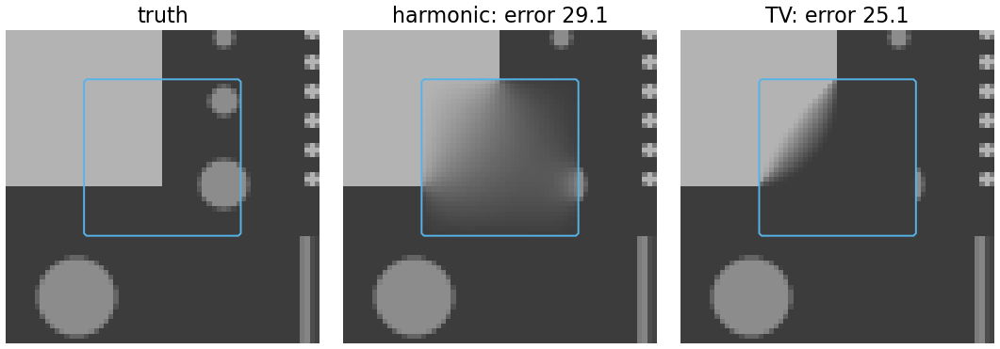
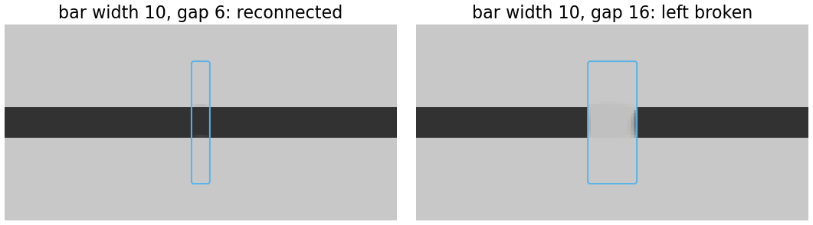
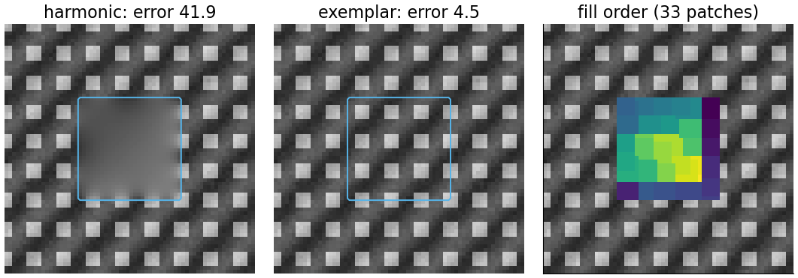
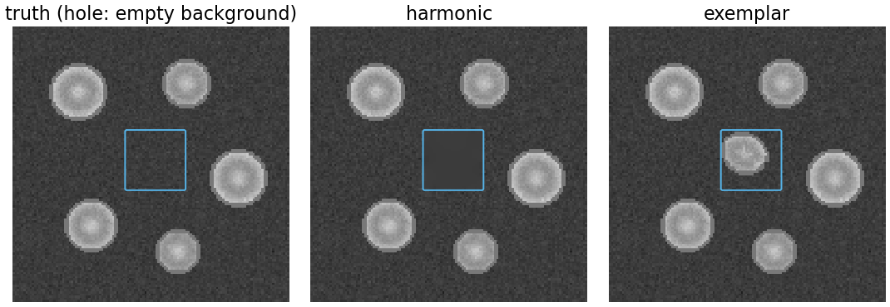

## About this lecture

Some pixels of an image are missing or wrong: a dead column, a saturated spot, a scratch, a burnt-in scale bar. **Inpainting** fills them from the rest of the image.

- **Harmonic (diffusion) inpainting**: let heat flow into the hole until it settles.
- **TV inpainting**: continue edges sharply into the hole; when does a broken bar get reconnected?
- **Exemplar inpainting**: copy patches from elsewhere, for texture.
- The rule for the whole unit: **inpainted pixels are invented**. Fine for display and for algorithms that need a full image; never for measurement.

Slides titled **The math** give the formulas and proofs; the ideas are complete without them.

::: notes
Builds on the [heat-equation unit](../heat-equation/lec.qmd) (explicit steps, w² iterations), [TV flow](../tv-flow/lec.qmd) (TV as a penalty), and NLM's patch distance ([bilateral-nlm](../bilateral-nlm/lec.qmd)). Pointers: the diffusion-model day inpaints with a learned prior ([diffusion-inverse](../diffusion-inverse/lec.qmd)); the sparse representations day inpaints with a sparsity prior ([ista](../ista/lec.qmd), [dictionaries](../dictionaries/lec.qmd)).
:::

## Why fill holes in scientific images?

:::: {.columns}
::: {.column width="45%"}
- **Detector defects**: dead or hot pixels and columns.
- **Saturation**: spots where the true value is unknown above the maximum.
- **Scratches, dust, seams** between tiles of a mosaic.
- **Burnt-in annotations**: scale bars, text.
- A removed object (for display).

Why fill instead of leave? Many algorithms need a **full** image: a Fourier transform, a registration, a filter, a segmentation that should not trip over a black column.

**Inpainted pixels are invented.** Keep the mask, and exclude those pixels from every measurement.
:::
::: {.column width="55%"}
{width="100%" fig-alt="The micrograph with four synthetic defects: a black dead column, a white saturated disc, a bright diagonal scratch, and a tile seam where the right half is brighter and a dark line separates the halves."}

[Synthetic defects on the micrograph: Robert M. Hunt, CC BY 3.0, via Wikimedia Commons.]{style="font-size: 0.6em; color: #666"}
:::
::::

## Harmonic inpainting: heat flows into the hole

:::: {.columns}
::: {.column width="45%"}
Keep the known pixels fixed and let the [heat equation](../heat-equation/lec.qmd) run **only inside the hole** until nothing changes any more.

At equilibrium every hole pixel is the **mean of its four neighbours**: the hole solves Laplace's equation, with the rim as boundary values. The result is the smoothest possible fill.

In 1D this is **linear interpolation**: known 2 and 10 around three missing pixels → 4, 6, 8.

Starting from zeros, Jacobi sweeps (every hole pixel ← mean of its neighbours' old values) give (1, 0, 5), then (1, 3, 5), …, converging to (4, 6, 8).
:::
::: {.column width="55%"}
{width="100%" fig-alt="Known values 2 and 10 at pixels 0 and 4; the harmonic fill is the straight line 4, 6, 8; two Jacobi sweeps from zero give 1, 0, 5 and then 1, 3, 5."}
:::
::::

## Two missing pixels by hand

:::: {.columns}
::: {.column width="45%"}
Two missing pixels $a$, $b$ side by side. The other three neighbours of $a$ are 10, those of $b$ are 30. Each is the mean of its neighbours:

$$4a = 10 + 10 + 10 + b, \qquad 4b = 30 + 30 + 30 + a.$$

From the first, $b = 4a - 30$; into the second: $16a - 120 = 90 + a$, so $a = 14$, $b = 26$.

Each missing pixel leans towards its own side but feels the other: a smooth transition across the hole. A system of equations, one per missing pixel: sparse and linear.
:::
::: {.column width="55%"}
{width="85%" fig-alt="A grid: the missing pixels a and b in the middle; a has neighbours 10 above, left and below; b has neighbours 30 above, right and below. The equations 4a = 30 + b and 4b = 90 + a give a = 14, b = 26."}
:::
::::

## The math: Laplace's equation in the hole {.math}

- Harmonic inpainting minimises the **Dirichlet energy** $\int_\Omega|\nabla u|^2$ over the hole Ω with $u = f$ on its boundary. Euler–Lagrange (as in the [TV-flow unit](../tv-flow/lec.qmd)): $\Delta u = 0$ in Ω.
- Discretely: for every missing pixel $p$, $\sum_{q \sim p}(u_q - u_p) = 0$. Split the unknowns $u_\Omega$ from the known rim values $f_\partial$:
$$L_{\Omega\Omega}\,u_\Omega = -L_{\Omega\partial}\,f_\partial,$$
a sparse, symmetric positive definite system (one row per missing pixel).
- **Mean-value property**: each solution value is the average of its neighbours; there is no maximum or minimum inside the hole.
- **Jacobi** $u_p \leftarrow \frac14\sum_{q\sim p}u_q$ is exactly the explicit heat step with $\Delta t = 1/4$, run inside the hole only.

## Iterating is slow

:::: {.columns}
::: {.column width="45%"}
Jacobi is the heat equation, so information from the rim spreads like heat: a distance of $w$ pixels takes about $w^2$ sweeps (the $\sigma^2$ law of the first unit).

Square holes, sweeps until every pixel is within 1 grey level of the solution:

| hole width | 8 | 16 | 32 |
|---|---|---|---|
| Jacobi sweeps | 77 | 288 | 1081 |

Doubling the width costs about four times the sweeps. Gauss–Seidel (use new values at once) is about twice as fast; a direct sparse solve (conjugate gradients) needs a few dozen iterations.
:::
::: {.column width="55%"}
{width="100%" fig-alt="A 16 × 16 hole over the corner of the square on the test card, filled by Jacobi sweeps starting from black: after 10 sweeps the middle is still dark, after 100 it is a smooth blend with a darker middle, after 1000 it equals the direct solve."}
:::
::::

## Diffusion blurs

:::: {.columns}
::: {.column width="45%"}
Harmonic inpainting is perfect for **thin** holes: a dead column or a scratch is one or two pixels wide, and the fill is a short interpolation.

For a **large** hole the fill is a smooth blend of the rim: edges entering the hole **fade out**, objects inside it are lost, texture becomes a featureless smear.

Here a 32 × 32 hole over the square's corner and two small discs: the harmonic fill is a soft gradient (mean error 29 grey levels).

**TV inpainting** minimises the total variation instead of $\sum|\nabla u|^2$: edges are continued **sharply** (error 25). It cuts the corner diagonally: the shortest boundary, not the true corner.
:::
::: {.column width="55%"}
{width="100%" fig-alt="A 32 × 32 hole over the corner of the bright square: the truth, the harmonic fill (a soft blur, mean error 29.1) and the TV fill (a sharp diagonal boundary that cuts the corner, mean error 25.1). The two small discs inside the hole are lost in both."}
:::
::::

## TV inpainting and the connectivity rule

:::: {.columns}
::: {.column width="45%"}
TV charges an edge by **contrast × length**. A dark bar of width $w$ is interrupted by a gap of length $d$. Two candidate fills:

- **connect** the bar across the gap: two new edges of length $d$, cost $2d \cdot c$;
- **leave it broken**: two end caps of length $w$, cost $2w \cdot c$.

TV picks the cheaper: the bar is reconnected if $d < w$, left broken if $d > w$.

Bar width 10: a gap of 6 is bridged (centre 50, as dark as the bar), a gap of 16 is not (centre 200).

Curvature-based and "transport" methods (continue level lines smoothly, Bertalmío et al.) can bridge longer gaps and curved edges.
:::
::: {.column width="55%"}
{width="100%" fig-alt="A horizontal dark bar of width 10 on a bright background, interrupted by a masked gap. TV inpainting reconnects the bar across a gap of 6 but leaves it broken across a gap of 16."}
:::
::::

## The math: TV inpainting {.math}

- Minimise $\mathrm{TV}(u) = \int_\Omega|\nabla u|$ in the hole with $u = f$ outside (or, with noisy known pixels, $\lambda\sum_{\text{known}}(u - f)^2 + \mathrm{TV}(u)$).
- For a piecewise constant image, TV = $\sum$ (contrast of each edge × its length) (coarea formula). Connecting: $2d\,c$; breaking: $2w\,c$. For $d = w$ both cost the same and the minimiser is not unique.
- The demo and the figures compute it with primal–dual iterations (Chambolle & Pock): a dual step $p \leftarrow \mathrm{proj}_{|p| \le 1}(p + \sigma\nabla\bar u)$, a primal step $u \leftarrow u + \tau\,\nabla\cdot p$ in the hole, known pixels reset to $f$.
- Near $d \approx w$ the iterations converge slowly: the two candidates cost almost the same.

## Try it: diffusion and TV

```{=html}
<link rel="stylesheet" href="../demos/dist/demo.css">
<div data-demo="inpaint" data-preset="barjoin"></div>
<script src="../demos/dist/inpaint.js"></script>
```

::: notes
Left: the result, the hole outlined in cyan; right: the error inside the hole (bright = large). Tour: "bar: gap < width connects" (width 10, gap 6, TV): the centre of the gap ends at 50, as dark as the bar. Move the gap slider and restart TV: gaps up to 8 connect, from 14 on the bar stays broken; between 9 and 12 TV converges slowly and the centre is grey (the two fills cost almost the same at d = w). "dead column": Gauss–Seidel solve, mean error 13 grey levels: the column is interpolated, the texture of the micrograph cannot be. "Jacobi needs ~w² sweeps": play; after 100 sweeps the mean difference to the solution is still 17, after 200 3; Gauss–Seidel is about twice as fast. "large hole": diffusion blurs (error 29.1); "TV continues edges": sharp diagonal cut (error 23.9 after 1500 iterations).
:::

## Exemplar inpainting: copy, don't diffuse

:::: {.columns}
::: {.column width="40%"}
For **texture** no smooth fill is right: the hole should look like the rest. So **copy** (Efros & Leung 1999; Criminisi, Pérez & Toyama 2004):

1. Find the pixels on the **fill front** (missing, with a known neighbour).
2. Pick the front pixel with the highest **priority**: many known pixels around it, and a strong edge running into the hole.
3. Find the **best-matching patch** elsewhere: smallest squared difference over the target's **known** pixels (the NLM distance, masked).
4. Copy its missing pixels. Repeat.

Edges are continued first, texture fills in after. The dot texture: harmonic error 41.9, exemplar 4.5.
:::
::: {.column width="60%"}
{width="100%" fig-alt="A dot texture with a 28 × 28 hole: the harmonic fill is a grey smear (error 41.9); the exemplar fill continues the texture (error 4.5); the fill order map shows 33 patches filled from the rim inwards."}
:::
::::

## The math: priority and matching {.math}

- Priority of a front pixel $p$: $P(p) = C(p)\,D(p)$.
- **Confidence** $C(p)$: the sum of the confidences of the known pixels in the patch around $p$, divided by the patch area (known pixels start at 1, filled pixels inherit the confidence of the step that filled them). Patches mostly known go first.
- **Data term** $D(p) = |\nabla I_p^\perp\cdot n_p|/\alpha$: the strength of the isophote (the level line, $\nabla I^\perp$) arriving at the front, along the front's normal $n_p$; α normalises (255 for 8-bit grey). Edges that run into the hole go first, so they are continued before texture closes them off.
- Matching: $\hat q = \arg\min_q\sum_{k\,\text{known in }P_p}(I_{p+k} - I_{q+k})^2$ over fully known candidate patches $q$ in a search region.

## Exemplar inpainting invents

:::: {.columns}
::: {.column width="40%"}
Exemplar inpainting copies whatever matches best, including **objects**. Here the hole covers empty background next to a nucleus; the patches along the rim match the edges of other nuclei, and the fill grows a nucleus into the hole (244 pixels brighter than 120 where the truth never exceeds 80).

The result looks **plausible**. It is a **fabrication**.

A generative model fills holes even more convincingly with a learned prior ([inpainting with a learned prior](../diffusion-inverse/lec.qmd)); the same rule applies, more strongly.
:::
::: {.column width="60%"}
{width="100%" fig-alt="Synthetic nuclei with a 28 × 28 hole over empty background. The truth is empty there; the harmonic fill is a flat grey; the exemplar fill contains a bright, textured blob that looks like part of a nucleus."}
:::
::::

## Try it: texture and invention

```{=html}
<div data-demo="inpaint" data-preset="nucleus"></div>
<script src="../demos/dist/inpaint.js"></script>
```

::: notes
Exemplar method: press step to fill patch by patch: the yellow box is the target, the orange box the source it is copied from (arrow); the right panel shows the fill order. "exemplar invents a nucleus": 30 patches; part of a nucleus appears in a hole that was empty background. Restart and step: the first patches go along the nucleus edge (high data term). "texture: exemplar wins": 33 patches, mean error 4.5 (harmonic: 41.9). Draw your own hole: choose "paint" and drag over the image, then pick a method. "text over the micrograph": Gauss–Seidel solve removes "10 µm" and the bar (mean error 19 grey levels in the letters).
:::

## Which method?

| defect | method | why |
|---|---|---|
| thin: dead pixel or column, scratch | **harmonic** | short interpolation, smooth is right |
| medium hole with edges crossing it | **TV** | continues edges sharply (across short gaps) |
| texture, or a large hole | **exemplar** | only copying reproduces texture |
| anything you will **measure** | **none** | mask the pixels and exclude them |

- Burnt-in text and scale bars: harmonic for display; for analysis, crop or mask.
- Inpainting with a **sparsity prior** (an image is a few dictionary atoms) is on the sparse representations day: [a mask as the forward operator](../ista/lec.qmd), and [patch dictionaries](../dictionaries/lec.qmd).

## What may never be measured

- An inpainted pixel carries **no information** about the specimen: its value is a guess made by a prior (smoothness, small TV, "looks like elsewhere").
- Intensities, counts, sizes, colocalisation and distances must be computed **with the mask**, excluding filled pixels; report how many pixels were masked.
- Inpainting before a filter is fine (it avoids artefacts at the hole's edge), but the filtered values **near** the hole are contaminated too (within the filter's radius).
- Display: say "defects inpainted" in the figure legend.

## Summary

- **Harmonic inpainting**: the hole solves Laplace's equation with the rim as boundary; each pixel is the mean of its neighbours; in 1D linear interpolation. Jacobi = heat flow in the hole: about $w^2$ sweeps; a sparse solve is faster.
- Diffusion blurs: right for thin defects, wrong for large holes and edges.
- **TV inpainting** continues edges sharply; a bar of width $w$ is reconnected across a gap $d$ only if $d < w$.
- **Exemplar inpainting** copies best-matching patches in priority order: reproduces texture, and can **invent** objects.
- Inpainted pixels are invented: keep the mask, never measure them.
