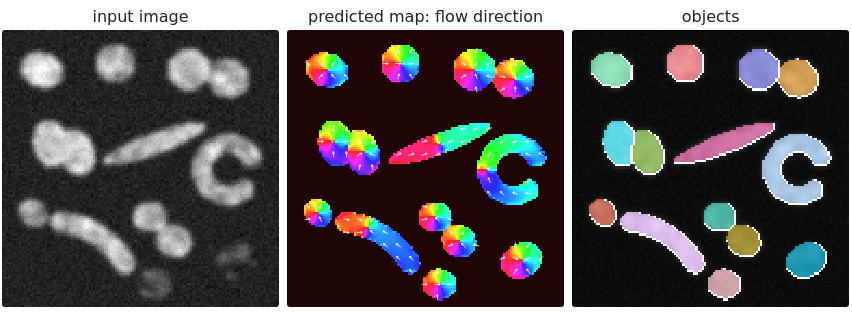

## Goal

By the end of this exercise you should be able to:

- explain why a semantic mask is not a set of objects, and what **map** each instance route predicts,
- turn a **boundary class** and a **distance map** into objects by hand on small examples,
- predict which route fails on **touching** and **elongated** cells, and why,
- say in one sentence what **star-convex polygons** and **flow fields** predict, and know that they are taught in detail on the next day ([StarDist](../stardist/lec.qmd), [Cellpose](../cellpose/lec.qmd)),
- read the object errors (merges, splits) with the [evaluation day](../object-eval/lec.qmd)'s matching.

Do the pen-and-paper part first, then the demo. Questions marked *(math)* are for those who want the derivations; the concept questions do not depend on them.

## Background

| Route | The network predicts | The classical step | Typical failure |
|---|---|---|---|
| Semantic | P(cell) per pixel | threshold + connected components | touching cells merge |
| Boundary class | background / interior / boundary | label the interiors, grow back | a gap in the boundary merges |
| Distance | distance to the border, 1 at the centre | h-maxima markers + watershed | long cells split |
| Star-convex ([next day](../stardist/lec.qmd)) | objectness + distances along $n$ rays | one polygon per pixel + NMS | non-star-convex shapes |
| Flows ([next day](../cellpose/lec.qmd)) | a unit arrow per pixel, towards the centre along the cell | follow the arrows; same sink = same object | noisy arrows: extra sinks |

Matching (the [evaluation day](../object-eval/lec.qmd)): one to one at IoU $\ge 0.5$; F1 $= 2TP/(2TP + FP + FN)$, matching accuracy $= TP/(TP + FP + FN)$.

{width=100%}


## By hand

**B1.** A network's three-class output on a $6 \times 8$ image (`.` background, `B` boundary, `I` interior):

```
. B B B B B B .
B I I B I I I B
B I I B I I I B
B I I I I I I B
B I I B I I I B
. B B B B B B .
```

(a) Label the interior pixels with 4-connectivity. How many objects do you get?
(b) Which single pixel would have to be `B` to get two objects? What does this say about predicting thin classes?
(c) Would a distance map have had the same problem? Explain in one sentence.

**B2.** A predicted distance profile along a line through two touching cells: $0, 2, 4, 6, 5, 4, 5, 3, 1, 0$.
(a) Where are the regional maxima? How deep is the second peak below its saddle?
(b) How many objects does the watershed give with h-maxima markers for $h = 0.5$? For $h = 1.5$?
(c) An elongated cell has the profile $0, 3, 5, 5.2, 4.9, 5.1, 5, 3, 0$ along its long axis. How many objects for $h = 0.5$, and what does that teach you about choosing $h$?

**B3.** For each cell type, choose a route and say what may go wrong (the last two routes in one sentence each are enough; their details come on the next day):
(a) round fluorescent nuclei, often touching in pairs;
(b) rod-shaped bacteria, some bent, in a dense colony;
(c) irregular cytoplasm of cultured cells with long protrusions;
(d) a tissue section where you must count nuclei **and** measure the area of stroma.

**B4.** Panoptic quality. A prediction has 3 matched nuclei with IoU 0.9, 0.8 and 0.7, one false positive and two missed nuclei. Compute SQ, RQ and PQ. What would PQ be if the false positive were removed?

::: {.callout-note collapse="true" title="Solutions"}
**B1.** (a) The left interior (columns 2–3) and the right interior (columns 5–7) are joined through the `I` at row 4, column 4: **one** object. (b) The pixel in row 4, column 4 (the gap in the vertical boundary). One wrong pixel out of 48 merges two cells: a thin class must be predicted perfectly along its whole length, and it is thinnest exactly where cells touch. (c) No, not necessarily: a distance map has a valley (a low value) along the contact; one wrong pixel lowers the depth of the neck a little, but the two peaks remain, and the watershed still separates them as long as the neck stays deeper than $h$.

**B2.** (a) Maxima 6 (position 4) and 5 (position 7); the saddle between them is 4 (position 6). The second peak is $5 - 4 = 1$ above its saddle (its **dynamic**). (b) $h = 0.5 < 1$: both peaks are markers, **two** objects. $h = 1.5 > 1$: the second peak is removed, **one** object. (c) Local maxima at 5.2 and 5.1 with a saddle of 4.9 between them; the lower peak is only $5.1 - 4.9 = 0.2$ above the saddle, so $h = 0.5$ gives **one** object; $h = 0.1$ would split it in two. $h$ must be larger than the ripple of the distance along a long cell and smaller than the depth of the necks between touching cells; for long cells and shallow necks no single $h$ works.

**B3.** (a) Distance map + watershed, or star-convex polygons: both separate round touching nuclei; risk: merges when the network does not predict the neck (low contrast between nuclei). (b) Flows (long, bent, touching); risk: splits of long cells where the field is noisy, merges of rods lying side by side. Star-convex polygons fail on the bent ones. (c) Flows; distance maps oversplit long protrusions, polygons cannot follow them. Risk: thin protrusions missed or cut off. (d) Panoptic: nuclei as things (any instance route), stroma as stuff (a semantic class); the area of stroma needs no instances. Why polygons fail on bent cells and flows do not: [StarDist](../stardist/exercise.qmd), [Cellpose](../cellpose/exercise.qmd).

**B4.** SQ $= (0.9 + 0.8 + 0.7)/3 = 0.8$. RQ $= 3/(3 + 0.5 + 1) = 0.667$. PQ $= 0.8 \times 0.667 = 0.53$. Without the false positive: RQ $= 3/4 = 0.75$, PQ $= 0.6$.
:::

### Math questions

**B5.** *(math)* Show that RQ in panoptic quality equals the F1 score of the matching, and that PQ $\le$ F1.

::: {.callout-note collapse="true" title="Solutions (math)"}
**B5.** RQ $= \frac{TP}{TP + \frac12 FP + \frac12 FN} = \frac{2TP}{2TP + FP + FN}$, the F1 score. SQ is a mean of IoU values $\le 1$, so PQ $=$ SQ $\cdot$ RQ $\le$ RQ $=$ F1.
:::

## Explore {#explore}

A $128 \times 128$ synthetic image with 14 cells: round and oval cells, three touching pairs, a long rod, a C-shaped cell, a bent cell and two dim cells (or, with **crowded**, a tissue of 74 touching cells). The **network output is simulated**: the exact training target of the chosen route, degraded by the error sliders: *noise* (smooth random errors), *blur*, *contact bias* (where two cells touch, the map looks as if the contact were not there) and *missed dim cells* (the map fades on the dim cells). The three panels show the input, the predicted map and the objects (truth outlined in white, **M** = merge, **S** = split). The readout gives TP, FP, FN, F1 and matching accuracy at IoU $\ge 0.5$. Click the map to see one pixel's rays (star-convex) or path (flows); **animate** shows the particles moving to their sinks or the flood rising. The star-convex and flow routes are here only for comparison; their own questions are in the next day's units ([StarDist](../stardist/exercise.qmd#explore), [Cellpose](../cellpose/exercise.qmd#explore)).

```{=html}
<link rel="stylesheet" href="../demos/dist/demo.css">
<div data-demo="instancemaps" data-preset="semantic"></div>
<script src="../demos/dist/instancemaps.js"></script>
```

**E1.** Preset **semantic mask merges**. How many objects are found, and which cells are merged? Give F1 and the matching accuracy.

**E2.** Preset **boundary: gaps merge** (contact bias 0.5). Compare with E1. Lower the contact bias step by step: at which value are all 14 cells found? Look at the map: what changes at the contacts?

**E3.** Preset **distance separates** (same contact bias 0.5). How many objects? Now set the contact bias to 1 (preset **contact bias: merges**). What happens, and why does a filled-in neck defeat the watershed?

**E4.** Preset **elongated: oversplit** (noise 0.2, $h = 0.1$). Which cells are split, into how many pieces? Raise $h$ to 0.2 and 0.3. Compare with B2.

**E5.** Preset **crowded tissue** (distance route, noise 0.1, blur 1). Switch through the five routes and note the number of objects and F1 for each. Which one fails completely, which one partly, and why?

**E6.** Choose the **distance** route on the mixed cells and raise **missed dim cells**. From which value are cells lost, and what do the readouts call them? Do the same on the flows route.

::: {.callout-note collapse="true" title="Solutions"}
**E1.** 11 objects for 14 cells: the three touching pairs (the two round cells at the top right, the two overlapping ovals on the left, the pair in the lower middle) are merged (three **M**). TP 11, FP 0, FN 3: each merged blob still overlaps one of its two cells with IoU above 0.5. F1 0.88, matching accuracy 0.79.

**E2.** Exactly the same: 11 objects, three merges, F1 0.88. With contact bias 0.4 or less all 14 cells are found (F1 1.00). In the map, the magenta boundary class fades where cells touch; once the interiors meet (the interior class wins over the boundary at one pixel), the labelling joins them.

**E3.** All 14 cells, F1 1.00: the mask joins the pairs, but each cell keeps its own peak, and the watershed separates them along the neck. With contact bias 1 the network predicts the same height across the neck as at the centres: the two peaks become one plateau, h-maxima gives one marker per pair, and the three pairs merge again (11 objects, F1 0.88). Markers come from the peaks; if the map has no neck, no classical step can find one.

**E4.** 20 objects, TP 13, FP 7, FN 1, F1 0.76, matching accuracy 0.62: the rod is split into 3 pieces and the C-shaped cell into 5. With $h = 0.2$: 16 objects, only the C is split (in 3), F1 0.87. With $h = 0.3$: all 14, F1 1.00. As in B2(c), the noise makes small extra peaks along the long ridge of the distance; a larger $h$ removes them, but a too large $h$ would also merge touching cells with shallow necks.

**E5.** Distance: 74 objects, F1 1.00. Semantic: **1** object (the whole tissue is one connected blob), F1 0.00. Boundary class: 68 objects, F1 0.94, six merges: the blur smears the thin boundary between some cells. Star-convex: 74, F1 1.00. Flows: 74, F1 1.00. In crowded tissue every route that predicts something wider than a one-pixel line (a distance, rays from the centre, arrows) separates the cells; the semantic mask cannot, and the thin boundary is fragile.

**E6.** On the distance route, cells disappear only from about 0.9 (at 0.6 all 14 are still found; at 0.9, 12 objects): the two dim cells' distances fall below the mask threshold 0.1, and they count as **FN** (missed). On the flows route the threshold of P(cell) is 0.5, so the dim cells are already lost at 0.6 (12 objects, F1 0.92). A network that has seen few dim cells makes exactly this error, and it is invisible in a picture of the bright cells.
:::

## Where this leads

Two routes above (star-convex polygons, and detection) depend on **non-maximum suppression** of overlapping candidates; the [next unit, **detection**](../detection/lec.qmd), teaches boxes, IoU and NMS. Star-convex polygons and flow fields come back on the next day with real networks ([StarDist](../stardist/lec.qmd), [Cellpose](../cellpose/lec.qmd)). The predicted distance map and flow field are learned versions of the classical maps of the [watershed](../ws-distance/lec.qmd) and [labelling](../label-connectivity/lec.qmd) days; the errors they make are counted with the [evaluation day](../object-eval/lec.qmd)'s matching.
