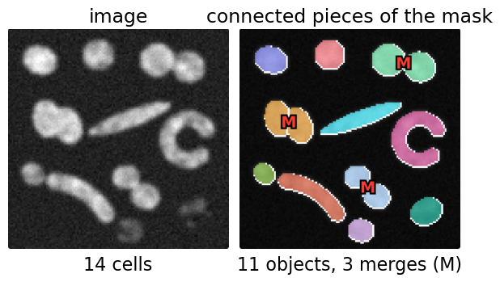
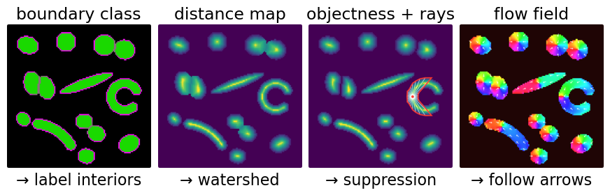
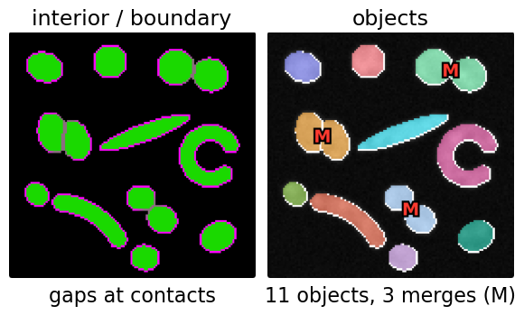
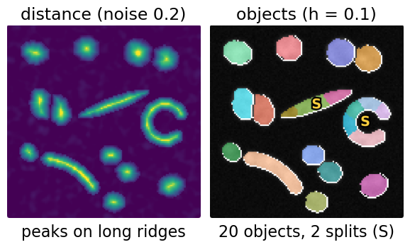
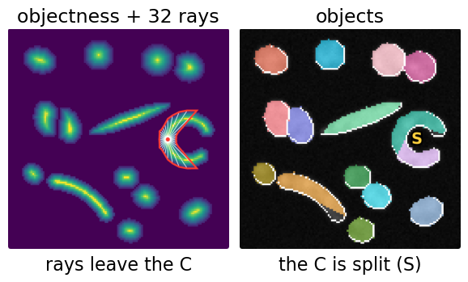
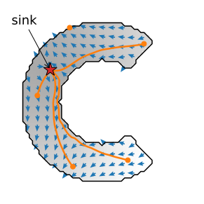
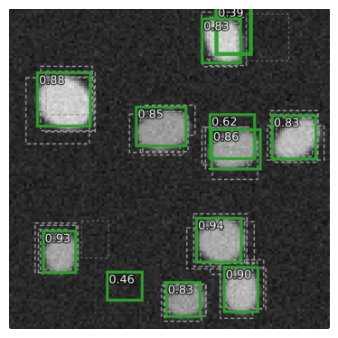
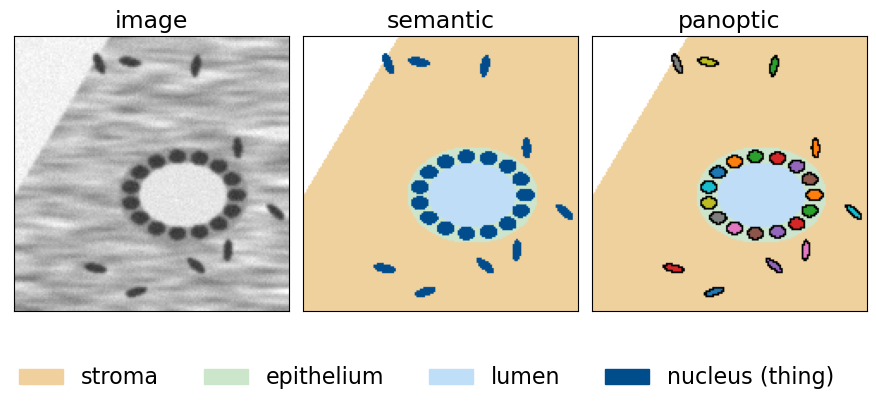

## About this lecture

*The network says "nucleus" for every nucleus pixel. Which pixels belong to which nucleus?*

- A semantic mask is **not** a set of objects: touching cells come out as one blob.
- A network has no fixed number of outputs, so it predicts a **map that makes separation easy**, and a classical step makes the objects.
- Four such maps: a **boundary class**, a **distance map**, **star-convex polygons**, **flow fields**; the first two in detail here, star-convex polygons and flows on the next day.
- Detection (boxes) as another output, and **panoptic** segmentation.

*Slides titled **The math** give the formulas and proofs; the ideas are complete without them.*

::: notes
This unit builds on the U-Net unit of the neural networks day (pixel probabilities), the watershed day (distance transform + markers + flooding), the labelling day (connected components) and the evaluation day (matching objects at an IoU threshold, F1). It recalls them and does not re-teach them. All network outputs in the demo are simulated: the exact training target plus controllable errors, so that every failure can be switched on and off.
:::

## Recall: a U-Net gives a class per pixel

:::: {.columns}
::: {.column width="56%"}
The [U-Net unit](../unet/lec.qmd) of the neural networks day: a probability "nucleus" per pixel, thresholded to a mask. Its "touching nuclei merge" preset: two touching nuclei become **one** connected blob.

- **Semantic** segmentation: a class per pixel ("nucleus", "background").
- **Instance** segmentation: an object identity per pixel ("nucleus 7").
- **Panoptic** segmentation: both at once. Every pixel gets a class; countable **things** (nuclei, cells) also get an identity, uncountable **stuff** (background, stroma) does not.

Counting, measuring, tracking: all need instances.
:::
::: {.column width="44%"}
{fig-alt="The four-route demo with the semantic route: 14 synthetic cells, and the connected pieces of the thresholded mask: 11 objects; three pairs of touching cells are merged (marked M)." width="100%"}
:::
::::

## Why post-processing is unavoidable

- A convolutional network does the same thing at every position (translation equivariance) and produces a **fixed** set of output maps.
- The number of objects in an image varies from 0 to 1000.
- So the network cannot output "object 1, object 2, …" directly. It outputs a **map that makes separation easy**, and a classical step turns the map into objects: labelling, watershed, suppression, following arrows.

The question for every method: *which map, and which classical step?*

{fig-alt="The same 14 cells as four predicted maps, each with its classical step: a boundary class (green interior, magenta boundary) then labelling of the interiors; a distance map then watershed; objectness with the 32 rays of one pixel then suppression; a flow field (colour = direction) then following the arrows." width="76%" fig-align="center"}

## Route 1: a boundary class

:::: {.columns}
::: {.column width="52%"}
Train with **three** classes: background, cell interior, cell **boundary** (a thin ring around every cell, also between touching cells).

- Label the connected **interiors** (the [labelling day](../label-connectivity/lec.qmd)), then grow each one back over its boundary pixels.
- Touching cells are separated by the boundary class between them.
- Fails when the boundary is **missed in one place**: a one-pixel bridge connects two interiors and they merge. Thin structures are hard to predict, especially exactly where two cells touch.
:::
::: {.column width="48%"}
{fig-alt="Boundary route with contact bias 0.5: the predicted boundary class (magenta) fades where cells touch, so the green interiors of three touching pairs connect; labelling gives 11 objects with three merges (M)." width="100%"}
:::
::::

## Route 2: a predicted distance map

:::: {.columns}
::: {.column width="52%"}
Train the network to predict, for every cell pixel, its **distance to the cell's border** (scaled to 1 at the centre of each cell).

- Then exactly the [watershed day](../ws-distance/lec.qmd)'s pipeline: threshold for the mask, **h-maxima** as markers, flood $-D$ inside the mask.
- Better than the distance transform of a mask: the network has seen the **image**, so it can put a deep neck between two cells even where the mask has none.
- Fails on **elongated** cells: the distance has a long flat ridge, and small errors make several peaks on it: one cell is **split**.
:::
::: {.column width="48%"}
{fig-alt="Distance route with noise 0.2 and h = 0.1: the noisy distance map has several peaks along the rod and the C-shaped cell; watershed splits them (marked S): 20 objects for 14 cells." width="100%"}
:::
::::

## The math: the four targets {.math}

Cell $O$, pixel $p \in O$:

- **Boundary class**: $p$ is boundary if one of its 4 neighbours is not in $O$; loss: cross-entropy over the 3 classes.
- **Distance**: $D(p) = \min_{q \notin O}\|p - q\| \,/\, \max_{p' \in O}\min_{q \notin O}\|p' - q\|$; loss: squared or absolute error.
- **Star-convex rays**: the distance from $p$ to the border of $O$ along each of $n$ fixed directions; definitions and star-convexity in the [StarDist unit](../stardist/lec.qmd).
- **Flows**: unit arrows along the gradient of heat diffused inside $O$; the heat target and following the flow in the [Cellpose unit](../cellpose/lec.qmd).

## Try it: four maps on one image

```{=html}
<link rel="stylesheet" href="../demos/dist/demo.css">
<div data-demo="instancemaps" data-preset="dist"></div>
<script src="../demos/dist/instancemaps.js"></script>
```

::: notes
Simulated network output: the exact target of the chosen route, plus the error sliders. Tour: "semantic mask merges": 11 objects for 14 cells, three merges (M). "boundary: gaps merge": with contact bias 0.5 the boundary class fades exactly where cells touch: the same three merges. "distance separates": same contact bias, the distance route finds all 14. "elongated: oversplit": noise 0.2 and h = 0.1: the rod splits into 3, the C-shaped cell into 5 (S). Raise h to 0.3: all 14 again. Point at the map panel each time: the errors are visible in the map before they are visible in the labels. The route selector also offers star-convex polygons and flows, with their presets (C-shape, flows, noisy flows); they are toured on the next day (StarDist, Cellpose).
:::

## Route 3: star-convex polygons

:::: {.columns}
::: {.column width="52%"}
- Each pixel proposes a **polygon** for "its" cell from predicted distances to the border along fixed rays.
- **Suppression** keeps one polygon per object (the rule of the [next unit](../detection/lec.qmd)).
- Fails **by construction** on shapes that are not star-convex, such as a C-shaped cell.

In detail, with real networks: [Networks for cells and objects: star-convex polygons](../stardist/lec.qmd).
:::
::: {.column width="48%"}
{fig-alt="Star-convex route: the objectness map with the 32 rays and polygon (red) of a pixel in the C-shaped cell; the polygon covers only part of the C, and the C ends up split into two objects (S)." width="100%"}
:::
::::

## Route 4: flow fields

:::: {.columns}
::: {.column width="60%"}
- Each cell pixel gets a small **arrow** along a path **inside** the cell towards its centre (from heat diffused inside the cell).
- Every pixel follows the arrows; pixels that end in the same **sink** form one object. The paths bend, so C-shaped and bent cells stay whole.
- Fails when the arrows are **noisy**: extra sinks split a cell.

In detail, with real networks: [Networks for cells and objects: flow fields](../cellpose/lec.qmd).
:::
::: {.column width="40%"}
{fig-alt="A C-shaped cell with its flow target: blue arrows along the gradient of heat diffused from a source in the cell (red star). Five particle paths (orange) start at the two ends and the middle of the C, follow the arrows around the bend inside the cell, and all end at the star." width="100%"}
:::
::::

## Choosing a route

| Cells | Good route | Typical failure |
|---|---|---|
| round, well separated | anything, even semantic + labelling | merges where they touch |
| round, touching (nuclei) | distance, star-convex | merge if the neck is not predicted |
| long, bent, irregular (bacteria, cytoplasm, neurites) | flows | splits where the field is noisy |
| very crowded tissue | distance, star-convex, flows | merges when the contacts are weak |

Star-convex polygons and flows in detail: [StarDist](../stardist/lec.qmd), [Cellpose](../cellpose/lec.qmd).

Whatever the route: **look at the predicted map**, not only at the final labels. Errors in the map turn into object errors (merges, splits, missed dim cells) that the [evaluation day](../object-eval/lec.qmd)'s matching counts.

## Detection: objects as a list

:::: {.columns}
::: {.column width="56%"}
The other big family predicts a **list** of objects instead of a map: a **box** and a score per object, optionally a small mask inside each box ("detect, then segment inside the box").

- A box is 4 numbers; good for counting, tracking and cropping; poor for long diagonal objects.
- The detector proposes many overlapping boxes, removed by non-maximum suppression: the [**next unit**](../detection/lec.qmd).
- Star-convex polygons are the same idea with a polygon instead of a box.
:::
::: {.column width="44%"}
{fig-alt="Detection on a sparse synthetic image: 12 green boxes kept with their scores (0.39 to 0.94) for nine cells, three of them false; grey dashed: overlapping candidate boxes removed by suppression." width="100%"}
:::
::::

## Panoptic segmentation

A **semantic** head (stuff and thing classes for every pixel) and an **instance** head (identities of the things), merged by a rule: on "thing" pixels the instance label wins.

Tissue example: nuclei are things (counted, measured one by one); stroma, lumen and background are stuff (area only).

{fig-alt="Synthetic tissue: a gland with a ring of nuclei around a lumen, in stroma with scattered elongated nuclei. Semantic: every pixel coloured by class (stroma, epithelium, lumen, nucleus), all nuclei the same colour. Panoptic: the same stuff classes, and every nucleus in its own colour." width="78%" fig-align="center"}

## The math: panoptic quality {.math}

Match predicted and true segments one to one at IoU $> 0.5$ (the [evaluation day](../object-eval/lec.qmd)'s matching: above 0.5 the matching is unique). With TP matched pairs, FP unmatched predictions, FN unmatched truths:

$$\mathrm{PQ} = \underbrace{\frac{\sum_{(p,g) \in TP}\mathrm{IoU}(p,g)}{|TP|}}_{\text{segmentation quality SQ}} \times \underbrace{\frac{|TP|}{|TP| + \tfrac12|FP| + \tfrac12|FN|}}_{\text{recognition quality RQ} \,=\, F_1}$$

Example: 3 matches with IoU 0.9, 0.8, 0.7, one FP and two FN: SQ = 0.8, RQ = 3/4.5 = 0.67, PQ = 0.53. Computed per class and averaged over classes.

## Recall: counting the errors

From the [evaluation day](../object-eval/lec.qmd): match predicted to true objects one to one at IoU $\ge \tau$ (here $\tau = 0.5$), count TP, FP, FN objects; F1 $= 2\,TP/(2\,TP + FP + FN)$; **matching accuracy** $= TP/(TP + FP + FN)$; a **merge** is a predicted object covering two true ones, a **split** a true object covered by two predictions.

The demo shows these numbers for every route and every error setting.

## Summary

- A semantic mask is not a set of objects; instance segmentation needs a map **plus** a classical step.
- **Boundary class** + labelling: one missed boundary pixel merges two cells.
- **Distance map** + watershed: separates round touching cells; oversplits long ones.
- **Star-convex polygons**: round nuclei, not C-shapes ([next day](../stardist/lec.qmd)).
- **Flows**: follow bends; noise splits ([next day](../cellpose/lec.qmd)).
- **Panoptic** = things with identities + stuff with classes. Always look at the predicted map.
