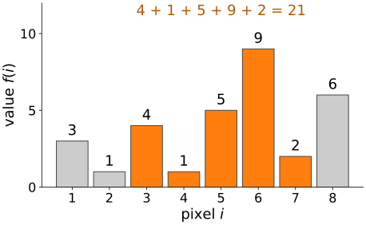
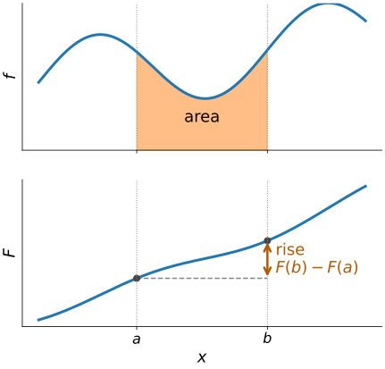
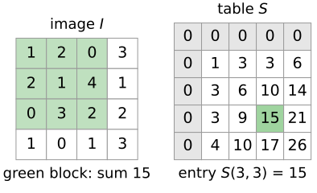
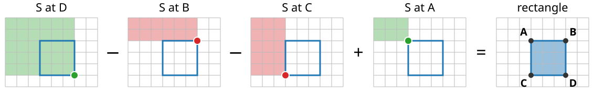
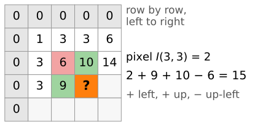
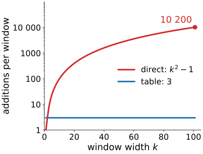
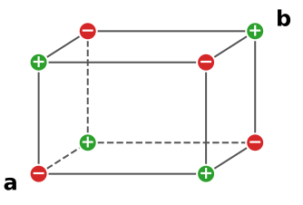

## About this lecture

Many image analysis methods need the **sum of the pixels in a rectangle**, millions of times: a blur, a local mean, a feature for a detector. Adding the pixels up each time costs as much as the rectangle is large.

- Write down a **running total** once; then any range sum is **one subtraction**.
- In 2D: the **integral image** (summed-area table) gives the sum over **any rectangle from four lookups**, whatever its size.
- It is built in **one pass** over the image.
- It is the fundamental theorem of calculus, made discrete.

*Slides titled **The math** give the formulas and proofs; the ideas are complete without them.*

::: notes
Part IV; needs only the [filtering unit](../kernels/lec.qmd) of day 1 (box blur, border rules). This unit owns the integral image: construction, four-corner rule, cost. The next unit uses it for box filters and local statistics, and works out how wide the numbers in the table must be.
:::

## A thousand range sums

:::: {.columns}
::: {.column width="55%"}
A row of 8 pixels: $3, 1, 4, 1, 5, 9, 2, 6$.

- Sum of pixels 3 to 7? $4 + 1 + 5 + 9 + 2 = 21$: **4 additions**.
- Pixels 2 to 5? 3 more additions. Pixels 1 to 8? 7 more.
- A blur, a local mean or a detector asks this question at **every** pixel, for windows of 10, 50, 100 pixels. Adding up each time costs the **length of the range**, every time.

Can we pay once, and then answer every question at the same small cost?
:::
::: {.column width="45%"}
{width="100%" fig-alt="The row as bars; pixels 3 to 7 (orange) add up to 21."}
:::
::::

## The running total

Write down the **running total** (prefix sum) $S(i)$ = sum of pixels $1, \dots, i$, with $S(0) = 0$:

| $i$ | 0 | 1 | 2 | 3 | 4 | 5 | 6 | 7 | 8 |
|---|---|---|---|---|---|---|---|---|---|
| pixel $f(i)$ | | 3 | 1 | 4 | 1 | 5 | 9 | 2 | 6 |
| $S(i)$ | 0 | 3 | 4 | 8 | 9 | 14 | 23 | 25 | 31 |

- Each entry is the one before plus one pixel: **one addition per entry**.
- Sum of pixels $a$ to $b$: everything up to $b$, minus everything before $a$:
  $$f(a) + \dots + f(b) = S(b) - S(a-1)$$
- Pixels 3 to 7: $S(7) - S(2) = 25 - 4 = 21$. **One subtraction**, whatever the length.

## Try it: range sums from a running total

```{=html}
<link rel="stylesheet" href="../demos/dist/demo.css">
<div data-demo="satstep" data-mode="1d" data-preset="exercise"></div>
<script src="../demos/dist/satstep.js"></script>
```

::: notes
Top: the pixel values (drag the bars). Bottom: the running total as a staircase; each step is one pixel. The range a..b is the shaded bars on top, and the rise of the staircase from the red dot S(a−1) to the green dot S(b) below. Tour: exercise row, a = 3, b = 7: 21 both ways. Move a and b: the table always needs one subtraction. "one spike": the staircase jumps at the spike. Then tick "smooth": the bars become a curve f and the staircase its antiderivative F; the area under f between the markers is the rise of F. That is the next slide.
:::

## The same picture in calculus

:::: {.columns}
::: {.column width="58%"}
The running total of a curve is its **antiderivative**: $F(x)$ = area under $f$ from the start up to $x$.

- The area between $a$ and $b$ is the **rise** of $F$: $F(b) - F(a)$.
- For pixels, the "curve" is a row of bars and the antiderivative a **staircase**: the same rule, with sums instead of integrals.
- Differencing undoes summing: $S(i) - S(i-1) = f(i)$, as the derivative of $F$ gives back $f$.

So the running total is a **pre-computed integral**. Hence the name: **integral image**.
:::
::: {.column width="42%"}
{width="100%" fig-alt="Top: a curve f with the area between a and b shaded. Bottom: its antiderivative F; the area equals the rise of F from a to b."}
:::
::::

## The math: from $\int$ to $\sum$ {.math}

Fundamental theorem of calculus: with $F(x) = \int_0^x f(t)\,dt$,
$$\int_a^b f(t)\,dt = F(b) - F(a), \qquad F' = f.$$

Discrete version: with $S(i) = \sum_{k=1}^{i} f(k)$ and $S(0) = 0$,
$$\sum_{k=a}^{b} f(k) = S(b) - S(a-1), \qquad S(i) - S(i-1) = f(i).$$

The backward difference $\Delta S(i) = S(i) - S(i-1)$ plays the role of the derivative: it undoes the summation exactly, with no approximation.

## In 2D: the integral image

:::: {.columns}
::: {.column width="52%"}
$S(x, y)$ = sum of all pixels **above and to the left** of $(x, y)$, including it:
$$S(x, y) = \sum_{x' \le x}\ \sum_{y' \le y} I(x', y')$$

- Pixels are numbered $1, \dots, N$; the table gets an extra **zero row and zero column** (index 0).
- With the zero row and column, the formulas below need **no special cases at the border**. We use this convention everywhere (demos, exercises).
- The last entry, $S(N, M)$, is the sum of the whole image.
:::
::: {.column width="48%"}
{width="100%" fig-alt="A 4 × 4 image and its 5 × 5 table. The entry S(3, 3) = 15 is the sum of the green 3 × 3 block above and to the left."}
:::
::::

## Any rectangle from four corners

{width="100%" fig-alt="S at D, minus S at B, minus S at C, plus S at A leaves exactly the rectangle."}

For the rectangle with corners $A$ (above-left, outside), $B$, $C$, $D$ (its bottom-right pixel):
$$\text{sum} = S(D) - S(B) - S(C) + S(A)$$

$S(D)$ covers too much. Remove the strip above ($S(B)$) and the strip to the left ($S(C)$): the block above-left of $A$ has now been removed **twice**, so add it back **once**.

## Building the table in one pass

Go through the image row by row, left to right. Each entry from three entries already filled, plus the pixel:
$$S(x, y) = I(x, y) + S(x-1, y) + S(x, y-1) - S(x-1, y-1)$$

:::: {.columns}
::: {.column width="52%"}
- The same four-corner picture: left block + upper block, the overlap counted twice, so subtract it once.
- Or in two 1D passes: running totals along every row, then running totals of the result down every column.
- The raster fill is the same picture as the cost table of the [dynamic-programming day](../dp-paths/lec.qmd), with a **sum** instead of a **minimum**.
:::
::: {.column width="48%"}
{width="100%" fig-alt="Filling S(3, 3) of the table on the previous slide: pixel 2, plus left 9 and up 10 (green), minus up-left 6 (red), gives 15."}
:::
::::

## Try it: fill the table, sum a rectangle

```{=html}
<link rel="stylesheet" href="../demos/dist/demo.css">
<div data-demo="satstep" data-mode="2d" data-preset="exercise"></div>
<script src="../demos/dist/satstep.js"></script>
```

::: notes
Left: a 5 × 5 image (the exercise image), right: its table with the zero row and column (grey). Tour: press step a few times: the orange cell is being filled; green + are its left and upper neighbours, red − the upper-left one. Fill all. Then drag a rectangle on the image, e.g. the inner 3 × 3 (x and y from 2 to 4): the four corners light up, 31 − 6 − 6 + 2 = 21, and the counter compares additions (8 direct against 3). Preset "rectangle at the border": two corners lie in the zero row/column, still four lookups, no special case. "one pixel, four lookups": I(3,3) = 19 − 10 − 11 + 7 = 5. "1 × 8 row": the 1D case: the zero row makes two of the corners 0.
:::

## The math: the corner formula {.math}

In the continuous case, with $\Phi(x, y) = \int_0^x\!\int_0^y f$:
$$\iint_{[a,b]\times[c,d]} f = \Phi(b, d) - \Phi(a, d) - \Phi(b, c) + \Phi(a, c)$$
(inclusion–exclusion of four quadrants).

Discrete, for columns $x_0..x_1$ and rows $y_0..y_1$:
$$\sum_{x=x_0}^{x_1}\sum_{y=y_0}^{y_1} I(x,y) = S(x_1, y_1) - S(x_0{-}1, y_1) - S(x_1, y_0{-}1) + S(x_0{-}1, y_0{-}1)$$

Proof: write $S(x, y) = \sum_{x' \le x}\sum_{y' \le y} I$ and count how often each pixel is included: inside the rectangle $1 - 0 - 0 + 0$; left of it $1 - 1 - 0 + 0$; above it $1 - 0 - 1 + 0$; above-left $1 - 1 - 1 + 1$; all others 0. The recursion is the special case of a single pixel; the mixed difference $\Delta_x\Delta_y S = I$ undoes the double sum, as $\partial^2\Phi/\partial x\,\partial y = f$.

## What it costs

:::: {.columns}
::: {.column width="62%"}
- **Building**: one pass, about 3 additions per pixel.
- **Each rectangle sum**: 4 lookups, 3 additions, **whatever its size**.
- A $101 \times 101$ window: directly $101^2 - 1 = 10\,200$ additions; with the table **3**.
- A window at every pixel of a $1000 \times 1000$ image: $10^6 \times 10\,200 \approx 10^{10}$ additions directly, $3 \times 10^6 + 3\times 10^6$ with the table.
- For a $3 \times 3$ window the saving is small (8 additions against 3, plus building): the table pays off for **large** windows, and when **many different** windows are needed.

The price: one extra image of **wider numbers**. The last entry is the sum of the whole image; the next unit works out how many bits that needs.
:::
::: {.column width="38%"}
{width="100%" fig-alt="Additions to sum one k × k window: directly k² − 1 (red, log scale), with the table always 3 (blue)."}
:::
::::

## The math: $d$ dimensions {.math}

:::: {.columns}
::: {.column width="64%"}
For a box in $d$ dimensions with lower corner $\mathbf a$ (just outside) and upper corner $\mathbf b$, sum over the $2^d$ corners $\mathbf c$ with $c_k \in \{a_k, b_k\}$:
$$\sum_{\text{box}} I = \sum_{\mathbf c} (-1)^{\,d - \#\{k:\, c_k = b_k\}}\, S(\mathbf c)$$

- 1D: 2 corners, $S(b) - S(a)$. 2D: 4 corners. 3D (a volume, or a video as $x, y, t$): 8 corners.
- Building: $S(\mathbf x) = I(\mathbf x) - \sum$ over the other $2^d - 1$ corners of the unit cube behind $\mathbf x$ with signs $(-1)^{\#\text{shifted}}$; or $d$ passes of 1D running totals, one per axis.
:::
::: {.column width="36%"}
{width="100%" fig-alt="The 8 corners of a box in 3D with their signs: + where an even number of coordinates is at the lower corner a."}
:::
::::

## Where it is used

- **Box filters** of any size at constant cost, and **local mean and variance**: the [next unit](../box-filters/lec.qmd). The same two maps give local thresholds (Niblack, Sauvola) on the [thresholding day](../local-threshold/lec.qmd).
- **Rectangle features** (Haar-like features) at any size: the unit after.
- The **Viola–Jones** detector, which made real-time face detection possible in 2001.
- Computer graphics: summed-area tables were introduced (Crow, 1984) to average a texture over a pixel's footprint.

## Summary

- The **running total** $S$ turns any range sum into one subtraction: $S(b) - S(a-1)$. It is the discrete antiderivative.
- The **integral image** $S(x, y)$ = sum of everything above and to the left, padded with a zero row and column.
- **Any rectangle**: $S(D) - S(B) - S(C) + S(A)$: four lookups, whatever the size.
- **Built in one pass**: $S(x,y) = I + S(\text{left}) + S(\text{up}) - S(\text{up-left})$.
- Pays off for large windows and many windows; the price is one table of wider numbers.
