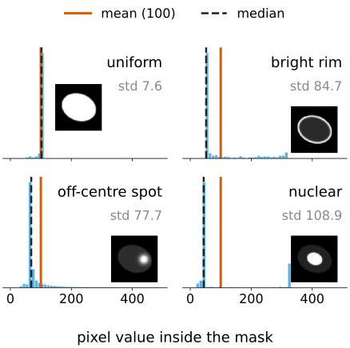
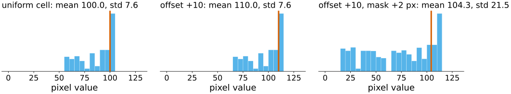
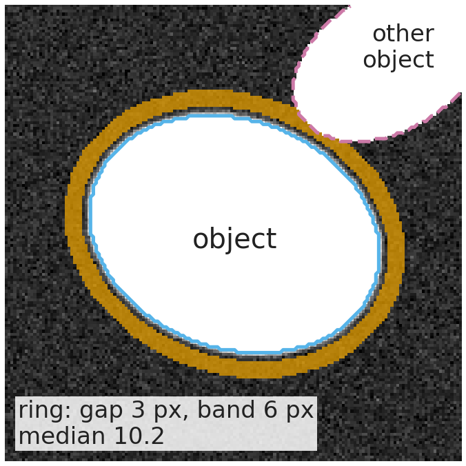
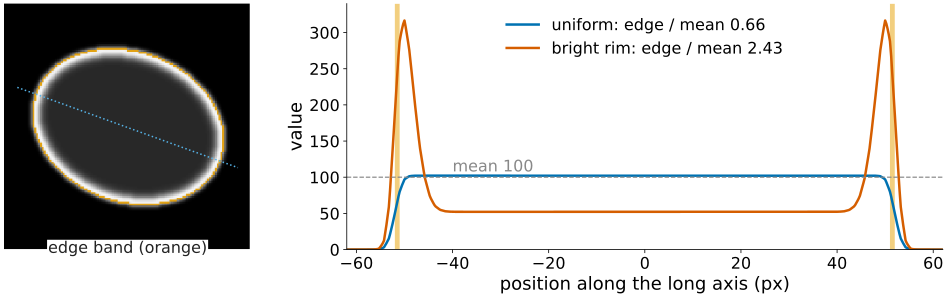
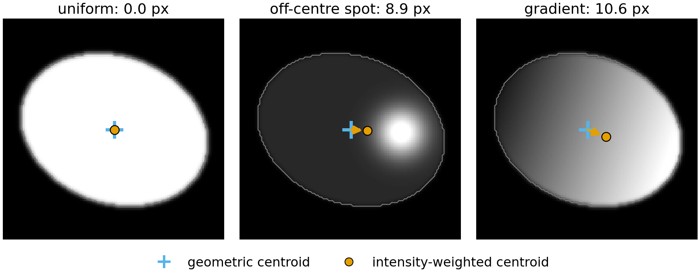
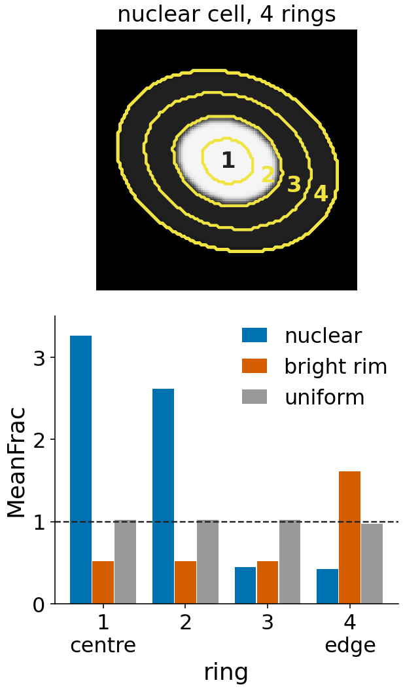
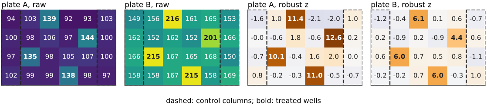

## About this lecture

A segmentation gives a label image; a measurement turns it into a **table**: one row per object, one column per property. The size and shape columns were the labelling day. Today: what the **pixel values inside** an object tell us.

- **Statistics of the values**: integrated, mean, spread, median, quartiles, MAD.
- Which numbers survive a **background offset**, a **gain**, a **mask one pixel too large**, **saturation**.
- **Where** the signal is: edge intensity, **mass displacement**, **radial distribution**.
- From a table to numbers you can **compare**: units, aggregation per well, normalisation.

*Slides titled **The math** give the formulas and proofs; the ideas are complete without them.*

::: notes
This is the first of three units of the measurements day: intensity (this), texture, relations between objects (colocalisation moved to the Fluorescence quantification elective; recall slide in `relations/`). The day is a practical catalogue; theory owned by other days (perimeter estimators, moments, convex hull, the distance transform, PCA, the statistics of measurements) is recalled in one line with a pointer. Coordinates: x = column, y = row (down), pixel centres at integers.
:::

## Recall: the size and shape columns

From the labelling day (region properties and shape features), not repeated here:

| column | what it is | unit |
|---|---|---|
| area, equivalent diameter | pixel count; diameter of the disc with that area | px², px |
| perimeter | boundary length (the edge count is about 27 % too long) | px |
| extent | area / bounding-box area | – |
| axis lengths, orientation, eccentricity | from the second moments (the equivalent ellipse) | px, °, – |
| Euler number | objects minus holes | – |
| convex area, solidity | convex hull; area / hull area | px², – |
| form factor | $4\pi A/P^2$ (inherits the perimeter bias) | – |
| Feret diameters, inscribed radius | caliper widths; largest inscribed disc | px |

Rotation-invariant moment codes (moments elective) and skeleton lengths and branches (skeleton elective) are further columns. **What else is in the table?**

## Same mask, same total signal

{width="100%"}

Six synthetic cells: identical mask (6521 px), identical **sum of the pixel values** (652 100). Uniform, bright rim, one off-centre spot, punctate, gradient, nuclear.

- Area, shape and the total are the same. A biologist would call these six different phenotypes.
- **Which numbers separate them?** Spread, extremes, where the signal sits relative to the centre and the edge.

::: notes
The cells are the patterns of the intensityfeat demo (160 × 160, an ellipse with semi-axes 52 and 40, blurred by a Gaussian of σ = 1.2 px to mimic the optics, scaled so that the mean inside the mask is 100). Ask the class which of them they could tell apart with "mean intensity" alone: none.
:::

## Statistics of the pixel values {.smaller}

:::: {.columns}
::: {.column width="55%"}
Take the values $I(\mathbf x)$ of the $n$ pixels inside the object $\Omega$:

- **Integrated intensity** = their **sum**: proportional to the **amount** of dye (DNA content: G2 nuclei have twice the integrated DAPI of G1 nuclei).
- **Mean** = sum / area: proportional to the **concentration**.
- **Standard deviation**, **min**, **max**: spread and extremes.
- Robust versions: **median**, lower and upper **quartiles** (25 % and 75 % of the pixels below), **MAD** = median of $|I - \text{median}|$.

| cell (demo) | mean | std | max | median | edge / mean |
|---|---|---|---|---|---|
| uniform | 100 | 7.6 | 102 | 102 | 0.66 |
| bright rim | 100 | 84.7 | 318 | 52 | 2.43 |
| off-centre spot | 100 | 77.7 | 488 | 69 | 0.46 |
| nuclear | 100 | 108.9 | 326 | 44 | 0.28 |
:::
::: {.column width="45%"}
{width="100%" fig-alt="Histograms of the pixel values inside the mask for four of the synthetic cells, each with a thumbnail. Uniform: a narrow peak near 102. Bright rim: a peak near 50 and a long tail to 318. Off-centre spot: a peak near 60 and a tail to 488. Nuclear: two peaks, near 40 and near 300. The mean is 100 in every cell; the median differs."}
:::
::::

## The math: intensity statistics {.math}

For the values $I_1, \dots, I_n$ of the pixels of $\Omega$:

$$S = \sum_k I_k, \qquad \mu = \frac{S}{n}, \qquad \sigma = \sqrt{\frac1n \sum_k (I_k - \mu)^2}.$$

- $\sigma$ divides by $n$: the pixels are the whole object, not a sample (tools differ; $n - 1$ changes little for $n$ in the hundreds).
- Quantiles $q_p$ by sorting: position $h = (n-1)p$ in the sorted list, linear interpolation between neighbours. Median $q_{0.5}$, quartiles $q_{0.25}$, $q_{0.75}$.
- $\mathrm{MAD} = \operatorname{median}_k |I_k - q_{0.5}|$. For normal data $\mathrm{MAD} = \sigma\,\Phi^{-1}(0.75) = 0.6745\,\sigma$, so $1.4826 \cdot \mathrm{MAD}$ estimates $\sigma$.
- Sorting costs $O(n \log n)$ per object; sums cost $O(n)$, for all objects in one scan.

## Which numbers survive what {.smaller}

| change | integrated | mean, median, quartiles | std, MAD | ratios (edge / mean) |
|---|---|---|---|---|
| background offset $+b$ | $+\,b\,n$ | $+\,b$ | unchanged | change |
| gain $\times g$ | $\times g$ | $\times g$ | $\times g$ | unchanged |
| mask 1–2 px too large | includes the blurred edge and background | **lower** | larger | change |
| saturation | too low | mean too low; median and quartiles unchanged unless half the object clips | std too low | change |

{width="92%" fig-alt="Histograms (log counts) of the uniform cell's pixel values. Ideal: mean 100.0, std 7.6. Offset +10: the whole histogram moves right by 10, mean 110.0, std still 7.6. Offset +10 with the mask 2 px too large: a tail of dim edge and background pixels appears, mean 104.3, std 21.5."}

Demo numbers (uniform cell): offset 10 → mean 110.0, std 7.6 unchanged. Mask 2 px too large (with offset 10): 528 extra pixels, mean 110.0 → **104.3**. Spot cell clipped at 300: max 488 → 300, mean 100 → 96.0, integrated −4 %.

How values are stored, rescaled and when they clip is the bit depth day.

## The math: offset and gain {.math}

Write the measured image as $J = g\,I + b$ (gain $g > 0$, offset $b$).

- Sum: $\sum_\Omega J = g \sum_\Omega I + b\,n$. Mean: $\mu_J = g\,\mu_I + b$. Every quantile moves the same way: $q_p(J) = g\,q_p(I) + b$ (sorting is unchanged by an increasing map).
- Spread: $\sigma_J = g\,\sigma_I$ and $\mathrm{MAD}_J = g\,\mathrm{MAD}_I$: differences cancel $b$.
- A ratio of two means $\mu_1/\mu_2$ (edge / mean, nucleus / cytoplasm) cancels $g$ but not $b$: $\frac{g\mu_1 + b}{g\mu_2 + b}$ moves towards 1 as $b$ grows.
- So subtract the background **before** any ratio, and divide by a reference **after**.

## Local background

:::: {.columns}
::: {.column width="60%"}
The offset is rarely constant across an image. Measure it **next to each object**:

- A **ring** around the object: skip a **gap** of a few pixels (the blurred edge), then take a **band** of a few pixels; leave out pixels that belong to other objects.
- Background = the **median** of the ring (robust to a neighbour's edge or debris).
- Subtract it from every pixel of the object, then compute the statistics.

The ring is "distance to the object between gap and gap + width": a threshold of the distance transform of the background (morphology day).
:::
::: {.column width="40%"}
{width="100%" fig-alt="The uniform cell with offset 10 and noise: its mask outlined in blue, the background ring in orange (3 px gap, 6 px band), and a neighbouring object, dashed, whose pixels are left out of the ring. The ring's median is 10.2."}
:::
::::

::: notes
In the figure, the neighbour's pixels (value about 90) are left out of the ring. Had they been kept, the ring's mean would be 12.2 instead of 10.2; its median only moves to 10.4.
:::

## Edge intensity {.smaller}

The **edge band** = the object minus its erosion by one pixel (the cross): the object pixels that have a 4-neighbour outside (morphology day).

- The same statistics on the band: edge mean, edge integrated, …
- **Edge / mean** separates rim staining (a membrane marker) from filled staining.
- Demo: bright rim 2.43, uniform 0.66 (not 1: the optics blur the edge, so the outermost pixels are darker), nuclear 0.28.
- It is sensitive to the mask: one pixel inwards or outwards moves the band to a very different place in the edge profile.

{width="80%" fig-alt="Left: the bright-rim cell with its one-pixel edge band in orange. Right: profiles along the long axis through the centre for the uniform cell (edge / mean 0.66) and the bright-rim cell (edge / mean 2.43); the orange strips mark the edge band, where the blurred uniform profile has already dropped below its mean of 100."}

## Mass displacement {.smaller}

Two centres of an object:

- the **geometric centroid**: mean pixel position (labelling day);
- the **intensity-weighted centroid**: each pixel counts with its value, the "centre of mass" of the signal.

**Mass displacement** = the distance between them (in px, or µm with the pixel size).

- 0 for a uniform or a rim-stained cell (by symmetry), large when the signal is **polarised**: demo off-centre spot 8.9 px, gradient 10.6 px.
- Noise and a background offset pull the weighted centroid towards the geometric one: subtract the background first.

{width="62%" fig-alt="Three cells with the geometric centroid (blue plus) and the intensity-weighted centroid (orange dot). Uniform: they coincide, 0.0 px. Off-centre spot: the weighted centroid moves towards the spot, 8.9 px. Gradient: it moves towards the bright side, 10.6 px."}

## The math: the first intensity moment {.math}

Intensity moments are the region moments of the labelling day with weights $I(\mathbf x)$:

$$M_{pq} = \sum_{(x,y)\in\Omega} I(x,y)\, x^p y^q, \qquad \bar{\mathbf x}_I = \Big(\frac{M_{10}}{M_{00}}, \frac{M_{01}}{M_{00}}\Big), \qquad \bar{\mathbf x} = \Big(\frac{m_{10}}{m_{00}}, \frac{m_{01}}{m_{00}}\Big).$$

- Mass displacement $= \lVert \bar{\mathbf x}_I - \bar{\mathbf x} \rVert$.
- With $I = c$ constant, $M_{pq} = c\,m_{pq}$ and the two centroids coincide.
- With $J = I + b$: $\bar{\mathbf x}_J = \frac{M_{00}\,\bar{\mathbf x}_I + b\,n\,\bar{\mathbf x}}{M_{00} + b\,n}$, a weighted average that slides towards $\bar{\mathbf x}$ as $b$ grows.

## Radial distribution {.smaller}

:::: {.columns}
::: {.column width="62%"}
Divide the object into $k$ **rings** that follow its shape, from the centre to the edge.

- For each pixel: $d_c$ = distance to the centre point, $d_e$ = distance to the edge (the distance transform). **Normalised position** $\rho = d_c/(d_c + d_e)$: 0 at the centre, close to 1 at the edge, whatever the shape.
- Ring $j$ holds the pixels with $\rho$ in $[\tfrac{j-1}{k}, \tfrac{j}{k})$.
- **FracAtD**: the share of the object's total intensity in ring $j$.
- **MeanFrac**: FracAtD divided by the share of the object's **pixels** in ring $j$: 1 = as expected for uniform staining, > 1 enriched, < 1 depleted.
- **RadialCV**: how unequal the ring is around the circle (coefficient of variation over 8 angular sectors).

Demo, 4 rings: nuclear MeanFrac 3.26, 2.62, 0.45, 0.42; bright rim 0.52, 0.52, 0.52, 1.61; uniform about 1.
:::
::: {.column width="38%"}
{width="74%" fig-align="center" fig-alt="Top: the nuclear cell with the boundaries of its 4 rings, which follow the elliptic outline. Bottom: MeanFrac per ring for the nuclear cell (3.26, 2.62, 0.45, 0.42), the bright-rim cell (0.52, 0.52, 0.52, 1.61) and the uniform cell (about 1 everywhere)."}
:::
::::

## The math: rings {.math}

For pixel $\mathbf x \in \Omega$ with centre $\mathbf c$: $\rho(\mathbf x) = \dfrac{\lVert \mathbf x - \mathbf c\rVert}{\lVert \mathbf x - \mathbf c\rVert + \mathrm{DT}(\mathbf x)}$, ring $r(\mathbf x) = \min(k, \lfloor k\rho \rfloor + 1)$.

$$\mathrm{FracAtD}_j = \frac{\sum_{r(\mathbf x) = j} I(\mathbf x)}{\sum_\Omega I}, \qquad a_j = \frac{\#\{r(\mathbf x) = j\}}{n}, \qquad \mathrm{MeanFrac}_j = \frac{\mathrm{FracAtD}_j}{a_j}.$$

- $\sum_j \mathrm{FracAtD}_j = \sum_j a_j = 1$, and $\sum_j a_j\,\mathrm{MeanFrac}_j = 1$: enrichment in one ring is paid for in another.
- $\mathrm{MeanFrac}_j = \bar I_j / \bar I$: the ring's mean over the object's mean, so the gain cancels; an offset pulls every MeanFrac towards 1.
- The centre $\mathbf c$ matters: the centroid, the intensity maximum, or a **parent** object such as the nucleus (nuclear vs peripheral signal; translocation assays).

## Try it: intensity features

```{=html}
<link rel="stylesheet" href="../demos/dist/demo.css">
<div data-demo="intensityfeat" data-preset="offset" data-rows="integrated,mean,sd,median,mad,edgeRatio,massDisplacement"></div>
<script src="../demos/dist/intensityfeat.js"></script>
```

::: notes
Tour: "background offset" (offset 40, noise 4): mean, median and integrated move, std barely (noise adds a little), MAD becomes non-zero. Then "polarised cell": the arrow is the mass displacement (8.9 px); switch the rings to the intensity maximum. "nuclear: radial bins": MeanFrac 3.3 in ring 1, 0.4 at the edge. "dilated mask": offset 10 and the mask 2 px too large: the mean drops from 110 to 104.3 and edge / mean collapses. "saturation": the max is clipped at 300. The Δ column compares with the ideal measurement of the same cell (no offset, gain 1, no noise, exact mask).
:::

## Per object, per image, per well

- **Per-image** columns use the same statistics over the whole image: total intensity, fraction of **saturated** pixels, a focus score. They are **quality control**: flag images before trusting their objects.
- **Units**: lengths × pixel size (µm), areas × pixel size² (µm²), 3D voxels × $\Delta x\,\Delta y\,\Delta z$ (often anisotropic: the 3D images unit). Intensities stay in the stored units: compare only images acquired and stored the same way. Ratios are dimensionless.
- **Aggregate** objects per image or per well: the **median** (robust), the mean, counts and fractions ("% of cells with more than 3 spots").
- **Redundant** columns: area, perimeter, equivalent diameter, convex area and maximum Feret move together. Keep one per group, or summarise with PCA (day 1).

## Normalisation: plates and batches {.smaller}

Wells on different plates or days differ in gain and offset (**batch**), and within a plate in smooth **row/column gradients** (edge evaporation, illumination, timing).

- **z-score** against the control wells: $(x - \text{mean}) / \text{sd}$.
- **Robust z**: $(x - \text{median}) / (1.4826 \cdot \text{MAD})$ of the controls: one outlying control well does not inflate the scale.
- Robust z removes a plate's **offset and gain**, not a gradient across it. A gradient needs a **row/column correction** first (subtract row and column medians: "median polish"); the scale then comes from the robust spread of all wells.

{width="100%" fig-alt="Two simulated plates of 4 × 6 wells (median of 40 cells per well). Raw: plate B is brighter (controls 149 to 169 against 94 to 103 on plate A). After robust z against each plate's control columns, both plates are on one scale and only the four treated wells stand out (z 10.1 to 12.6 on A, 4.4 to 6.1 on B)."}

## Try it: two plates

```{=html}
<link rel="stylesheet" href="../demos/dist/demo.css">
<div data-demo="intensityfeat" data-preset="gradient"></div>
<script src="../demos/dist/intensityfeat.js"></script>
```

::: notes
Plate demo: two plates of 4 × 6 wells, each well the median of 40 simulated cells, controls in the outer columns, four treated wells (+40). "plate offset: robust z": raw plate B is brighter (controls 149 to 169 against 94 to 103 on plate A: gain 1.4, offset 20); robust z puts both on the same scale and finds the four treated wells (|z| > 3) and nothing else. "plate gradient hides it" (12 units per column): the controls now spread from 64 to 133 on plate A, the robust scale grows, and no treated well reaches |z| = 3 (largest 1.4). "row/column correction": subtract row and column medians first, then a robust z over all wells; the four hits come back (z 6.8 to 9.8 on plate A) and no other well passes |z| > 3.
:::

## The math: robust z and median polish {.math}

Controls $c_1, \dots, c_m$: $\quad z_i = \dfrac{x_i - \operatorname{median}(c)}{1.4826\,\operatorname{MAD}(c)}$.

- Under $x \mapsto g x + b$ the median moves to $g\,\mathrm{med} + b$ and MAD scales by $g$: $z$ is unchanged. That is why it removes batch gain and offset.
- **Breakdown**: up to half the controls can be wild before the median and MAD follow them; one wild value moves the mean and sd without bound.
- **Median polish** fits $x_{rc} \approx m + a_r + b_c$ by alternately subtracting row medians and column medians; the residuals $x_{rc} - a_r - b_c$ keep the treated wells (few per row and column) and lose the smooth gradient. A column made only of controls loses its spread in the polish, so the scale is taken from the MAD of **all** residuals (this is the idea of the "B-score").

## Catalogue: intensity columns

| column | formula | unit | range |
|---|---|---|---|
| integrated intensity | $\sum_\Omega I$ | intensity · px | $\ge 0$ |
| mean, median, quartiles | location of the values | intensity | min … max |
| std, MAD | spread of the values | intensity | $\ge 0$ |
| min, max | extremes (max saturates) | intensity | |
| edge mean, edge / mean | statistics on the edge band | intensity, – | |
| mass displacement | $\lVert \bar{\mathbf x}_I - \bar{\mathbf x}\rVert$ | px (µm) | $\ge 0$ |
| FracAtD, MeanFrac, RadialCV | share, enrichment, asymmetry per ring | – | 0…1, $\ge 0$, $\ge 0$ |
| local background | median of a ring around the object | intensity | |

What comes next with the table: classifying objects from it is the random forests day; turning numbers into a claim (replicates, effect sizes, many features) is the evaluation day.

## Summary

- An object's pixel values give **location** (mean, median, quartiles), **spread** (std, MAD) and **amount** (integrated).
- A background **offset** moves the location and the integral, not the spread; a **gain** scales all but ratios; a **mask** that is too large dilutes the mean; **saturation** clips the top.
- **Where** the signal is: edge / mean, **mass displacement**, and **radial rings** in normalised distance (FracAtD, MeanFrac).
- Comparable numbers need **units**, a robust **aggregate** per well, and **normalisation**: robust z against controls for batches, a row/column correction for gradients.
