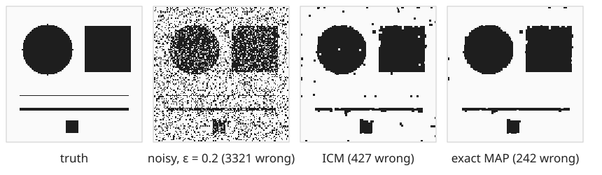
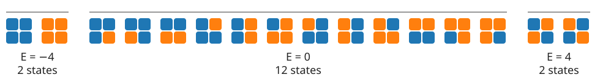

## About this lecture

"Neighbouring pixels usually agree" is a statement about **probability**. This unit turns it into a model: an **energy** that counts disagreements, and a rule that turns energy into probability.

- The **Ising model**: $\pm 1$ "spins" on a grid that want to agree with their neighbours.
- The **Gibbs distribution**: low energy = likely; **temperature** says how strongly.
- The **partition function** $Z$: easy for 16 states, hopeless for an image, easy again for a chain.
- The link back to graph cuts: the Ising energy **is** the segmentation energy.

*Slides titled **The math** give the formulas and proofs; the ideas are complete without them.*

::: notes
This is the first unit of the elective day on energy-based methods (after the graph-cut day). Units: (1) this one, (2) sampling and the phase transition, (3) Bayesian denoising of a binary image, (4) continuous MRFs: quadratic smoothing and total variation. Everything here is sums and exponentials of small examples; no physics is assumed.
:::

## Neighbouring pixels usually agree

{width="100%"}

- Each pixel of the noisy image was flipped with probability 0.2. Looked at alone, a pixel cannot be trusted.
- But true images are made of **regions**: a pixel usually has the same value as its neighbours. An isolated black pixel in a white area is **unlikely** to be real.
- Wanted: a number for "how plausible is this whole image", high for images with few disagreeing neighbours.

::: notes
The two right panels are the denoising results of unit 3 (ICM and the exact best image). Today only the model: how plausible is an image before we have seen any data? Ask: which of the four images would you call most "image-like"?
:::

## The Ising model

Each pixel $p$ carries a **spin** $s_p = +1$ or $-1$ (object / background, or "up" / "down"). Two numbers set the preferences:

- **Coupling $J > 0$**: every pair of 4-neighbours that **agrees** lowers the energy by $J$; every pair that **disagrees** raises it by $J$.
- **Field $h$**: every $+1$ lowers the energy by $h$ (and every $-1$ raises it): a preference for one value.

$$E(\mathbf s) = -J \sum_{\text{neighbours } (p,q)} s_p s_q \;-\; h \sum_p s_p$$

The story it came from (Ising, 1925): a magnet. Each atom is a small arrow that wants to point like its neighbours; heat shakes them. Only the formulas matter here.

- $J < 0$ (an *antiferromagnet*) rewards disagreement: the best states are **checkerboards**. Not useful for images, but a good check of understanding.

## From energy to probability

The **Gibbs distribution** (also called Boltzmann distribution) turns every energy into a probability:

$$p(\mathbf s) = \frac{e^{-E(\mathbf s)/T}}{Z}, \qquad Z = \sum_{\text{all states } \mathbf s} e^{-E(\mathbf s)/T}$$

- **Low energy = high probability.** The exponential makes a state with 4 units less energy $e^{4/T}$ times more likely.
- $Z$ (the **partition function**) only makes the probabilities sum to 1.
- **Ratios need no $Z$:** $\dfrac{p(\mathbf a)}{p(\mathbf b)} = e^{-(E_a - E_b)/T}$. Comparing two images only needs their energy **difference**. This sentence is the key to the next unit.

## The math: why an exponential? {.math}

Two requirements fix the form $p \propto e^{-E/T}$:

- **Only energy differences matter.** Adding a constant $c$ to every energy must not change the probabilities: $e^{-(E + c)/T} = e^{-c/T}e^{-E/T}$, and the factor $e^{-c/T}$ cancels against $Z$.
- **Independent parts multiply.** Two separate lattices with $E = E_1 + E_2$ should be independent: $p = p_1 p_2$. Only the exponential turns sums into products: $e^{-(E_1 + E_2)/T} = e^{-E_1/T}e^{-E_2/T}$, and $Z = Z_1 Z_2$.

Equivalently, $-T\log p(\mathbf s) = E(\mathbf s) + T\log Z$: **energy is negative log-probability**, up to a constant. The literature often writes $\beta = 1/T$ (and also $\beta$ for $J$); we keep $T$ and $J$, and later $\lambda$.

## Temperature: how strongly energy matters

The temperature $T$ (in energy units) is a **knob**:

- **$T \to 0$**: $e^{-E/T}$ is overwhelmingly largest for the lowest energy. All probability goes to the **ground states** (the energy minima).
- **$T \to \infty$**: $e^{-E/T} \to 1$ for every state. All states are **equally likely**: the energy no longer matters.
- In between: low energies are preferred, higher ones still happen.

**Energy minimisation is the $T \to 0$ limit of probability.** "Find the lowest energy" (graph cuts) and "describe the likely states" (this day) are the same model, read at different temperatures.

## The $2 \times 2$ lattice by hand {.smaller}

{width="100%"}

$J = 1$, $h = 0$, free boundary: 4 neighbour pairs. Orange = $+1$, blue = $-1$.

- **2** aligned states: all 4 pairs agree, $E = -4$. **2** checkerboards: all disagree, $E = +4$. The other **12**: two pairs agree, two disagree, $E = 0$.
- $Z = 2e^{4/T} + 12 + 2e^{-4/T}$. At $T = 1$: $109.20 + 12 + 0.04 = 121.23$.
- $p(\text{both aligned states}) = 109.20 / 121.23 = 0.90$; each one 0.45. At $T = 4$: $Z = 18.17$ and only 0.30.

## Try it: every state of a tiny lattice

```{=html}
<link rel="stylesheet" href="../demos/dist/demo.css">
<div data-demo="isingenum" data-preset="hand"></div>
<script src="../demos/dist/isingenum.js"></script>
```

::: notes
Bars: the probability of each energy level (number of states above the bar); orange = the level of the state on the left. Bonds: green = the pair lowers the energy, red = raises it. Tour: "2×2 by hand": Z = 121.2, p(this state) = 0.450 for all-plus. Click one spin: E = 0, p = 0.00825 (= 1/Z). Move T to 4: the E = 0 level wins (12 states), p(aligned level) 0.30. Then 3×3 (512 states, periodic: 18 pairs). "T → 0": only the two ground states. "T → ∞" (T = 100): bars proportional to the number of states (198 states at E = −2 carry 39 %). "A field breaks the tie" (h = 0.3): magnetisation tab, all-plus 0.94, all-minus 0.03. "J < 0" with free boundary: the two checkerboards carry 89 %.
:::

## The partition function is the hard part

$Z$ sums over **every** state.

| lattice | states $2^n$ |
|---|---|
| $2 \times 2$ | 16 |
| $3 \times 3$ | 512 |
| $4 \times 4$ | 65 536 |
| $256 \times 256$ | $2^{65536} \approx 10^{19728}$ |

- For an image, $Z$ cannot be computed, and so neither can the probability of one particular image.
- What still works without $Z$: **ratios** (next unit: sampling), and the **lowest energy** (graph cuts, unit 3).

## A chain is easy: sum from left to right

For pixels on a **line** (or a ring) there is a shortcut, the same trick as dynamic programming on a chain (graph-cut day, `segchain`), with "minimum" replaced by "sum":

- Walk along the chain. Keep two numbers: the total weight of all partial chains ending in $+1$, and of those ending in $-1$.
- Each new pixel updates both with a $2 \times 2$ table of weights $e^{-(\text{pair energy})/T}$: the **transfer matrix**.
- $n$ pixels cost $n$ small steps instead of $2^n$ terms.

In 2D, the rows interact with each other in every column; no such shortcut exists in general.

## The math: the transfer matrix {.math .smaller}

A ring of $n$ spins, energy $E = -J\sum_i s_i s_{i+1} - h\sum_i s_i$ (with $s_{n+1} = s_1$). Split the field evenly over the two pairs of each spin:

$$e^{-E/T} = \prod_{i=1}^n M_{s_i s_{i+1}}, \qquad M = \begin{bmatrix} e^{(J+h)/T} & e^{-J/T} \\ e^{-J/T} & e^{(J-h)/T}\end{bmatrix} \quad (\text{rows/columns: } +1, -1).$$

Summing over all states is a chain of matrix products around the ring:

$$Z = \sum_{s_1, \dots, s_n} M_{s_1 s_2}M_{s_2 s_3}\cdots M_{s_n s_1} = \operatorname{tr}(M^n) = \mu_1^n + \mu_2^n,$$

with the eigenvalues $\mu_{1,2} = e^{J/T}\cosh(h/T) \pm \sqrt{e^{2J/T}\sinh^2(h/T) + e^{-2J/T}}$. For $h = 0$: $2\cosh(J/T)$ and $2\sinh(J/T)$.

Ring of 3, $J = 1$, $h = 0$, $T = 1$: $3.086^3 + 2.350^3 = 42.38$. Check by listing: 2 aligned states ($E = -3$) and 6 others ($E = +1$): $2e^3 + 6e^{-1} = 42.38$.

## Recall: this is the segmentation energy

The graph-cut day (`seg-energy/`) wrote a binary segmentation as labels $L_p \in \{0, 1\}$ with

$$E(L) = \sum_p D_p(L_p) + \lambda\sum_{(p,q)}[L_p \ne L_q].$$

With $s_p = 2L_p - 1$ it is the Ising energy, up to a constant:

- the coupling is the smoothness weight: **$\lambda = 2J$**;
- the field is a data term: $D_p(1) - D_p(0) = -2h_p$ (a pixel-dependent field $h_p$ when the data differ from pixel to pixel).

So the minimum-cut solution of that day is the Ising ground state, and its $\lambda$ is today's $J$. From unit 3 on we write $\lambda$.

## The math: from spins to labels {.math}

With $s_p = 2L_p - 1$: if $L_p = L_q$ then $s_p s_q = 1$, otherwise $-1$, so $s_p s_q = 1 - 2[L_p \ne L_q]$ and

$$-J s_p s_q = 2J\,[L_p \ne L_q] - J, \qquad -h_p s_p = -2h_p L_p + h_p.$$

Summing, with $m$ neighbour pairs:

$$E_{\text{Ising}}(\mathbf s) = \underbrace{\sum_p (-2h_p) L_p}_{D_p(1) = -2h_p,\; D_p(0) = 0} + \;2J\sum_{(p,q)}[L_p \ne L_q] \;+\; \Big(\sum_p h_p - mJ\Big).$$

The constant does not depend on the state: same probabilities, same minimum. The graph-cut day's "probabilistic view" slide read the same equation the other way: $P(L \mid I) \propto e^{-E(L)}$, i.e. $T = 1$.

## Summary

- The **Ising model**: spins $\pm 1$ on a grid; the coupling $J$ rewards agreeing neighbours, the field $h$ prefers one value.
- The **Gibbs distribution** $p(\mathbf s) \propto e^{-E(\mathbf s)/T}$: low energy is likely; **ratios** of probabilities need only energy differences.
- **Temperature**: $T \to 0$ keeps only the lowest energies (energy minimisation), $T \to \infty$ makes everything equally likely.
- The **partition function** $Z$ is easy for tiny lattices and for chains (transfer matrix), impossible for images.
- The Ising energy **is** the binary segmentation energy, with $\lambda = 2J$ and the field as data term.
