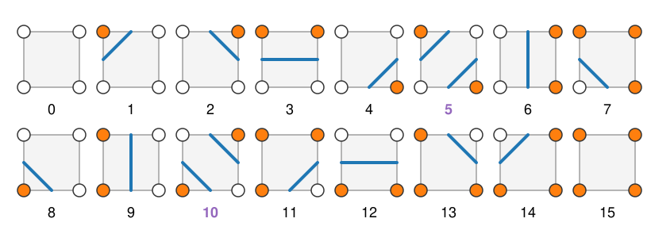

## Goal

By the end of this exercise you should be able to:

- run **marching squares** by hand: classify cells (16 cases), find the crossed edges, place the crossing points by **linear interpolation**, and draw the contour,
- recognise a **saddle** cell and resolve it with the **asymptotic decider**,
- measure a contour: **length** and **enclosed area** (shoelace), with holes counting negative,
- predict what **noise**, **blur** and the choice of **$c$** do to the contours of a real image.

Do the pen-and-paper part first, then the two demos. Questions marked *(math)* are for those who want the derivations; the concept questions do not depend on them.

## Background

| Idea | What it means |
|---|---|
| Above / below | a grid point is above if $I > c$ |
| Cell corners | 0 = top-left, 1 = top-right, 2 = bottom-right, 3 = bottom-left; edge $k$ joins corner $k$ and $k+1$ |
| Case index | $\sum 2^k$ over the corners above $c$: 0 … 15 |
| Crossing point | on an edge from $a$ to $b$ with $I_a$, $I_b$ on opposite sides of $c$: $t = (c - I_a)/(I_b - I_a)$ of the way from $a$ |
| Saddle cases | 5 (corners 0, 2 above) and 10 (corners 1, 3 above) |
| Asymptotic decider | $f^\ast = \dfrac{I_0 I_2 - I_1 I_3}{I_0 + I_2 - I_1 - I_3}$ (corner values $I_k$); $f^\ast > c$: join the above corners, else separate |
| Shoelace | $A = \tfrac12\sum_i (x_i y_{i+1} - x_{i+1}y_i)$ around a closed polygon |

{width="85%"}

## By hand

**B1.** A $4 \times 4$ grid of values ($x$ = column 0–3, left to right; $y$ = row 0–3, top to bottom) and $c = 5$:

| | $x = 0$ | $x = 1$ | $x = 2$ | $x = 3$ |
|---|---|---|---|---|
| $y = 0$ | 4 | 9 | 3 | 7 |
| $y = 1$ | 3 | 1 | 9 | 6 |
| $y = 2$ | 2 | 4 | 8 | 3 |
| $y = 3$ | 2 | 1 | 3 | 4 |

(a) Mark the grid points above $c$. Give the case index of each of the 9 cells (cell $(x, y)$ has its top-left corner at grid point $(x, y)$).
(b) Which cell is a saddle? Compute $f^\ast$ and decide with the asymptotic decider.
(c) For every crossed edge, compute $t$ and the crossing point in grid coordinates $(x, y)$.
(d) Draw the contour. How many pieces does it have, and where do they end?
(e) Which piece changes if you use the rule "always separate" in the saddle cell?

**B2.** An edge runs from a pixel of value $I_a = 40$ to one of value $I_b = 200$, one pixel apart.
(a) Where does the contour cross it for $c = 120$, for $c = 60$ and for $c = 180$?
(b) Where does the midpoint rule put it? By how much can the midpoint rule be off on this edge, as $c$ ranges over $(40, 200)$?

**B3.** The saddle cell with corners (clockwise from top-left) $8, 4, 7, 3$.
(a) For which values of $c$ is it a saddle case at all?
(b) Compute $f^\ast$. For which of these $c$ does the decider join the bright corners, and for which does it separate them?
(c) Replace the 8 by 6 and the 7 by 6.5. Recompute $f^\ast$. What changes at $c = 5$?

**B4.** (a) Compute the area and the perimeter of the closed polygon $(1, 0), (2, 1), (1, 2), (0, 1)$ with the shoelace formula and the segment lengths.
(b) Reverse the order of the points. What happens to the shoelace sum?
(c) A bright ring is described by two closed contours, an outer one of area 50 and an inner one around the dark hole of area 12. Marching squares orients them oppositely. What is the sum of the signed areas, and what does it measure?

**B5.** Pad the grid of B1 with a frame of zeros (so every contour closes) and keep $c = 5$.
(a) How many closed contours are there with the asymptotic decider, and how many with "always separate"?
(b) Without computing: which rule gives the larger total length?

**B6.** A noisy image (noise standard deviation 25 grey levels) of bright objects (200) on a dark background (30), contoured at $c = 120$.
(a) Why are there many tiny contours, and why do they barely change the total enclosed area?
(b) What does a Gaussian blur before marching squares do to the number of contours? Name one thing that too much blur breaks.

::: {.callout-note collapse="true" title="Solutions"}
**B1.** (a) Above 5: $(1, 0) = 9$, $(3, 0) = 7$, $(2, 1) = 9$, $(3, 1) = 6$, $(2, 2) = 8$. Cases (corners 0 1 2 3 = top-left, top-right, bottom-right, bottom-left):

| cell | corners | case |
|---|---|---|
| (0, 0) | 4, 9, 1, 3 | 2 |
| (1, 0) | 9, 3, 9, 1 | 5 (saddle) |
| (2, 0) | 3, 7, 6, 9 | 14 |
| (0, 1) | 3, 1, 4, 2 | 0 |
| (1, 1) | 1, 9, 8, 4 | 6 |
| (2, 1) | 9, 6, 3, 8 | 11 |
| (0, 2) | 2, 4, 1, 2 | 0 |
| (1, 2) | 4, 8, 3, 1 | 2 |
| (2, 2) | 8, 3, 4, 3 | 1 |

(b) Cell $(1, 0)$: $f^\ast = (9 \cdot 9 - 3 \cdot 1)/(9 + 9 - 3 - 1) = 78/14 = 5.57 > 5$: **join** the two 9s through the cell; the segments cut off the dark corners 3 (top-right) and 1 (bottom-left).
(c) Crossing points (each computed once and shared):

| edge | values | $t$ | point $(x, y)$ |
|---|---|---|---|
| $(0,0)$–$(1,0)$ | 4 → 9 | 0.2 | (0.2, 0) |
| $(1,0)$–$(2,0)$ | 9 → 3 | 0.667 | (1.667, 0) |
| $(2,0)$–$(3,0)$ | 3 → 7 | 0.5 | (2.5, 0) |
| $(1,0)$–$(1,1)$ | 9 → 1 | 0.5 | (1, 0.5) |
| $(2,0)$–$(2,1)$ | 3 → 9 | 0.333 | (2, 0.333) |
| $(1,1)$–$(2,1)$ | 1 → 9 | 0.5 | (1.5, 1) |
| $(3,1)$–$(3,2)$ | 6 → 3 | 0.333 | (3, 1.333) |
| $(1,2)$–$(2,2)$ | 4 → 8 | 0.25 | (1.25, 2) |
| $(2,2)$–$(3,2)$ | 8 → 3 | 0.6 | (2.6, 2) |
| $(2,2)$–$(2,3)$ | 8 → 3 | 0.6 | (2, 2.6) |

(d) Two pieces, both ending on the border: a short one $(1.667, 0) \to (2, 0.333) \to (2.5, 0)$ that cuts off the dark corner $(2, 0)$, and a long one $(3, 1.333) \to (2.6, 2) \to (2, 2.6) \to (1.25, 2) \to (1.5, 1) \to (1, 0.5) \to (0.2, 0)$ around the bright region $9, 9, 8, 7, 6$ (which continues across the right border).
(e) With "separate", the saddle cell connects $(1.667, 0)$ to $(1, 0.5)$ and $(1.5, 1)$ to $(2, 0.333)$ instead. The pieces become $(1.667, 0) \to (1, 0.5) \to (0.2, 0)$ (a small piece around the top 9 alone) and a long piece that now ends at $(2.5, 0)$: the top 9 is cut off from the rest of the bright region.

**B2.** (a) $c = 120$: $t = 80/160 = 0.5$; $c = 60$: $t = 20/160 = 0.125$; $c = 180$: $t = 140/160 = 0.875$ (from the dark pixel).
(b) Always at $0.5$. The error $|t - 0.5|$ approaches $0.5$ pixel as $c$ approaches 40 or 200.

**B3.** (a) Corners 0 and 2 (values 8 and 7) must be above $c$ and corners 1 and 3 (4 and 3) below: $4 \le c < 7$ (case 5).
(b) $f^\ast = (56 - 12)/(15 - 7) = 44/8 = 5.5$. For $4 \le c < 5.5$ the decider joins the bright corners; for $5.5 \le c < 7$ it separates them.
(c) $f^\ast = (6 \cdot 6.5 - 4 \cdot 3)/(6 + 6.5 - 7) = 27/5.5 = 4.91$. At $c = 5$ the decider now separates: lower values at the bright corners lower the saddle.

**B4.** (a) Area 2 (computed in the lecture: $\tfrac12(1 + 3 + 1 - 1) = 2$); perimeter $4\sqrt2 = 5.66$.
(b) The sum changes sign: $-2$. The sign tells the direction of travel.
(c) $50 - 12 = 38$: the area of the bright ring itself (the region above $c$).

**B5.** (a) With the decider: **one** closed contour (the top 9 belongs to the same region as the 9, 8, 6, 7 on the right). With "separate": **two** (the top 9 is a region of its own). In the demo's computation the enclosed areas are 4.53 (decider) and $0.69 + 3.35$ (separate).
(b) "Separate", because it adds the boundary between the top 9 and the rest (10.90 against 10.42 grid units).

**B6.** (a) Background pixels pushed above 120 by noise (and object pixels pushed below) each form small islands or holes, with a contour of their own. They come in both directions, so bright specks outside and dark holes inside roughly cancel in the area, while each adds its full length.
(b) Blur averages neighbouring pixels: fewer pixels cross $c$ by accident, so most tiny contours disappear and the boundary becomes smooth. Too much blur rounds corners, shrinks small objects, and breaks thin bright structures (a neck between two objects) or fills thin dark gaps.
:::

### Math questions

**B7.** *(math)* Derive $t = (c - I_a)/(I_b - I_a)$ from the straight line through $(0, I_a)$ and $(1, I_b)$, and show that the bilinear interpolant of a cell, restricted to any of its edges, is exactly this line.

**B8.** *(math)* Write the bilinear interpolant of a cell as $f(x, y) = A + Bx + Cy + Dxy$. (a) Express $A, B, C, D$ in the corner values. (b) Find the saddle point and show that its value is $f^\ast = (I_{00}I_{11} - I_{10}I_{01})/(I_{00} + I_{11} - I_{10} - I_{01})$. (c) Show that $f - f^\ast = D(x - x^\ast)(y - y^\ast)$, so the level sets are hyperbolas.

**B9.** *(math)* In a saddle case, argue that the two above-$c$ corners are connected by a path inside the cell along which $f > c$ if and only if $f^\ast > c$. (Hint: use (c) of B8 and look at the four quadrants around $(x^\ast, y^\ast)$.)

**B10.** *(math)* Derive the shoelace formula from Green's theorem $A = \oint \tfrac12(x\,dy - y\,dx)$ by evaluating the integral on one straight segment from $\mathbf p_i$ to $\mathbf p_{i+1}$.

::: {.callout-note collapse="true" title="Solutions (math)"}
**B7.** The line is $f(t) = I_a + t(I_b - I_a)$; $f(t) = c$ gives the formula, with $t \in (0, 1)$ when $c$ lies strictly between $I_a$ and $I_b$. On the edge $y = 0$ the bilinear interpolant is $I_{00}(1 - x) + I_{10}x$: linear in $x$, through the two corner values. Likewise on the other three edges.

**B8.** (a) $A = I_{00}$, $B = I_{10} - I_{00}$, $C = I_{01} - I_{00}$, $D = I_{00} + I_{11} - I_{10} - I_{01}$. (b) $\partial_x f = B + Dy = 0$, $\partial_y f = C + Dx = 0$: $x^\ast = -C/D$, $y^\ast = -B/D$, and $f^\ast = A + Bx^\ast + Cy^\ast + Dx^\ast y^\ast = A - BC/D$. Multiplying out $(AD - BC)/D$ with (a) gives $(I_{00}I_{11} - I_{10}I_{01})/D$. (c) $D(x - x^\ast)(y - y^\ast) = Dxy - Dx^\ast y - Dy^\ast x + Dx^\ast y^\ast = Dxy + Cy + Bx + BC/D = f - A + BC/D = f - f^\ast$. For $D \ne 0$, $f = c$ is $(x - x^\ast)(y - y^\ast) = (c - f^\ast)/D$: a hyperbola with asymptotes $x = x^\ast$, $y = y^\ast$.

**B9.** In a saddle case $D \ne 0$ and the saddle lies inside the cell. The lines $x = x^\ast$ and $y = y^\ast$ split the cell into four quadrants; by (c), $f - f^\ast$ has the sign of $D$ in two opposite quadrants and the opposite sign in the other two, and the two above-$c$ corners lie in opposite quadrants where $f > f^\ast$. If $f^\ast > c$, the set $\{f > c\}$ contains the whole region $\{f \ge f^\ast\}$, which includes both quadrant pairs' common point $(x^\ast, y^\ast)$ and the segments from it to both bright corners: they are connected. If $f^\ast < c$, the region $\{f > c\}$ lies strictly inside the two open quadrants where $f > f^\ast$, which touch only at the saddle point (where $f = f^\ast < c$): no path joins them. (If $f^\ast = c$ the two touch in one point, the borderline case.)

**B10.** On the segment $\mathbf p(s) = \mathbf p_i + s(\mathbf p_{i+1} - \mathbf p_i)$, $s \in [0, 1]$: $x\,dy - y\,dx = \big(x(s)\,(y_{i+1} - y_i) - y(s)\,(x_{i+1} - x_i)\big)ds$. The $s$-terms cancel, leaving the constant $x_i y_{i+1} - y_i x_{i+1}$. So the segment contributes $\tfrac12(x_i y_{i+1} - x_{i+1}y_i)$; summing over the closed polygon gives the shoelace formula.
:::

## Explore: marching squares by hand {#explore-squares}

A small grid of corner values (white: below $c$, orange: above). Each cell shows its case index; the thick blue segments are the contour. **Click a corner** to flip it to the other side of $c$, **drag it up or down** to change its value; **click a cell** to see its arithmetic (bits, case, $t$ on each crossed edge, and $f^\ast$ for a saddle). **Show the bilinear interpolant** shades the cells with the interpolant and draws its exact level curve (dashed red).

```{=html}
<link rel="stylesheet" href="../demos/dist/demo.css">
<div data-demo="marchsquares" data-preset="bump"></div>
<script src="../demos/dist/marchsquares.js"></script>
```

**S1.** Preset **exercise grid**: check your answers to B1 (cases, $t$ values, the saddle). Switch the saddle rule to **separate** and compare with B1(e).

**S2.** Preset **one bump** ($c = 5$). How many contour pieces are there? Lower $c$ to 3 and raise it to 8: what happens to the contour? Click cell $(2, 2)$ at $c = 5$: which case is it, and why does it have only one segment?

**S3.** Preset **all 16 cases**. Find a cell for each case 0–15. Which cases have two segments?

**S4.** Preset **saddle: the decider joins** (the cell of B3). Read $f^\ast$. Raise $c$ slowly: at which $c$ does the decider switch to separating, and at which $c$ does the cell stop being a saddle? Compare with B3(a) and (b).

**S5.** Preset **saddle: the decider separates**. Show the interpolant. Which rule (separate or join) follows the dashed red curve? Switch to **join**: what is wrong now?

**S6.** Preset **midpoint vs linear** ($c = 3$). Compare the two kinds of crossing points with the dashed exact curve. Then set $c = 9$: what does the midpoint contour look like, and why?

::: {.callout-note collapse="true" title="Solutions"}
**S1.** The demo's readouts match B1: e.g. cell $(1, 0)$ has bits 1 0 1 0, case 5, $t = 0.67, 0.33, 0.5, 0.5$ on its four edges, and $f^\ast = 5.57 > 5$, so the decider joins. With **separate** the top 9 gets its own small contour piece, as in B1(e).

**S2.** One closed contour around the bump. At $c = 3$ it is larger (about 16.7 grid units long, enclosing 22.0 square units), at $c = 8$ smaller (5.6 long, area 2.3); at $c = 5$ it is 12.2 long, area 11.5. Cell $(2, 2)$ has corners 4.7, 6.1, 8.8, 6.7: only the top-left corner is below 5, so it is case $2 + 4 + 8 = 14$ with one crossed pair of edges and one segment cutting off that corner.

**S3.** Every case 0–15 appears at least once. Only the saddle cases 5 and 10 (purple numbers) have two segments.

**S4.** $f^\ast = 5.5$. The decider joins for $c < 5.5$ and separates from $c = 5.5$ on; the cell stops being a saddle at $c = 7$ (the corner of value 7 drops below $c$, giving case 1) and it was a saddle from $c = 4$ (below that, the corner of value 4 is above $c$).

**S5.** $f^\ast = 4.91 < 5$: **separate** follows the dashed curve, whose two branches each bend around one bright corner. With **join**, the segments cut off the dark corners instead and claim that the middle of the cell is bright, which the interpolant says it is not: the topology (one bright region instead of two) is wrong.

**S6.** At $c = 3$ the linear points lie on the dashed curve at the cell edges; the midpoints are up to half a cell off, giving a jagged contour (length 17.3 against 16.7, area 20.5 against 22.0). At $c = 9$ only one grid point (9.1) is above $c$: the linear contour is a tiny diamond around it (length 0.9), the midpoint contour a diamond reaching halfway to the neighbours (length 2.8), much too large: the midpoint rule cannot see that 9.1 is only just above 9.
:::

## Explore: contours of an image {#explore}

Marching squares on a $128 \times 128$ image: a test image (two smooth blobs, and two discs joined by a thin neck; background 30, objects up to about 200) or a micrograph. Set $c$ with the slider or by dragging in the histogram, blur the image (Gaussian $\sigma$) and add noise (standard deviation in grey levels). The image is padded with a dark frame, so every contour closes. The readout counts the contours (outer boundaries and holes), their total length, the enclosed area (shoelace, holes negative) and the pixels above $c$.

```{=html}
<link rel="stylesheet" href="../demos/dist/demo.css">
<div data-demo="isocontour" data-preset="blobs"></div>
<script src="../demos/dist/isocontour.js"></script>
```

**E1.** Preset **test image** ($c = 120$). How many contours are there? Compare the enclosed area with the number of pixels above $c$. Why are they close but not equal?

**E2.** Preset **noise: many tiny contours**. How many contours, outer boundaries and holes are there now? How did the total length and the enclosed area change compared with E1? Explain with B6.

**E3.** Preset **blur first** ($\sigma = 1.5$). What happens to the number of contours and the length? Now raise $\sigma$ to 2.5. What breaks, and why does the number of contours go **up**?

**E4.** Preset **two blobs merge as c drops** ($c = 140$). Lower $c$ step by step. At which $c$ do the two upper blobs merge into one contour? What is special about that value? At which $c$ does everything become one contour?

**E5.** Preset **micrograph**. The dark nucleus is below $c$: how does it appear in the readout? Add noise and blur and describe the effect on the contours of the cytoplasm.

::: {.callout-note collapse="true" title="Solutions"}
**E1.** 3 contours (two blobs, one dumbbell). Enclosed area 2122.8 px², pixels above $c$: 2110. Close, because both measure the bright region; not equal, because the contour passes between pixel centres at the interpolated position while the pixel count is all-or-nothing per pixel.

**E2.** 141 contours: 111 outer boundaries and 30 holes. The total length rises from 385.9 to 935.0 px, while the enclosed area barely moves (2138.5 px²; pixels above $c$: 2212). Specks outside and holes inside are many and small: each adds its whole perimeter, but their areas largely cancel.

**E3.** With $\sigma = 1.5$: 3 contours again, total length 385.0 px, enclosed area 2056.4 px². At $\sigma = 2.5$ the 3-pixel neck is blurred below 120 (its centre value drops to about 106), so the dumbbell splits into two discs: 4 contours, length 314.8 px. Blur removes noise but also thin structures.

**E4.** At $c = 96$ there are still 3 contours, at $c = 95$ only 2: the two blobs merge near $c \approx 96$, the value of the saddle point (the lowest point on the ridge) between them. Below about $c = 30$, the background value, everything is above $c$ and the only contour is the frame: 1 contour.

**E5.** At $c = 100$ (blur 1): 32 contours, 8 outer and 24 holes. The nucleus and other dark structures are **holes** in the bright region (negative areas). Noise adds many small contours in the textured cytoplasm; blur reduces them again, at the cost of rounding the boundary of the nucleus.
:::

## Where this leads

The same idea one dimension up: in a volume, a cell is a cube of 8 voxels, the boundary is a surface, and marching squares becomes **marching cubes** (next unit). The level-set elective evolves a whole function on the grid and draws its zero contour with exactly this algorithm.
