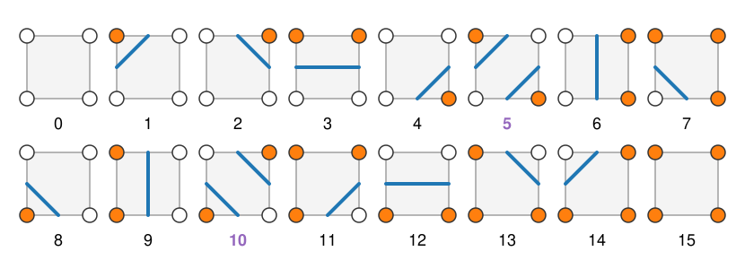
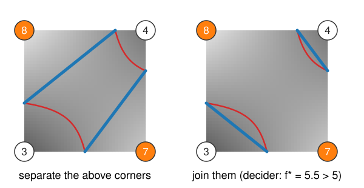

## About this lecture

A threshold tells us which **pixels** belong to a bright object. Today we draw its **boundary** as a curve with sub-pixel precision, in 2D; the next unit does the same in 3D.

- The boundary at level $c$: the **level set** $\{I = c\}$, an **isocontour**.
- **Marching squares**: each $2 \times 2$ cell on its own, 16 cases, crossing points by **linear interpolation**.
- The two **saddle cases**, and the **asymptotic decider** that resolves them.
- **Measuring** a contour: length, and the enclosed area by the shoelace formula.
- Real images: noise, blur, and the choice of $c$.

*Slides titled **The math** give the formulas and proofs; the ideas are complete without them.*

::: notes
This unit owns marching squares for the whole course: the level-set elective draws its zero contours with the same code (lib/marching.ts) and only recalls the idea. Prerequisites: bilinear interpolation from "Images as arrays"; thresholds (one line here; the thresholding day owns them).
:::

## A boundary is where the image crosses a value

- A bright object on a dark background: inside $I > c$, outside $I < c$. The boundary is where $I = c$.
- The set of points $\{(x, y) : I(x, y) = c\}$ is the **level set** of $I$ at level $c$. In 2D it is a set of curves, an **isocontour**: the contour lines of a height map, with $I$ as the height. In 3D it is a surface (next unit).
- **Thresholding** at $c$ labels whole pixels (the thresholding day). The level set lies **between** the pixel centres: where exactly between a pixel of 40 and one of 200 does $I$ pass 120?
- One $c$ gives one boundary; a different $c$ moves it, merges or splits pieces. Choosing $c$ comes back in the last unit of the day.

## We only know the image at the pixels

Treat pixel centres as **grid points** and look at one **cell** of $2 \times 2$ pixels at a time.

{width="88%"}

- Mark each corner **above** (orange, $I > c$) or **below** $c$. Four corners, two states: a 4-bit **case index**, $2^4 = 16$ cases. Corners 0, 1, 2, 3 = top-left, top-right, bottom-right, bottom-left, bit $k$ = corner $k$.
- An edge whose two corners disagree is **crossed** by the contour, exactly once. The case says which edges are crossed and how to connect them.
- Cases 0 and 15: no contour. Cases 5 and 10: four crossings, **two** ways to connect them (later).

## Where on the edge?

Along an edge from corner $a$ (value $I_a$) to corner $b$ (value $I_b$), assume $I$ changes **linearly**. It reaches $c$ at the fraction

$$t = \frac{c - I_a}{I_b - I_a}$$

of the way from $a$ to $b$.

- Example: $I_a = 40$, $I_b = 200$, $c = 120$: $t = 80/160 = 0.5$. With $c = 80$: $t = 0.25$, closer to the dark pixel.
- **Midpoint** rule ($t = \tfrac12$ always): the contour of the thresholded image. It only knows above/below, so it is blocky, with steps of half a pixel.
- Linear interpolation uses the grey values: a smooth contour, accurate to a fraction of a pixel when the image is smooth.

## The math: the crossing point {.math}

The straight line through $(0, I_a)$ and $(1, I_b)$ is $f(t) = I_a + t\,(I_b - I_a)$. Setting $f(t) = c$:

$$t = \frac{c - I_a}{I_b - I_a} \in (0, 1)\quad\text{when } c \text{ lies strictly between } I_a \text{ and } I_b.$$

- The point is $\mathbf p = \mathbf p_a + t\,(\mathbf p_b - \mathbf p_a)$.
- Computed from the same two values, it is the same point whichever of the two neighbouring cells computes it.
- Along a cell edge the bilinear interpolant of `images/` *is* this straight line, so the crossing points lie exactly on the level set of the bilinear interpolant.

## Marching: every cell on its own

- Visit the cells one by one ("marching" over the grid). Each cell needs only its 4 corners: no global step, every cell could be processed in parallel.
- Two neighbouring cells **share an edge**, so they compute the same crossing point there: the segments join up. The result is a set of **closed curves**, or curves that end at the image border.
- Pad the image with a frame of background pixels, and every contour closes.
- **Orientation**: connect each segment so that the bright side is always on the same side. Then outer boundaries run one way round and the boundaries of holes the other way: that sign is what makes the area formula work.

## Try it: marching squares by hand

```{=html}
<link rel="stylesheet" href="../demos/dist/demo.css">
<div data-demo="marchsquares" data-preset="bump"></div>
<script src="../demos/dist/marchsquares.js"></script>
```

::: notes
An 8 × 8 grid of values (one bump, maximum 9.1); case numbers in the cells, the selected cell's arithmetic in the readout. Tour: move c from 5 down to 3 and up to 8: one closed contour that grows and shrinks. Click a cell on the contour, e.g. (2, 2): corners 4.7, 6.1, 8.8, 6.7, case 14, one crossed edge pair. Drag a corner value up or down and watch the crossing points slide. "All 16 cases": find all of them; 5 and 10 are drawn in purple. "Midpoint vs linear" at c = 3: the midpoint contour is an octagon-like staircase; the dashed red curve is the exact level curve of the bilinear interpolant.
:::

## Saddle cells: two valid answers

{width="72%"}

- Case 5 (corners 0 and 2 above) and case 10 (corners 1 and 3): diagonal corners above, the other two below. Four crossings, two ways to pair them:
  - **separate** the two bright corners (two small bright pieces), or
  - **join** them through the cell (one bright band, the dark corners cut off).
- The corners alone cannot decide. A fixed rule (always separate) still gives closed, consistent curves, but sometimes the wrong **topology**: two objects where there is one, or the reverse.

## The asymptotic decider

Use the values, not only the signs. The **bilinear interpolant** inside the cell (from `images/`) has curved level lines: hyperbolas. In a saddle cell it has a **saddle point** with value $f^\ast$:

- if $f^\ast > c$, the middle of the cell is above $c$: the bright corners are **joined**;
- if $f^\ast < c$, the middle is below $c$: they are **separated**.

Example (corners clockwise from top-left: 8, 4, 7, 3, $c = 5$): $f^\ast = (8 \cdot 7 - 4 \cdot 3)/(8 + 7 - 4 - 3) = 44/8 = 5.5 > 5$: join. With 6 instead of 8 and 6.5 instead of 7: $f^\ast = 27/5.5 = 4.91 < 5$: separate.

Two neighbouring cells never disagree: the decision is made inside one cell (Nielson & Hamann, 1991).

## The math: the saddle of the bilinear interpolant {.math}

On the cell $[0, 1]^2$ with corner values $I_{00}, I_{10}, I_{01}, I_{11}$ (first index $x$):

$$f(x, y) = I_{00}(1-x)(1-y) + I_{10}\,x(1-y) + I_{01}(1-x)\,y + I_{11}\,xy = A + Bx + Cy + Dxy,$$

with $D = I_{00} + I_{11} - I_{10} - I_{01}$. Setting $\partial_x f = B + Dy = 0$ and $\partial_y f = C + Dx = 0$ gives the saddle at $x^\ast = -C/D$, $y^\ast = -B/D$, with value

$$f^\ast = A - \frac{BC}{D} = \frac{I_{00}I_{11} - I_{10}I_{01}}{I_{00} + I_{11} - I_{10} - I_{01}}.$$

- $f - f^\ast = D\,(x - x^\ast)(y - y^\ast)$: the level lines are **hyperbolas** with asymptotes $x = x^\ast$ and $y = y^\ast$ (hence the name).
- In a saddle case the two bright corners lie in opposite quadrants around $(x^\ast, y^\ast)$; they are connected inside the cell exactly when the region $\{f > c\}$ contains the centre point of the hyperbolas, i.e. when $f^\ast > c$.

## Measuring a contour

- **Length**: the sum of the segment lengths.
- **Enclosed area**: the **shoelace formula** (from the labelling day's shape features, restated here): for a closed polygon $(x_1, y_1), \dots, (x_n, y_n)$,
$$A = \tfrac12 \sum_{i=1}^{n} (x_i\,y_{i+1} - x_{i+1}\,y_i), \qquad (x_{n+1}, y_{n+1}) = (x_1, y_1).$$
- Example: the diamond $(1, 0), (2, 1), (1, 2), (0, 1)$: $\tfrac12\big[(1 - 0) + (4 - 1) + (1 - 0) + (0 - 1)\big] = 2$.
- Signed: one direction round gives $+$, the other $-$. With the orientation of marching squares, holes count negative automatically; summing over all contours gives the bright area.
- Compare: counting pixels above $c$ gives almost the same area, but the pixel boundary (a staircase) has the wrong length.

## The math: why the shoelace works {.math}

- Each term $\tfrac12(x_i y_{i+1} - x_{i+1} y_i) = \tfrac12\det\begin{bmatrix} x_i & x_{i+1} \\ y_i & y_{i+1}\end{bmatrix}$ is the signed area of the triangle (origin, $\mathbf p_i$, $\mathbf p_{i+1}$). Summed around the polygon, the parts outside cancel.
- Equivalently, Green's theorem: $A = \oint \tfrac12(x\,dy - y\,dx)$, evaluated exactly on straight segments.
- This is the 2D version of the **divergence theorem**. The last unit of the day uses the 3D version to get the volume of a closed surface from its triangles.

## Real images: noise and blur

- **Noise**: every pixel that noise pushes across $c$ starts a tiny contour of its own, and the boundary becomes ragged. Lengths explode; areas are almost unaffected (the specks inside and outside roughly cancel).
- **Blur first** (Gaussian, `kernels/`): the noise is averaged away, contours become smooth and few. Too much blur rounds corners, moves the contour of small objects, and breaks or closes thin necks.
- **$c$ decides the topology**: two blobs joined by a valley are one contour below the valley's height and two above it.

## Try it: contours of an image

```{=html}
<link rel="stylesheet" href="../demos/dist/demo.css">
<div data-demo="isocontour" data-preset="noise"></div>
<script src="../demos/dist/isocontour.js"></script>
```

::: notes
128 × 128 test image (two Gaussian blobs, two discs joined by a 3-pixel neck, background 30) or the micrograph. Tour: "noise" (σ_n = 25, c = 120): 141 contours (111 outer, 30 holes), total length 935 px, yet enclosed area 2138 px² against 2212 pixels above c. "Blur first" (σ = 1.5): 3 contours, length 385 px. Raise the blur to 2.5: the neck breaks and the dumbbell falls apart (4 contours). "Two blobs merge as c drops": lower c from 140; the two blobs join at about c = 96 (their saddle value). Then the micrograph.
:::

## Summary

- The boundary at level $c$ is the **level set** $\{I = c\}$: curves in 2D, surfaces in 3D.
- **Marching squares**: per cell, 4 corners → case index (16 cases) → crossed edges → segments. Shared edges make the curves close up.
- Crossing points by **linear interpolation** $t = (c - I_a)/(I_b - I_a)$; the midpoint rule gives the blocky boundary of the thresholded image.
- **Saddle** cases 5 and 10 are ambiguous; the **asymptotic decider** joins the bright corners when the bilinear saddle value exceeds $c$.
- Length by summing segments, area by the **shoelace** formula; noise makes many tiny contours, blur first.
