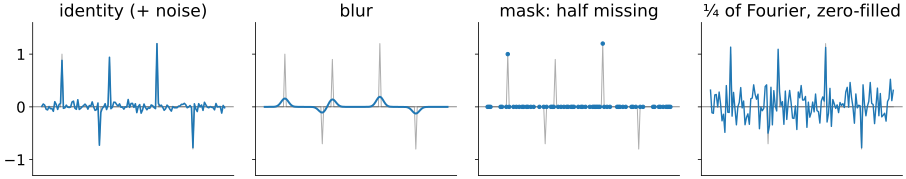
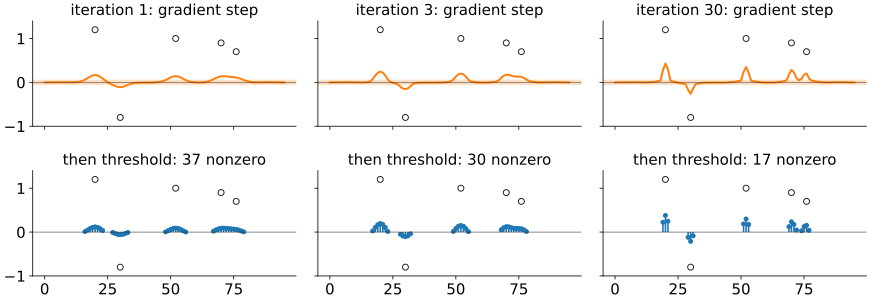
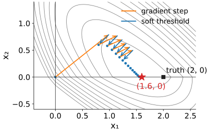
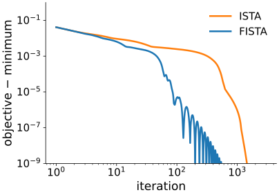
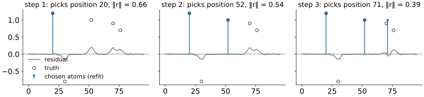
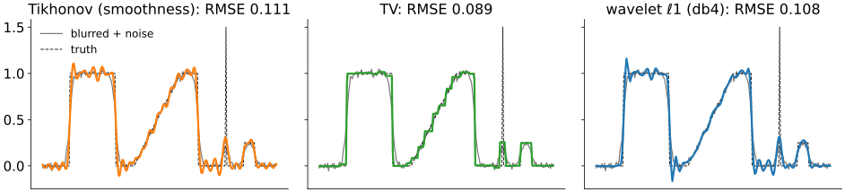
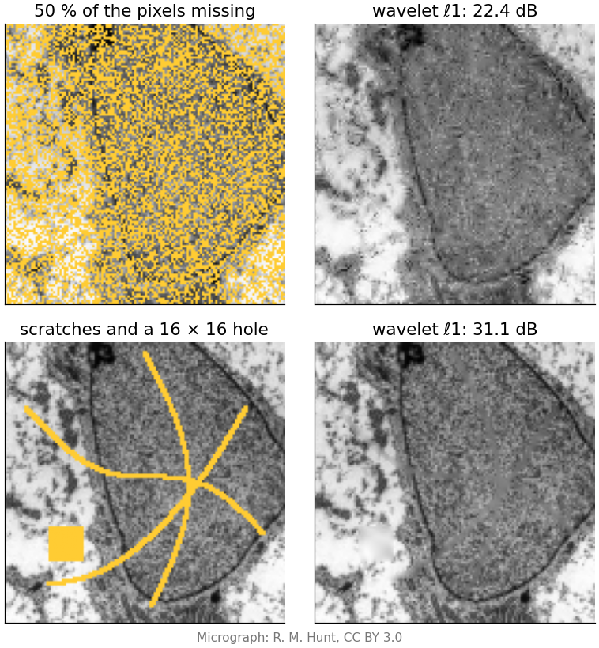
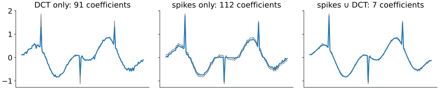

## About this lecture

In an orthonormal basis the ℓ1 problem has a one-line answer: soft-threshold every coefficient. Real problems blur, mask and undersample, and then it does not. Today: how to solve

$$\min_{\mathbf x}\ \tfrac12\|A\mathbf x - \mathbf y\|^2 + λ\|\mathbf x\|_1$$

for any forward operator $A$.

- **ISTA**: a gradient step on the data, then a soft threshold. Repeat. **FISTA**: the same with momentum.
- **Orthogonal matching pursuit** (OMP): pick atoms greedily, refit.
- **Deconvolution** and **inpainting** with a sparsity prior: the same problem with different $A$.
- **Redundant dictionaries**: two bases at once.

*Slides titled **The math** give the formulas and proofs; the ideas are complete without them.*

::: notes
Second unit of the sparse representations day. Needs [sparsity](../sparsity/lec.qmd) (the penalties, the lasso, λ_max) and the deconvolution day's [regularisation unit](../regularise/lec.qmd) (data + λ·penalty, Landweber iterations, choosing λ). This unit owns the solvers (proximal steps, ISTA/FISTA, OMP) and inpainting as an inverse problem with a mask operator; the TV prior is recalled from the Ising day ([gmrf](../gmrf/lec.qmd)), choosing λ from [regularise](../regularise/lec.qmd). Diffusion, TV and exemplar inpainting are owned by [inpainting](../inpainting/lec.qmd) (day 10) and only pointed to here.
:::

## No one-line answer any more

:::: {.columns}
::: {.column width="40%"}
The same sparse signal (grey) seen through four forward operators:

- **identity** with noise: denoising, thresholding is exact;
- **blur**: deconvolution;
- **mask**: missing samples, inpainting;
- **few Fourier coefficients**: undersampling (next unit).

Write the image as $\mathbf x = W\mathbf c$ with sparse coefficients $\mathbf c$ (synthesis) and fold $W$ into the operator: the unknowns are $\mathbf c$, the matrix is $AW$. Its columns are no longer orthonormal, so the coefficients interact.
:::
::: {.column width="60%"}
{width="100%" fig-alt="Four panels with the same five-spike signal in grey. Identity: the spikes plus small noise. Blur: smooth bumps. Mask: dots at the half of the positions that are kept. A quarter of the Fourier coefficients: the spikes buried in noise-like ripples."}
:::
::::

## Recall: data + λ·penalty, and Landweber

From [Regularisation: what we add, and how much](../regularise/lec.qmd):

- Restoration = **minimise misfit + λ·penalty**; λ trades fidelity against prior; the discrepancy principle and the L-curve choose it. Nothing changes about choosing λ today.
- **Landweber iteration**: a gradient step on the misfit,
$$\mathbf x \leftarrow \mathbf x + τA^\top(\mathbf y - A\mathbf x):$$
predict the data, compare, push the error back with $A^\top$.

New today: the penalty is **ℓ1**, which has a kink at 0. A gradient step alone cannot produce exact zeros, so we add one more operation.

## ISTA in one sentence

"**Fit a bit better, then make it simpler.**" Take a Landweber step, then soft-threshold every coefficient at τλ. Repeat.

{width="88%" fig-align="center" fig-alt="ISTA on a blurred signal with five spikes (circles). Top row: after the gradient step of iterations 1, 3 and 30, a smooth curve with a shaded band of plus or minus τλ. Bottom row: after the threshold, 37, 30 and 17 nonzero coefficients, concentrating near the true spikes."}

The gradient step spreads energy around (it is a blurred correction); the threshold removes everything inside the band ±τλ. Iteration by iteration the support shrinks towards the spikes.

::: notes
Iterative shrinkage-thresholding algorithm (Daubechies, Defrise & De Mol 2004). Blur σ = 2, noise 0.01, λ = 0.05, τ = 1 (L = 1 for a normalised blur). Nonzero counts 37, 30, 17 after iterations 1, 3 and 30 (tools/figs/ista/figs.py). Many iterations are needed with a blur: next slides.
:::

## By hand: two unknowns

$A = \begin{pmatrix}1 & 0.5\\ 0.5 & 1\end{pmatrix}$, $\mathbf y = (2, 1)$ (the truth was (2, 0)), λ = 0.5, step τ = 0.4, start at 0.

| $k$ | gradient step $\mathbf z = \mathbf x + τA^\top(\mathbf y - A\mathbf x)$ | threshold at τλ = 0.2 | objective |
|---|---|---|---|
| 1 | (1.00, 0.80) | (0.80, 0.60) | 1.105 |
| 2 | (1.16, 0.78) | (0.96, 0.58) | 1.053 |
| 3 | (1.248, 0.706) | (1.048, 0.506) | 1.022 |
| … | | | |
| ∞ | | **(1.6, 0)** | **0.900** |

- ℓ1 finds the right **support**: $x_2 = 0$. The value 1.6 instead of 2 is the **shrinkage bias** of the last unit.
- Ridge with the same λ: (1.15, 0.48), no zero.

## Step size

- Each step uses the gradient of the misfit. Too long a step overshoots, as in gradient descent for [neural networks](../backprop/lec.qmd).
- Safe: τ ≤ 1/L, where L is the **largest gain** of $A^\top A$ (its largest eigenvalue). Then the objective never increases.
- Above 2/L the iteration is **unstable**: errors along the strongest direction grow at every step (FISTA blows up quickly; in plain ISTA the threshold sometimes keeps it in check, but nothing guarantees it).
- Examples: the by-hand matrix has L = 2.25, so τ ≤ 0.44 (τ = 0.4 above). A blur that keeps the mean has largest gain $|H|^2 = 1$ at frequency 0, so τ = 1. Keeping some Fourier coefficients or some pixels also has L = 1.
- L of a general operator: a few iterations of the power method ($\mathbf v \leftarrow A^\top A\mathbf v$, normalise).

## The math: the proximal operator {.math}

For a penalty $g$ and a step τ, the **proximal operator** is the denoising problem
$$\mathrm{prox}_{τg}(\mathbf v) = \arg\min_{\mathbf x}\ \tfrac12\|\mathbf x - \mathbf v\|^2 + τg(\mathbf x).$$

- $g = λ\|\cdot\|_1$: it separates into scalars, each a soft threshold at τλ ([shrinkage](../shrinkage/lec.qmd), [sparsity unit](../sparsity/lec.qmd)).
- $g$ = the indicator of $\mathbf x \ge 0$ (0 if feasible, ∞ otherwise): **clipping** at 0.
- $g = \frac{λ}{2}\|\mathbf x\|^2$: shrink by $1/(1 + τλ)$.
- $g$ = λ·TV: a TV denoiser (the [Ising day](../gmrf/lec.qmd)'s TV denoising), computed by its own inner iteration.

The **proximal gradient** method alternates $\mathbf z = \mathbf x + τA^\top(\mathbf y - A\mathbf x)$ and $\mathbf x = \mathrm{prox}_{τg}(\mathbf z)$; ISTA is the case $g = λ\|\cdot\|_1$.

## The math: ISTA minimises an upper bound {.math}

Let $h(\mathbf x) = \tfrac12\|A\mathbf x - \mathbf y\|^2$, $\nabla h = A^\top(A\mathbf x - \mathbf y)$, and $L \ge \|A\|^2$. For any $\mathbf x_k$:
$$h(\mathbf x) \le h(\mathbf x_k) + \nabla h(\mathbf x_k)^\top(\mathbf x - \mathbf x_k) + \tfrac L2\|\mathbf x - \mathbf x_k\|^2,$$
with equality at $\mathbf x = \mathbf x_k$ (the difference is $\tfrac12(\mathbf x - \mathbf x_k)^\top(LI - A^\top A)(\mathbf x - \mathbf x_k) \ge 0$).

- Completing the square, bound + λ‖x‖₁ $= \tfrac L2\|\mathbf x - (\mathbf x_k - \tfrac1L\nabla h)\|^2 + λ\|\mathbf x\|_1 + $ const: its minimiser is the soft threshold of the gradient step at λ/L. That is one ISTA step with τ = 1/L.
- Minimising an upper bound that touches at $\mathbf x_k$ cannot increase the objective (**majorise–minimise**).
- A fixed point $\mathbf x = \mathrm{soft}(\mathbf x + τA^\top\mathbf r, τλ)$ satisfies exactly the lasso optimality conditions of the last unit.

## Soft thresholding is the "proximal step"

:::: {.columns}
::: {.column width="48%"}
The two half-steps of the by-hand example in the plane (contours of the full objective):

- **orange**: the gradient step ignores the penalty and moves downhill on the misfit;
- **blue**: the threshold solves the penalty part exactly, and **snaps** $x_2$ to 0 once it is small enough.

The same split works for any penalty whose own "denoising step" is easy: non-negativity (clip at 0), TV (a TV denoiser), even a learned denoiser ([dictionaries unit](../dictionaries/lec.qmd), [diffusion priors](../diffusion-inverse/lec.qmd)).
:::
::: {.column width="52%"}
{width="100%" fig-alt="Contours of the objective in the (x1, x2) plane. From the origin, orange arrows (gradient steps) alternate with blue arrows (thresholds) in a zigzag that reaches the x1 axis and then slides along it to the minimum (1.6, 0), marked with a red star; the truth (2, 0) is a black square."}
:::
::::

## FISTA: momentum

:::: {.columns}
::: {.column width="50%"}
ISTA crawls when $A$ is ill-conditioned (a blur): the gradient step is short in the directions that the blur damps.

**FISTA** (Beck & Teboulle 2009): take the next step from an **extrapolated** point, a bit beyond the current iterate in the direction it was moving.

- Same cost per iteration (one $A$, one $A^\top$, one threshold).
- Far fewer iterations: on the blurred spike signal, to reach the minimum within $10^{-6}$: ISTA **993**, FISTA **121**.
- Not monotone: the objective can wiggle on its way down.
:::
::: {.column width="50%"}
{width="100%" fig-alt="Objective minus its minimum against the iteration, log-log. ISTA (orange) decreases slowly and reaches 1e-6 after about a thousand iterations; FISTA (blue) drops much faster with small oscillations and reaches 1e-6 after about 120 iterations."}
:::
::::

## The math: convergence rates {.math}

With $f = h + λ\|\cdot\|_1$, minimum $f^\star$ at $\mathbf x^\star$, and τ = 1/L:

- **ISTA**: $f(\mathbf x_k) - f^\star \le \dfrac{L\|\mathbf x_0 - \mathbf x^\star\|^2}{2k}$. Error ∝ 1/k.
- **FISTA**: $t_1 = 1$, $t_{k+1} = \dfrac{1 + \sqrt{1 + 4t_k^2}}{2}$,
$$\mathbf z_{k+1} = \mathbf x_k + \frac{t_k - 1}{t_{k+1}}(\mathbf x_k - \mathbf x_{k-1}),\qquad \mathbf x_{k+1} = \mathrm{soft}\big(\mathbf z_{k+1} + τA^\top(\mathbf y - A\mathbf z_{k+1}),\ τλ\big),$$
and $f(\mathbf x_k) - f^\star \le \dfrac{2L\|\mathbf x_0 - \mathbf x^\star\|^2}{(k + 1)^2}$. Error ∝ 1/k², which is optimal for first-order methods (stated).
- For 10⁻⁴ accuracy: about 10⁴ ISTA iterations against 10² FISTA iterations, if the constants are similar.

## A greedy alternative: matching pursuit

:::: {.columns}
::: {.column width="42%"}
**Orthogonal matching pursuit** (OMP) aims at ℓ0 directly, greedily:

1. Pick the atom (column) **most correlated** with the residual.
2. **Refit** all chosen atoms by least squares.
3. Update the residual; stop at $K$ atoms or when the residual reaches the noise level.

By hand ($A$, $\mathbf y$ as before): correlations $\mathbf a_j^\top\mathbf y$ = 2.5 and 2 → atom 1; refit $x_1 = 2$; residual (0, 0). Done: **(2, 0)**, exact, no shrinkage.

Fails when two atoms are similar: on the right, step 3 picks position 71, **between** the true spikes at 70 and 76, and never undoes it.
:::
::: {.column width="58%"}
{width="100%" fig-alt="Three OMP steps on the blurred five-spike signal. Step 1 picks position 20 (residual norm 0.66), step 2 position 52 (0.54), step 3 position 71 (0.39), between the true spikes at 70 and 76. Blue stems: the refitted atoms; grey: the residual; circles: the truth."}
:::
::::

## The math: OMP {.math}

At step $k$ with support $S$ (columns $A_S$):

- Refit: $\mathbf x_S = (A_S^\top A_S)^{-1}A_S^\top\mathbf y$ (normal equations on the support).
- Then $A_S^\top\mathbf r = 0$: the residual is **orthogonal** to every chosen atom, so the same atom is never picked twice (unlike plain matching pursuit, which only subtracts the projection on the newest atom).
- Selection uses normalised correlations $|\mathbf a_j^\top\mathbf r|/\|\mathbf a_j\|$.
- Guarantee (Tropp 2004): with unit-norm columns and **mutual coherence** $μ = \max_{i\ne j}|\mathbf a_i^\top\mathbf a_j|$, OMP (and ℓ1) recover every $K$-sparse $\mathbf x$ from $A\mathbf x$ if $K < \tfrac12(1 + 1/μ)$. Similar atoms mean large μ and small guaranteed $K$; this links to the next unit.

## Try it: ISTA, FISTA and OMP

```{=html}
<link rel="stylesheet" href="../demos/dist/demo.css">
<div data-demo="ista1d" data-preset="fista"></div>
<script src="../demos/dist/ista1d.js"></script>
```

::: notes
Top: truth (black), data (grey), estimate (blue). Middle: coefficients as stems: green on the true support, red false atoms, open circles the true values (red open circles: missed). Bottom left: objective minus its minimum for ISTA and FISTA (log-log); bottom right: error against λ/λmax with the current λ. Tour: "identity: ISTA = one soft threshold" (one iteration solves it). "Blur: ISTA needs many steps" (20 iterations of ISTA, compare the gap curves). "FISTA vs ISTA" (100 iterations). "Step size too large" (τL = 2.2): the objective explodes. "OMP is exact here" (DCT-sparse signal with 60 % missing, no noise). "OMP commits to the wrong atom" (two spikes 4 apart under blur σ = 3: OMP picks the middle). "Shrinkage bias and debiasing": tick debias. "Spikes + sines need both bases": switch the dictionary to DCT only or spikes only and watch the number of coefficients. The "step (½ ISTA)" button shows the gradient step and the threshold as separate frames.
:::

## Deconvolution with a sparsity prior

:::: {.columns}
::: {.column width="38%"}
Recall [deconvolution](../deconv/lec.qmd): Tikhonov smooths, so steps blur and ring. A blurred, noisy profile (blur σ = 3, noise 0.02), each prior with its best λ:

| prior | RMSE |
|---|---|
| none (blurred input) | 0.126 |
| Tikhonov (smoothness) | 0.111 |
| wavelet ℓ1 (db4) | 0.108 |
| TV | **0.089** |

- TV fits this mostly piecewise-constant profile best, but **staircases the ramp**.
- No prior restores the spike to its height: the blur removed what no prior can bring back.
- λ is chosen as in [regularisation](../regularise/lec.qmd) (here: by the true error, for comparison).
:::
::: {.column width="62%"}
{width="100%" fig-alt="Three panels: the blurred noisy profile (grey), the truth (dashed) and the restoration. Tikhonov (orange): rounded edges with ripples, RMSE 0.111. TV (green): sharp flat plateaus, the ramp turned into a staircase, RMSE 0.089. Wavelet ℓ1 (blue): sharper edges than Tikhonov with small ripples, RMSE 0.108. None of them recovers the full height of the narrow spike."}
:::
::::

::: notes
Profile of 256 samples: a plateau, a ramp, a second plateau, a single-sample spike of height 1.5 and a small bump of height 0.25. Each prior's λ minimises the RMSE over a grid (tools/figs/ista/data.ts; FISTA, 600 iterations; db4 with 8-fold cycle spinning). The small bump survives in all three at about its height (0.25–0.28). The ranking depends on the signal: TV wins on cartoons, wavelets on smooth-with-edges, which is why the next demo lets you switch.
:::

## Inpainting is an inverse problem

:::: {.columns}
::: {.column width="50%"}
The forward operator **keeps** the known pixels and drops the rest: $A$ = a mask.

- Least squares has **no opinion** about the missing pixels: they are the **null space** of $A$ (recall [ill-posed problems](../illposed/lec.qmd)). Any value fits the data equally well.
- A sparsity prior fills them with the **sparsest continuation**: ISTA alternates "put the known pixels back" with "threshold the wavelet coefficients".
- Works for scattered missing pixels and thin scratches. **Fails for holes larger than the atoms**: the 16 × 16 square on the right is filled with a smooth blur.

Patch dictionaries do better ([dictionaries unit](../dictionaries/lec.qmd)); classical diffusion and exemplar inpainting is in [filling holes](../inpainting/lec.qmd); diffusion-model priors fill large holes with plausible but invented content ([diffusion priors](../diffusion-inverse/lec.qmd)).
:::
::: {.column width="50%"}
{width="88%" fig-alt="Top: a micrograph crop with 50 % of the pixels missing (yellow), and its wavelet ℓ1 reconstruction (22.4 dB). Bottom: the same crop with three thin curved scratches and a 16 by 16 square hole, and the reconstruction (31.1 dB): the scratches vanish, the square is filled with a smooth grey patch."}
:::
::::

::: notes
FISTA, 150 iterations, db4 with 4 levels, λ = 0.5, cycle spinning over 4 shifts, start: the known pixels with the holes set to their mean (PSNR of that start: 16.5 dB for the random mask, 24.6 dB for the scratches). Micrograph credit: R. M. Hunt, CC BY 3.0.
:::

## Try it: restoring images with a sparsity prior

```{=html}
<link rel="stylesheet" href="../demos/dist/demo.css">
<div data-demo="sparserestore" data-preset="wavelet" data-priors="none tikhonov haar db4 tv"></div>
<script src="../demos/dist/sparserestore.js"></script>
```

::: notes
Observed, restored, error (blue: too dark, red: too bright) and PSNR against the iteration (dashed: the observed image). Tour: "deblur: Tikhonov rings" then "deblur: wavelet ℓ1 does not" (shapes, blur σ = 2, noise 5); compare the error maps around the edges. Switch the prior to "none": least squares amplifies the noise more with every iteration (semi-convergence, recall regularise/). "TV: cartoon" on the micrograph. "λ too large: texture gone" on the texture image. "50 % of the pixels missing", "a scratch is fine, a large hole is not", "remove the text": inpainting with the mask operator.
:::

## Redundant dictionaries

:::: {.columns}
::: {.column width="40%"}
Some signals are sparse in **no single basis**: a few spikes **plus** a few slow cosines.

- In the DCT, the spikes need many coefficients; in the pixel basis, the cosines do.
- In the **union** of the two (256 atoms for 128 samples) the signal is 5 atoms. Coding is no longer a change of basis; ISTA or OMP choose the atoms.
- On the right (ℓ1 with each dictionary, same λ): 91, 112 and **7** coefficients.

Image version: spots on a smooth background, or cartoon plus texture: separate them by coding in two dictionaries at once.
:::
::: {.column width="60%"}
{width="100%" fig-alt="A signal made of three spikes and two cosines (grey) with its ℓ1 approximation (blue) in three dictionaries: DCT only, 91 coefficients, ringing at the spikes; spikes only, 112 coefficients; the union of spikes and DCT, 7 coefficients and a close fit."}
:::
::::

## Summary

- ℓ1 problems with any forward operator: **ISTA** = a gradient (Landweber) step on the data, then a **soft threshold** at τλ. The threshold is the **proximal step** of ℓ1; other penalties plug in their own (clip, TV).
- Step τ ≤ 1/L (L = largest gain of $A^\top A$); FISTA adds **momentum**: same cost, far fewer iterations.
- **OMP**: greedy atom selection with refit; no shrinkage bias, but it can commit to a wrong atom when atoms are similar.
- **Deconvolution** and **inpainting** are the same problem with different $A$: a blur, a mask. A sparsity prior fills the null space with the sparsest continuation, which fails for holes larger than the atoms.
- **Redundant dictionaries** make mixtures sparse.
- Next: if a prior can fill missing pixels, can we **measure fewer** on purpose? Compressed sensing.
