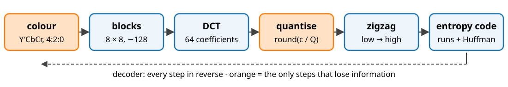
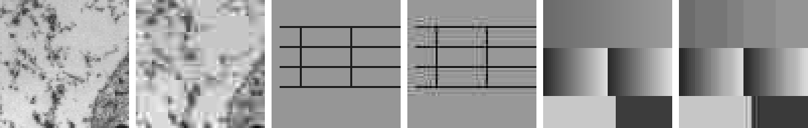

## About this lecture

Everything from the day so far, put together: the DCT of 8 × 8 blocks, a **quantisation table**, zigzag order, run lengths and Huffman codes. That is baseline JPEG (1992), still the most used image format.

- The pipeline step by step, and one block **by hand**.
- The **quality factor**: one number that scales the table.
- **Rate and distortion**: bits against error.
- **Artefacts**: blocking, ringing, colour bleeding, generation loss.
- Measuring quality: **PSNR** (recall) and **SSIM**, and why they can disagree.

*Slides titled **The math** give the formulas and proofs; the ideas are complete without them.*

## The pipeline

{width="100%"}

- **Colour** (colour day): convert R′G′B′ to Y′CbCr (brightness and two colour differences) and halve the colour resolution in both directions (**4:2:0**). The eye sees colour detail poorly.
- **Blocks**: cut each channel into 8 × 8 blocks; subtract 128 so values are centred at 0.
- **DCT** of every block (previous unit).
- **Quantise**, **zigzag**, **entropy code**: the next slides.

Decoding reverses every step. Only **quantisation** (and chroma subsampling) loses information.

## Quantisation: the psychovisual redundancy as a table

Divide each coefficient by its own step $Q_{uv}$ and round: $q_{uv} = \operatorname{round}(c_{uv}/Q_{uv})$. The decoder multiplies back: $q_{uv} Q_{uv}$.

:::: {.columns}
::: {.column width="50%"}
Standard luminance table (top-left corner):

| | 0 | 1 | 2 | 3 | … | 7 |
|---|---|---|---|---|---|---|
| **0** | 16 | 11 | 10 | 16 | … | 61 |
| **1** | 12 | 12 | 14 | 19 | … | 55 |
| **2** | 14 | 13 | 16 | 24 | … | 56 |
| **7** | 72 | 92 | 95 | 98 | … | 99 |
:::
::: {.column width="50%"}
- Small steps at **low** frequencies (top left), large steps at **high** frequencies: the eye barely sees fine detail, so it gets few levels.
- Most high-frequency coefficients become **0**.
- The error of each coefficient is at most $Q_{uv}/2$.
- The **quality factor** $1 \dots 100$ scales the whole table: quality 50 = the table as printed, quality 25: steps × 2, quality 75: steps × ½.
:::
::::

## The math: the quality factor and the quantiser {.math}

- Scaling (the common reference implementation): $s = 5000/q$ for $q < 50$, $s = 200 - 2q$ for $q \ge 50$ (percent), then $Q'_{uv} = \lfloor (Q_{uv} s + 50)/100 \rfloor$, at least 1 (at most 255).
  - $q = 25$: $s = 200$, $Q'_{00} = 32$; $q = 75$: $s = 50$, $Q'_{00} = 8$; $q = 100$: $s = 0$, all steps 1.
- Uniform quantiser with step $\Delta$: the error $c - \Delta\,\operatorname{round}(c/\Delta)$ lies in $[-\Delta/2, \Delta/2]$; for coefficients spread over many steps it is roughly uniform, with variance $\Delta^2/12$ (bit-depth day).
- The DCT is orthonormal, so the squared pixel error of a block is the sum of the squared coefficient errors: $E\|x - \hat x\|^2 \approx \sum_{uv} \min(Q_{uv}^2/12,\ \operatorname{Var} c_{uv})$ (a coefficient quantised to 0 costs its own variance).

## Zigzag and entropy coding

- **Zigzag**: read the 64 quantised values diagonally from the top left. Low frequencies first, so the zeros gather at the end.
- **DC**: coded as the **difference** from the previous block's DC (prediction, lossless unit): neighbouring blocks have similar averages.
- **AC**: each non-zero value becomes a symbol (**run** of zeros before it, **size** = number of bits of the value) + the value's bits. The (run, size) symbols are **Huffman**-coded with standard tables. **EOB** (end of block) says "only zeros from here".
- Example: zigzag `12 −3 2 −1 0 1 0 0 …` after a block with DC 9: DC difference 3; AC symbols (0,2) −3, (0,2) 2, (0,1) −1, (1,1) 1, EOB.

## One block by hand

| position (row, col) | (0,0) | (0,1) | (1,0) | (2,0) | (1,1) | (0,2) | others |
|---|---|---|---|---|---|---|---|
| coefficient $c$ | 190 | −33 | 25 | −15 | 5 | 9 | small |
| step $Q$ (quality 50) | 16 | 11 | 12 | 14 | 12 | 10 | ≥ 10 |
| $q = \operatorname{round}(c/Q)$ | 12 | −3 | 2 | −1 | 0 | 1 | 0 |
| decoded $qQ$ | 192 | −33 | 24 | −14 | 0 | 10 | 0 |

- Zigzag: 12, −3, 2, −1, 0, 1, then 58 zeros. Previous DC 9: DC difference 3.
- Bits with the standard tables: DC `011`+`11` (5), (0,2) −3: `01`+`00` (4), (0,2) 2: `01`+`10` (4), (0,1) −1: `00`+`0` (3), (1,1) 1: `1100`+`1` (5), EOB `1010` (4): **25 bits** for 64 pixels (512 bits raw).
- Largest error: the (1,1) coefficient, 5, below $Q/2 = 6$.

## Try it: JPEG

```{=html}
<link rel="stylesheet" href="../demos/dist/demo.css">
<div data-demo="jpeg" data-preset="q10" data-tab="block"></div>
<script src="../demos/dist/jpeg.js"></script>
```

::: notes
Quality 10 on the cell: 5 021 bytes (13 : 1), PSNR 22.6 dB, SSIM 0.72; the zoom shows flat 8 × 8 blocks in the background. Click a block: its coefficients, the quantised values (mostly 0), zigzag, symbols, bits. Move to quality 90: 34 681 bytes, 36.5 dB, SSIM 0.985: invisible. "Ringing": the test card at quality 25, thin dark lines with ghost copies. "Colour bleeding": the colour card at 4:2:0: the red/blue edge gets a purple fringe. "Flat table, same size": quality 50 vs a flat step 42 at the same size: higher PSNR (27.1 vs 26.7 dB), but visibly different noise. "Recompress 10×": at quality 75 with the grid moved 4 px each time: PSNR falls from 29.8 to 25.1 dB. The rate-distortion tab plots PSNR and SSIM against bits per pixel over all qualities.
:::

## Rate and distortion

- **Rate**: bits per pixel. **Distortion**: e.g. mean squared error. Every codec setting is a point; a **rate–distortion curve** joins them, and codecs are compared by their curves.
- Quantising with step $\Delta$ costs a squared error of about $\Delta^2/12$ per coefficient, unchanged in the image (orthonormal DCT).
- **Halving** $\Delta$: a quarter of the squared error, **+6 dB** of PSNR, and about **one more bit** for each coefficient that is not zero.
- Real codecs add a **dead zone** (a wider zero bin) so that noise-sized coefficients become 0.
- The micrograph: quality 10 → 0.61 bpp, 22.6 dB; quality 50 → 1.75 bpp, 26.7 dB; quality 90 → 4.23 bpp, 36.5 dB.

## The math: six decibels per bit {.math}

- A coefficient spread uniformly over a range $R$, quantised with step $\Delta$: about $\log_2(R/\Delta)$ bits, squared error $\Delta^2/12$.
- Halve $\Delta$: $+1$ bit, squared error $/4$. In decibels: $10 \log_{10} 4 = 6.02$ dB.
- So at high rates $D(R) \approx c \cdot 2^{-2R}$ per coefficient: each extra bit buys 6 dB, for any reasonable coefficient distribution (only the constant $c$ changes).
- Reverse water-filling (rate–distortion theory, Gaussian coefficients with variances $\sigma_k^2$): the best code gives every coefficient the same error $\theta$ and spends nothing on coefficients with $\sigma_k^2 < \theta$. A **flat** table is that strategy for squared error; the JPEG table deliberately departs from it, to match the eye.

## Artefacts

{width="100%"}

Pairs of original | decoded (zoomed 3×): the cell at quality 10, the test card at quality 25 and at quality 10.

- **Blocking**: every block quantised on its own; flat areas become flat 8 × 8 tiles with steps between them.
- **Ringing** (mosquito noise): high frequencies of an edge are quantised away: ripples next to edges and lines (Gibbs, as with the Fourier unit's low-pass).
- **Colour bleeding**: halved colour resolution smears colour across sharp colour edges.
- **Generation loss**: recompressing after an edit or a shift of the 8 × 8 grid adds new errors each time.

## Measuring quality: PSNR and SSIM

- **MSE** and **PSNR** $= 10 \log_{10}(\text{peak}^2/\text{MSE})$ (camera noise unit, bit-depth day): the error energy, pixel by pixel. Easy, and what the transform's Parseval property controls.
- **SSIM** (structural similarity, Wang et al. 2004): compare two images in a small window around each pixel by
  - **luminance**: are the local means equal?
  - **contrast**: are the local standard deviations equal?
  - **structure**: are the local patterns correlated?
- The product is 1 for identical windows; the **SSIM map** shows where structure is lost, its mean is the score.
- They disagree: a brightness shift has a large MSE but keeps all structure (SSIM ≈ 1); blocking or blur with the same MSE destroys structure.

## The math: SSIM {.math}

In a Gaussian window ($11 \times 11$, $\sigma = 1.5$) around each pixel, local means $\mu_x, \mu_y$, variances $\sigma_x^2, \sigma_y^2$, covariance $\sigma_{xy}$:

$$\mathrm{SSIM} = \frac{(2\mu_x\mu_y + C_1)(2\sigma_{xy} + C_2)}{(\mu_x^2 + \mu_y^2 + C_1)(\sigma_x^2 + \sigma_y^2 + C_2)}, \quad C_1 = (0.01 L)^2,\ C_2 = (0.03 L)^2$$

- $L$ = the dynamic range (255 for 8 bit); the constants avoid division by zero in flat regions.
- It is the product of luminance $\frac{2\mu_x\mu_y + C_1}{\mu_x^2 + \mu_y^2 + C_1}$ and contrast–structure $\frac{2\sigma_{xy} + C_2}{\sigma_x^2 + \sigma_y^2 + C_2}$ terms; each is $\le 1$, with equality iff $\mu_x = \mu_y$ (resp. $y - \mu_y = x - \mu_x$ locally).
- A constant offset $y = x + d$: structure term exactly 1, luminance term $1 - \frac{d^2}{\mu_x^2 + \mu_y^2 + C_1}$, close to 1. MSE $= d^2$.

## Try it: same MSE, different quality

```{=html}
<link rel="stylesheet" href="../demos/dist/demo.css">
<div data-demo="samemse" data-mse="144"></div>
<script src="../demos/dist/samemse.js"></script>
```

::: notes
All five have MSE 144 (PSNR 26.6 dB). SSIM: brightness shift 0.996, contrast 0.973, noise 0.884, blur 0.877, JPEG 0.888. Tick "show SSIM maps": the shift and contrast maps are white; noise is uniformly grey; blur and JPEG lose structure at the fine texture. At MSE 400: shift 0.987, blur 0.629. Neither number says whether a cell's intensity or texture measurement survived: that is the next unit.
:::

## Summary

- JPEG: **Y′CbCr + 4:2:0** → **8 × 8 blocks** → **DCT** → **quantise** with a table scaled by the quality factor → **zigzag** → **DC difference, (run, size) + Huffman**.
- Only quantisation and subsampling lose information; the error per coefficient is at most $Q/2$.
- **Rate–distortion**: halving the step costs about one bit per significant coefficient and buys 6 dB.
- Artefacts: **blocking**, **ringing**, **colour bleeding**, **generation loss**.
- **PSNR** measures error energy, **SSIM** local structure; they can disagree, and neither measures what an analysis needs.
