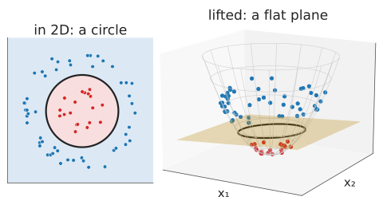
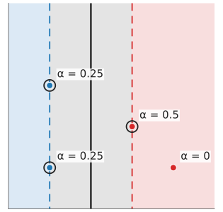
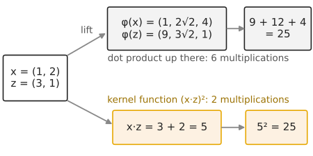
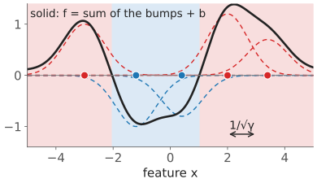
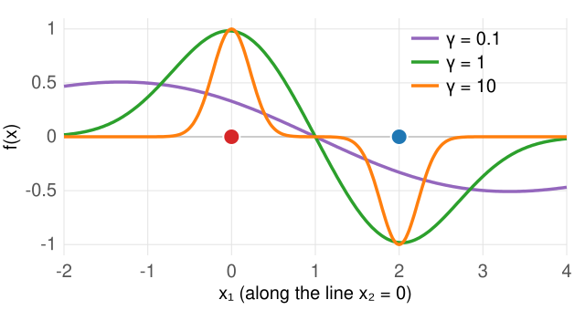
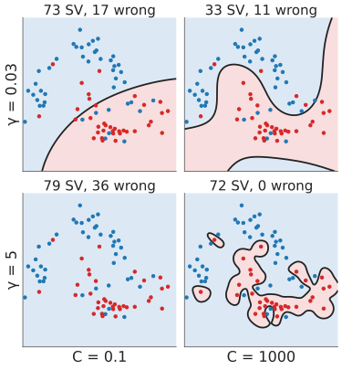

## About this lecture

[Last unit](../maxmargin/lec.qmd): the max-margin **line**. Many problems need a curve ([unit 1](../classify/lec.qmd): XOR, a ring around a blob). This unit gets curves while keeping the line, by working in a **bigger feature space**, and then never writing that space down.

- **Lifting**: add features such as $x_1^2 + x_2^2$; a plane up there is a curve down here.
- The SVM needs only **dot products** between data points.
- Replace them by a **kernel function** $k(\mathbf x, \mathbf z)$: the **kernel trick**.
- The **RBF** kernel function and its length scale $1/\sqrt\gamma$; what large $\gamma$ and large $C$ do.
- What makes a valid kernel function.

*Slides titled **The math** give the formulas and proofs; the ideas are complete without them.*

::: notes
Course convention: "kernel" alone is a convolution kernel (the [filtering unit](../kernels/lec.qmd)). Here it is always "kernel function", a similarity between two feature vectors. The dual is in the math layer; the concept layer needs only "f is a weighted sum of similarities to the support vectors".
:::

## Lift the points, cut with a plane

:::: {.columns}
::: {.column width="50%"}
A ring around a blob: no line separates them in $(x_1, x_2)$.

- Add a third coordinate $x_3 = x_1^2 + x_2^2$ (the squared distance from the centre). Every point is lifted onto a **paraboloid**: the inner points sit low, the ring sits high.
- Now a **flat plane** $x_3 = r^2$ separates them.
- Seen from above, the plane cuts the paraboloid in a **circle**: a curved boundary in 2D from a linear classifier in 3D.
:::
::: {.column width="50%"}
{width="100%" fig-alt="Left: a red blob inside a blue ring, separated by a circle. Right: the same points lifted onto the paraboloid x3 = x1² + x2²; the red points sit low, the blue ring high, and a flat yellow plane between them cuts the paraboloid in the circle."}

The demo's "ring → plane": the max-margin plane in 3D and its cut.
:::
::::

General plan: map $\mathbf x \mapsto \varphi(\mathbf x)$ to more features, fit the max-margin **plane** there. (On this day $\varphi$ is the feature map; on the [neural networks day](../neuralnet/lec.qmd) $\varphi$ was the activation function.)

## Try it: lift and cut

```{=html}
<link rel="stylesheet" href="../demos/dist/demo.css">
<div data-demo="svmlift" data-preset="ring"></div>
<script src="../demos/dist/svmlift.js"></script>
```

::: notes
WebGL. Left: the points and the boundary in 2D; right: the lifted points, the lifted surface and the plane of a linear SVM in 3D, with its cut through the surface (black). Drag the 3D view to rotate. Tour: "ring → plane": rotate to the side view: inner points low, ring high, the plane between. "XOR needs x₁x₂": the saddle map lifts one diagonal up and the other down; switch to the paraboloid map: it does not help. "Two rings": a band in the middle height; no single plane works. "(x₁², √2x₁x₂, x₂²)" is the map of the next slides.
:::

## The cost of explicit features

Lifting works, but the number of features explodes:

- All products of two features (the quadratic map) of a pixel with **20** features: $20 + 20 + 190 = 230$ coordinates ($x_i$, $x_i^2$, $x_ix_j$).
- All monomials up to degree 5: **53 130** coordinates.
- The Gaussian (RBF) similarity below corresponds to **infinitely** many.

We need a way to fit the max-margin plane in such a space **without** computing $\varphi(\mathbf x)$.

## The SVM only needs dot products

:::: {.columns}
::: {.column width="64%"}
A fact from the math layer (next slides): the max-margin solution is a weighted sum over the **support vectors**,

$$f(\mathbf x) = \sum_{i} \alpha_i y_i\, \mathbf x_i\cdot\mathbf x + b, \qquad \alpha_i > 0 \text{ only for support vectors},$$

and the weights $\alpha_i$ are found from the dot products $\mathbf x_i\cdot\mathbf x_j$ of the training points alone.

- Training: needs $\mathbf x_i\cdot\mathbf x_j$ for all pairs. Prediction: needs $\mathbf x_i\cdot\mathbf x$ for the support vectors.
- In a lifted space: replace every $\mathbf x_i\cdot\mathbf x_j$ by $\varphi(\mathbf x_i)\cdot\varphi(\mathbf x_j)$. If that number can be computed **directly** from $\mathbf x_i, \mathbf x_j$, we never need $\varphi$.
:::
::: {.column width="36%"}
{width="100%" fig-alt="The four by-hand points of the last unit with their street; the three support vectors carry weights α = 0.25, 0.25 and 0.5, the fourth point α = 0."}

[Last unit](../maxmargin/lec.qmd)'s example: only the support vectors have $\alpha_i > 0$.
:::
::::

## Kernel functions: the kernel trick

A **kernel function** computes the dot product in a lifted space directly: $k(\mathbf x, \mathbf z) = \varphi(\mathbf x)\cdot\varphi(\mathbf z)$.

:::: {.columns}
::: {.column width="48%"}
**By hand.** $\varphi(\mathbf x) = (x_1^2,\ \sqrt2\,x_1x_2,\ x_2^2)$, $\mathbf x = (1, 2)$, $\mathbf z = (3, 1)$:

- Lifted: $\varphi(\mathbf x) = (1,\ 2\sqrt2,\ 4)$, $\varphi(\mathbf z) = (9,\ 3\sqrt2,\ 1)$, dot product $9 + 12 + 4 = 25$.
- Directly: $\mathbf x\cdot\mathbf z = 3 + 2 = 5$, and $(\mathbf x\cdot\mathbf z)^2 = 25$. The same, with 2 multiplications instead of 6.
:::
::: {.column width="52%"}
{width="100%" fig-alt="Two routes from x = (1, 2) and z = (3, 1) to the number 25: up through the lifted vectors φ(x) and φ(z) and their dot product 9 + 12 + 4, or directly through x·z = 5 squared."}
:::
::::

So $k(\mathbf x, \mathbf z) = (\mathbf x\cdot\mathbf z)^2$ **is** a dot product of quadratic features. The **polynomial kernel function** $(\mathbf x\cdot\mathbf z + c)^p$ covers all monomials up to degree $p$ at the cost of one dot product.

The SVM with $f(\mathbf x) = \sum_i \alpha_i y_i\, k(\mathbf x_i, \mathbf x) + b$ is the max-margin plane in the lifted space: the **kernel trick**. (Not a convolution kernel: "kernel" alone in this course means the filter.)

## The math: Lagrange multipliers {.math}

Recall (equality constraints): at the optimum of $\min g(\mathbf u)$ subject to $h(\mathbf u) = 0$, the gradients are parallel, $\nabla g = \alpha\nabla h$; equivalently, $\mathbf u$ is a stationary point of the **Lagrangian** $g - \alpha h$. (Multipliers are called $\alpha$ here: $\lambda$ is the prior weight course-wide.)

For **inequality** constraints $h_i(\mathbf u) \ge 0$ the multipliers must be $\alpha_i \ge 0$, and **complementary slackness** holds: $\alpha_i\,h_i(\mathbf u) = 0$. In words: **a multiplier is non-zero only where its constraint is tight** (holds with equality).

For the SVM, constraint $i$ is $y_i f(\mathbf x_i) - 1 \ge 0$. It is tight exactly for the points on the edge of the street. So $\alpha_i > 0$ only for **support vectors**.

## The math: the dual problem {.math}

Hard margin. Lagrangian $L = \tfrac12\|\mathbf w\|^2 - \sum_i\alpha_i\left[y_i(\mathbf w\cdot\mathbf x_i + b) - 1\right]$, $\alpha_i \ge 0$. Stationarity:

$$\frac{\partial L}{\partial\mathbf w} = 0 \Rightarrow \mathbf w = \sum_i \alpha_i y_i\mathbf x_i, \qquad \frac{\partial L}{\partial b} = 0 \Rightarrow \sum_i \alpha_i y_i = 0.$$

Substituting back eliminates $\mathbf w$ and $b$:

$$\max_{\boldsymbol\alpha}\ \sum_i\alpha_i - \tfrac12\sum_{i,j}\alpha_i\alpha_j y_iy_j\,\mathbf x_i\cdot\mathbf x_j \quad\text{s.t.}\quad \sum_i\alpha_iy_i = 0,\quad 0 \le \alpha_i \le C.$$

- The data enter **only** through $\mathbf x_i\cdot\mathbf x_j$: replace by $k(\mathbf x_i, \mathbf x_j)$.
- Soft margin: the same, with the extra bound $\alpha_i \le C$ (from the slack multipliers). $\alpha_i = C$: inside the street or wrong; $0 < \alpha_i < C$: on the edge.
- $b$ from any edge point: $y_i f(\mathbf x_i) = 1$. Then $f(\mathbf x) = \sum_i\alpha_iy_i\,k(\mathbf x_i, \mathbf x) + b$.

## The math: how it is solved {.math}

- The dual is a **quadratic program** in $n$ variables with box constraints and one equality: convex, one optimum.
- **SMO** (sequential minimal optimisation; Platt, 1998): change **two** $\alpha$s at a time. Two, because $\sum_i \alpha_iy_i = 0$ forces any change in one to be balanced by another. For a pair the optimum is a 1D quadratic, solved in closed form and clipped to the box $[0, C]$.
- Which pair? The two that violate the optimality conditions most (with a second-order rule: Fan, Chen & Lin, 2005). Stop when no pair violates them by more than a tolerance.
- The kernel matrix $K_{ij} = k(\mathbf x_i, \mathbf x_j)$ is computed once ($n^2$ numbers): fine for a few thousand training points. The demos use this solver.

## The RBF kernel function

:::: {.columns}
::: {.column width="58%"}
The most used kernel function: the **Gaussian** or **RBF** (radial basis function)

$$k(\mathbf x, \mathbf z) = e^{-\gamma\|\mathbf x - \mathbf z\|^2}.$$

- A **similarity**: 1 for identical points, falling to 0 with distance.
- $1/\sqrt\gamma$ is a **length scale**: how far one training point's influence reaches.
- $f(\mathbf x) = \sum_i \alpha_iy_i\,e^{-\gamma\|\mathbf x_i - \mathbf x\|^2} + b$: a **signed sum of Gaussian bumps** on the support vectors. Red bumps up, blue bumps down; the boundary is where they balance.
- Seen before: the graph-cut n-link weight and the normalized-cuts affinity $e^{-\Delta^2/2\sigma^2}$ (the [graph cuts day](../graphcut-seg/lec.qmd)) are this function with $\gamma = 1/(2\sigma^2)$. The **kernel matrix** $K_{ij}$ is that day's affinity matrix $W$.
:::
::: {.column width="42%"}
{width="100%" fig-alt="One feature axis with five support vectors: red ones carry upward Gaussian bumps, blue ones downward bumps (dashed); their sum f (solid) is positive in the red-shaded intervals and negative in the blue one. An arrow marks the length scale 1/√γ."}

In 1D: red bumps up, blue bumps down; the sign of the sum decides.
:::
::::

- Unlike a Gaussian mixture's bumps (the [Gaussian mixtures day](../gaussian-mixture/lec.qmd)), the weights are signed and fitted to **separate**, not to describe the density.

## Two bumps by hand

:::: {.columns}
::: {.column width="50%"}
{width="100%"}
:::
::: {.column width="50%"}
Support vectors $(0, 0)$ with $\alpha y = +1$ and $(2, 0)$ with $\alpha y = -1$, $b = 0$, $\gamma = 1$:

- $f(0.5, 0) = e^{-0.25} - e^{-2.25} = 0.779 - 0.105 = 0.673$: class $+1$.
- $f(1, 0) = e^{-1} - e^{-1} = 0$ and $f(1, 1) = e^{-2} - e^{-2} = 0$: on the boundary, the line $x_1 = 1$.
- At $(0.5, 0)$ with $\gamma = 0.1$: 0.177 (wide, flat bumps); with $\gamma = 10$: 0.082 (narrow bumps, almost nothing reaches).
:::
::::

## Try it: kernel functions in 2D

```{=html}
<link rel="stylesheet" href="../demos/dist/demo.css">
<div data-demo="svm2d" data-preset="ring" data-kernel="linear,poly,rbf" data-kmatrix="1"></div>
<script src="../demos/dist/svm2d.js"></script>
```

::: notes
The same demo as the [last unit](../maxmargin/exercise.qmd), with a kernel-function menu. Tour: "ring": linear: w ≈ 0, 21 errors; polynomial degree 2: a closed curve, 0 errors, 13 support vectors; RBF (γ = 0.32): 0 errors, 15 support vectors. Tick "show the RBF bumps": circles of radius 1/√γ. "XOR: degree 2": linear 38 errors of 80, polynomial degree 2: 0 errors. "γ too large": 79 of 80 points are support vectors, an island around each; lower γ to 1: 35 support vectors, 1 error. "γ too small": the boundary is almost a line (10 errors, like the linear one). Tick "show the kernel matrix": blocks by class; with a large γ it becomes the identity.
:::

## $\gamma$ and $C$ together

:::: {.columns}
::: {.column width="62%"}
| | small $C$ | large $C$ |
|---|---|---|
| **small $\gamma$** (long length scale) | almost a straight line, wide street: **underfits** | still smooth; a few more bends |
| **large $\gamma$** (short length scale) | bumps too narrow to interact, many support vectors | an island around **every** training point: **overfits**, memorises |

- Large $\gamma$: each bump reaches only its own point; with large $C$ every training point is classified correctly, and new points between them get the background value $b$.
- In practice both are chosen by **cross-validation** on a log grid ([next unit](../pixel-classify/lec.qmd)).
:::
::: {.column width="38%"}
{width="100%" fig-alt="The same noisy two-moons data with the RBF boundary for four settings: γ = 0.03 with C = 0.1 (73 support vectors, 17 wrong) and C = 1000 (33, 11 wrong); γ = 5 with C = 0.1 (79, 36 wrong) and C = 1000 (72, 0 wrong, small islands around single points)."}
:::
::::

## What makes a valid kernel function?

A kernel function must behave like a dot product **somewhere**.

- Every kernel matrix $K_{ij} = k(\mathbf x_i, \mathbf x_j)$ must be **symmetric** with **no negative eigenvalues** (positive semidefinite): a negative eigenvalue would be a "negative squared length".
- Example of an invalid "similarity": two points with $k(\mathbf x, \mathbf x) = k(\mathbf z, \mathbf z) = 1$ and $k(\mathbf x, \mathbf z) = 2$. The matrix $\begin{bmatrix}1 & 2\\2 & 1\end{bmatrix}$ has eigenvalues 3 and $-1$. The "squared distance" would be $k(\mathbf x, \mathbf x) + k(\mathbf z, \mathbf z) - 2k(\mathbf x, \mathbf z) = -2$: impossible.
- Building new ones: **sums** and **products** of kernel functions, and positive multiples, are kernel functions.
- A valid kernel function keeps the training problem convex: one optimum.

## The math: Mercer's condition {.math}

- **Mercer**: $k$ is a dot product $\varphi(\mathbf x)\cdot\varphi(\mathbf z)$ in some (possibly infinite-dimensional) space $\iff$ for every finite set of points the kernel matrix is symmetric positive semidefinite. (Stated, not proven.)
- The RBF kernel function's space is infinite-dimensional: $e^{-\gamma\|\mathbf x - \mathbf z\|^2} = e^{-\gamma\|\mathbf x\|^2}e^{-\gamma\|\mathbf z\|^2}\,e^{2\gamma\,\mathbf x\cdot\mathbf z}$, and the Taylor series $e^{2\gamma\,\mathbf x\cdot\mathbf z} = \sum_{p \ge 0} \frac{(2\gamma)^p}{p!}(\mathbf x\cdot\mathbf z)^p$ contains polynomial kernel functions of **every** degree.
- The squared distance in the lifted space is $\|\varphi(\mathbf x) - \varphi(\mathbf z)\|^2 = k(\mathbf x, \mathbf x) + k(\mathbf z, \mathbf z) - 2k(\mathbf x, \mathbf z)$, computable without $\varphi$.

## Summary

- A curved boundary = a **plane in a lifted feature space** $\varphi(\mathbf x)$.
- The SVM needs only **dot products**; a **kernel function** $k(\mathbf x, \mathbf z) = \varphi(\mathbf x)\cdot\varphi(\mathbf z)$ computes them without $\varphi$: the kernel trick. $f(\mathbf x) = \sum_i \alpha_iy_i\,k(\mathbf x_i, \mathbf x) + b$, a sum over the support vectors.
- Polynomial $(\mathbf x\cdot\mathbf z + c)^p$; **RBF** $e^{-\gamma\|\mathbf x - \mathbf z\|^2}$ with length scale $1/\sqrt\gamma$ (the graph-cut affinity with $\gamma = 1/2\sigma^2$).
- Small $\gamma$: almost linear. Large $\gamma$ and $C$: islands, overfitting.
- Valid kernel functions give positive semidefinite kernel matrices.
