## About this lecture

Two photographs of the same thing, taken from different places, at different zoom, turned. Which points can we find in **both**? This unit finds them; the next three units describe them, match them and fit a transform to the matches.

- What makes a good **interest point**: repeatable and distinctive.
- Corners (recall) and why **zoom** breaks a detector with one fixed σ.
- **Keypoints with a scale**: extrema of the difference of Gaussians in $(x, y, \sigma)$, over an **octave pyramid**.
- **Refining** a candidate to sub-pixel position and scale; throwing away weak and **edge-like** candidates.
- An **orientation** for each keypoint, and how to measure a detector: **repeatability**.

*Slides titled **The math** give the formulas and proofs; the ideas are complete without them.*

::: notes
Day plan: detect (this unit) → describe ([descriptors/](../descriptors/lec.qmd)) → match ([feature-matching/](../feature-matching/lec.qmd)) → fit ([feature-alignment/](../feature-alignment/lec.qmd)). Notation for the day: image I, Gaussian scale space L(x, y; σ), DoG D = L(·; kσ) − L(·; σ), structure tensor J with eigenvalues μ1 ≥ μ2, the Hessian of D written ℋ (calligraphic) so that H stays free for the homography of unit 4. A keypoint is (x, y, σ, θ). All images in the demos are synthetic scenes generated from a seed, or the course micrograph.
:::

## The task: find the same points twice

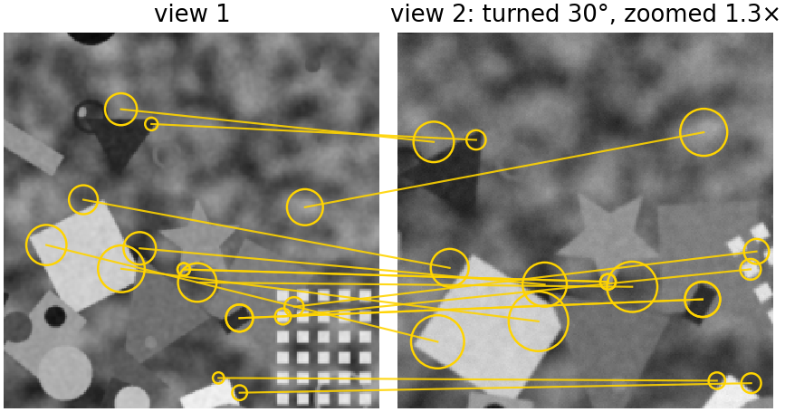{fig-alt="Two views of a synthetic scene with shapes, discs and a grid of squares; the second view is turned by 30 degrees and zoomed 1.3 times. Sixteen keypoints are circled in both views and joined by yellow lines to their partners." width="72%" fig-align="center" .nostretch}

Two requirements: **repeatability** (the detector fires at the same physical point in both views) and **distinctiveness** (its neighbourhood looks unlike the others, so that it can be recognised). Uses: panoramas, slide-scanner tiles with rotation, serial sections, geometry from photographs.

::: notes
A few hundred points per image are enough to align two images. The points do not need to be "meaningful", only findable again. The lines are correct matches from the full pipeline of the day (ratio test 0.7 plus mutual check, verified against the known transform).
:::

## Recall: corners are interest points

From the [structure tensor unit](../structure-tensor/lec.qmd): a window on a **corner** changes under **every** small shift, so it can be found again in a shifted image.

:::: {.columns}
::: {.column width="45%"}
- Structure tensor $J$ (gradients averaged in a window); eigenvalues $\mu_1 \ge \mu_2$.
- Harris: $\det J - k(\operatorname{tr}J)^2$; Förstner / Shi–Tomasi: $\mu_2$.
- Corners survive **shift and rotation**: the eigenvalues of $J$ do not change when the image turns (right: 16 of 22 corners found again after turning by 25°).

The question for today: what happens when the image is **zoomed**?
:::
::: {.column width="55%"}
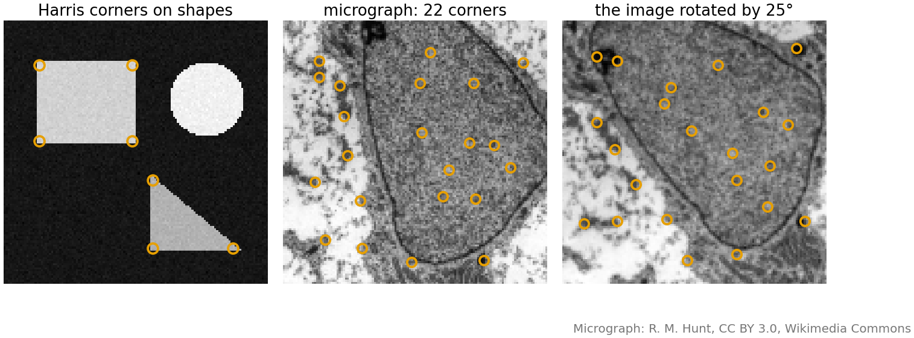{fig-alt="From the structure tensor unit: Harris corners on synthetic shapes, the 22 strongest corners in a crop of the micrograph, and the same crop turned by 25 degrees with 16 of the 22 corners found again." width="100%"}
:::
::::

::: notes
Only a recall: the derivation of Harris from shifting a window is in the structure tensor unit, and so is the figure.
:::

## Try it: corners (recall)

```{=html}
<link rel="stylesheet" href="../demos/dist/demo.css">
<div data-demo="structtensor" data-preset="checker" data-presets="checker,corner,edge"></div>
<script src="../demos/dist/structtensor.js"></script>
```

::: notes
The structure tensor unit's demo, opened on the corners of a checkerboard (Harris tab). If time is short, skip it.
:::

## Zoom breaks a detector with one σ

:::: {.columns}
::: {.column width="58%"}
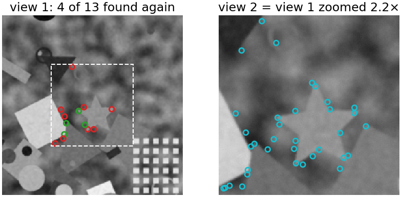{fig-alt="Left: view 1 with Harris corners at sigma 1.5 inside the region that view 2 shows (dashed); 4 of 13 are found again (green), the others not (red). Right: view 2, the same scene zoomed 2.2 times, with its own Harris corners in cyan, at different places." width="100%"}
:::
::: {.column width="42%"}
Harris with derivative scale σ = 1.5 px on a view and its **2.2× zoom**:

- the window is fixed in **pixels**, so it covers a 2.2× smaller piece of the scene in view 2;
- a slightly rounded corner becomes a gentle curve, an edge; small texture corners appear that were invisible before;
- here only **4 of 13** points are found again (31 %).

The same physical structure needs a window **proportional to its size**.
:::
::::

::: notes
Repeatability is defined on slide "Measuring a detector": the fraction of points in the common region found again within 2.5 px. At zoom 2.2 the DoG detector (later in this unit) finds 25 of 31 again (81 %). Numbers from the repeatability demo's code (export script tools/figs/keypoints/export.ts).
:::

## Give each point a scale

:::: {.columns}
::: {.column width="52%"}
From the [scale-space unit](../scale-space/lec.qmd): the **scale-normalised** Laplacian of a blob peaks at a σ proportional to the blob's size.

- Zoom the image by $s$: the peak moves from σ to $s\sigma$, and the position from $(x, y)$ to $(sx, sy)$.
- So a detection is a point in $(x, y, \sigma)$: a **local extremum** over position **and** scale (26 neighbours in a 3 × 3 × 3 cube).
- The scale is **measured**, not chosen. It sets the size of the window that the [next unit](../descriptors/lec.qmd) describes.
:::
::: {.column width="48%"}
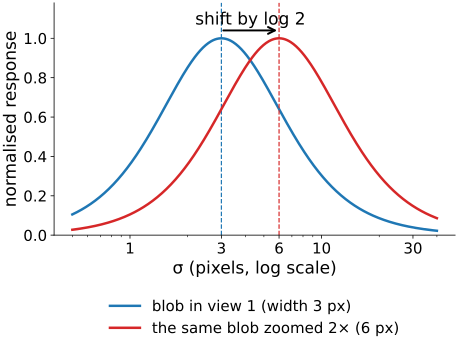{fig-alt="Normalised blob response against sigma on a log axis for a blob of width 3 px (peak at 3) and the same blob zoomed twice (peak at 6): the same curve shifted by log 2." width="100%"}
:::
::::

## The math: scale covariance {.math}

Zoom by $s$: $I_2(\mathbf x) = I_1(\mathbf x/s)$. Blurring commutes with the zoom if σ is scaled too:

$$L_2(\mathbf x; \sigma) = L_1(\mathbf x/s;\ \sigma/s).$$

- Each derivative brings a factor $1/s$: $\nabla^2 L_2(\mathbf x; \sigma) = s^{-2}\,\nabla^2 L_1(\mathbf x/s; \sigma/s)$.
- With the normalisation $\sigma^2$: $\ \sigma^2\nabla^2 L_2(\mathbf x; \sigma) = (\sigma/s)^2\,\nabla^2 L_1(\mathbf x/s; \sigma/s)$. The two functions are **the same function** after the change of variables $(\mathbf x, \sigma) \to (\mathbf x/s, \sigma/s)$, so every extremum at $(\mathbf x, \sigma)$ in image 1 appears at $(s\mathbf x, s\sigma)$ in image 2.
- Without $\sigma^2$, the response falls like $\sigma^{-2}$ and the extrema over σ are pulled to the smallest scale: the wrong scale (the scale-space unit's "Why scale-normalise").
- The DoG is already normalised: $D = L(\cdot; k\sigma) - L(\cdot; \sigma) \approx (k - 1)\,\sigma^2\nabla^2 L$ (scale-space unit, "DoG ≈ LoG").

## The octave pyramid

:::: {.columns}
::: {.column width="45%"}
Computing many blurs of a large image is expensive. Organise them in **octaves** (a doubling of σ):

- blur in steps of $k = 2^{1/S}$, e.g. $S = 3$ steps per octave;
- subtract neighbours: $S + 2$ DoGs; look for extrema on the $S$ inner levels;
- after a doubling of σ, **keep every second pixel** (blur before downsampling: the image is already blurred enough);
- the whole pyramid costs about **4/3** of the first octave.

Often the first octave is computed on a 2× **upsampled** image, to catch the smallest blobs.
:::
::: {.column width="55%"}
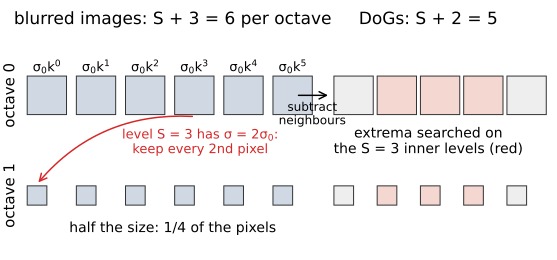{fig-alt="Diagram: octave 0 with six blurred images (sigma0 times k to the 0 ... 5) and five DoGs, the three inner DoGs marked red as the levels searched for extrema; an arrow from the fourth blurred image (sigma 2 sigma0) down to octave 1, which has the same structure at half the size." width="100%"}
:::
::::

## The math: octaves {.math}

- Levels $\sigma_i = \sigma_0 k^i$ with $k = 2^{1/S}$, $i = 0, \dots, S + 2$: **$S + 3$ blurred images**, $S + 2$ DoGs $D_i = L_{i+1} - L_i$. An extremum needs a DoG below and above, so the $S$ levels $1 \dots S$ are searched, and together the octaves cover every scale once.
- Incremental blur (the semigroup property of Gaussians, recall): $L_{i+1} = G_{\sqrt{\sigma_{i+1}^2 - \sigma_i^2}} * L_i$, and $\sqrt{\sigma_{i+1}^2 - \sigma_i^2} = \sigma_i\sqrt{k^2 - 1}$.
- Level $S$ has $\sigma_S = 2\sigma_0$: subsampled by 2 it is the start of the next octave, with $\sigma_0$ in the new pixels.
- Cost: an octave has $1/4$ of the pixels of the one before, $1 + \tfrac14 + \tfrac1{16} + \dots = \tfrac43$.
- With $\sigma_0 = 1.6$, $S = 3$: $\sigma = 1.60, 2.02, 2.54, 3.20, 4.03, 5.08$ in octave 0; a keypoint in octave $o$, level $\ell$ has $\sigma = \sigma_0\,2^{o + \ell/S}$ in original pixels.

## Try it: the DoG pyramid, step by step

```{=html}
<link rel="stylesheet" href="../demos/dist/demo.css">
<div data-demo="dogpyramid" data-preset="octave"></div>
<script src="../demos/dist/dogpyramid.js"></script>
```

::: notes
192 × 192 synthetic image: discs (radius 3, 6, 12) and squares (3, 6, 12 half sides), bright and dark, on a ramp; a long bar whose brightness varies along it; noise 2. Left: the DoGs of each octave (192², 96², 48², 24², 12²); "step" builds them one by one. Middle: the selected level with its candidates by stage. The preset shows octave 0 only (12 candidates); press "all": with S = 3, contrast 3, r = 10 there are 24 candidates, 2 unstable, 2 too weak, 9 on an edge, 11 kept. Tour: "the bar gives edge candidates" (r off): five candidates along the bar on level 1 of octave 0, tr²/det about 20; "edge test removes them" (r = 10, limit 12.1). "S = 1": the three small discs (radius 3, σ ≈ 2) are no longer found, because they fall between the coarse levels. Click a candidate to see its 3 × 3 × 3 neighbourhood.
:::

## Refining a candidate

:::: {.columns}
::: {.column width="50%"}
The true extremum lies **between** the samples, in position and in scale.

- Fit a parabola through the samples around the candidate, along $x$, $y$ and σ (in 3D: a quadratic through the 3 × 3 × 3 cube).
- Its vertex gives the **sub-pixel position** and the **sub-level scale**.
- If an offset is larger than half a sample, move to that neighbour and fit again; a candidate that keeps moving is dropped.

Example: DoG samples 0.6, 1.0, 0.8 at $x = -1, 0, 1$: peak at $x = +0.17$, value 1.008. The same three-point rule as in [spot localisation](../spot-fit/lec.qmd).
:::
::: {.column width="50%"}
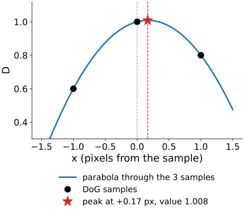{fig-alt="Three DoG samples 0.6, 1.0 and 0.8 at x = -1, 0 and 1, the parabola through them, and its peak marked at x = +0.17 with value 1.008." width="100%"}
:::
::::

## The math: sub-pixel refinement {.math}

Expand $D$ around the sample $\mathbf x_0$ to second order, with $\mathbf h = (h_x, h_y, h_\sigma)$:

$$D(\mathbf x_0 + \mathbf h) \approx D + \nabla D^\top\mathbf h + \tfrac12\,\mathbf h^\top\mathcal H\,\mathbf h .$$

- Setting the gradient in $\mathbf h$ to zero: $\nabla D + \mathcal H\hat{\mathbf h} = 0$, so $\hat{\mathbf h} = -\mathcal H^{-1}\nabla D$.
- Peak value: $D(\hat{\mathbf h}) = D + \nabla D^\top\hat{\mathbf h} + \tfrac12\hat{\mathbf h}^\top\mathcal H\hat{\mathbf h} = D + \tfrac12\nabla D^\top\hat{\mathbf h}$ (because $\mathcal H\hat{\mathbf h} = -\nabla D$).
- $\nabla D$ and the 3 × 3 Hessian $\mathcal H$ by central differences in the cube, e.g. $D_x = (D_{+1} - D_{-1})/2$, $D_{xx} = D_{+1} - 2D_0 + D_{-1}$.
- In 1D: $\hat h = \dfrac{D_{-1} - D_{+1}}{2(D_{-1} - 2D_0 + D_{+1})}$; for 0.6, 1.0, 0.8: $\hat h = -0.2 / (2 \cdot (-0.6)) = 1/6$.

## Throw away weak and edge-like candidates

:::: {.columns}
::: {.column width="45%"}
- **Low contrast**: $|D|$ at the refined peak below a threshold: an extremum of noise. The threshold scales with the noise (as in [How many false spots?](../spot-threshold/lec.qmd)).
- **Edges**: the DoG also responds **along** an edge or a line. There the position along the edge is undefined (the aperture problem again), so the point cannot be found again reliably.
- Test: the curvature across the edge is large, the curvature along it small. Reject if their **ratio** exceeds $r$ (typically 10).

Right: along the bar every candidate is edge-like (orange): removed. Blobs and corners of small squares stay.
:::
::: {.column width="55%"}
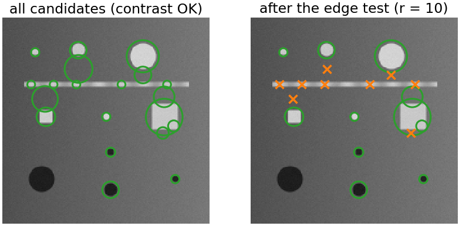{fig-alt="The DoG test image twice. Left: all candidates that pass the contrast test, including five along the long bar. Right: after the edge test with r = 10 the bar candidates are crossed out in orange; the discs and squares keep their green circles." width="100%"}
:::
::::

## The math: the edge test {.math}

At the refined point take the 2 × 2 **spatial** Hessian of $D$, $\mathcal H_2 = \begin{pmatrix} D_{xx} & D_{xy}\\ D_{xy} & D_{yy}\end{pmatrix}$ (recall the [Hessian unit](../hessian/lec.qmd): eigenvalues = principal curvatures).

- Eigenvalues $\alpha = r\beta$ with $r \ge 1$: $\dfrac{\operatorname{tr}^2}{\det} = \dfrac{(\alpha + \beta)^2}{\alpha\beta} = \dfrac{(r + 1)^2}{r}$, which grows with $r$.
- So **keep** if $\det \mathcal H_2 > 0$ and $\operatorname{tr}^2/\det < (r + 1)^2/r$: 12.1 for $r = 10$. No eigenvalues needed.
- $\det < 0$: the curvatures have opposite signs, a saddle: reject.
- Examples: $\mathrm{diag}(-4, -3)$: $49/12 = 4.1$, keep. $\mathrm{diag}(-10, -0.5)$: $110.25/5 = 22.1$, reject (a ridge).

## An orientation for each keypoint

:::: {.columns}
::: {.column width="45%"}
- Around the keypoint (a disc of radius ∝ σ), a **histogram of gradient directions** in 36 bins of 10°, each gradient weighted by its magnitude and a Gaussian window.
- The highest peak is the **orientation** θ.
- A second peak above **80 %** of the highest gives a **second keypoint** at the same place (about 15 % of points in photographs; 45 % in our synthetic scene, whose round blobs have no single direction).
- Rotate the image by φ: every gradient turns by φ, the histogram shifts, θ turns by φ. Describing the window **relative to θ** removes rotation.
:::
::: {.column width="55%"}
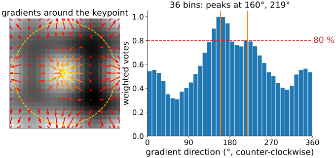{fig-alt="Left: a keypoint's neighbourhood with gradient arrows and the Gaussian window as a dashed circle. Right: its 36-bin histogram of gradient directions; the highest bar near 160 degrees and a second peak near 219 degrees above the 80 percent line." width="100%"}
:::
::::

## The math: orientation and repeatability {.math}

- Orientation histogram: bin $b$ collects $\|\nabla L\|\,e^{-\|\mathbf x - \mathbf x_0\|^2/2(1.5\sigma)^2}$ for every pixel with $\theta = \operatorname{atan2}(-L_y, L_x)$ (counter-clockwise on the screen) in that bin, on the blurred image of the keypoint's level; the peak is refined by the three-point parabola, now on a circle (bins wrap around).
- Repeatability of a detector under a **known** transform $T$ (image 1 → 2):

$$\mathrm{rep} = \frac{\#\{i : \exists j,\ \|T\mathbf x_i - \mathbf y_j\| < \varepsilon,\ |\log(s\sigma_i/\sigma_j)| < \delta\}}{\min(n_1, n_2)},$$

counted only in the region seen by both images, each point of image 2 used once; $s$ is the zoom of $T$. Single-scale detectors skip the scale condition.

## What a keypoint is now

:::: {.columns}
::: {.column width="62%"}
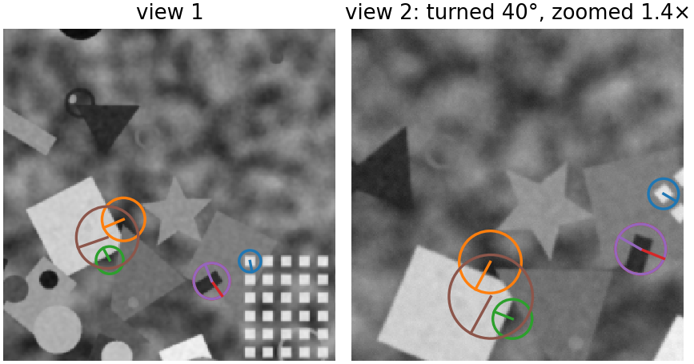{fig-alt="Two views of the scene, the second turned by 40 degrees and zoomed 1.4 times. Nine keypoints are drawn in matching colours in both views as circles with a radius line; in view 2 the circles are larger and the lines turned by 40 degrees." width="100%"}
:::
::: {.column width="38%"}
A keypoint is $(x, y, \sigma, \theta)$: a small **coordinate frame**.

- It moves with the image under **translation**, **zoom** and **rotation**.
- Read the window in this frame, and these three changes are gone before anything is described (next unit).
- What remains: lighting, blur, noise, and changes the frame cannot follow.
:::
::::

## Measuring a detector: repeatability

:::: {.columns}
::: {.column width="58%"}
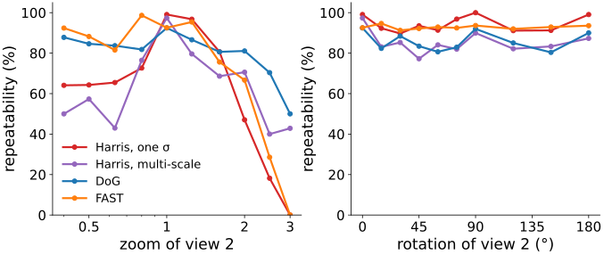{fig-alt="Repeatability in percent against the zoom of view 2 (log axis 0.4 to 3) and against rotation (0 to 180 degrees) for Harris at one sigma, multi-scale Harris, DoG and FAST. Against zoom Harris and FAST are near 100 percent at zoom 1 and fall to about 47 and 67 percent at 2 and to 0 at 3; DoG stays between 81 and 92 percent up to zoom 2 and falls to 50 percent at 3. Against rotation all four stay between about 80 and 100 percent." width="100%"}
:::
::: {.column width="42%"}
Known transform → count the points found again (within 2.5 px, matching scale).

- Single-scale detectors (Harris one σ, FAST) collapse with zoom: 47 % and 67 % at 2×, 0 at 3×.
- **DoG** stays at 81–92 % from 0.5× to 2×, then degrades (70 % at 2.5×).
- **Rotation** hurts none of them much (80–100 %).
- Our multi-scale Harris (normalised Harris, scale by the Laplacian) lies in between.
:::
::::

::: notes
Numbers from the demo code on the synthetic scene (200 strongest points, ε = 2.5 px, one-to-one). The published comparisons (Mikolajczyk et al. 2005) also find DoG and Harris–Laplace far better than single-scale detectors under zoom; on real images multi-scale Harris localises corners better than ours does here. The demo: switch detectors and drag zoom and rotation.
:::

## Try it: repeatability

```{=html}
<link rel="stylesheet" href="../demos/dist/demo.css">
<div data-demo="repeatability" data-preset="zoom"></div>
<script src="../demos/dist/repeatability.js"></script>
```

::: notes
View 2 is view 1 under a known similarity (zoom slider is logarithmic, 1/3 to 3), optional tilt (perspective), lighting, blur and noise. Green = found again, red = not, grey = outside the common region (dashed). The plot fills in the background, one zoom (or angle) at a time, cached per detector. Tour: "zoom 2×: Harris (one σ) loses the points": at zoom 2.2 4 of 13 (31 %); press DoG: 25 of 31 (81 %). "rotation: all detectors fine": 40°: Harris 92 %, DoG 81 %, FAST 91 %. "tilt 50°": DoG drops to 48 %. "gain and offset: no effect": the same points (Harris 97 %, DoG 88 %). "FAST is fast": compare the timing readout.
:::

## What is not covered

- **Strong tilt** (perspective): circles become ellipses, and a circular window no longer covers the same piece of surface. Affine-adapted detectors estimate the ellipse from the structure tensor (one line; further reading).
- **Heavy blur** and **non-rigid deformation**: the scale and the frame drift.
- **No texture**: an empty field has no keypoints. Then intensity-based alignment ([phase correlation](../phasecorr/lec.qmd)) is the better tool.
- **Repetitive texture**: repeatable, but not distinctive (units 2 and 3).

## Other detectors

:::: {.columns}
::: {.column width="60%"}
- **FAST**: a ring of 16 pixels around the centre; a corner if 9 or more in a row are all brighter (or all darker) than the centre by $t$. Very cheap, no scale: used on every level of a pyramid.
- **Determinant of the Hessian** with box filters: a fast blob detector ([integral images](../box-filters/lec.qmd)).
- **MSER**: regions that stay the same over many thresholds ([watershed flooding](../ws-flooding/lec.qmd)).
- **Learned** detectors: networks trained on many image pairs (further reading).

Image libraries call the DoG detector with orientations "SIFT keypoints". A spot detector ([point detection](../spot-filters/lec.qmd)) finds blobs too, but without the frame and the description.
:::
::: {.column width="40%"}
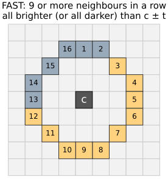{fig-alt="A 9 by 9 pixel grid around a centre pixel c; the 16 pixels of a circle of radius 3 are numbered; ten contiguous ones (3 to 12) are marked brighter." width="100%"}
:::
::::

## Summary

- A good interest point is **repeatable** and **distinctive**. Corners are repeatable under shift and rotation, not under zoom.
- Keypoints with a **scale**: extrema of the DoG in $(x, y, \sigma)$, over an **octave pyramid** (blur in steps of $2^{1/S}$, halve the size at each doubling of σ).
- **Refine** to sub-pixel position and scale; drop **weak** candidates and **edge-like** ones (curvature ratio $r$).
- An **orientation** from a histogram of gradient directions; a keypoint is a frame $(x, y, \sigma, \theta)$ that moves with the image.
- Measure detectors by **repeatability** under a known transform.
- Next: [describing a keypoint](../descriptors/lec.qmd).
