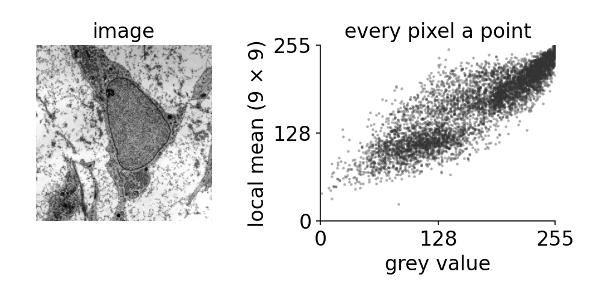
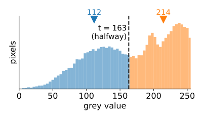
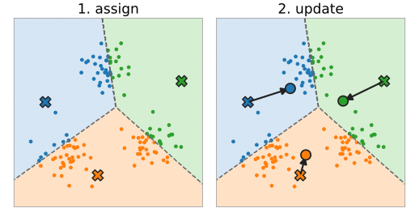
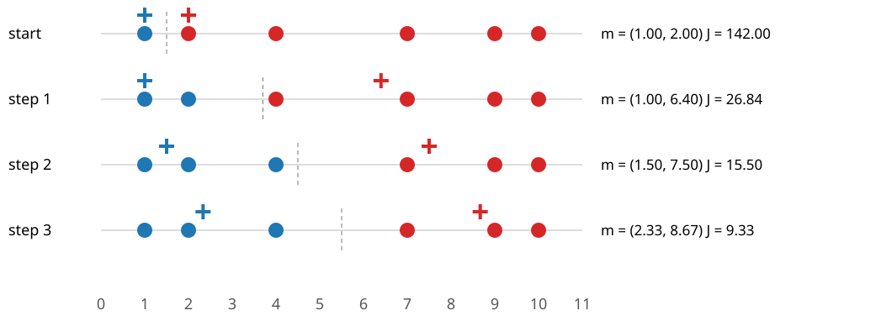
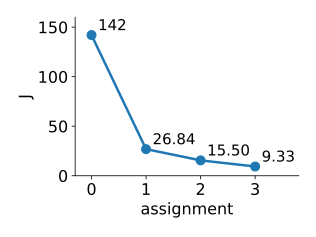
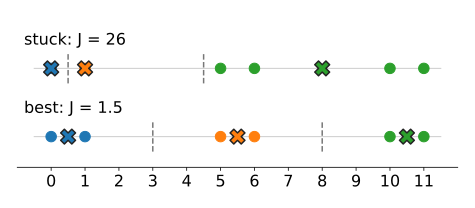
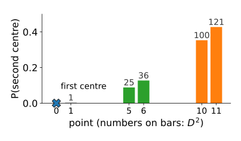
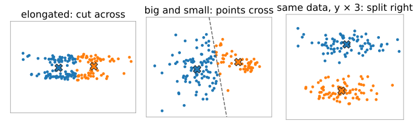
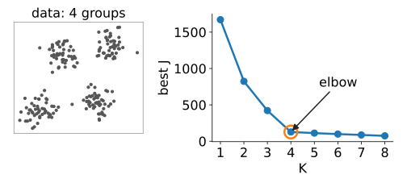

## About this lecture

Segmentation without labels: nobody tells us which pixels belong together. We look for **groups** of similar points.

- Pixels and objects as **points in a feature space**.
- **k-means** (Lloyd's algorithm): assign every point to the nearest centre, move every centre to the mean of its points, repeat.
- What it **minimises**, why it always stops, and why it can stop in the **wrong place** (local minima).
- **Initialisation**: random starts, **k-means++**, restarts.
- What k-means **assumes**: round groups of similar size, and units that mean something.

Slides titled **The math** give the formulas and proofs; the ideas are complete without them.

::: notes
First unit of the Gaussian-mixture day (elective, More learning). The day goes: k-means (this unit), one Gaussian and the mixture as a model (unit 2), fitting it by EM (unit 3), mixtures on images (unit 4). Everything here is unsupervised: no labelled examples, unlike the random-forests day and the SVM elective.
:::

## Every pixel is a point

:::: {.columns}
::: {.column width="52%"}
Measure a few numbers per pixel (or per object) and draw each pixel as a **point**, one axis per number: a **feature space**.

- **Intensity**: 1D. The histogram is the cloud of points along a line.
- **Colour**: 3D (R, G, B or L\*, a\*, b\*).
- Intensity + local mean, or colour + position $(x, y)$: 2D to 5D.
- Every **segmented object** is a point too: (area, mean intensity, roundness, …).

Pixels of the same kind of material form a **group** (a cluster) in this space. Segmentation without labels = **finding the groups**. The feature space and the feature stack are the subject of the random-forests day; here we only need "a point per pixel".
:::
::: {.column width="48%"}
{width="100%" fig-alt="The course micrograph and a scatter plot of 6000 of its pixels, grey value against the 9 × 9 local mean: the pixels form a dense band along the diagonal with a dark group and a bright group"}

The course micrograph (Robert M. Hunt, CC BY 3.0, via Wikimedia Commons): grey value against the local mean, one dot per pixel.
:::
::::

## Recall: isodata is two groups in 1D

:::: {.columns}
::: {.column width="52%"}
The thresholding day's **isodata** threshold: start with a threshold $t$; take the mean grey value below $t$ and the mean above; put the new $t$ halfway between them; repeat.

- That is exactly "two centres in 1D": every pixel goes to the nearer of the two means, then each mean is recomputed.
- The colour day ran the same loop on colour pixels (in Lab) as a quick colour segmentation.

Today: the algorithm itself, for **any** number of groups $K$ and any dimension: what it optimises, and how it fails.
:::
::: {.column width="48%"}
{width="100%" fig-alt="Histogram of the course micrograph split at t = 163: the mean of the pixels below is 112, the mean above 214, and 163 is halfway between them"}

Isodata on the course micrograph: means 112 and 214, threshold halfway at 163.
:::
::::

## Lloyd's algorithm

:::: {.columns}
::: {.column width="55%"}
Choose $K$ and $K$ starting **centres** $\mathbf m_1, \dots, \mathbf m_K$. Then repeat:

1. **Assign**: every point goes to its **nearest** centre.
2. **Update**: every centre moves to the **mean** of the points assigned to it.

Stop when no assignment changes.

- The assignment step cuts the space into **Voronoi cells**: the region closer to $\mathbf m_k$ than to any other centre.
- Between two centres the boundary is the **perpendicular bisector**: a straight line (a plane in 3D) halfway between them.
- Each iteration costs one distance per point and centre: $nK$ distances. Cheap even for every pixel of an image.
:::
::: {.column width="45%"}
{width="100%" fig-alt="Two panels with three groups of points. Assign: the plane is cut into three Voronoi cells by dashed bisectors between three badly placed centres, and each point takes the colour of its cell. Update: arrows move every centre to the mean of its coloured points"}
:::
::::

## By hand: six points on a line {.smaller}

{width="88%"}

Points $1, 2, 4, 7, 9, 10$, $K = 2$, start $\mathbf m = (1, 2)$. The dashed line is the boundary halfway between the centres.

- Assign: $\{1\}$, $\{2, 4, 7, 9, 10\}$. Update: $m = (1, 6.4)$.
- Assign: $\{1, 2\}$, $\{4, 7, 9, 10\}$. Update: $m = (1.5, 7.5)$.
- Assign: $\{1, 2, 4\}$, $\{7, 9, 10\}$. Update: $m = (2.33, 8.67)$. Assign again: nothing changes, **stop**.

## What k-means minimises

:::: {.columns}
::: {.column width="64%"}
The **within-cluster sum of squares**: every point's squared distance to its own centre, added up:

$$J = \sum_i \lVert \mathbf x_i - \mathbf m_{c(i)} \rVert^2 .$$

- The **assign** step can only lower $J$: each point picks the centre that is nearest, so its term can only shrink.
- The **update** step can only lower $J$: for a fixed group, the mean is the point with the smallest sum of squared distances.
- There are finitely many ways to split $n$ points into $K$ groups, and $J$ never goes up, so the loop **must stop**.
- In the example: $J = 142 \to 26.84 \to 15.50 \to 9.33$.

But "stops" does not mean "best": it stops when **no single step** helps, a **local minimum**. (The same objective with $K = 2$ appears as a region energy on the level-sets elective.)
:::
::: {.column width="36%"}
{width="100%" fig-alt="J after each assignment of the six-point example: 142, 26.84, 15.50, 9.33, falling fast and then levelling off"}
:::
::::

## The math: why each step lowers J {.math}

**Update.** For a fixed group $G_k$, $J_k(\mathbf m) = \sum_{i \in G_k} \lVert \mathbf x_i - \mathbf m \rVert^2$ is a convex quadratic in $\mathbf m$:

$$\frac{\partial J_k}{\partial \mathbf m} = -2 \sum_{i \in G_k} (\mathbf x_i - \mathbf m) = 0 \;\Longleftrightarrow\; \mathbf m = \frac{1}{|G_k|}\sum_{i \in G_k} \mathbf x_i .$$

Moreover $J_k(\mathbf m) = J_k(\bar{\mathbf x}) + |G_k|\,\lVert \mathbf m - \bar{\mathbf x} \rVert^2$: any other centre costs more.

**Assign.** With the centres fixed, $J = \sum_i \lVert \mathbf x_i - \mathbf m_{c(i)}\rVert^2$ is minimised point by point by $c(i) = \arg\min_k \lVert \mathbf x_i - \mathbf m_k\rVert$.

**Termination.** $J$ is non-increasing and takes one value per partition; there are at most $K^n$ partitions, so no partition repeats once $J$ strictly decreases: the loop ends. Finding the **global** minimum is NP-hard in general (already for $K = 2$ in many dimensions), which is why the starting point matters.

## Try it: k-means step by step

```{=html}
<link rel="stylesheet" href="../demos/dist/demo.css">
<div data-demo="kmeans2d" data-preset="hand1d"></div>
<script src="../demos/dist/kmeans2d.js"></script>
```

::: notes
Tour: "by hand (1D)": press assign / update alternately and read the centres and J off the readout: (1, 6.4), (1.5, 7.5), (2.33, 8.67); J 142, 26.84, 15.50, 9.33 in the plot. Then "three blobs" (k-means++, start 1): run; J goes 3.478 → 1.814 → 1.811 in two updates. Drag a centre into the middle of a blob and run again. Then "stuck": centres (0, 1, 8) on the points 0, 1, 5, 6, 10, 11: J = 26 and nothing moves. "k-means++ avoids it": the seeds land at 10, 0 and 5 and J = 1.5 after one update.
:::

## Stuck: a local minimum

Points $0, 1, 5, 6, 10, 11$, $K = 3$, start $\mathbf m = (0, 1, 8)$.

{width="48%" fig-alt="Two rows of the six points. Top, stuck: centres at 0, 1 and 8, with the four points 5, 6, 10, 11 all assigned to the centre at 8; J = 26. Bottom, best: centres at 0.5, 5.5 and 10.5, one per pair; J = 1.5"}

- Assign: $\{0\}$, $\{1\}$, $\{5, 6, 10, 11\}$ (5 is nearer to 8 than to 1). Update: $8$ stays the mean of $5, 6, 10, 11$. Nothing changes: **stopped**, $J = 0 + 0 + (9 + 4 + 4 + 9) = 26$.
- The obvious answer $\{0, 1\}, \{5, 6\}, \{10, 11\}$ has $J = 6 \times 0.5^2 = 1.5$.
- Two centres **share one group**, and one centre has to cover two groups. No single assign or update step can fix this: one centre would have to jump across an empty gap.

This is typical: a bad start gives a bad answer, and k-means does not tell you.

## Better starts: k-means++

:::: {.columns}
::: {.column width="58%"}
- **Random points** as centres: two of them often land in the same group.
- **k-means++** (Arthur & Vassilvitskii, 2007): choose the first centre at random; choose each next centre at random with probability **proportional to $D(\mathbf x)^2$**, its squared distance to the nearest centre chosen so far. Far-away points are much more likely: the centres spread out.
- **Restarts**: run from several starts and keep the run with the **smallest $J$**.

The example with first centre 0: $D^2 = 0, 1, 25, 36, 100, 121$, sum 283.

- $P(\text{second centre} \in \{10, 11\}) = 221/283 = 0.78$; $P(\in\{5, 6\}) = 61/283 = 0.22$; $P(= 1) = 1/283$.
- Whichever group is picked, the third centre then most likely lands in the remaining far group.
:::
::: {.column width="42%"}
{width="100%" fig-alt="Bar chart of the probability that each point becomes the second k-means++ centre when the first is at 0: 0 for 0, 1/283 for 1, 0.09 and 0.13 for 5 and 6, 0.35 and 0.43 for 10 and 11; the bars are labelled with D squared: 1, 25, 36, 100, 121"}
:::
::::

## Try it: restarts

```{=html}
<link rel="stylesheet" href="../demos/dist/demo.css">
<div data-demo="kmeans2d" data-preset="stuck" data-restarts="1"></div>
<script src="../demos/dist/kmeans2d.js"></script>
```

::: notes
The "100 restarts" histogram is the final J of 100 runs. On the points 0, 1, 5, 6, 10, 11 with K = 3 and random points as starts: 80 of 100 runs reach J = 1.5, 20 stop at J = 26. Press "k-means++" and "100 restarts" again: 100 of 100 reach 1.5. On "three blobs" with random starts: 94 of 100 reach the best J (1.811); the others stop between 7.6 and 8.4. With k-means++: 99 of 100.
:::

## What k-means assumes

Every boundary is a **straight bisector** between two centres, and every point belongs to **exactly one** group. So k-means works best for groups that are

- **round** (same spread in every direction): an **elongated** group is cut across, because cutting a long group in half lowers $J$ more than separating two parallel groups;
- of **similar size**: the boundary sits halfway between the centres, so a big, spread-out group loses its outer points to a small neighbour;
- measured in **comparable units**: distances add squared differences of all features. Rescale one axis (µm instead of mm, or intensity × 10) and the groups change.

{width="62%" fig-alt="Three synthetic examples of k-means with two groups. Two parallel elongated clouds are cut across into a left and a right half. A wide group next to a small tight one: the bisector cuts into the wide group, so many of its points go to the small one. The two elongated clouds again with the y axis multiplied by 3: now k-means separates them correctly"}

The next units replace the round, equal groups by **Gaussians** with their own shape, size and weight.

## The math: the boundary is a bisector {.math}

A point $\mathbf x$ is equally far from $\mathbf m_1$ and $\mathbf m_2$ when

$$\lVert \mathbf x - \mathbf m_1\rVert^2 = \lVert \mathbf x - \mathbf m_2\rVert^2 \;\Longleftrightarrow\; 2\,\mathbf x^\top(\mathbf m_2 - \mathbf m_1) = \lVert\mathbf m_2\rVert^2 - \lVert\mathbf m_1\rVert^2 .$$

The quadratic terms $\lVert\mathbf x\rVert^2$ cancel: a **linear** equation, a line (hyperplane) with normal $\mathbf m_2 - \mathbf m_1$ through the midpoint $\tfrac12(\mathbf m_1 + \mathbf m_2)$.

- The cell of $\mathbf m_k$ is an intersection of half-planes: a **convex** polygon (Voronoi cell).
- Scaling feature $j$ by $s$ multiplies its squared differences by $s^2$: distances, and so the bisectors, change. k-means is not scale invariant.

## Try it: where k-means fails

```{=html}
<link rel="stylesheet" href="../demos/dist/demo.css">
<div data-demo="kmeans2d" data-preset="elongated"></div>
<script src="../demos/dist/kmeans2d.js"></script>
```

::: notes
"elongated: cut across": two parallel cigars. k-means (run) ends with J = 3.079 and agrees with the true groups for only 125 of 160 points: it cuts both cigars across. The true split has a larger J (5.514): k-means does what it is told, the objective is wrong for these data. "big and small group": 120 wide points and 30 tight ones; k-means gives 108 and 42: twelve points of the big group cross the bisector. "rescale the y axis": two horizontal bands. At y × 1 k-means splits left/right; drag the slider to 1.5: the bands are separated (all 140 points right).
:::

## How many groups?

:::: {.columns}
::: {.column width="50%"}
- $J$ always **decreases** with $K$: with $K = n$, every point is its own centre and $J = 0$. So "the smallest $J$" cannot choose $K$.
- The **elbow** heuristic: plot the best $J$ against $K$; look for the $K$ after which adding a centre helps much less.
- A principled answer needs a **model** of how the data arise, so that "fit" and "complexity" can be traded off: unit 3 (BIC, AIC).
:::
::: {.column width="50%"}
{width="100%" fig-alt="Synthetic data with four well-separated groups and the best J of 20 restarts against K from 1 to 8: J falls steeply up to K = 4 and only slowly after it, the elbow"}
:::
::::

## Summary

- Pixels or objects are **points in a feature space**; segmentation without labels looks for **groups**.
- **k-means**: assign to the nearest centre, move centres to the means, repeat. Boundaries are **perpendicular bisectors** (Voronoi cells).
- It minimises $J = \sum_i \lVert\mathbf x_i - \mathbf m_{c(i)}\rVert^2$; both steps lower $J$, so it **stops**, at a **local** minimum.
- **Starts matter**: k-means++ seeds far apart; restarts keep the lowest $J$.
- Assumes **round**, **equally sized** groups in **comparable units**; $J$ cannot choose $K$.
