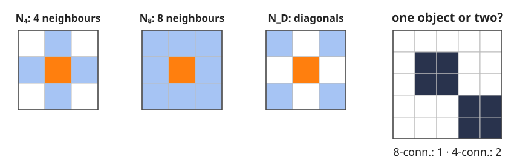
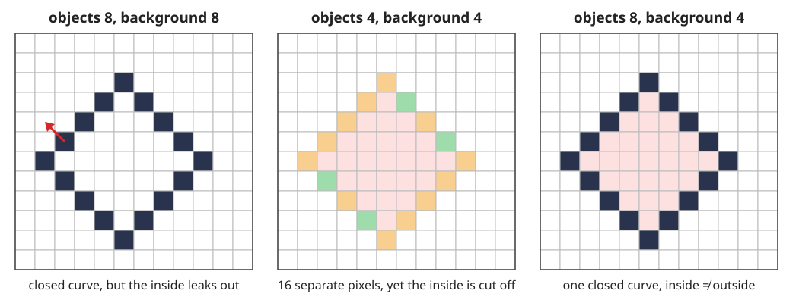
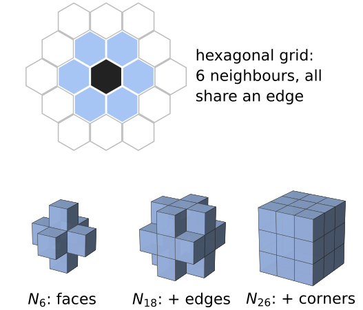
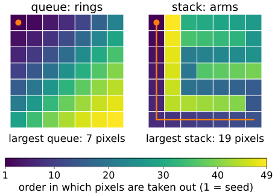
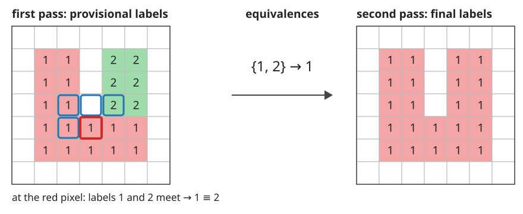
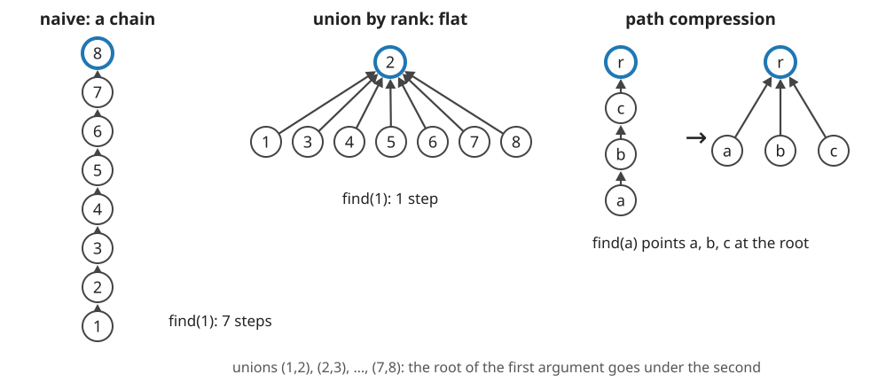

## About this lecture

A thresholded image of nuclei is a mask of 0s and 1s. "How many nuclei are there, and how big is each?" The mask cannot answer: it does not know which pixel belongs to which object.

- **Neighbours, paths, components**: what "connected" means on a grid, and why 4 and 8 give different counts.
- The **digital topology paradox**: objects and background need **complementary** connectivities.
- **Flood fill** with a queue or a stack.
- The **two-pass algorithm** and the data structure behind it, **union–find**.
- Cost: why all of this is (almost) linear in the number of pixels.

*Slides titled **The math** give the formulas and proofs; the ideas are complete without them.*

::: notes
This is the course's owner of connected components: the watershed, graph-cut, measurement and skeleton days recall it in one line. From the morphology day we use: masks, the 3×3 cross and square, and "the component of p is its reconstruction from p".
:::

## Neighbours and paths

{width="88%"}

- $N_4(p)$: the 4 pixels sharing an **edge** with $p$; $N_8(p)$: also the 4 sharing only a **corner**.
- A **path** is a sequence of pixels, each a neighbour of the previous one. A set is **connected** if a path inside the set joins any two of its pixels.
- A **connected component** is a maximal connected set: you cannot add a pixel without breaking connectedness.
- Right: two blocks that touch at a corner are **one** object with 8-connectivity and **two** with 4-connectivity.

## The math: components are equivalence classes {.math}

Write $p \sim q$ if a path inside the foreground $A$ joins $p$ and $q$ (with $N_4$ or $N_8$ fixed).

- **Reflexive** ($p \sim p$, the path of length 0), **symmetric** (reverse the path), **transitive** (join two paths). So $\sim$ is an equivalence relation.
- Its classes are the components; they **partition** $A$: every object pixel gets exactly one label.
- A 4-path is also an 8-path, so every 4-component lies inside one 8-component: 8-connectivity never gives **more** objects than 4-connectivity.
- As a graph: pixels of $A$ are nodes, neighbouring pairs are edges; labelling = finding the connected components of this graph.

## The digital topology paradox

{width="100%"}

A closed diagonal curve (dark pixels). In the plane, a closed curve has an inside and an outside (Jordan's curve theorem).

- **8 / 8**: the curve is one closed object, but the background leaks diagonally between its pixels: no inside.
- **4 / 4**: the curve falls into 16 separate pixels, yet the inside is cut off: a "broken" curve that separates.
- **8 / 4** (or 4 / 8): one closed curve, and it separates. Foreground and background need **complementary** connectivities (Rosenfeld).

## Try it: connectivity pairs

```{=html}
<link rel="stylesheet" href="../demos/dist/demo.css">
<div data-demo="connparadox" data-preset="leaky"></div>
<script src="../demos/dist/connparadox.js"></script>
```

::: notes
Objects are coloured by component, enclosed background regions are tinted. Tour: "8/8: closed but leaky": 1 object, 1 background region, nothing enclosed. Switch the background to 4: the inside appears (2 regions, 1 enclosed). "4/4": 16 objects, still 1 enclosed region: the contradiction. "a diagonal line": with 8/4 it splits the image into 2 halves, with 8/8 into 1. Click pixels to make your own curve. Then the 3D presets (next slide): "corner-touching voxels" are 1 object with 26, 3 objects with 18 or 6; "shell with a corner missing": with 26/26 the cavity leaks out, with 26/6 it is sealed.
:::

## The convention, other grids and 3D

:::: {.columns}
::: {.column width="58%"}
- Course convention (also on the [morphology](../morph-binary/lec.qmd), [thresholding](../local-threshold/lec.qmd) and [watershed](../ws-flooding/lec.qmd) days): **objects 8-connected, background 4-connected**. A hole is a background component that does not reach the image border.
- A **hexagonal grid** has no paradox: every neighbour shares an edge, so there is only one connectivity. Square grids are what cameras give us.
- **3D**: $N_6$ (faces), $N_{18}$ (+ edges), $N_{26}$ (+ corners). Consistent pairs: (26, 6), (6, 26), and (18, 6). Labelling stacks of slices (voxel spacing, anisotropy) is the 3D unit [3D images](../volumes3d/lec.qmd) of the marching-cubes day (day 47).
- Euler number ([next unit](../regionprops/lec.qmd)) and thinning ([skeleton day](../skel-thinning/lec.qmd)) are only well defined with a consistent pair.
:::
::: {.column width="42%"}
{width="100%" fig-alt="A hexagonal pixel with its 6 neighbours, all sharing an edge; below, the 3D neighbourhoods of a voxel: 6 face neighbours, 18 with the edge neighbours, 26 with the corner neighbours."}
:::
::::

## Flood fill

From a seed pixel, grow its component: take a pixel from a list, add its unlabelled object neighbours to the list, repeat until the list is empty.

:::: {.columns}
::: {.column width="55%"}
- **Queue** (first in, first out): breadth-first, the region grows **ring by ring**, like the geodesic dilation of the [morphology day](../morph-reconstruct/lec.qmd) (the component of $p$ is the reconstruction of the mask from $\{p\}$).
- **Stack** (last in, first out): depth-first, the region grows in long **arms**.
- Recursion is a hidden stack: a recursive fill of a 1000 × 1000 object may nest $10^6$ calls and overflow. Use an explicit list.
- Labelling: scan the image; at every object pixel without a label, start a fill with a new label. Each pixel enters the list once: $O(n)$, but with jumps through memory.
:::
::: {.column width="45%"}
{width="100%" fig-alt="A 7 by 7 block filled from its top-left pixel with 4-connectivity, coloured by the order in which pixels are taken out. With a queue the colours form diagonal rings and the queue never holds more than 7 pixels; with a stack the fill runs down the first column and back in long arms, and the stack grows to 19 pixels."}
:::
::::

## Try it: flood fill

```{=html}
<link rel="stylesheet" href="../demos/dist/demo.css">
<div data-demo="morphgrid" data-mode="label" data-preset="rings"></div>
<script src="../demos/dist/morphgrid.js"></script>
```

::: notes
Left: the mask (click to edit); right: the labels. Orange numbers on the mask are the queue (1 = next out) or the stack. Tour: "queue rings vs stack arms" (7 × 7 block, objects 4): step with the queue, the label front moves as diagonal rings; the largest queue is 7 pixels. Switch to "flood fill (stack)": the fill runs down the first column and back; the stack grows to 19. Then "diagonal neighbours": with objects 8 it is 1 object, with objects 4 it is 2.
:::

## The two-pass algorithm

{width="80%"}

Rosenfeld & Pfaltz (1966). **First pass**, in raster order, at each object pixel look only at the neighbours already visited (8: up-left, up, up-right, left; 4: up, left):

- none labelled → a **new** provisional label;
- one label → **copy** it;
- several labels → copy the smallest and record that they are **equivalent**.

Then resolve the equivalences into classes, number them 1, 2, 3, …, and in a **second pass** replace each provisional label by its class number.

## Try it: two passes

```{=html}
<link rel="stylesheet" href="../demos/dist/demo.css">
<div data-demo="morphgrid" data-mode="label" data-preset="u"></div>
<script src="../demos/dist/morphgrid.js"></script>
```

::: notes
"a U needs one equivalence": the two arms get labels 1 and 2; at row 4 the pixel between them sees both and records 1 ≡ 2 (red ≡); "next stage" jumps to the equivalence table and the second pass. "a comb: many": 5 teeth, 5 provisional labels, 4 equivalences recorded along the bottom row. "count with 4 and with 8": 2 objects with 8, 9 with 4. Use "runs" on "a spiral": the same algorithm with horizontal runs instead of pixels.
:::

## Union–find

The equivalences form sets that keep merging: $\{1, 2\}$, then $\{1, 2, 5\}$, … A **disjoint-set forest** stores them:

- each label points to a **parent**; a set is a tree, named by its **root** (`parent[r] = r`);
- **find**($x$): follow the parents to the root;
- **union**($a$, $b$): find both roots and hang one under the other.

{width="72%"}

Naively the trees can become **chains** (left): find costs up to $n$ steps. Two fixes: **union by rank** (hang the shallower tree under the deeper one) and **path compression** (on the way up, point every visited node at the root).

## The math: why union–find is nearly linear {.math}

**Union by rank.** The rank of a root is an upper bound on the height of its tree; ranks only grow when two equal ranks meet. A root of rank $r$ has at least $2^r$ nodes (induction: rank $r + 1$ needs two trees of rank $r$, each with $\ge 2^r$ nodes). So with $n$ labels every tree has height $\le \log_2 n$, and each find costs $O(\log n)$.

**Path compression** in addition: Tarjan (1975) showed that $m$ operations on $n$ elements cost $O(m\,\alpha(n))$, with $\alpha$ the inverse Ackermann function. $\alpha(n) \le 4$ for any $n$ that fits in a computer, so the cost is linear in practice. (Stated, not proved here.)

**Halving** (each node on the path points to its grandparent) gives the same bound with a single pass.

## Try it: the forest

```{=html}
<link rel="stylesheet" href="../demos/dist/demo.css">
<div data-demo="unionfind" data-preset="chain" data-step="8"></div>
<script src="../demos/dist/unionfind.js"></script>
```

::: notes
Nodes are labels; arrows point to parents; roots have a blue ring. Tour: "naive unions build a chain": 7 unions union(i, i+1) make a chain of depth 7; find(1) costs 7 pointer steps, and the second find(1) again 7. Tick "union by rank": the same unions give a star under 2 (depth 1), find(1) costs 1. "compression flattens on the way": the first find(1) costs 7, the second 1. "halving": the second find costs 4. "two-pass equivalences of the comb": the 4 equivalences of the comb make a star. Click two nodes to unite them.
:::

## Runs, blocks, 3D, cost

| method | memory access | cost |
|---|---|---|
| flood fill | random (queue/stack) | $O(n)$ |
| two-pass + union–find | sequential, 2 scans | $O(n\,\alpha(n))$ |
| run-based | sequential, per run | $O(n + r\,\alpha(r))$, $r$ runs |

- **Runs**: label horizontal stretches of object pixels; a run joins the runs above that overlap it (diagonally too, for 8). Far fewer elements than pixels.
- **Block-based** methods look at 2 × 2 blocks with a decision tree: the fastest in practice.
- **3D** two-pass: 3 visited neighbours for 6-connectivity, 13 for 26. A large stack can hold more than 65 535 objects: label images need 32-bit integers.

## Summary

- A component is a maximal connected set; **4 vs 8** can change the count.
- Objects and background need **complementary** connectivities (8/4 or 4/8; 26/6 in 3D), or closed curves stop separating.
- **Flood fill**: queue (rings) or stack (arms), explicit list, $O(n)$.
- **Two-pass**: provisional labels, equivalences, second pass; the equivalences live in a **union–find** forest.
- **Union by rank** + **path compression**: almost constant time per operation.
- Every segmentation method of the course ends in a label image: the [next units](../regionprops/lec.qmd) measure it.
