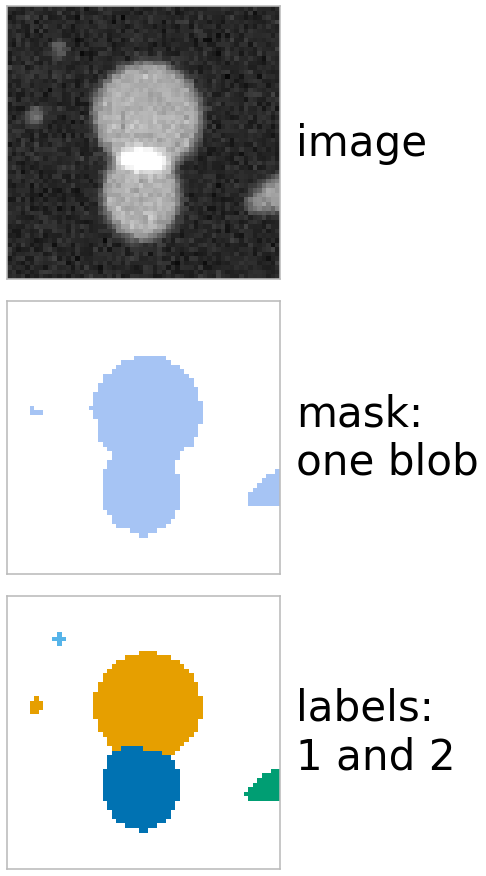
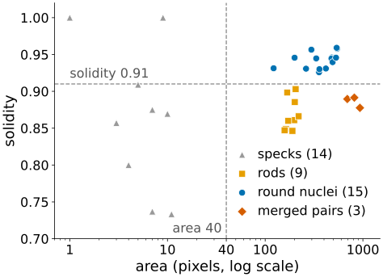
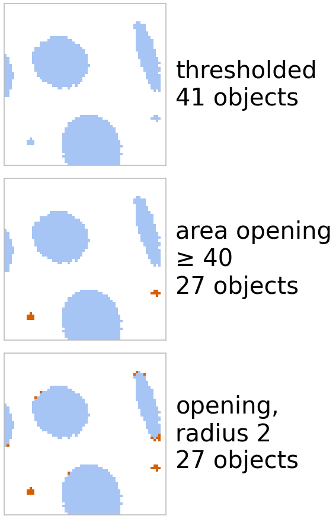
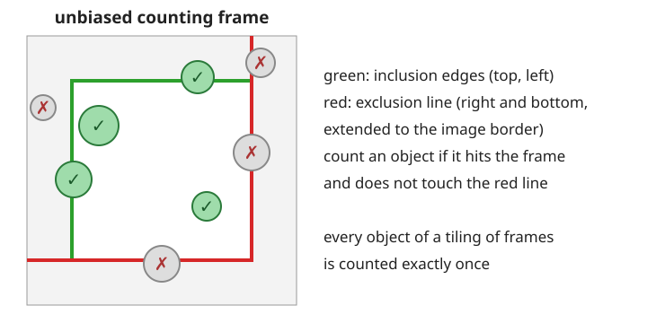
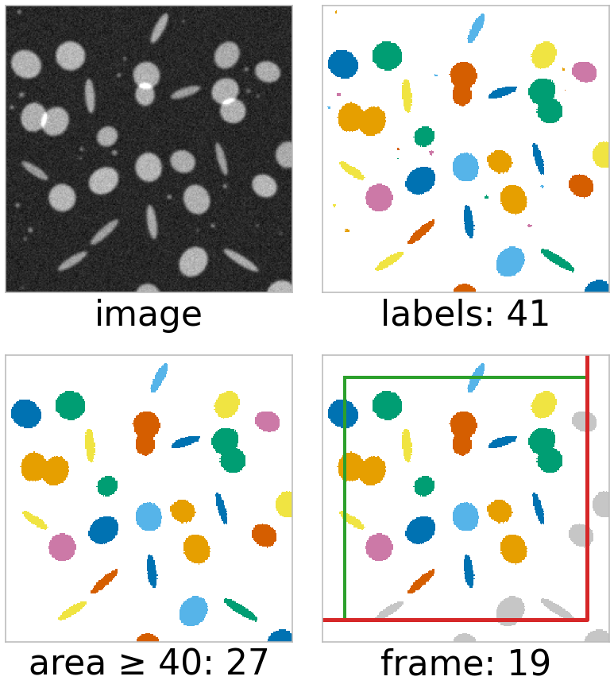

## About this lecture

We can label objects and measure them. This unit puts it together into a **measurement pipeline** and asks what can go wrong with the **count**.

- **Label image** vs binary mask: when you need which.
- The **measurement table** and a scatter plot of two properties.
- **Filtering** objects by their properties: area opening, roundness, border objects.
- **Counting** and its errors: merged, split, debris, and objects cut by the image border; the **unbiased counting frame**.
- The whole pipeline on one image: threshold → clean → label → measure → filter → count.

*Slides titled **The math** give the formulas and proofs; the ideas are complete without them.*

::: notes
Recalled: thresholding (day 12), opening, fill holes, clear border and reconstruction (morphology day), region properties and shape features (the two previous units). Object-level evaluation (matching predicted and true objects) belongs to the evaluation day (day 37): one forward pointer only.
:::

## Label image or mask?


:::: {.columns}
::: {.column width="66%"}
- A **binary mask** says object or background. Two touching nuclei are one blob: the boundary between them does not exist in a mask.
- A **label image** stores an integer per pixel: 0 = background, $k$ = object $k$. Touching objects can have different labels; the mask of object $k$ is $\{L = k\}$.
- Data type: 8 bits allow only 255 objects; use 16 or 32 bits. After deleting objects, **relabel sequentially** (1, 2, 3, … without gaps).
- Display with a label palette where neighbouring numbers get very different colours, never with a grey ramp.
- Who produces label images: this day's labelling, the **[watershed](../ws-landscape/lec.qmd)** (day 15), **[graph cuts](../graphcut-seg/lec.qmd)** with several labels (day 27), [level sets](../chanvese/lec.qmd) (day 31), and [instance-segmentation networks](../instances/lec.qmd) (day 39).
:::
::: {.column width="34%"}
{width="68%" fig-alt="Three panels of the same small crop: the grey image of two touching nuclei, the thresholded mask in which they are a single blob, and the label image in which they have two different colours."}
:::
::::

## The measurement table


:::: {.columns}
::: {.column width="50%"}
| label | area | eccentricity | solidity | form factor | … |
|---|---|---|---|---|---|
| 1 | 5 | 0.82 | 0.91 | 1.03 | |
| 2 | 198 | 0.95 | 0.86 | 0.57 | |
| 3 | 545 | 0.21 | 0.96 | 1.01 | |
| … | | | | | |

One row per object, one column per property.
:::
::: {.column width="50%"}
{width="100%" fig-alt="Scatter plot of solidity against area on a log scale for the 41 labelled objects: 14 grey specks with areas from 1 to 11, 9 orange rods near area 200 with solidity 0.85 to 0.90, 15 blue round nuclei with areas 122 to 545 and solidity 0.93 to 0.96, and 3 red merged pairs with areas 693 to 932 and solidity 0.88 to 0.89. Dashed lines at area 40 and solidity 0.91 separate the round nuclei from the rest."}
:::
::::

A **scatter plot** of two columns shows **populations**: in the synthetic image of the demo, round nuclei (area 122–545, eccentricity up to 0.91, solidity 0.93–0.96), rods (area 158–220, eccentricity 0.95–0.98), specks (area 1–11) and merged pairs (area 693–932, solidity 0.88–0.89). No single threshold on one property separates all of them; two properties together often do.

## Filtering objects

:::: {.columns}
::: {.column width="66%"}
- **Remove small objects**: keep components with area $\ge a$. This is the **area opening**, a *connected* filter: objects are kept or removed **whole**, the shapes of the survivors are untouched. A morphological opening removes small objects too, but also rounds the corners and cuts thin parts of all the others (opening by reconstruction, morphology day, does the same as the area opening for "contains a disc of radius $r$").
- **Keep round objects**: eccentricity, form factor or solidity in a range.
- **Remove border objects**: bounding box touches the image edge (or clear border, [morphology day](../morph-reconstruct/lec.qmd)).
- **Hysteresis**: label the low-threshold mask and keep the labels that contain at least one high-threshold pixel (the idea is from the [thresholding day](../local-threshold/lec.qmd); [reconstruction](../morph-reconstruct/lec.qmd) does the same).
- Filters on the table, then **relabel** the label image.
:::
::: {.column width="34%"}
{width="80%" fig-alt="Three panels of a crop of the thresholded mask: as thresholded; after the area opening, which removes the two small specks whole and leaves the other objects unchanged; and after an opening with radius 2, which removes the same specks but also nibbles pixels off the corners of the nuclei and the rod. Both leave 27 objects in the whole image, from 41."}
:::
::::

## The math: connected filters {.math}

A **connected filter** acts on whole components: $\psi(X) = \bigcup\{C : C \text{ a component of } X,\ \text{criterion}(C)\}$.

- **Anti-extensive**: $\psi(X) \subseteq X$. **Idempotent**: $\psi(\psi(X)) = \psi(X)$ (the kept components are still components and still pass).
- **Increasing** ($X \subseteq Y \Rightarrow \psi(X) \subseteq \psi(Y)$) when the criterion is increasing, such as "area $\ge a$": a component of $X$ lies in a component of $Y$ that is at least as large. Then $\psi$ is an algebraic **opening**: the area opening.
- Not increasing: "eccentricity $< 0.8$" (a larger set can be more elongated). Then the filter is called a **thinning** in morphology's sense.
- Area opening of a grey image: apply it to every threshold set (the max-tree), the grey counterpart; the [watershed day](../ws-gradient/lec.qmd) cuts its merge tree by area, and [merge trees](../merge-trees/lec.qmd) (day 29) build the tree itself.

## Counting, and how it goes wrong

The count = number of labels after filtering. Each error has a typical fix:

| error | effect | fix |
|---|---|---|
| touching objects merge | undercount | split them: [watershed](../ws-distance/lec.qmd) (day 15); solidity flags them |
| an object falls apart (gaps, dim parts) | overcount | closing or a lower threshold before labelling |
| noise specks, debris | overcount | area filter, opening |
| objects cut by the border | wrong sizes, count bias | counting frame |
| 4 vs 8 connectivity | diagonal contacts change the count | fix the convention (8/4) |

A count can be right while the objects are wrong (one merge + one split): only matching objects to a ground truth catches that ([evaluation day](../object-eval/lec.qmd), day 37).

## Border objects and the counting frame

{width="72%"}

- Removing **all** objects that touch the border biases the count and the sizes: large objects touch the border more often, so they are under-represented.
- Keeping all of them counts objects that are mostly outside, and an object cut by two neighbouring fields is counted twice.
- **Unbiased counting frame** (Gundersen, 1977): an inner frame with **inclusion** edges (top, left) and an **exclusion line** (right and bottom, extended to the image border). Count an object if it hits the frame and does not touch the exclusion line. Tiling the plane with such frames counts every object exactly once.

## The math: why the frame is unbiased {.math}

**Associated points.** Give each object one unique point, e.g. its first pixel in raster order, and count the objects whose point lies in the frame $[x_0, x_1) \times [y_0, y_1)$. Frames that tile the plane partition the points, so every object is counted exactly once, and for objects scattered at random the expected count is (number density) × (frame area), whatever their size and shape.

**Gundersen's frame** does the same without finding the point. In a tiling, a connected object hits a block of neighbouring frames; the exclusion lines (right edge extended upwards, bottom edge extended leftwards, the mirror image of Gundersen's left/bottom convention) are placed so that exactly one frame of that block counts it. (Stated, not proved here.)

**Discarding border objects** instead keeps an object only if it fits entirely in the image, with probability $\approx (W - w)(H - h)/(WH)$ for an object with a $w \times h$ box: smaller for larger objects. The count is biased towards small objects, and so is the mean size.

The guard zone outside the frame must be at least as wide as the largest object, so that every counted object is measured completely.

## The pipeline

On the synthetic image of the demo (256 × 256: 15 nuclei, 3 touching pairs, 9 rods, 22 specks of which 14 are bright enough):

:::: {.columns}
::: {.column width="60%"}
1. **Threshold** (100): 41 labels.
2. **Open** (radius 2) or filter by **area** ($\ge 40$): the specks go: 27.
3. **Fill holes**, choose **8**-connectivity (here neither changes the count).
4. **Label**, **measure**: one row per object.
5. **Filter**: keep solidity $\ge 0.91$: 15 single nuclei (rods and merged pairs fall below).
6. **Border rule**: counting frame (margin 20): 19 of the 27.
7. **Count**, and report what was excluded and why.
:::
::: {.column width="40%"}
{width="78%" fig-alt="Four panels of the demo's synthetic image: the grey image; the 41 labels after thresholding; the 27 objects with area at least 40; and the counting frame with margin 20, where 19 objects are counted and the objects touching the red exclusion line or lying outside the frame are grey."}
:::
::::

Each step changes the count; write the steps down as part of the result.

## Try it: filter and count

```{=html}
<link rel="stylesheet" href="../demos/dist/demo.css">
<div data-demo="regionfilter" data-preset="debris"></div>
<script src="../demos/dist/regionfilter.js"></script>
```

::: notes
Three linked panels: the image with the labels (grey = filtered out; click an object), the table (click a column to sort, a row to select), and the scatter plot (the buttons cycle the properties; drag a rectangle to keep only the objects inside). Tour: "debris": the area ≥ 40 rectangle keeps 27 of 41. "rods vs round": eccentricity ≤ 0.93 keeps the 15 nuclei and the 3 pairs (18). "touching nuclei": solidity ≥ 0.91 keeps 15 single nuclei. "counting frame": green inclusion, red exclusion line: 19. "opening removes the specks": radius 2 → 27 labels. "connectivity changes the count": the micrograph, 1141 objects with 4, 764 with 8.
:::

## Summary

- A **label image** keeps touching objects apart; relabel after deleting, use 16/32 bits and a label palette.
- The **measurement table** (one row per object) and a **scatter plot** of two properties reveal populations.
- **Area opening** = connected filter: removes small objects whole, keeps the others' shapes.
- **Counting errors**: merges (watershed), splits (closing), debris (area), border (counting frame), connectivity.
- **Counting frame**: inclusion edges top/left, exclusion line right/bottom: each object counted once, no size bias.
- Write the pipeline down: every step changes the number.
