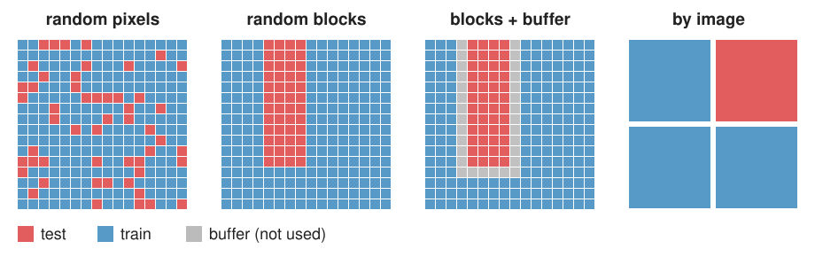

## About this lecture

A test score is only as good as the test. Today: how a validation can **lie**, and how to design one that does not.

- The rule: **the test set must be as new as the data you will work on later.**
- Why **random pixel or patch splits** leak: neighbouring pixels are near copies.
- The **hierarchy of splits**: pixel, patch, image, specimen, experiment, day, site.
- Other leaks: augmenting or normalising before the split, duplicates, **tuning on the test set**.
- **Domain shift**: what a held-out day or site measures.

*Slides titled **The math** give the formulas and proofs; the ideas are complete without them.*

## Recall: training and test sets

From the random-forest day: train on one set, measure on another; **cross-validation** rotates the test part through the data (k folds).

That day already met a trap: pixels of one stroke are near copies of each other, so a classifier "tested" on pixels next to its training pixels scores far too well ("out-of-bag 99 %, held-out region 85 %").

Today turns this into a rule and climbs above the single image.

## The rule

> The test set must be **as new as the data you want to work on later**.

If the method will be used on new images, from new experiments, on other days, then the test images must come from experiments and days it has never seen, not only from images it has not seen.

Every shortcut in the split is **leakage**: information about the test set reaches the training, and the score is **optimistic**. Leakage is not cheating on purpose; it is the default when data are split carelessly.

## Why random pixel splits leak

Images are **spatially autocorrelated**: a pixel looks almost like its neighbours and has almost always the same label.

{width=92%}

- **Random pixels**: every test pixel has training pixels right next to it, with nearly the same features and the same label. The classifier only needs to **remember**, not to generalise.
- **Random blocks**: only the pixels at block edges have close neighbours in training. **Blocks with a buffer** zone remove even those.
- **By image**: no test pixel has a neighbour in training.

The same holds for patches cut from one image, frames of one movie, slices of one volume, cells of one well.

## The math: correlated samples count less {.math}

The autocorrelation of an image, $C(\delta) = \text{corr}\big(I(\mathbf x), I(\mathbf x + \delta)\big)$, falls from 1 at $\delta = 0$ to about 0 beyond a **correlation length** $\ell$ (the size of the structures, or of the smoothing in the features). Samples closer than $\ell$ carry almost the same information.

$n$ samples in clusters of $m$, with correlation $\rho$ inside a cluster and 0 between clusters: the variance of their mean is that of

$$n_{\text{eff}} = \frac{n}{1 + (m - 1)\rho}$$

independent samples (the **design effect**; derived in the replicates unit). For $\rho \to 1$, $n_{\text{eff}} \to n/m$: one sample per cluster.

For a test score: if test pixels sit within $\ell$ of training pixels, the test is not a new sample at all; the error rate measures memory, not generalisation.

## The hierarchy of splits

Data come in nested levels; each level shares something the level below does not:

pixel < patch < **image** < specimen / well < **experiment / day** < site / microscope / lab

- **Split at the level you claim to generalise to**: all data of one unit go to the same side. "Leave one experiment out" is k-fold cross-validation over experiments (group k-fold).
- The test score then answers: *how well does it work on a new experiment?*
- Only one big image (one slide, one scan)? Split it into **spatial blocks** with a **buffer** between training and test blocks wider than the correlation length.

## Try it: five ways to split

```{=html}
<link rel="stylesheet" href="../demos/dist/demo.css">
<div data-demo="leakage" data-preset="nothing"></div>
<script src="../demos/dist/leakage.js"></script>
```

::: notes
12 synthetic images from 4 days, a k-nearest-neighbour pixel classifier on a feature stack, accuracy for five splits (4 folds each). Tour: "nothing to learn": the labels are random blobs unrelated to the image. Random pixels: 78 %; random blocks 60 %; blocks + buffer 50 %; by image 48 %; by day 54 % (chance is 50 %). The prediction panel shows the blob shapes reproduced from neighbouring training pixels. "Random pixels look great" (real labels): pixels 97.8, blocks 96.9, buffer 94.5, image 92.2, day 86.8; always "background" gives 81.5. "A new day": by day 80.5, no better than always "background". "No day effect": image 96.1, day 96.0. "Augment then split": by image jumps to 99.1, by day stays 86.1.
:::

## Other leaks

- **Augment, then split**: rotated or flipped copies of a test image end up in training. The classifier has seen the test image. Augment the training set **after** the split.
- **Normalise with statistics of the whole data set** before splitting: the test set's mean and SD shape the training data (usually mild, but avoid it).
- **Duplicates and near-duplicates**: the same field imaged twice, overlapping tiles, the same patient under two names.
- **Selecting features on all data**, then cross-validating the classifier: the selection has already looked at the test labels.
- **Shortcuts inside the data**: a scale bar, a plate edge, a scanner mark that correlates with the label. Not a split error, but the same effect: the score measures something other than what you want.

## Tuning on the test set

You try 50 settings (feature scales, a threshold, the network size, post-processing) and report the best **test** score. That reports **luck**.

- A test score from $n$ objects wobbles by about $\sqrt{a(1-a)/n}$: 0.04 for accuracy 0.8 and $n = 100$.
- The **maximum** of many noisy scores lies above the true value, even if all settings are equally good: with 20 equal settings by about 1.9 SE, with 50 by about 2.2 SE.
- 50 settings, all with true accuracy 0.80, test set of 100 objects: the best reads **0.89** on average; on fresh data it scores 0.80.

Choosing the best-looking result after the fact is a **leak from the test set into the method**.

## The math: the optimism of the best of $k$ {.math}

$k$ settings with the same true accuracy $a$; test scores $\hat a_j = a + \varepsilon_j$, $\varepsilon_j \sim N(0, \sigma^2)$ independent, $\sigma = \sqrt{a(1-a)/n}$.

$$E\big[\max_j \hat a_j\big] - a = \sigma\, E\big[\max_j Z_j\big], \qquad Z_j \sim N(0, 1).$$

$E[\max Z] = 0.56$ for $k = 2$ (exactly $1/\sqrt\pi$), 1.54 for 10, 1.87 for 20, 2.25 for 50, 2.51 for 100. Bound: for any $t > 0$, by Jensen's inequality,

$$e^{t\,E[\max Z]} \le E\big[e^{t \max Z}\big] \le \sum_j E\big[e^{t Z_j}\big] = k\,e^{t^2/2} \;\Rightarrow\; E[\max Z] \le \frac{\ln k}{t} + \frac t2 = \sqrt{2 \ln k} \text{ at } t = \sqrt{2\ln k}.$$

The optimism grows only like $\sqrt{\ln k}$, but it never stops growing, and it shrinks only like $1/\sqrt n$.

## Try it: peeking at the test set

```{=html}
<link rel="stylesheet" href="../demos/dist/demo.css">
<div data-demo="testpeek" data-preset="fifty"></div>
<script src="../demos/dist/testpeek.js"></script>
```

::: notes
Left: one run, the test score of each candidate (blue), the best one (red) and the same candidate on fresh data (green). Right: 1000 runs. Tour: "50 settings, 100 objects": mean reported 89.1 %, fresh 80.1 %: optimism 9.0 points. "One method": optimism about 0. "Bigger test set" (1000 objects): 2.9 points. "Validation set fixes it": choose on a validation set, report the test score: optimism 0.0. "Real differences" (true accuracies spread by 0.03, 20 candidates): the choice now finds a better method (fresh 83.2) but still overstates it (reported 89.1).
:::

## Training, validation, test

- **Training set**: fit the model.
- **Validation set** (or cross-validation inside the training data): make every choice: settings, features, when to stop, which model.
- **Test set**: touch it **once**, at the end, for the number you report.

If you need the test set again after looking at it, it has become a validation set; a new test set is needed for an honest number. With little data, **nested cross-validation**: an inner loop chooses, an outer loop tests the whole procedure.

## The math: nested cross-validation {.math}

What we want to estimate is the error of the **procedure** "tune, then train", applied to new data, not the error of one fitted model.

- Outer loop over folds $F_1, \dots, F_K$: hold out $F_k$.
- Inner loop on the rest: cross-validate every candidate setting; pick the best $\theta_k^*$; retrain on all of the rest with $\theta_k^*$.
- Test that model on $F_k$. Average over $k$.

Every outer test fold is untouched by the choice of $\theta_k^*$, so the average is unbiased for the procedure (up to the smaller training sets). The inner CV score of $\theta_k^*$ is the optimistic "best of $k$" from the previous math slide; the outer score is not.

## Domain shift

A new microscope, a new stain batch, a new cell line, another lab: the **input distribution changes** (the neural-networks day calls this domain shift).

- A test on **held-out images** of the same experiments measures interpolation. A test on a **held-out day or site** measures generalisation to new conditions.
- The **drop** from "held-out image" to "held-out day" **is** the domain shift, and it is the number a user of the method cares about.
- In the demo: by image 92.2 %, by day 86.8 %; with a strong day effect, by day 80.5 %, no better than always answering "background" (81.5 %).

Report the split level next to every score.

## A checklist for a validation

1. What is the **unit of the split** (pixel, image, experiment, day, site), and is it the level of the claim?
2. Was anything done **before** the split (augmentation, normalisation, feature selection)?
3. What was **tuned** on what? Was the test set used once?
4. Are there **duplicates** or near-duplicates across the split?
5. What is the **test domain**: same microscope and protocol, or new ones?
6. Could a **shortcut** in the data explain the score?

## Summary

- **The test set must be as new as the data you will use the method on.** Otherwise information leaks and the score is optimistic.
- Neighbouring pixels, patches, frames and cells are near copies: **random pixel splits leak**. Split by image, experiment or day; for one big image use **blocks with a buffer**.
- **Augment and normalise after the split**; beware duplicates and feature selection on all data.
- **Tuning on the test set** reports luck: the best of $k$ noisy scores is optimistic by about $\sigma\sqrt{2\ln k}$ at most. Use a **validation set** or nested cross-validation; touch the test set once.
- A held-out **day or site** measures **domain shift**, the number users care about.
