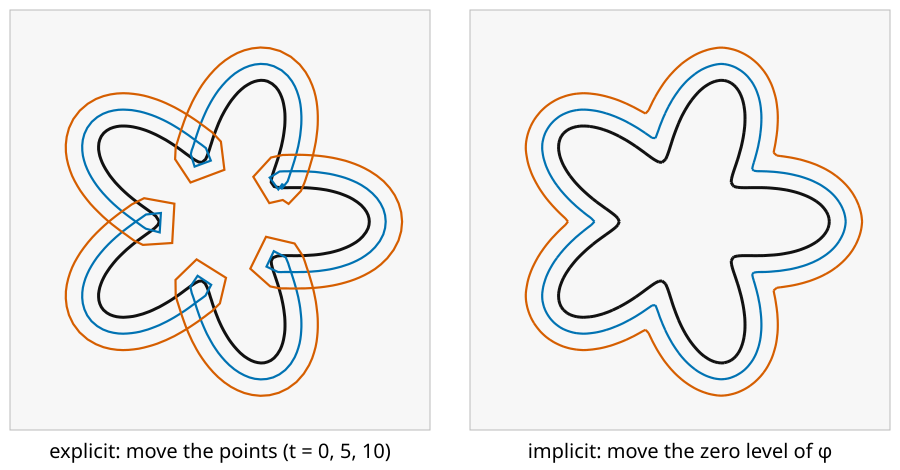

## About this lecture

Last unit: a curve is the zero level of $\phi$. Now we make it **move**: every point of the curve travels along its normal with a speed $F$. Instead of moving points, we change the image $\phi$ a little at every time step.

- Why moving the points of a polygon goes wrong.
- The **level set equation** $\phi_t + F|\nabla\phi| = 0$, first in 1D.
- One time step on the grid: **forward Euler** in time, **upwind** differences in space.
- How large a step may be: the **CFL condition**, seen in the demo first.
- Speeds: constant (grass fire) and **curvature flow**.
- **Merging and splitting** for free; **reinitialisation** to keep $\phi$ healthy.

*Slides titled **The math** give the formulas and proofs; the ideas are complete without them.*

::: notes
The densest unit of the day. Prerequisites: the previous unit (implicit curves, signed distance), forward differences and Taylor from Filtering & convolution. No PDE theory: the equation is "a rule for how each pixel value of φ changes per time step". Stability is shown in the demo before the condition is stated.
:::

## The task: move a curve along its normal

Every point of the curve moves with speed $F$ along its outward normal ($F > 0$: outward, $F < 0$: inward).

{width="80%"}

- **Explicit** (left): move each point of a polygon along its normal. At the dents the points converge, the curve **crosses itself** and forms loops ("swallowtails"); elsewhere the points spread apart. Two curves that meet would need **surgery** to merge.
- **Implicit** (right): the same motion as a moving zero level. No loops, corners where the fronts meet, and the topology may change.

## The idea: change φ, not the points

- Let $\phi$ depend on time. At each pixel, how fast must $\phi$ change so that its zero level moves with speed $F$?
- Picture a slope: where $\phi$ rises steeply, a small decrease of $\phi$ shifts the zero crossing only a little; where it is shallow, the same decrease shifts it far.
- To move the crossing outward by $F$ per unit time, $\phi$ must **drop** by $F$ times its **slope**:
$$\phi_t = -F\,|\nabla\phi| \qquad\text{the level set equation.}$$
- Only the speed **along the normal** matters: sliding points along the curve does not change the curve.

## The math: deriving the level set equation {.math}

A point $\mathbf x(t)$ on the moving curve keeps $\phi(\mathbf x(t), t) = 0$ for all $t$. Differentiate with the chain rule:
$$\phi_t + \nabla\phi\cdot\mathbf x'(t) = 0.$$
The point moves along the outward normal with speed $F$: $\mathbf x' = F\,\mathbf n = F\,\nabla\phi/|\nabla\phi|$. Then $\nabla\phi\cdot\mathbf x' = F\,|\nabla\phi|^2/|\nabla\phi| = F|\nabla\phi|$, so
$$\phi_t + F\,|\nabla\phi| = 0.$$
A tangential velocity $\mathbf v \perp \nabla\phi$ adds $\nabla\phi\cdot\mathbf v = 0$: it does not appear. The same equation holds for every level, not only zero: all level lines move with speed $F$.

## In 1D: an interval that grows

$\phi(x) = |x| - 1$ describes the interval $[-1, 1]$ (negative inside). With $F = 1$ the slope is 1 everywhere, so the V **shifts down** by $t$: $\phi = |x| - 1 - t$, the interval is $[-1 - t, 1 + t]$.

On the grid $x = -3, \dots, 3$, one step of $\Delta t = 0.5$:

| $x$ | −3 | −2 | −1 | 0 | 1 | 2 | 3 |
|---|---|---|---|---|---|---|---|
| $\phi$ before | 2 | 1 | 0 | −1 | 0 | 1 | 2 |
| $\phi$ after | 1.5 | 0.5 | −0.5 | −1 | −0.5 | 0.5 | 1.5 |

The crossing moves from $\pm 1$ to $\pm 1.5$: exactly $F\,\Delta t$. Note the bottom of the V: it does **not** move. Which slope to use there is the question of the next slides.

## One time step: forward Euler

- Time is discrete: $\phi^{n+1} = \phi^n - \Delta t\,F\,|\nabla\phi^n|$. This is the first-order **Taylor** step $\phi(t + \Delta t) \approx \phi(t) + \Delta t\,\phi_t$ (Taylor from *Filtering & convolution*).
- Space is discrete too: $|\nabla\phi|$ from differences of neighbours. Which differences? In the table, at $x = -1$ the backward difference $\phi(-1) - \phi(-2) = -1$ and the forward one $\phi(0) - \phi(-1) = -1$ agree. At $x = 0$ they disagree: $-1$ and $+1$.
- **Upwind**: use the difference on the side the front **comes from**. A growing front reaches a pixel from inside, so look towards smaller $\phi$; a shrinking front reaches it from outside.
- At the bottom of the V with $F > 0$, no neighbour is lower: nothing arrives from either side, the slope counts as 0 and the value stays.

## Central differences fail at kinks

Central difference at $x = 0$: $(\phi(1) - \phi(-1))/2 = 0$. The slope "vanishes" at the kink.

- **Shrinking** interval ($F = -1$, $\Delta t = 0.5$): the true interval vanishes at $t = 1$. Upwind: after two steps every value is positive. Central: the value at $x = 0$ stays $-1$ **forever**; the curve never disappears.
- Kinks are everywhere in level sets: the middle of every shape (the ridge of the distance function), and wherever two fronts collide.
- Central differences also make the scheme unstable for waves: small wiggles grow.

## The math: the upwind (Godunov) scheme {.math}

With $D^-_x\phi = \phi_i - \phi_{i-1}$ and $D^+_x\phi = \phi_{i+1} - \phi_i$ (and the same in $y$), Osher & Sethian's scheme uses, for $F > 0$,
$$|\nabla\phi|^2 \approx \max(D^-_x\phi, 0)^2 + \min(D^+_x\phi, 0)^2 + \max(D^-_y\phi, 0)^2 + \min(D^+_y\phi, 0)^2,$$
and for $F < 0$ the same with $\max$ and $\min$ swapped. Then $\phi_i^{n+1} = \phi_i^n - \Delta t\,F\,|\nabla\phi|$.

- $F > 0$ keeps a backward difference only if it is positive (the lower neighbour is behind), a forward one only if negative.
- At the minimum of $|x| - 1$ with $F > 0$: $D^- = -1$, $D^+ = +1$, both discarded: slope 0. With $F < 0$: both kept, slope $\sqrt 2$: the front arrives from both sides.
- This is the Godunov flux for the Hamilton–Jacobi equation $\phi_t + F|\nabla\phi| = 0$; its solution is the "entropy" one, where colliding fronts form a corner instead of crossing.

## Try it: moving fronts

```{=html}
<link rel="stylesheet" href="../demos/dist/demo.css">
<div data-demo="curveflow" data-preset="merge"></div>
<script src="../demos/dist/curveflow.js"></script>
```

::: notes
128 × 128 grid. φ in blue (inside) and red, black zero contour, grey level lines every 4 pixels; green: the explicit polygon moved with the same speed. Tour: "two blobs merge" (F = 1): play; at step 17 (t = 6.0) "pieces" drops from 2 to 1 while the green polygons simply overlap. "dumbbell splits" (F = −1): one piece becomes two at t = 6.0 (the bar is 12 pixels thick). "swallowtail" (star, F = 1, stops at t = 14): loops in the green polygon at the dents, corners in the black contour. Draw your own closed curves on the image: they are added to the shape.
:::

## How large may a time step be?

Try it first: preset "Δt too large" (1.5 times the limit). After about 15 steps a checkerboard pattern appears in φ and grows until everything explodes.

- Rule (Courant, Friedrichs & Lewy, **CFL**): in one step the front may move **at most one pixel**: $\Delta t \le \Delta x / |F|$ in 1D.
- In 2D a diagonal front moves $|F|/\sqrt2$ in $x$ **and** in $y$, and both count: $\Delta t \le \Delta x/(\sqrt2\,|F|)$, about $0.71/|F|$ pixels per unit speed.
- In 1D with $\Delta t = 2$ (twice the limit): the values after one step are $0, -1, -2, -1, -2, -1, 0$. The V has turned into a zigzag: the information jumped further than one pixel.

## The math: why the limit {.math}

For $F > 0$ in 1D near a front where $D^-_x\phi > 0$, the upwind step is $\phi_i^{n+1} = (1 - a)\,\phi_i^n + a\,\phi_{i-1}^n$ with $a = F\Delta t/\Delta x$.

- For $0 \le a \le 1$ the new value is a **weighted average** of old values: no new maxima or minima, errors cannot grow (monotone scheme).
- For $a > 1$ the weight $1 - a$ is negative: the scheme **extrapolates**, and an alternating error $\pm\epsilon$ is amplified by $|1 - 2a| > 1$ per step.
- In 2D the update averages $\phi_i$, $\phi_{i-1,j}$ and $\phi_{i,j-1}$ with weights $1 - a_x - a_y$, $a_x$, $a_y$, where $a_x = F\Delta t\,|n_x|/\Delta x$: the condition is $F\Delta t(|n_x| + |n_y|) \le \Delta x$, worst at $45°$: $\sqrt2\,F\Delta t \le \Delta x$.

## Speeds: grass fire and curvature flow

- **Constant $F$** ("grass fire"): every point moves the same distance. Growing shapes get rounded corners (a square grown by $t$ gets quarter circles of radius $t$); shrinking shapes get sharper; dents fill in.
- **Curvature flow** $F = -\varepsilon\kappa$: bumps ($\kappa > 0$) move in, dents ($\kappa < 0$) move out. The curve gets **smoother** and **shorter**, like a rubber band.
- A circle of radius $r$ under curvature flow ($\varepsilon = 1$) shrinks with speed $1/r$: $r(t) = \sqrt{r_0^2 - 2t}$. A circle of radius 30 vanishes at $t = 450$.
- Combinations $F = c - \varepsilon\kappa$: move with speed $c$, but smooth the curve while doing it (the basis of the next two units).
- The curvature term uses central differences (it behaves like diffusion, not like a wave) and needs a stricter step: $\Delta t \le \Delta x^2/(4\varepsilon)$.

## The math: curvature flow {.math}

**Circle.** $\kappa = 1/r$, the inward speed is $\varepsilon/r$: $r' = -\varepsilon/r$, so $\tfrac{d}{dt}r^2 = -2\varepsilon$ and $r^2 = r_0^2 - 2\varepsilon t$. Vanishing time $r_0^2/(2\varepsilon)$.

**Any closed curve.** The area changes by $A' = -\oint F\,ds = -\varepsilon\oint\kappa\,ds$, and for a simple closed curve the total turning $\oint\kappa\,ds = 2\pi$. So $A' = -2\pi\varepsilon$: every simple closed curve loses area at the same rate. (Check for the circle: $\tfrac{d}{dt}\pi r^2 = -2\pi$.)

**Grayson's theorem** (1987): a simple closed curve under curvature flow stays simple, becomes convex, and shrinks to a round point. It **never splits**: a dumbbell's thin neck has $\kappa < 0$ on its sides and widens.

**Stability.** The curvature term is like the heat equation $\phi_t = \varepsilon\nabla^2\phi$ (for a signed distance), for which the explicit step needs $\varepsilon\Delta t \le \Delta x^2/4$.

## Topology for free

- Two growing blobs: their $\phi$ is the minimum of two distances (union). When the zero level passes the saddle between them, the contour becomes one. No code detects this.
- A dumbbell shrinking with constant speed: the bar disappears first, and the contour splits in two.
- Explicit polygons cannot do either without checking every pair of edges for collisions.
- But not every flow changes topology: under **pure curvature flow** the dumbbell does **not** split (Grayson's theorem): it becomes round and vanishes as one piece. The demo shows it; expect the neck to pinch, and it widens instead.

## Try it: what can go wrong

```{=html}
<link rel="stylesheet" href="../demos/dist/demo.css">
<div data-demo="curveflow" data-preset="cfl"></div>
<script src="../demos/dist/curveflow.js"></script>
```

::: notes
"Δt too large" (circle, F = 1, Δt = 1.5 × limit = 1.06, one step per frame): max|φ| is 55 at step 5, 109 at step 15, 568 at step 20; the noise starts in the middle (far from the front) and reaches the contour by step 32; the demo stops when φ explodes. Set Δt/limit to 1.0: stable. "central differences": the circle shrinks with F = −1; the contour breaks into dozens of pieces around step 45, one pixel in the middle never leaves, and φ blows up. Switch to upwind: the circle vanishes at t = 29 (radius 30). "dumbbell, curvature flow": the neck widens, the shape rounds and shrinks as one piece; area drops by about 6.3 per unit time (2π). "no reinitialisation" (star, curvature flow): mean |∇φ| at the front falls from 1.00 to 0.56 by t = 100 and the grey level lines bunch and spread; set "reinit every" to 10 and it stays at 1.00.
:::

## Keeping φ healthy: reinitialisation

After many steps $\phi$ is no longer a signed distance: level lines bunch up in some places and spread out in others (curvature flow moves different levels at different speeds). Then $|\nabla\phi|$ is far from 1, gradients and curvatures get noisy, and the step-size rule based on "one pixel" is no longer meaningful.

**Reinitialisation**: replace $\phi$ by the signed distance to its own zero contour, without moving that contour.

- (a) **Recompute distances**: find the zero contour (marching squares), measure each pixel's distance to it, keep the sign of $\phi$. Exact; fine for a $128 \times 128$ grid.
- (b) **Let it flow**: evolve $\phi$ with a rule that pushes $|\nabla\phi|$ towards 1 while the zero level stays put (next slide).
- Every 10–20 steps is typical. To save work, only pixels in a **narrow band** around the front are updated and reinitialised.
- A front that only grows can instead be described by its arrival time, computed in one sweep: **fast marching**, on the dynamic programming day ("Dijkstra with an upwind update"). With speed 1 the arrival time is exactly the distance transform.

## The math: the reinitialisation equation {.math}

Sussman, Smereka & Osher (1994): evolve in an artificial time $\tau$
$$\phi_\tau = \operatorname{sign}(\phi_0)\,\big(1 - |\nabla\phi|\big),$$
with $\phi_0$ the function before reinitialisation and a smoothed sign $S = \phi_0/\sqrt{\phi_0^2 + \Delta x^2}$.

- Where $|\nabla\phi| < 1$ the values move away from zero, where $|\nabla\phi| > 1$ towards zero; at steady state $|\nabla\phi| = 1$.
- On the zero level $\operatorname{sign}(\phi_0) = 0$: the curve does not move (in practice it shifts a little; the exact method (a) avoids this).
- It is itself a level set equation, $\phi_\tau + S(|\nabla\phi| - 1) = 0$, with speed $S$: information flows outward from the front, so it needs upwind differences, and about as many steps as the width of the band to be corrected.

## Summary

- A curve moving with normal speed $F$ is the zero level of $\phi$ with $\phi_t + F|\nabla\phi| = 0$.
- One step: $\phi \leftarrow \phi - \Delta t\,F\,|\nabla\phi|$ (forward Euler), with **upwind** differences: look where the front comes from. Central differences stall at kinks.
- **CFL**: the front moves at most one pixel per step, $\Delta t \le \Delta x/(\sqrt2|F|)$ in 2D; curvature terms need $\Delta t \le \Delta x^2/4\varepsilon$.
- **Curvature flow** smooths and shrinks; area drops by $2\pi\varepsilon$ per unit time; it never splits a curve.
- Merging and splitting happen by themselves; explicit polygons form swallowtails and need surgery.
- **Reinitialise** $\phi$ to a signed distance every few steps.
