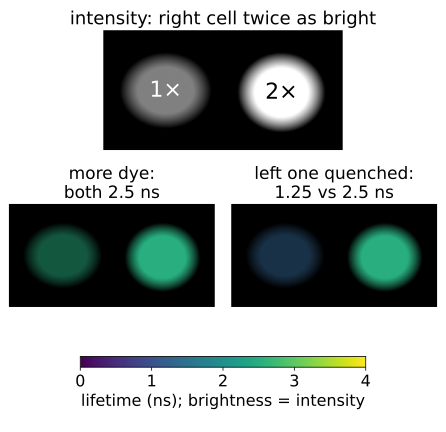
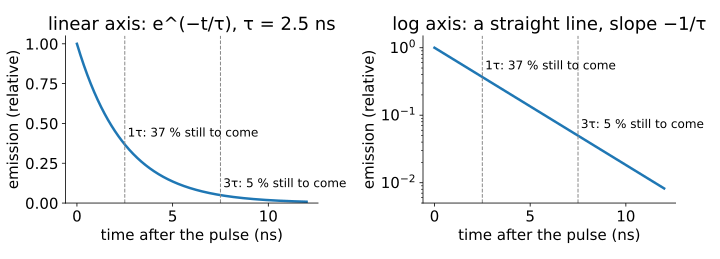
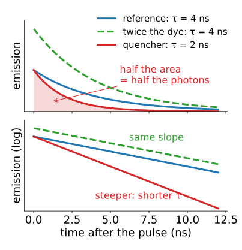
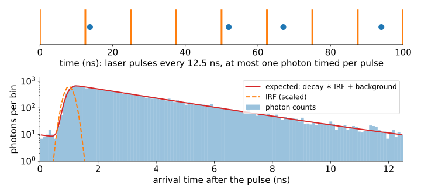
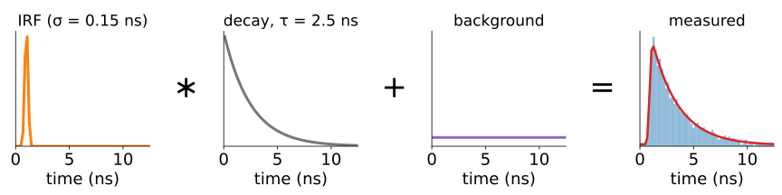
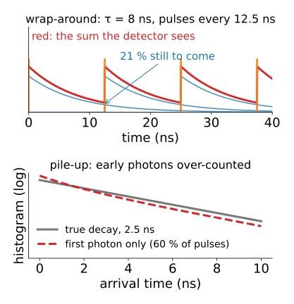
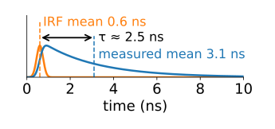
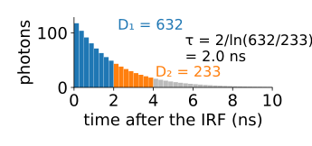
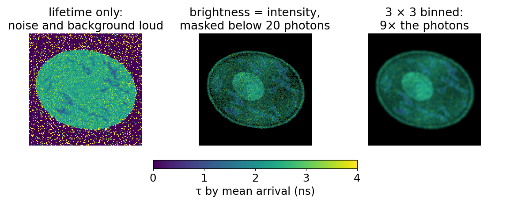

## About this lecture

A fluorescence image says **how much** light came from each pixel. Today we ask **how long** the light took to come out, and why that is a better measurement for many questions.

- The **fluorescence lifetime** τ: an exponential waiting time.
- What changes τ (quenching, binding, FRET) and what does **not** (concentration, brightness).
- **Time-correlated single-photon counting**: one photon per laser pulse, a histogram of arrival times.
- The **instrument response** blurs that histogram: a convolution, as the PSF blurs an image.
- Two quick estimates without fitting: the **mean arrival time** and **two gates**.

*Slides titled **The math** give the formulas and proofs; the ideas are complete without them.*

::: notes
First unit of the FLIM day (fluorescence quantification elective). Units: lifetime (this one), decayfit (fitting with few photons), phasor (frequency domain and phasors), flim-fret (FRET and metabolic imaging). Notation for the day: τ for a lifetime (never λ), ω = 2πf, N photons, (g, s) for phasor coordinates, IRF for the instrument response.
:::

## Brighter: more dye, or a different dye?

:::: {.columns}
::: {.column width="56%"}
Two cells, one twice as bright as the other. Is there **twice as much** dye, or is the dye **in a different state** (bound, quenched, near a partner)?

- Intensity mixes everything: concentration, laser power, detector gain, focus, bleaching, bleed-through from another dye.
- The **lifetime** is a property of the molecule and its surroundings. To first order it does not depend on how many molecules there are.
- A **FLIM image** (fluorescence lifetime imaging) stores both: intensity, plus "how long did the light take to come out" in every pixel.

The rest of the day: how to measure it, how to estimate it from few photons, and how to read it.
:::
::: {.column width="44%"}
{fig-alt="Top: an intensity image of two synthetic cells, the right one twice as bright as the left. Bottom: two possible lifetime images, colour for lifetime and brightness for intensity. If there is simply more dye, both cells are the same colour (2.5 ns). If the left cell's dye is quenched, it shows a different colour (1.25 ns) while the right one stays at 2.5 ns." width="100%"}
:::
::::

## What a lifetime is

After a laser pulse puts a molecule in its excited state, it leaves that state with a **constant chance per nanosecond**, by emitting a photon or by losing the energy without light.

{width="88%" fig-align="center"}

- Many molecules: the emission decays **exponentially**, $I(t) = A\,e^{-t/\tau}$.
- τ is the **mean** waiting time; typical values 0.3 to 5 ns.
- After one τ, 37 % of the photons are still to come; after 3τ, 5 %. On a **log axis** the decay is a straight line.

::: notes
The radioactive-decay picture: no memory, a constant hazard. Example values as shapes, not products: a green fluorescent protein about 2.5 ns, fluorescein in base about 4 ns, free NADH about 0.4 ns, protein-bound NADH 2 to 3 ns.
:::

## The math: the exponential law {.math}

Excited molecules $n(t)$ leave by light (rate $k_r$) or without light (rate $k_{nr}$):

$$\frac{dn}{dt} = -(k_r + k_{nr})\,n \quad\Rightarrow\quad n(t) = n_0\,e^{-t/\tau}, \qquad \tau = \frac{1}{k_r + k_{nr}}.$$

- Emission $I(t) = k_r\,n(t)$. The **quantum yield** (photons per excitation) is $Q = k_r/(k_r + k_{nr}) = k_r\tau$.
- One molecule's photon arrives at a random time with density $p(t) = \tau^{-1}e^{-t/\tau}$: mean $\tau$, variance $\tau^2$.
- Fraction still to come at time $t$: $\int_t^\infty p = e^{-t/\tau}$.

## What changes τ, and what does not

:::: {.columns}
::: {.column width="57%"}
**Not** (to first order): concentration, laser power, detector gain, out-of-focus dilution, bleed-through of another channel. They change **how many** photons, not **when**.

**Yes**: anything that opens a **new way to lose the energy**.

- A **quencher** (oxygen, a halide ion, a nearby amino acid).
- **Binding** to a protein, which can lengthen or shorten τ.
- **FRET**: an acceptor within a few nanometres takes the energy (fourth unit of the day).
- pH, viscosity, ion concentration, for dyes designed as sensors.

A new exit makes the molecule leave sooner (τ falls) **and** wastes energy (fewer photons): brightness and lifetime fall **together**.
:::
::: {.column width="43%"}
{fig-alt="Decays of a 4 ns reference dye, twice as much of the same dye, and the dye with a quencher (2 ns). Top, linear axis: the quenched decay has half the area, so half the photons. Bottom, log axis: twice the dye is the same slope shifted up; the quenched decay is steeper." width="100%"}
:::
::::

## The math: quenching {.math}

Add a quenching rate $k_q[\mathrm{Q}]$ for a quencher at concentration $[\mathrm{Q}]$:

$$\tau = \frac{1}{k_r + k_{nr} + k_q[\mathrm{Q}]}, \qquad \frac{\tau_0}{\tau} = 1 + k_q\tau_0[\mathrm{Q}] \quad\text{(Stern–Volmer)}.$$

- $Q = k_r\tau$: since $k_r$ is unchanged, the quantum yield falls by the **same factor** as τ.
- Example: $\tau_0 = 4$ ns with $Q_0 = 0.8$ gives $k_r = 0.2\ \text{ns}^{-1}$; a quencher that halves τ to 2 ns halves Q to 0.4.

## Measuring nanoseconds: one photon per pulse

{width="78%" fig-align="center"}

- A pulsed laser fires every 12.5 ns (80 MHz). After each pulse a fast detector times **at most one photon**.
- Repeat millions of times: a **histogram of arrival times** (say 64 or 256 bins over the 12.5 ns). Every bin is a **Poisson** count (recall [camera noise](../cameranoise/lec.qmd)).
- A scanning microscope makes one histogram per pixel: an $x \times y \times t$ stack, like the lambda stack of the unmixing day with time bins instead of wavelength bins.

::: notes
Time-correlated single-photon counting (TCSPC). Single-photon detectors have no read noise but a dead time after each photon. The camera-based alternatives (time-gated and frequency-modulated cameras) come up at the end of this unit and in the phasor unit.
:::

## Recall: blur is a convolution

From [the PSF unit](../psf/lec.qmd): the image is the object **convolved** with the PSF, plus noise. FLIM has the same forward model **in time**:

$$\text{measured histogram} = \text{IRF} * \text{decay} + \text{background} + \text{Poisson noise}.$$

- The laser pulse has a width and the detector's timing jitters: the **instrument response function** (IRF), 0.1 to 0.3 ns wide. It is the PSF of the time axis.
- Measured by recording light scattered straight back (a "zero-lifetime" sample).
- The **background** (dark counts, room light) is flat in time.

{fig-alt="The forward model as four small plots: a narrow IRF (σ = 0.15 ns) convolved with a 2.5 ns decay, plus a flat background, equals the measured histogram of Poisson counts (bars) around its expected value (red line)." width="92%" fig-align="center"}

## The math: the expected histogram {.math}

The decay repeats every period $T$. A photon excited by an earlier pulse $k$ periods ago arrives at $t + kT$; summing the geometric series over all earlier pulses gives the **periodic decay** on $0 \le t < T$:

$$p_T(t) = \sum_{k \ge 0} \frac{e^{-(t + kT)/\tau}}{\tau} = \frac{e^{-t/\tau}}{\tau\,(1 - e^{-T/\tau})}.$$

With $N$ photons, the IRF $h$ and background $b$ per bin, bin $j$ (from $t_j$ to $t_{j+1}$) expects

$$\mu_j = N\int_{t_j}^{t_{j+1}} (h * p_T)(t)\,dt + b, \qquad y_j \sim \text{Poisson}(\mu_j).$$

## Try it: photons into a histogram

```{=html}
<link rel="stylesheet" href="../demos/dist/demo.css">
<div data-demo="tcspc" data-preset="log"></div>
<script src="../demos/dist/tcspc.js"></script>
```

::: notes
Top: the last six laser pulses (orange) and the photons timed after them (blue). Bottom: the histogram (blue bars), the decay without IRF (grey), the IRF (orange, scaled) and the expected histogram (red). Drag on the histogram to move the two gates. Tour, numbers from the demo with its fixed seed: "one photon at a time" (5 % of pulses, press play): most pulses are empty. "The log plot is a straight line" (τ = 2.5 ns, 100 000 photons): mean arrival 3.37 − IRF 1.00 = 2.37 ns, two gates 2.47 ns. The mean arrival is low because the window is finite: the tail of each decay wraps into the start of the next period. "τ = 8 ns at 80 MHz": 21 % of a decay is still to come at the next pulse; mean arrival gives 4.23 ns, two gates 8.16 ns; set the period to 50 ns and the mean arrival gives 7.90 ns. "Too bright": 60 % of pulses have a photon, 38.8 % of those had two or more; mean arrival 1.87 ns, two gates 1.79 ns. "Background flattens the tail" (15 %): mean arrival 2.80 ns, two gates 2.72 ns.
:::

## Two side effects of the pulse train

:::: {.columns}
::: {.column width="56%"}
**Wrap-around.** When τ is not much shorter than the period, the tail of the previous decay is still arriving when the next pulse fires. A fraction $e^{-T/\tau}$ is still to come: 4.4 % for τ = 4 ns at 80 MHz, 21 % for τ = 8 ns. The histogram is a sum over all earlier pulses (the periodic decay).

**Pile-up.** The electronics time only the **first** photon after a pulse. When two photons arrive in one period, the later one is lost, so early times are over-counted and τ looks **shorter**.

- Rule of thumb: detect a photon in only a few percent of the pulses (1 % of pulses: 0.5 % of them hold a second photon).
- So FLIM is **slow**: 1 000 photons in each of 256 × 256 pixels at 1 % of 80 MHz takes 82 s. Every photon counts (next unit).
:::
::: {.column width="44%"}
{fig-alt="Top: decays of 8 ns after pulses every 12.5 ns; each decay is still at 21 % when the next pulse fires, and the detector sees their sum (red). Bottom, log axis: the true 2.5 ns decay and the histogram of only the first photon when 60 % of pulses give a photon; the first-photon histogram is too high early and too low late, so τ looks shorter." width="100%"}
:::
::::

## Quick estimates without fitting

:::: {.columns}
::: {.column width="50%"}
**Mean arrival time.** For one exponential the mean arrival time is τ. Means **add** under convolution, so subtract the IRF's mean:

$$\hat\tau = \langle t\rangle_\text{measured} - \langle t\rangle_\text{IRF}.$$

Example: measured mean 3.1 ns, IRF mean 0.6 ns: τ ≈ 2.5 ns.

{fig-alt="The IRF with mean 0.6 ns and the measured decay with mean 3.1 ns; the arrow between the two means is the lifetime, about 2.5 ns." width="100%"}
:::
::: {.column width="50%"}
**Two gates.** Count photons in two adjacent windows of equal width Δt, after the IRF: on an exponential, $D_1/D_2 = e^{\Delta t/\tau}$, so

$$\hat\tau = \frac{\Delta t}{\ln(D_1/D_2)}.$$

Example: 632 and 233 photons in 0–2 and 2–4 ns: τ = 2/ln 2.71 = 2.0 ns.

{fig-alt="A histogram of 1000 photons from a 2 ns decay. The bins from 0 to 2 ns (blue) hold D1 = 632 photons, those from 2 to 4 ns (orange) D2 = 233; τ = 2/ln(632/233) = 2.0 ns." width="100%"}
:::
::::

Both are fast. Both break with **background** (flat counts pull the mean towards the middle of the window and flatten the ratio), a **short window**, or **two lifetimes**. The next unit fits instead.

## The math: means add, two gates {.math}

**Means add under convolution.** With $h$ and $p$ normalised to area 1,

$$\int t\,(h * p)(t)\,dt = \iint (u + v)\,h(u)\,p(v)\,du\,dv = \langle t\rangle_h + \langle t\rangle_p.$$

**Two gates.** For $I(t) = A e^{-t/\tau}$, $D_1 = \int_{a}^{a + \Delta t} I$, $D_2 = \int_{a + \Delta t}^{a + 2\Delta t} I = e^{-\Delta t/\tau}D_1$. A background $b$ per gate gives $\frac{D_1 + b}{D_2 + b} < \frac{D_1}{D_2}$, so $\hat\tau$ is too **long**.

## Try it: a lifetime image

```{=html}
<link rel="stylesheet" href="../demos/dist/demo.css">
<div data-demo="flimcell" data-mode="estimate" data-preset="intensity"></div>
<script src="../demos/dist/flimcell.js"></script>
```

::: notes
The cell of the unmixing day as a FLIM image: 128 × 128 pixels, 64 time bins over 12.5 ns, IRF σ = 0.1 ns at 0.5 ns, Poisson counts. Left: intensity; middle: lifetime as colour, intensity as brightness; right: the clicked pixel's histogram. Tour: "intensity lies, lifetime does not": one dye (2.5 ns) whose concentration varies about 10×; the lifetime image is flat. Pixel (64, 50): 251 photons, mean arrival 2.24 ns, two gates 3.37 ns (true 2.50). "Same brightness, different lifetime": flat intensity, the nucleus holds a 1.0 ns dye (pixel (56, 60): 0.96 ns). "A quencher shortens τ": the mitochondria are dimmer and shorter. "Too few photons per pixel: bin": 21 photons in the pixel; binning 3×3, 5×5, 7×7 gives 201, 559, 1099 photons and mean-arrival estimates 2.46, 2.41, 2.47 ns. "Background pixels: mask them": a pixel outside the cell has 9 photons and a "lifetime" of 5.70 ns: pure background, whose mean arrival sits in the middle of the window.
:::

## Showing a lifetime image

{fig-alt="The flimcell demo's quencher scene at about 60 photons in the brightest pixels, shown three ways. Lifetime as colour alone: the background around the cell and the dim pixels are loud noise. Brightness = intensity with pixels below 20 photons masked: the cell stands out, the quenched mitochondria are shorter. After 3 × 3 binning: smoother lifetimes at a lower resolution." width="74%" fig-align="center"}

- **Hue = lifetime, brightness = intensity** (recall [colour display](../colour-display/lec.qmd)): dim pixels fade to black instead of showing loud noise. Use a perceptual colour map, not a rainbow.
- **Mask** pixels with too few photons: their lifetime is noise, or background.
- **Bin** pixels (sum the histograms of a 3 × 3 or 5 × 5 neighbourhood) to gain photons, at the cost of resolution (recall [denoising](../denoise/lec.qmd)).
- **Time-gated cameras**: instead of timing single photons, a wide-field camera takes one image per delay window; the two-gate formula per pixel gives a lifetime image quickly. Frequency-domain cameras come in the phasor unit.

## Summary

- The **lifetime** τ is the mean time a molecule stays excited; the emission decays as $e^{-t/\tau}$, a straight line on a log axis.
- τ does **not** depend on how many molecules there are; it **does** change with quenching, binding, FRET and the environment, together with the brightness per molecule.
- **TCSPC**: at most one photon timed per laser pulse; a histogram of arrival times per pixel, with Poisson counts.
- Measured histogram = **IRF ∗ decay** + background: the forward model of the PSF, in time. The pulse train adds **wrap-around**; bright samples add **pile-up**.
- **Mean arrival time** (minus the IRF's mean) and **two gates** give quick estimates; background, short windows and mixtures bias them.
