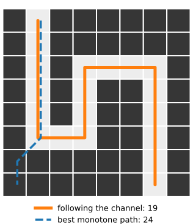
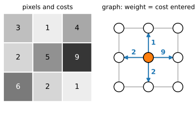
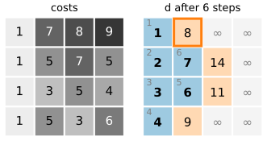
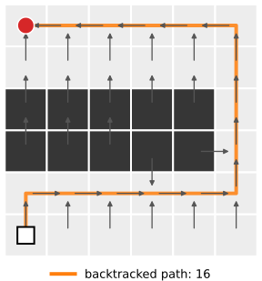
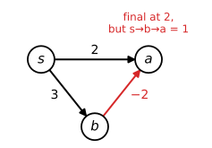
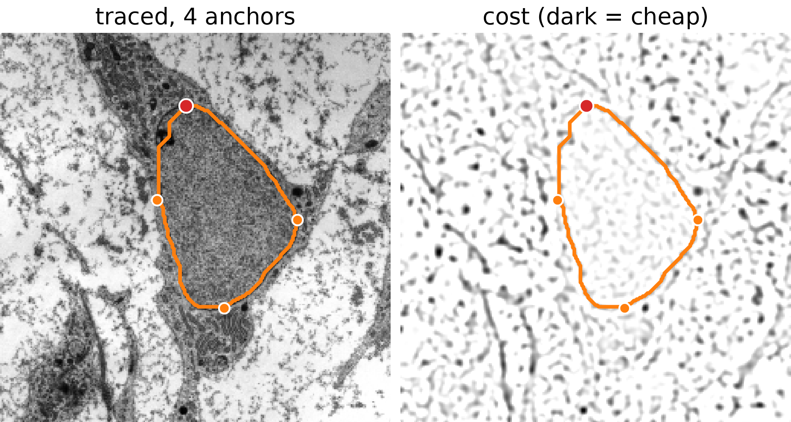
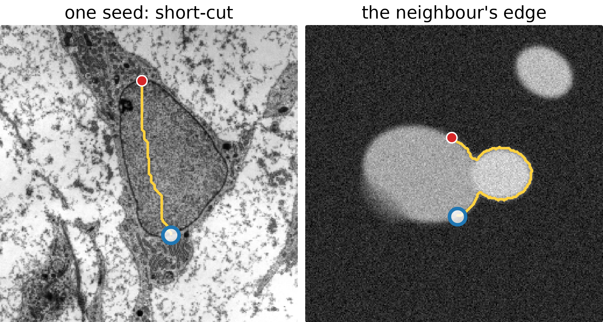
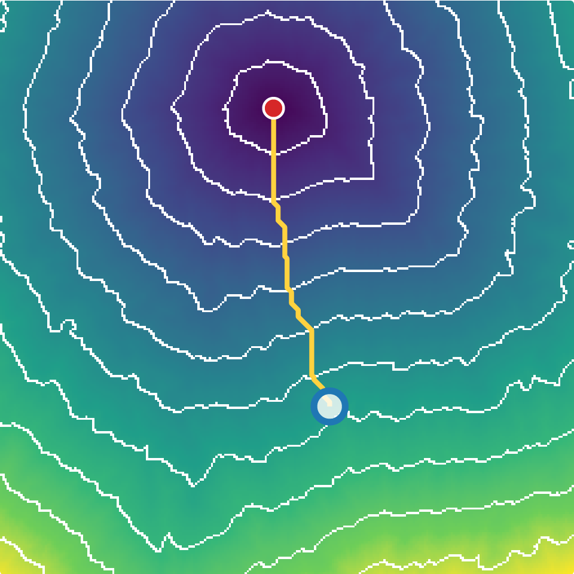

## About this lecture

The DP table needs an **order**: row after row, angle after angle. A boundary that may wander in any direction has no such order. Today the algorithm **finds the order as it runs**.

- Pixels as a **graph**; the same Bellman equations, but no fixed order.
- **Dijkstra's algorithm**: the unfinished pixel with the smallest tentative cost is final. A **priority queue** gives the order.
- The result is a **shortest-path tree**: every pixel knows its best predecessor.
- **Live-wire** (intelligent scissors): click a seed, and the cheapest path to the mouse follows in real time.
- Same tree, other uses: length along a neurite, distances, watershed.

*Slides titled **The math** give the formulas and proofs; the ideas are complete without them.*

::: notes
Prerequisites: the DP table and backtracking (first unit of this day), graphs from the graph-cut day (recalled in two lines), the gradient magnitude and the Laplacian of Gaussian from the filtering/edges units (used as costs, not re-taught). Watershed (day 10) is recalled on one slide.
:::

## The detour

:::: {.columns}
::: {.column width="60%"}
Recall the "detour" grid of the first unit: a cheap channel that runs down, right, **up** and down again.

- The best **monotone** path (one cell per row) costs **24**: it has to cross two expensive cells.
- Following the channel costs **19**, but that path goes **up**: not one cell per row.
- Worse: the cheapest way to a cell in row 2 may come from row 5, which a row-by-row table fills **later**.
:::
::: {.column width="40%"}
{fig-alt="An 8 by 8 grid of dark cells (cost 9) with a light channel (cost 1) that runs down column 1, right along row 5, up column 3, right along row 2 and down column 6 to the bottom. The path following the channel costs 19 (orange, solid); the best monotone path goes down column 1 and then crosses two dark cells to the bottom, cost 24 (blue, dashed)." width="100%"}
:::
::::

The same happened to the distance transform: one raster pass is wrong where the shortest path goes up or left. We need a method that works without a fixed order.

## Pixels as a graph

Recall from the graph-cut day: a **graph** is a set of nodes and edges between them, each edge with a weight.

- Node = pixel; edges to the **4** (or **8**) neighbours.
- Weight of a move $u \to v$: here the **cost of the pixel entered**, $C(v)$ (times the step length 1 or $\sqrt 2$ for 8 neighbours).
- A path from the seed $s$ pays the sum of its weights. On the grids of this unit the seed's own cost counts too, as in the first unit.

:::: {.columns}
::: {.column width="45%"}
The question: the cheapest path from $s$ to **every** pixel.
:::
::: {.column width="55%"}
{fig-alt="Left: 3 by 3 pixels with costs 3 1 4 / 2 5 9 / 6 2 1. Right: the same pixels as nodes of a graph with edges to the 4 neighbours; the four moves out of the centre node are labelled with the costs of the pixels they enter: 1 up, 2 left, 9 right, 2 down." width="100%"}
:::
::::

## The same equations, no order

The principle of optimality still holds: the best path to $v$ ends with a step from some neighbour $u$, and its part up to $u$ is the best path to $u$. So

> $d(v)$ = the smallest $d(u) + w(u, v)$ over the neighbours $u$ of $v$, and $d(s)$ = its start value.

These are the same equations as the DP table. But now $d(v)$ may depend on a neighbour **below** it, and that neighbour on $v$ itself: the equations go round in circles. There is no row order in which every right-hand side is known first.

## Dijkstra's idea

:::: {.columns}
::: {.column width="58%"}
All weights are **non-negative**. Keep a **tentative** cost for every pixel (∞ at first, the start value at the seed).

1. Take the **unfinished pixel with the smallest tentative cost**. Its cost is **final**: any other route to it would pass through some unfinished pixel, which already costs at least as much, and can only add.
2. **Update its neighbours**: if going through it is cheaper, lower their tentative cost and remember it as their predecessor.
3. Repeat until every pixel is final.

A **priority queue** hands out the smallest tentative pixel quickly. This is DP where the order is **discovered** while the algorithm runs (Dijkstra, 1959).
:::
::: {.column width="42%"}
{fig-alt="The 4 by 4 by-hand grid (costs 1 7 8 9 / 1 5 7 5 / 1 3 5 4 / 1 5 3 6) from the top-left corner, after 6 steps. Final pixels (blue, with their step number): the left column with d = 1, 2, 3, 4, then 6 and 7 in the second column. Tentative pixels (shaded): 8, 14, 11 and 9. The rest is still infinity. The next pixel to become final, the 8 at the top, is outlined." width="100%"}

Blue: final (step number in the corner). Shaded: tentative, in the queue. The outlined 8 is the next to become final.
:::
::::

## The math: why the smallest is final {.math}

Let $F$ be the set of final pixels, with $d(u)$ correct for $u \in F$, and let $v \notin F$ have the smallest tentative value $\tilde d(v) = \min_{u \in F,\, u \sim v} d(u) + w(u, v)$.

Take any path from $s$ to $v$. It leaves $F$ somewhere: let $y \notin F$ be the first pixel on it outside $F$, entered from $x \in F$. Its cost is at least

$$d(x) + w(x, y) + (\text{rest}) \;\ge\; \tilde d(y) + 0 \;\ge\; \tilde d(v),$$

because the rest has non-negative weights and $v$ had the smallest tentative value. So no path beats $\tilde d(v)$: it is final. Induction over the pops proves that every final value is correct.

With a binary heap, each pop and each update costs $O(\log N)$: $O(N \log N)$ for an image with $N$ pixels and a fixed number of neighbours.

## Try it: Dijkstra step by step

```{=html}
<link rel="stylesheet" href="../demos/dist/demo.css">
<div data-demo="dpgrid" data-mode="dijkstra" data-preset="exercise"></div>
<script src="../demos/dist/dpgrid.js"></script>
```

::: notes
Left: the costs; right: the tentative cost d (∞ = not reached yet). "step" makes the smallest pixel of the queue final (blue, numbered in the order they become final) and updates its 4 neighbours (outlined); the queue, smallest first, is listed under the controls. Arrows point to each pixel's predecessor (grey while tentative, orange when final). At the end "backtrack" follows the arrows from the target. Tour: by-hand grid (from the top-left corner; target bottom-right, cost 18). "the detour": the same grid as in the first unit, now solved: 19. "a wall with one gap": from the top-left to the bottom-left corner: the path goes right, through the gap and back left (16). Switch to "one raster pass": the same grids with one top-to-bottom, left-to-right pass: wrong cells in red, with the true value as the small number.
:::

## The shortest-path tree

:::: {.columns}
::: {.column width="62%"}
When Dijkstra stops, every pixel has a final cost and a **predecessor**: the neighbour its best path comes from.

- The predecessors form a **tree** rooted at the seed: following them from any pixel leads back to the seed.
- The cheapest path to **any** pixel is read off by **backtracking**, as in the DP table: a few steps, no new computation.
- Work: every pixel is made final once and updates its neighbours: about $N \log N$ for $N$ pixels. A $256 \times 256$ image takes some tens of milliseconds.
:::
::: {.column width="38%"}
{fig-alt="The 6 by 6 'wall with one gap' grid from the demo: two rows of dark cells across the middle with a gap at the right end. Every pixel has an arrow to its predecessor, all leading back to the seed in the top-left corner. The backtracked path to the bottom-left corner runs right along the top row, down through the gap and back left, cost 16." width="100%"}
:::
::::

## When Dijkstra fails, and when we don't need it

:::: {.columns}
::: {.column width="66%"}
- A **negative** weight breaks the argument: a pixel declared final could still be reached more cheaply by a later detour through the negative edge. (Costs of pixels, which are $\ge 0$, are fine.)
:::
::: {.column width="34%"}
{fig-alt="Three nodes s, a, b: s to a costs 2, s to b costs 3, b to a costs -2. Dijkstra makes a final at 2, but the path s, b, a costs 1." width="100%"}
:::
::::

- If the moves only go **forward** (down, as in the first unit), the graph has **no cycles**, and a fixed order exists: the row-by-row table. Monotone-path DP is the special case where the order is known in advance.

| | order of evaluation | needs |
|---|---|---|
| DP table | fixed (rows, angles) | moves only forward |
| Dijkstra | discovered (smallest first) | non-negative weights |

## Live-wire: an edge-following cost

:::: {.columns}
::: {.column width="55%"}
**Intelligent scissors** (Mortensen & Barrett, 1995; Falcão et al., 1998): the user clicks on a boundary, and the cheapest path follows the edges. The local cost of entering a pixel is low on edges:

- **gradient magnitude**: low where the gradient is strong, $1 - G/G_{\max}$;
- **Laplacian zero crossing**: 0 on the zero crossing of the Laplacian of Gaussian (the centre of the edge), 1 elsewhere;
- **gradient direction**: a penalty for running **across** the edge direction instead of along it;

each with a weight, after Gaussian smoothing with scale $\sigma$ (the edges day owns these filters). For a thin bright or dark line, the line response itself.
:::
::: {.column width="45%"}
{fig-alt="Two stills of the live-wire demo on the micrograph. Left: the nucleus traced with four anchors, the contour following the dark nuclear envelope. Right: the dark-line cost image, where the envelope and other dark structures are dark (cheap), with the same contour." width="100%"}

[Micrograph: transmission electron micrograph of a mesenchymal stem cell, Robert M. Hunt, CC BY 3.0, via Wikimedia Commons.]{style="font-size: 0.6em; color: #666;"}
:::
::::

## The math: the link cost {.math}

For a move from $p$ to a neighbour $q$ of length $\ell = |q - p|$ ($1$ or $\sqrt2$):

$$w(p, q) = \ell\,\big(\varepsilon + w_G\, f_G(q) + w_Z\, f_Z(q)\big) + w_D\, f_D(p, q),$$

with $f_G = 1 - G/G_{\max}$, $f_Z \in \{0, 1\}$, and, for unit vectors $\mathbf u_p, \mathbf u_q$ **along** the edge (the gradient turned by $90°$) and the unit link $\mathbf l$ (turned to agree with $\mathbf u_p$),

$$f_D(p, q) = \tfrac{2}{3\pi}\big(\arccos(\mathbf u_p \cdot \mathbf l) + \arccos(\mathbf l \cdot \mathbf u_q)\big) \in [0, 1].$$

Weights $w_Z = w_G = 0.43$, $w_D = 0.14$ (Mortensen & Barrett); $\varepsilon = 0.02$ keeps every step slightly expensive, so flat regions do not give free detours. All terms are $\ge 0$: Dijkstra applies.

## Live-wire: how it is used

1. **Click a seed** on the boundary. One Dijkstra run computes the tree from the seed to **every** pixel.
2. **Move the mouse**: the wire is the backtracked path from the mouse to the seed. Only backtracking, so it follows in real time.
3. When the wire leaves the boundary, **click** to fix the good part: that point becomes an **anchor** and the seed of a new tree.
4. **Close** the contour by joining the last anchor to the first seed.

The user steers, the algorithm does the precise tracing. "Path cooling" fixes anchors automatically where the wire has been stable for a while.

## Try it: live-wire

```{=html}
<link rel="stylesheet" href="../demos/dist/demo.css">
<div data-demo="livewire" data-preset="nucleus"></div>
<script src="../demos/dist/livewire.js"></script>
```

::: notes
Click: seed / anchor; move the mouse, or drag the round handle (for touch and projectors), and the yellow wire follows; orange = fixed segments. "close" joins the last anchor to the first seed. Tour: "trace the nucleus" (micrograph, dark-line cost, 4 anchors, closed: 362.7 px). "weak edge": seed at the top of the nucleus, free end at the bottom: the wire cuts straight through the nucleus (143.4 px for a straight line of 135.3 px): add an anchor on the left envelope. "no smoothing" (σ = 0.5) on the weak arc of the synthetic nucleus: the wire wanders; raise σ to 1.5. "the neighbour steals the path": the wire runs around the outer edge of the brighter neighbour (195.2 px for 68.2 px straight); an anchor at the contact fixes it. "measure along a neurite": bright-line cost, 240.1 px along the neurite against 188.4 px straight. View "distance from seed": the tree's costs with iso-lines.
:::

## How live-wire behaves

:::: {.columns}
::: {.column width="56%"}
- **Short-cuts**: the cost is a **sum** along the path, so a long detour along a weak edge can cost more than a short cut across a uniform region. More anchors, or a stronger edge term, help.
- **The neighbour steals the path**: a stronger edge nearby (another cell) is cheaper per pixel; the wire jumps over to it.
- **Smoothing**: too little ($\sigma$ small) and the noise makes cheap pixels everywhere; too much and the edge is displaced and nearby edges merge.
- The **user** is part of the method: the result is as good as the anchors.
:::
::: {.column width="44%"}
{fig-alt="Two stills of the live-wire demo. Left: on the micrograph, with one seed at the top of the nucleus and the free end at the bottom, the wire cuts straight through the nucleus instead of following the envelope. Right: on the synthetic nuclei, the wire between two points on the main nucleus runs around the outer edge of the brighter neighbour." width="100%"}

[Micrograph: transmission electron micrograph of a mesenchymal stem cell, Robert M. Hunt, CC BY 3.0, via Wikimedia Commons.]{style="font-size: 0.6em; color: #666;"}
:::
::::

## Same tree, other uses

:::: {.columns}
::: {.column width="64%"}
- **Length along a structure**: the distance along a neurite or a vessel between two points: the cheapest path with a cost that is low on the structure; its length counts steps of 1 and $\sqrt2$ (as on the skeleton day).
- **Distance from a point**: with cost 1 per step, the tree gives the grid distance from the seed: city block with 4 neighbours, octagons with 8. Exact for the graph, not for the Euclidean plane (next unit). With an image cost, the iso-lines of the distance bend around the structures (right).
- **Watershed** (day 10) floods from markers with the same priority queue. It minimises the **maximum** height along the path (the lowest pass), where live-wire minimises the **sum**.
- **Fast marching**, the next unit: Dijkstra's order with a different update, for continuous, round fronts.
:::
::: {.column width="36%"}
{fig-alt="Live-wire demo, view 'distance from seed' on the micrograph: the cost of the cheapest path from a seed at the top of the nucleus as a colour map (dark = near) with white iso-lines that are irregular because they follow the image cost; the wire to the free end below is drawn in yellow." width="100%"}

[Micrograph: transmission electron micrograph of a mesenchymal stem cell, Robert M. Hunt, CC BY 3.0, via Wikimedia Commons.]{style="font-size: 0.6em; color: #666;"}
:::
::::

## Summary

- When no fixed order exists, the Bellman equations $d(v) = \min_u d(u) + w(u, v)$ still hold.
- **Dijkstra**: the unfinished pixel with the smallest tentative cost is final (non-negative weights); a **priority queue** gives the order; $O(N \log N)$.
- The result is a **shortest-path tree**: the cheapest path to any pixel by backtracking.
- **Live-wire**: edge-following local costs, one tree per anchor, real-time backtracking to the mouse; watch for short-cuts and stronger neighbouring edges.
- The monotone DP table is the special case with a known order; watershed uses the same queue with the maximum instead of the sum.
