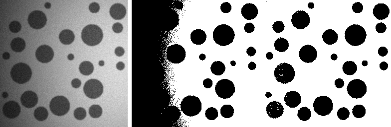
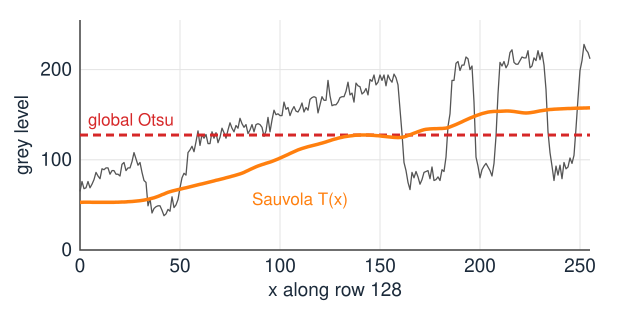
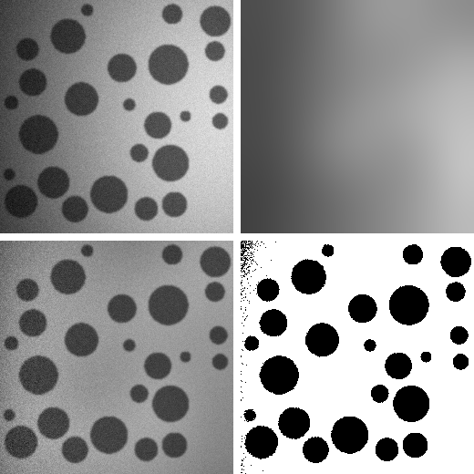
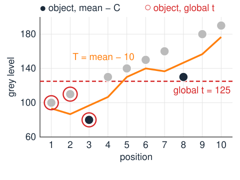
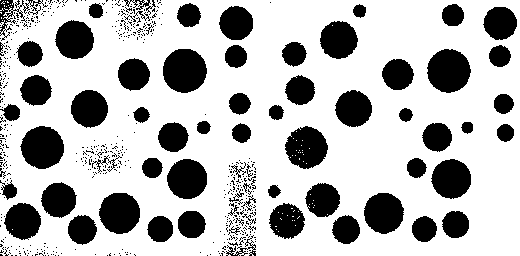
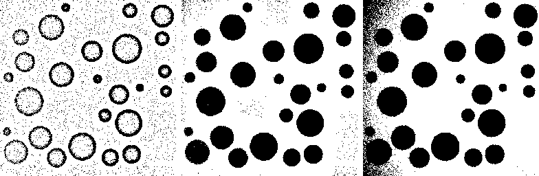
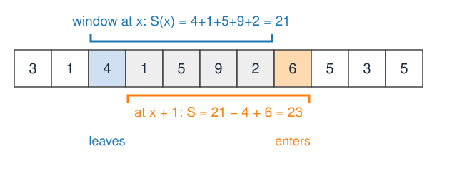
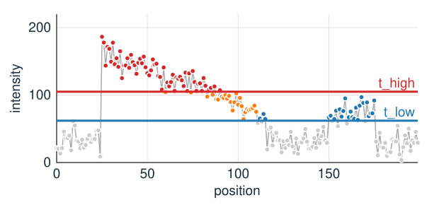
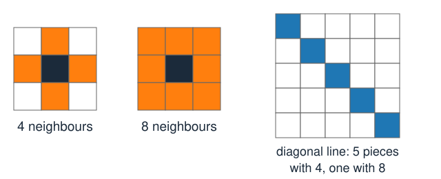

## About this lecture

The last two units chose **one** threshold for the whole image from its histogram. That fails as soon as the image is not two clean classes.

- When a global threshold cannot work: **uneven illumination**, few small objects, faint objects, **noise**.
- Remedy 1: **correct the background**, then threshold globally.
- Remedy 2: **local thresholds** $T(x)$ from a window: mean − C, **Niblack**, **Sauvola**; the window size.
- Remedy 3: **hysteresis**: two thresholds, and connectivity to sure seeds.
- When noise is the problem: let **neighbours agree** (graph cuts, MRFs).

*Slides titled **The math** give the formulas and proofs; the ideas are complete without them.*

::: notes
Convention in this unit: the synthetic test image is bright-field-like, dark objects on a bright background, because the local methods are published in that form (text on paper). Object where I < T. For bright objects, apply everything to the inverted image. Recalls: box and Gaussian filters (kernels, day 1); hysteresis inside Canny (edges day, day 2); connected components (labelling day, day 9).
:::

## When a global threshold fails

{width="80%"}

Left: dark discs, lit by a light that is dim on the left and bright on the right (plus a darker rim, **vignetting**). Middle: the best global threshold (Otsu); object in black. Right: a local threshold (Sauvola).

- **Uneven illumination**: the background on the left (about 79) is darker than the objects on the right (about 90). No single $t$ can be above every object and below every background pixel.
- **Unimodal histogram**: a few small objects make no peak of their own.
- **Small or faint objects**: blur mixes them with the background (partial volume).
- **Noise**: single pixels cross any threshold; no rule on single pixels fixes that.

## The threshold must follow the background

{width="56%"}

One row of the image (grey), the global threshold (red, dashed) and a local threshold $T(x)$ (orange).

- The **background level** changes along the row; the objects are dips **relative to** it.
- A global threshold is below the background on the right but above it on the left: it calls the whole left side object.
- A threshold that **follows** the local background separates every dip from its own surroundings.

## Remedy 1: correct the background

:::: {.columns}
::: {.column width="62%"}
Estimate the smooth background $B(x)$, remove it, then threshold the corrected image globally.

- $B(x)$: a **heavily blurred** copy of the image (blur much larger than the objects), or a **plane or quadratic surface** fitted by least squares to the background pixels.
- Illumination **multiplies** the image: **divide**, $I(x)/B(x)$. An additive offset (glow, stray light): **subtract**, $I(x) - B(x)$.
- In the test image: objects are about $0.5 \times$ their background on both sides ($39/79$, $90/202$). After dividing, one threshold (e.g. $0.75$) works everywhere.
- The **top-hat** of the morphology day (day 8) estimates the background without being pulled by the objects. A **flat-field** image (the same optics without a sample) measures the illumination directly.
:::
::: {.column width="38%"}
{fig-alt="Four panels. Top left: the disc image, dark on the left and bright on the right. Top right: the heavily blurred background estimate B. Bottom left: the ratio I/B, now evenly lit. Bottom right: the mask from one threshold on the ratio, every disc found." width="92%"}

Top: image, blurred background $B$. Bottom: $I/B$, and one threshold on it ($0.85 \times$ background): 648 of 65 536 pixels wrong.
:::
::::

## The math: dividing or subtracting {.math}

Model: $I(x) = L(x)\,R(x) + O(x) + n(x)$, with illumination $L$, the true reflectance or stain $R$, an additive offset $O$ and noise $n$.

- Multiplicative illumination ($O = 0$): $I/L = R + n/L$. Dividing makes the object contrast the same everywhere, but **amplifies the noise** where $L$ is small (dark corners).
- Additive offset ($L$ constant): $I - O = LR + n$.
- A fitted plane $B(x, y) = a + bx + cy$: least squares over background pixels, $\min_{a,b,c} \sum_j (I_j - a - bx_j - cy_j)^2$, solved by the normal equations $A^\top A\,\boldsymbol\beta = A^\top \mathbf I$ with rows $(1, x_j, y_j)$.
- A blur as estimate: $B = G_s * I$ contains the objects too; with dark objects covering a fraction $f$ of the window, $B$ is pulled down by about $f$ times the object contrast.

## Remedy 2: a threshold for every pixel

:::: {.columns}
::: {.column width="56%"}
Compute the threshold from a **window** $W$ around each pixel: $T(x)$ depends on what is near $x$.

- **mean − C**: $T(x) = m_W(x) - C$, the local mean minus a margin. A pixel is object if it is clearly darker than its surroundings.
- The local mean $m_W$ is a **box filter** (the filtering unit, day 1): a moving average over the window.
- In flat background $m_W \approx$ the background, so $T$ follows the illumination by construction.
- The margin $C$ must exceed the noise (or background speckle becomes object) and be smaller than the object contrast **everywhere**, including the dim side.

By hand: profile $100, 110, 80, 130, 140, 150, 160, 130, 180, 190$ on a rising background, window 3, $C = 10$: object at positions 3 and 8 only. A global $t = 125$ takes positions 1–3 instead.
:::
::: {.column width="44%"}
{fig-alt="The by-hand profile of 10 grey levels on a rising background. The local threshold T (local mean minus 10) follows the rise; only positions 3 and 8 lie below it. The global threshold 125 is below the first three values only." width="100%"}
:::
::::

## Niblack and Sauvola: adapt to the contrast

:::: {.columns}
::: {.column width="60%"}
Use the local **standard deviation** $s_W$ too: it is small in flat regions and large where there is an edge.

- **Niblack** (1986): $T = m + k\,s$ with $k \approx -0.2$. Near an object, $T$ drops a little below the mean. In **empty background**, $s$ is just the noise, and $T$ is barely below the mean: **42 %** of the background pixels fall below it. Speckle everywhere.
- **Sauvola** (2000): $T = m\,\big(1 + k(s/R - 1)\big)$, $R = 128$, $k \approx 0.2$–$0.5$. In flat regions ($s \ll R$), $T \approx m(1 - k)$: well below the mean, so background stays background. Near objects $s$ is large and $T$ rises towards $m$.
- Both scale with the window statistics; Sauvola's $T \propto m$ also scales with **multiplicative** illumination.

(Published for dark text on white paper. For bright objects, apply them to the inverted image.)
:::
::: {.column width="40%"}
{fig-alt="Two masks of the disc image with a 51 × 51 window. Left: Niblack, with speckle scattered over the whole background. Right: Sauvola, clean background and every disc found." width="100%"}

Niblack (left): 3180 false pixels in the background. Sauvola (right): 12.
:::
::::

## The math: Niblack and Sauvola in numbers {.math}

Flat background with mean $\mu_b$ and Gaussian noise $\sigma_n$: $m \approx \mu_b$, $s \approx \sigma_n$.

- Niblack: object if $I < \mu_b + k\sigma_n$, i.e. $\frac{I - \mu_b}{\sigma_n} < k$: probability $\Phi(k) = \Phi(-0.2) = 0.42$, independent of the noise level.
- Sauvola, $\mu_b = 200$, $\sigma_n = 6$, $k = 0.3$: $T = 200\,(1 + 0.3(6/128 - 1)) = 142.8$, more than 9 noise standard deviations below the background: no false pixels.
- At an object edge, $m = 150$, $s = 50$: $T = 150\,(1 + 0.3(50/128 - 1)) = 122.6$; an object at 90 is below, the background at 200 above.
- With $R = 128$ (the largest standard deviation of 8-bit data), $s/R \le 1$ and $T \le m$.

## The window size

The real parameter of every local method.

:::: {.columns}
::: {.column width="50%"}
- **Larger than the objects**: if the window fits inside an object, the local mean **is** the object, and the object's centre is no darker than its surroundings: discs come out **hollow** (only a rim).
- **Smaller than the illumination change**: a window as large as the image is a global threshold again.
- Rule of thumb: about twice the largest object diameter. In the test image (discs up to 45 pixels across, light changing over 256 pixels): $11 \times 11$ hollows the discs, $51 \times 51$ to $81 \times 81$ work, $241 \times 241$ is nearly global.
- The same trade-off returns for the size of the structuring element of a top-hat (day 8).
:::
::: {.column width="50%"}
{fig-alt="Three masks from mean minus C on the disc image. Window 11 × 11: the large discs come out as hollow rings. Window 51 × 51: every disc is solid. Window 241 × 241: the dark left side of the background becomes object." width="100%"}

Mean − C with windows $11 \times 11$ (hollow discs), $51 \times 51$ (good), $241 \times 241$ (the dim left edge turns object).
:::
::::

## Local mean and variance are box filters

$m_W = \text{box}(I)$ and $s_W^2 = \text{box}(I^2) - \text{box}(I)^2$: two box filters and a subtraction.

- A box filter with **running sums** costs the same for any window size: add the pixel that enters, subtract the one that leaves. Two 1D passes for 2D.
- The **integral image** gives any rectangle sum from four lookups; it is taught on the integral-images elective.
- So local thresholds cost $O(N)$ for an image of $N$ pixels, however large the window.

{fig-alt="A row of pixel values with a window of 5. Moving the window one step to the right, the sum 21 loses the value 4 that leaves and gains the value 6 that enters: 23." width="72%" fig-align="center"}

## The math: variance from two box filters {.math}

For the $n$ pixels $I_1, \dots, I_n$ in the window:
$$s^2 = \frac1n\sum_j (I_j - m)^2 = \frac1n\sum_j I_j^2 - 2m\,\frac1n\sum_j I_j + m^2 = \text{box}(I^2) - m^2 .$$

- Numerically fragile when $s \ll m$ (two large, nearly equal numbers are subtracted): use doubles, or subtract a rough offset first.
- Running sum along a row, window $2r + 1$: $S(x + 1) = S(x) + I(x + r + 1) - I(x - r)$. Two passes (rows, then columns) give the 2D box sum.

## Try it: local thresholds

```{=html}
<link rel="stylesheet" href="../demos/dist/demo.css">
<div data-demo="localthresh" data-preset="global"></div>
<script src="../demos/dist/localthresh.js"></script>
```

::: notes
Left: the image with the mask (orange); click to move the profile row (blue). Top right: I and T along the row, with the true discs shaded. Bottom: the threshold surface T(x). Readout: Dice against the ground truth, false positives and negatives. Tour: "global Otsu fails": t = 127, Dice 0.701, the whole left side is object. "divide by the background": Dice 0.982. "window too small" (11 × 11, mean − C): the large discs are hollow, Dice 0.602. "window too large" (241 × 241): nearly global again on the left, Dice 0.897. "Niblack in empty background": speckle, 3180 false pixels. "Sauvola fixes it": Dice 0.976, 12 false pixels.
:::

## Remedy 3: hysteresis

{width="52%"}

Two thresholds $t_\text{low} < t_\text{high}$ (the edges day used this inside Canny, on edge strength):

- Pixels above $t_\text{high}$ are **sure**: seeds (red).
- Pixels above $t_\text{low}$ are kept only if they are **connected** to a seed (orange); the others are rejected (blue).
- The fading structure survives to its faint end; isolated noise above $t_\text{low}$ does not. But the faint separate bump on the right has no seed: it is lost.

## Hysteresis on a grid

Connected = linked by a chain of neighbouring pixels that are all above $t_\text{low}$.

- **4-connectivity**: neighbours share a side. **8-connectivity**: corners count too. A one-pixel-wide diagonal line is connected only with 8.
- Foreground with 8-connectivity is the convention of the following days.
- The result is a **connected-components** question: keep every component of the low mask that contains a seed. How that is computed (reconstruction, labelling) is on days 8 and 9.
- Good for thin, faint, **continuous** structures: vessels, filaments, edges. Useless for separate faint objects without a bright spot.

{fig-alt="Left: the 4 neighbours of a pixel share a side with it. Middle: the 8 neighbours include the corners. Right: a one-pixel diagonal line is five separate pieces with 4-connectivity and one piece with 8." width="50%" fig-align="center"}

## Try it: hysteresis

```{=html}
<link rel="stylesheet" href="../demos/dist/demo.css">
<div data-demo="hysteresis" data-preset="hyst"></div>
<script src="../demos/dist/hysteresis.js"></script>
```

::: notes
Top: the 1D picture; drag either line. Bottom left: hysteresis on a 128 × 128 image of faint filaments that fade from one end to the other; bottom right: the two single thresholds. Tour: "high alone breaks the filament" (621 pixels, only the bright halves); "low alone keeps noise" (1412 pixels, with speckle); "hysteresis keeps both ends" (1311 kept, 101 rejected); "4- vs 8-connectivity": 11 more pixels rejected with 4. Lower t_low to 50: the speckle around the filaments starts to connect (752 rejected, but 1670 kept). Finally the edge strength of the micrograph.
:::

## When noise is the problem: let neighbours agree

- Every method so far decides each pixel by **its own** grey level (and a threshold that may vary). Isolated wrong pixels survive.
- Smoothing first helps, but blurs edges.
- The principled fix: an energy with a **data term** (how well the grey level fits each class: this unit's Bayes model) plus a **smoothness term** that charges for neighbours with different labels.
- **Graph cuts** (day 13) minimise it exactly; thresholding is the special case with no smoothness term ($\lambda = 0$). The Ising/MRF elective gives the probabilistic view.

## Summary

- One global threshold fails under **uneven illumination**, for **few small** or **faint** objects, and with **noise**.
- **Correct the background** first: divide by (or subtract) a smooth estimate, then threshold globally.
- **Local thresholds** $T(x)$ from a window: **mean − C**, **Niblack** $m + ks$ (speckle in empty background), **Sauvola** $m(1 + k(s/R - 1))$ (background stays background).
- The **window** must be larger than the objects and smaller than the illumination changes. Local mean and variance are **box filters**: $O(N)$ for any window.
- **Hysteresis**: seeds above $t_\text{high}$, keep what is **connected** above $t_\text{low}$ (4- or 8-connectivity).
- For noise, make **neighbours agree**: graph cuts.
