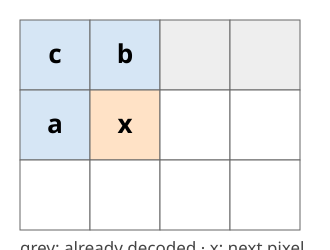
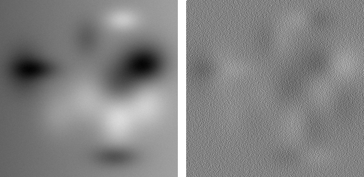
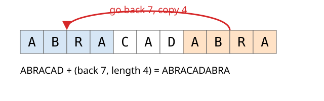

## About this lecture

Last unit: entropy coding removes the **coding** redundancy, but the grey-level entropy ignores neighbours. This unit removes the **inter-pixel** redundancy without losing anything.

- **Prediction**: store only what the neighbours did not predict, the **residual**.
- Predictors: left, up, average, planar, Paeth (PNG), MED (JPEG-LS).
- **Noise** sets the floor: why noisy micrographs compress only 1.2–2.5 times.
- **Dictionary** coding (LZ77, DEFLATE): repeats are cheap.

*Slides titled **The math** give the formulas and proofs; the ideas are complete without them.*

## Neighbours are alike

Plot every pixel against its **left neighbour**: for a smooth image the points lie on a narrow band around the diagonal.

- Knowing the left neighbour, the pixel is **almost known**. What is new is only the small difference.
- The grey-level histogram is wide (entropy 7.1 bits for the smooth image of the demo), the differences are narrow (3.3 bits).
- **Edges** are where a neighbour does not predict the pixel: there the difference is large. The difference to the left neighbour is a finite-difference **derivative** (filtering unit).

## Predictive coding (DPCM)

:::: {.columns}
::: {.column width="35%"}
{width="100%"}
:::
::: {.column width="65%"}
Scan the image row by row. For each pixel $x$:

1. **predict** $\hat x$ from neighbours that are already decoded ($a$ left, $b$ up, $c$ up-left);
2. store the **residual** $e = x - \hat x$, entropy-coded.

The **decoder** makes the same prediction from the same decoded neighbours and adds $e$ back: $x = \hat x + e$. **Exact**: nothing is lost.
:::
::::

{width="55%"}

Smooth image and its residual with the left neighbour as predictor (mid grey = 0, contrast ×8).

## A row by hand

Row: `100 102 104 103 105 107 106 108`, predictor: left neighbour (the first value is stored as it is).

| pixel | 100 | 102 | 104 | 103 | 105 | 107 | 106 | 108 |
|---|---|---|---|---|---|---|---|---|
| residual | (100) | 2 | 2 | −1 | 2 | 2 | −1 | 2 |

- 8 different pixel values: **3 bits** each.
- The 7 residuals use only two values, 2 (5 times) and −1 (2 times): $H = 0.86$ bits.
- Decoding: $100,\ 100 + 2 = 102,\ 102 + 2 = 104,\ 104 - 1 = 103, \dots$ exactly the row.

## The math: why prediction helps {.math}

- The decoder knows $\hat x$ (a function of decoded pixels), so $x \mapsto e = x - \hat x$ is invertible given the past: lossless.
- Cost per pixel $\approx H(e)$, the entropy of the residual histogram. For a Gaussian-like histogram with standard deviation $\sigma$ (in grey levels), $H \approx \log_2\!\big(\sigma\sqrt{2\pi e}\big) = \log_2 \sigma + 2.05$ bits: **halving the spread saves one bit**.
- Left predictor on a smooth signal: $e_i = x_i - x_{i-1} \approx \partial x/\partial t$; planar $a + b - c$ is exact on any plane $x = \alpha + \beta i + \gamma j$.
- **Noise floor**: if $x = s + n$ with independent noise of variance $\sigma_n^2$ and a perfect predictor of $s$ from noisy neighbours, the residual still contains $n_i - n_{i-1}$: variance $\ge \sigma_n^2$, and $2\sigma_n^2$ for the left predictor. On pure noise, prediction **adds** $\log_2\sqrt2 = 0.5$ bit.

## Predictors

With $a$ = left, $b$ = up, $c$ = up-left:

| name | prediction $\hat x$ | good for |
|---|---|---|
| left / up | $a$ / $b$ | horizontal / vertical structure |
| average | $\lfloor (a + b)/2 \rfloor$ | smooth regions (averaging also halves noise) |
| planar | $a + b - c$ | smooth gradients (exact on planes) |
| **Paeth** (PNG) | the one of $a, b, c$ closest to $a + b - c$ | edges in any direction |
| **MED** (JPEG-LS) | $\min(a,b)$ if $c \ge \max(a,b)$; $\max(a,b)$ if $c \le \min(a,b)$; else $a + b - c$ | edges: picks the side the pixel is on |

MED, the **median edge detector**: if $c$ is brighter than both $a$ and $b$, an edge runs between $c$ and $x$, so take the darker neighbour. It is the median of $a$, $b$ and $a + b - c$.

## Try it: prediction

```{=html}
<link rel="stylesheet" href="../demos/dist/demo.css">
<div data-demo="predict" data-image="smooth" data-predictor="left"></div>
<script src="../demos/dist/predict.js"></script>
```

::: notes
Smooth image, left predictor: entropy 7.08 → 3.28 bits/pixel, DEFLATE 44 457 → 31 212 bytes (of 65 536). Average is best here (3.11). Switch to "cell": only 7.68 → 6.78 (left), 6.45 (average): the micrograph is grainy, the grain cannot be predicted. "Noise kills prediction": smooth image + noise 10: residual entropy 5.89. "Flat field" with noise: the residuals have a HIGHER entropy than the pixels (+0.5 bit). "Edges are what remains": shapes with the planar predictor; the residual image shows only the outlines. Click a pixel on an edge and compare MED with average. "12-bit spots": 8.42 → 7.29 bits (MED), but DEFLATE on 2-byte values does poorly (82 742 → 79 341 of 131 072 bytes).
:::

## Noise sets the floor

The residual can never be narrower than the **noise**: noise is new information in every pixel.

| image (256 × 256) | pixels $H$ | best residual $H$ | ideal ratio |
|---|---|---|---|
| smooth synthetic, noise sd 1.5 | 7.08 | 3.11 (average) | 2.6 |
| same + noise sd 10 | 7.21 | 5.69 (average) | 1.4 |
| cell micrograph (8 bit) | 7.68 | 6.45 (average) | 1.24 |
| 12-bit fluorescence, Poisson noise | 8.42 | 7.16 (average) | 2.2 (of 16 bits stored) |

(ideal ratio = stored bits per pixel / residual entropy.) Lossless ratios for real microscopy data are typically **1.5–3×**, not 10×. The 12-bit image gains mostly because its 16-bit storage has 4 empty bits.

## Lossless formats: PNG and JPEG-LS

- **PNG**: each row picks one filter (None, Sub = left, Up, Average, Paeth), then the filtered bytes go through **DEFLATE**. 1 to 16 bits per channel.
- **JPEG-LS** (LOCO-I, 1990s): MED prediction, then the residuals are **context-modelled** (the local gradients choose a probability model) and coded with simple Golomb–Rice codes; also a near-lossless mode (error ≤ a set bound). Used in medical imaging.
- **Lossless JPEG 2000** (reversible integer wavelet, last unit of the day) and **JPEG-XL lossless** (several predictors, context modelling, an arithmetic-type coder) do somewhat better.
- All of them: predict or transform first, then entropy-code what is left.

## Dictionary coding: repeats are cheap

{width="60%"}

- **LZ77** (Ziv and Lempel 1977): replace a repeat by a pointer (go back $d$, copy $\ell$ symbols) into a sliding window of recent data. **LZW** (GIF, TIFF) builds a table of strings instead.
- **DEFLATE** = LZ77 + Huffman: zip, gzip, PNG, TIFF. Modern successors (e.g. Zstandard) are faster and stronger, used in chunked array formats.
- They need **exact** repeats. Noisy pixel values rarely repeat exactly, which is why PNG predicts first, and why DEFLATE on 16-bit values (two bytes) is poor.

## Summary

- Neighbours are alike: store the **residual** $e = x - \hat x$ of a prediction from decoded neighbours; the decoder repeats the prediction, so it is **exact**.
- Residual histograms are narrow and centred at 0: much lower entropy than the pixels.
- **Edges** and **noise** are what prediction cannot remove; noise sets the floor (pure noise: prediction even costs 0.5 bit).
- PNG: row filters + DEFLATE; JPEG-LS: MED + context modelling.
- Dictionary methods (LZ77, DEFLATE) exploit exact repeats.
- Next: instead of predicting pixel by pixel, change the **basis** so that a few coefficients carry the image.
