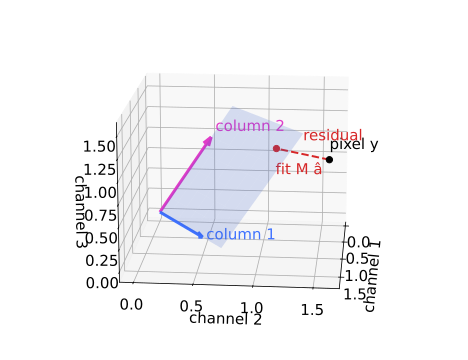

## About this lecture

Last unit: two dyes, two channels, compensation with $M^{-1}$. A spectral detector records 8–32 channels per pixel, a **lambda stack**: more equations than unknowns, and with noise they never all hold.

- Take the mixture **closest** to the measured spectrum: least squares, a **projection**.
- One **pseudo-inverse** for the whole image.
- The **residual** shows where the model is wrong (a missing component).
- **Conditioning**: how much similar spectra amplify noise.
- Photon noise and **weighted** least squares.

Slides titled **The math** give the formulas and proofs; the ideas are complete without them.

::: notes
Second unit of the spectral unmixing day. Linear algebra needed: least squares and the normal equations, which the students know from linear algebra; here they get a physical meaning. The noise model (Poisson, variance = mean) is recalled from the camera-noise unit (day 3).
:::

## A lambda stack: every pixel is a spectrum

- A spectral microscope records one image per wavelength band (here 16 bands of about 14 nm between 480 and 700 nm). Each pixel is a short **measured spectrum**.
- The cell has four components: nucleus, mitochondria, membrane, and a diffuse **autofluorescence** with a broad spectrum.
- Job: explain each pixel's spectrum as a sum of the four reference spectra, $\mathbf y \approx M\mathbf a$, with $M$ now 16 × 4.
- The same problem everywhere: multiplexed immunofluorescence, hyperspectral remote sensing (a field pixel = soil + crop + water), Raman and hyperspectral histology.

## More equations than unknowns: take the closest mixture

:::: {.columns}
::: {.column width="56%"}
Three channels, two dyes. All the pixels the model can explain, $M\mathbf a$ for any $\mathbf a$, form a **plane** through the origin, spanned by the two columns.

- A noisy pixel lies a little **off** the plane: no $\mathbf a$ fits exactly.
- **Least squares** picks the point of the plane **closest** to the pixel: drop a perpendicular.
- The perpendicular part is the **residual**: what the model cannot explain.
- With as many channels as dyes the plane is the whole space and least squares is $M^{-1}$: last unit was a special case.
:::
::: {.column width="44%"}
{width="100%"}
:::
::::

## A $3 \times 2$ example by hand

$M = \begin{pmatrix} 1 & 0.2 \\ 0.5 & 0.5 \\ 0.1 & 1 \end{pmatrix}$, a pixel $\mathbf y = (1.3,\ 0.9,\ 1.2)$.

$$M^\top M = \begin{pmatrix} 1.26 & 0.55 \\ 0.55 & 1.29 \end{pmatrix}, \qquad M^\top \mathbf y = \begin{pmatrix} 1.87 \\ 1.91 \end{pmatrix}.$$

- Solve the $2 \times 2$ system: $\hat{\mathbf a} = (1.029,\ 1.042)$. (The pixel was made from $(1, 1)$ plus noise.)
- Fit $M\hat{\mathbf a} = (1.238,\ 1.036,\ 1.145)$, residual $\mathbf r = (0.062,\ -0.136,\ 0.055)$.
- Check: $M^\top\mathbf r = (0, 0)$: the residual is **perpendicular** to both columns.

## The math: the normal equations {.math}

Minimise $E(\mathbf a) = \|\mathbf y - M\mathbf a\|^2 = (\mathbf y - M\mathbf a)^\top(\mathbf y - M\mathbf a)$:

$$\nabla E = -2M^\top(\mathbf y - M\mathbf a) = \mathbf 0 \quad\Longrightarrow\quad M^\top M\,\hat{\mathbf a} = M^\top\mathbf y .$$

- Same thing geometrically: the residual is orthogonal to every column, $M^\top \mathbf r = \mathbf 0$.
- If the columns are independent, $M^\top M$ is invertible: $\hat{\mathbf a} = M^+\mathbf y$ with the **pseudo-inverse** $M^+ = (M^\top M)^{-1}M^\top$ ($K \times N$).
- $M^+M = I$; for square $M$, $M^+ = M^{-1}$.

## One matrix for the whole image

- $M^+$ depends only on the reference spectra: compute it **once** ($K \times N$, here 4 × 16).
- Unmixing the image is one matrix product: $\hat A = M^+ Y$ (abundances × pixels = $(K \times N)(N \times \text{pixels})$).
- Each abundance map is a **weighted sum of the channels**, with weights from one row of $M^+$ (some negative).
- The fitted image $M\hat A$ and the residual $Y - M\hat A$ come for free.

## The math: least squares is a projection {.math}

$P = MM^+ = M(M^\top M)^{-1}M^\top$ maps a pixel to its fit.

- $P^2 = M(M^\top M)^{-1}(M^\top M)(M^\top M)^{-1}M^\top = P$ and $P^\top = P$: an **orthogonal projection** onto the column space.
- The residual $(I - P)\mathbf y$ is the projection onto the orthogonal complement: $N - K$ dimensions the dyes cannot reach.
- With the SVD $M = U\Sigma V^\top$ (thin): $M^+ = V\Sigma^{-1}U^\top$. A small singular value $\sigma_i$ becomes a large $1/\sigma_i$.

## Try it: unmix a lambda stack

```{=html}
<link rel="stylesheet" href="../demos/dist/demo.css">
<div data-demo="lsunmix" data-preset="one"></div>
<script src="../demos/dist/lsunmix.js"></script>
```

::: notes
Synthetic cell, four components, 16 channels, 400 photons for a pixel of abundance 1 (all channels together), Poisson noise. Top: true merge, unmixed merge, residual in units of the expected noise. Bottom: the four abundance maps (red = negative). Right: the spectra and the 16 bins; below, the clicked pixel: dots = measured, black = fit, coloured bands = each component's share. Tour: "one channel per dye": each map is the dye's brightest channel; the autofluorescence map shows the whole cell (RMSE 0.30) and the mitochondria map contains some of the nucleus. "Least squares removes it": RMSE 0.017–0.06, the maps are clean. Click the nucleus and a mitochondrion and show the stacked contributions. "Two dyes 6 nm apart": nucleus and mitochondria maps become grainy (noise × 4.9 and 5.1). "32 channels": hardly better. "Forgot the autofluorescence": residual lights up in the cytoplasm. "Add it as a component". "Photon-starved".
:::

## The residual: where the model is wrong

The residual map shows, for each pixel, how far its spectrum is from the best mixture, in units of the expected photon noise. About 1 everywhere means "noise only".

- Leave the autofluorescence out of $M$: the cytoplasm's residual rises to **1.37** times the noise (the nucleus stays at 1.04). The broad spectrum cannot be made from the three narrow ones.
- And the missing light goes somewhere: the other maps absorb it (mitochondria RMSE 0.023 → 0.054).
- Add the spectrum as an extra column and the residual drops back to noise (0.99).
- An **offset** (dark level) is a component with a flat spectrum: subtract it, or give it a column.

## Similar spectra amplify noise

Two near-parallel columns $(1, 0.9, 0.5)$ and $(0.9, 1, 0.5)$:

- Their **sum** is well determined, their **difference** is not: the data barely change when you trade one dye for the other.
- A unit error in channel 1 moves the abundances by $(5.2,\ -4.8)$. For well-separated columns $(1, 0.1, 0.5)$ and $(0.1, 1, 0.5)$: by $(0.88,\ -0.23)$.
- Picture: the cloud of possible estimates is an ellipse, long along "dye 1 minus dye 2".
- **Condition number** $\kappa = \sigma_\text{max}/\sigma_\text{min}$, the ratio of the largest and smallest stretch of $M$: 20.3 for the near-parallel pair, 1.45 for the separated one.

## The math: noise of the estimate {.math}

With independent channel noise of variance $\sigma_n^2$, $\operatorname{Cov}(\mathbf y) = \sigma_n^2 I$ and $\hat{\mathbf a} = M^+\mathbf y$:

$$\operatorname{Cov}(\hat{\mathbf a}) = M^+(\sigma_n^2 I)M^{+\top} = \sigma_n^2 (M^\top M)^{-1}.$$

- Near-parallel pair: $M^\top M = \begin{pmatrix} 2.06 & 2.05 \\ 2.05 & 2.06 \end{pmatrix}$, eigenvalues 4.11 and 0.01 (eigenvectors $(1, 1)$ and $(1, -1)$).
- $\operatorname{sd}(\hat a_1 + \hat a_2) = 0.70\,\sigma_n$, $\operatorname{sd}(\hat a_1 - \hat a_2) = 14.1\,\sigma_n$: the small eigenvalue sits in the difference direction.
- Singular values of $M$ are the square roots: $\sigma_1 = 2.03$, $\sigma_2 = 0.10$, $\kappa = 20.3$. The noise of the worst combination is $1/\sigma_\text{min}$ times the channel noise.

## More channels, better filters

In the demo, with nucleus and mitochondria 6 nm apart (same photons in total), the noise on those two maps is multiplied by:

| channels | 8 | 16 | 32 |
|---|---|---|---|
| noise × (vs the dye alone) | 5.7, 5.9 | 4.9, 5.1 | 4.7, 4.9 |

- Finer bins help a little: the shapes are sampled better. They add no photons and cannot separate **identical** shapes.
- What helps: dyes further apart (45 nm: 1.3 and 1.7), **more photons**, filters placed where the spectra **differ** (choose them to minimise $\kappa$, or the noise on the abundance you care about).

## Photon noise: weighted least squares

Recall the camera-noise unit (day 3): photon counts are Poisson, **variance = mean**. A bright channel is noisier in absolute terms than a dim one.

- Ordinary least squares trusts every channel equally. **Weighted** least squares divides each squared error by the channel's expected variance: weight $w_c = 1/\text{expected count}$.
- Bright pixels (hundreds of counts): little difference. Photon-starved pixels (a few counts per channel): WLS helps. In the demo at 20 photons the RMSE drops by 6–10 % (e.g. mitochondria 0.105 → 0.095).
- Maximum likelihood with the exact Poisson model does better still (pointer: the same idea as Richardson–Lucy on the deconvolution day).

## The math: WLS is maximum likelihood {.math}

Approximate channel $c$ as Gaussian with variance $v_c$ (Poisson: $v_c \approx$ the expected count). The log-likelihood of $\mathbf a$ is, up to constants,

$$-\tfrac12 \sum_c \frac{(y_c - (M\mathbf a)_c)^2}{v_c} = -\tfrac12 (\mathbf y - M\mathbf a)^\top W (\mathbf y - M\mathbf a), \quad W = \operatorname{diag}(1/v_c).$$

Setting the gradient to zero: $M^\top W M\,\hat{\mathbf a} = M^\top W\mathbf y$, so $\hat{\mathbf a} = (M^\top WM)^{-1}M^\top W\mathbf y$. The expected counts come from a first ordinary fit (the demo does one such iteration).

## Negative abundances in dim pixels

- Least squares does not know that abundances cannot be negative. In dim pixels the noise is as large as the signal and many estimates go below zero: 18 % of all abundance values in the demo.
- A negative abundance is not a measurement error to ignore: it says the pixel lies **outside** the set of physically possible mixtures.
- The next unit adds the constraints (non-negative, sum to one) and their geometry: cones and simplices.
- Afterwards, an abundance map is an ordinary image: threshold it (day 6) to find the positive cells, measure it, or compare it between conditions.

## Summary

- A lambda stack: each pixel is a spectrum; $\mathbf y \approx M\mathbf a$ with more channels than components.
- **Least squares** = the closest mixture = an orthogonal **projection** onto the column space; $\hat{\mathbf a} = M^+\mathbf y$, one $M^+$ for the whole image; square case = $M^{-1}$.
- The **residual** is perpendicular to every spectrum; a residual above the noise shows a **missing component** (autofluorescence, an offset).
- **Similar spectra**: a small singular value, a large condition number $\kappa$, noise amplified in the **difference** of the abundances. More channels help a little; more photons and better-separated dyes help more.
- Poisson noise: **weighted** least squares, weights 1/expected count.
- Unconstrained least squares gives **negative** abundances in dim pixels.
