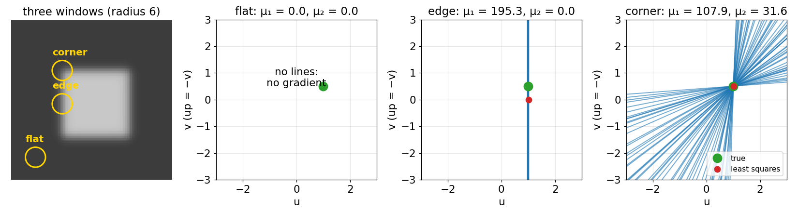
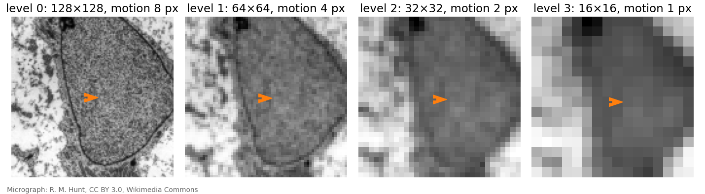

## About this lecture

Last unit: each pixel gives one constraint line in velocity space; one line is not enough (the aperture problem). Today, the classic local answer (Lucas and Kanade, 1981).

- Assume the flow is **constant in a small window**; take the velocity closest to all the window's lines.
- Its $2\times2$ matrix is **the structure tensor** of the edges day: flat, edge and corner tell us where flow can be measured.
- The **window size** trade-off.
- **Large motion** breaks the linearisation: **warping** and **coarse-to-fine pyramids** fix it.
- Block matching for comparison, and tracking points as a pointer.

*Slides titled **The math** give the formulas and proofs; the ideas are complete without them.*

::: notes
Owner of Lucas–Kanade, its iterative and pyramidal forms and the confidence by the smaller eigenvalue. Recalls: structure tensor (edges day), Gaussian pyramid (scale-space), warping with bilinear interpolation (images), block-wise correlation (FFT registration). The demo lkflow uses frame pairs with known motion so every estimate can be scored.
:::

## The idea: one velocity per window

{width="100%" fig-align="center"}

Assume all pixels in a small window move together. Each pixel contributes a line; take the point that is **closest to all lines** (least squares).

- **Flat** window: no lines, no answer.
- **Edge**: all lines parallel; only the motion across the edge.
- **Corner or texture**: lines in many directions cross at one point: the motion.

## Recall: the structure tensor

From [the structure tensor unit](../structure-tensor/lec.qmd): collect the gradients $(I_x, I_y)$ of a window; their spread is the $2\times2$ matrix
$$J = \begin{pmatrix}\overline{I_x^2} & \overline{I_x I_y}\\ \overline{I_x I_y} & \overline{I_y^2}\end{pmatrix}$$
(averages over the window, weighted by a Gaussian of width ρ), drawn as an ellipse.

Its eigenvalues $\mu_1 \ge \mu_2 \ge 0$ classify the window:

| $\mu_1$ | $\mu_2$ | window |
|---|---|---|
| small | small | flat |
| large | small | edge (one direction) |
| large | large | corner or texture |

## The Lucas–Kanade matrix *is* the structure tensor

The least-squares problem over the window has exactly this matrix $J$. So the edges day's map already says **where flow can be measured**:

- **corner/texture** (both eigenvalues large): reliable vector;
- **edge** ($\mu_2$ small): only the normal component, the aperture problem again;
- **flat** (both small): nothing.

Use $\mu_2$ as a **confidence** and mask the flow where it is small. Points with large $\mu_2$ are the Shi–Tomasi corners: "good features to track".

## The math: Lucas–Kanade {.math}

Minimise over $\mathbf u = (u, v)$, with window weights $w$ (a Gaussian of width ρ):
$$E(\mathbf u) = \sum_{\mathbf x \in W} w(\mathbf x)\,\big(I_x u + I_y v + I_t\big)^2 .$$
Setting $\partial E/\partial u = \partial E/\partial v = 0$ gives the **normal equations**
$$\underbrace{\begin{pmatrix}\sum wI_x^2 & \sum wI_xI_y\\ \sum wI_xI_y & \sum wI_y^2\end{pmatrix}}_{J}\begin{pmatrix}u\\v\end{pmatrix} = -\underbrace{\begin{pmatrix}\sum wI_xI_t\\ \sum wI_yI_t\end{pmatrix}}_{\mathbf b} .$$

- With Gaussian weights every sum is a blur of a product: $J$ and $\mathbf b$ for all pixels at once are **five Gaussian blurs** ($I_x^2, I_xI_y, I_y^2, I_xI_t, I_yI_t$), then a $2\times2$ solve per pixel.
- Solvable iff $\mu_2 > 0$. Noise in $\mathbf b$ is amplified by up to $1/\mu_2$ along the weak eigenvector: the condition number $\mu_1/\mu_2$ says how ill-posed the window is.
- Where $\mu_2 \approx 0$, the minimum-norm solution keeps only the strong direction: the normal flow.

## By hand: four pixels

| pixel | $I_x$ | $I_y$ | $I_t$ |
|---|---|---|---|
| 1, 2 | 1 | 0 | −2 |
| 3, 4 | 0 | 1 | −1 |

$J = \begin{pmatrix}2 & 0\\0 & 2\end{pmatrix}$, $-\mathbf b = (4, 2)$, so $(u, v) = (2, 1)$: the two vertical and two horizontal lines cross there.

If all four pixels were $(1, 0, -2)$: $J = \begin{pmatrix}4 & 0\\0 & 0\end{pmatrix}$, singular. $u = 2$, $v$ unknown: a vertical edge.

## Try it: Lucas–Kanade on a frame pair

```{=html}
<link rel="stylesheet" href="../demos/dist/demo.css">
<div data-demo="lkflow" data-preset="small"></div>
<script src="../demos/dist/lkflow.js"></script>
```

::: notes
Frame 1 is a 128² crop of the micrograph, frame 2 is frame 1 moved by a known flow plus noise (sd 2), so the endpoint error (EPE, the length of estimate − truth) can be shown. Click a pixel: the middle panel shows its window's constraint lines (opacity = weight × gradient), the estimate (red), the truth (green) and the uncertainty ellipse ∝ J⁻¹. Tour: "small shift" (1 px): mean EPE 0.08 px. "A membrane" (pixel (85, 114) on the nuclear envelope, ρ = 2): μ₁ = 226, μ₂ = 5.2, 2 % of μ₁: an edge. The lines are nearly one family and the uncertainty ellipse is long along the membrane; the confidence tab shows μ₂ dark along membranes. With noise only 2 the estimate (1.38, −0.82) is still near the truth (1.30, −0.75); the weak direction is where noise does its damage. "Flat: nothing to see": the ring scene; inside the flat disc there are only noise lines and the estimate is arbitrary; with the confidence threshold at 20 the flat regions turn grey, and the confident pixels have mean EPE 0.14 px (45 % of the image) against 0.52 px overall. "A motion boundary": a textured cell moving over a still substrate; pixel (98, 64) is outside the cell but its window reaches in: estimate (1.36, −0.38) against the truth (0, 0).
:::

## Window size

The window radius ρ is the same trade-off as the integration scale on the edges day:

- **small** window: few pixels, noisy estimate, more windows that see only an edge (aperture);
- **large** window: averages noise away, but **mixes different motions**: at a motion boundary (a cell crawling over a still background) it reports a blend.

In the demo (noise 12): mean endpoint error 0.35 px at ρ = 1.5, 0.18 at ρ = 3, 0.09 at ρ = 6. At a motion boundary the error grows with ρ instead.

## Large motion fails

The linearisation $I_t \approx -I_x u - I_y v$ holds only while the motion is **small compared with the smoothness of the image**: about a pixel at the scale of the gradients.

In the demo (micrograph, one solve): mean error 0.08 px for a 1 px shift, 0.36 px for 2 px, 2.4 px for 4 px and 7.5 px for 8 px: no better than guessing zero.

Two cures, usually used together:

1. **Iterate with warping**: estimate, warp frame 2 back by the estimate ([images unit](../images/lec.qmd): inverse mapping and bilinear interpolation), estimate the **remaining** small motion, add, repeat.
2. **Coarse to fine**: on a Gaussian pyramid ([scale space unit](../scale-space/lec.qmd): blur, then keep every second pixel) an 8 px motion is 4 px at level 1, 2 px at level 2, 1 px at level 3.

## Coarse to fine on a pyramid

{width="100%" fig-align="center"}

1. Estimate at the coarsest level, where the motion is about a pixel.
2. Go one level finer: **double** the flow (pixels are half as large), warp frame 2 by it, estimate the small remainder, add.
3. Repeat down to full resolution.

Price: coarse levels blur away small objects; a small cell moving differently from its surroundings may be lost before the fine levels can see it.

## The math: iterative and pyramidal LK {.math}

Iterative LK is Gauss–Newton on the nonlinear least-squares problem
$$\min_{\mathbf u}\;\sum_{\mathbf x \in W} w(\mathbf x)\,\big(I_2(\mathbf x + \mathbf u) - I_1(\mathbf x)\big)^2 .$$
Linearise around the current estimate $\mathbf u_k$: with $I_2^{(k)}(\mathbf x) = I_2(\mathbf x + \mathbf u_k)$ (frame 2 warped back) and $I_t^{(k)} = I_2^{(k)} - I_1$,
$$J\,\Delta\mathbf u = -\mathbf b(\mathbf u_k),\qquad \mathbf u_{k+1} = \mathbf u_k + \Delta\mathbf u .$$

- At pyramid level $\ell$ the motion is $\mathbf u / 2^\ell$; initialise level $\ell - 1$ with $2\,\mathbf u_\ell$ (upsampled).
- Each level only needs to find a correction of about a pixel, which the linearisation can.
- For a quadratic image $I(\mathbf x) = \tfrac12\mathbf x^\top A\mathbf x + \mathbf g^\top\mathbf x$ translated by $\mathbf d$, one step is exact (exercise).

## Try it: the pyramid rescues large motion

```{=html}
<link rel="stylesheet" href="../demos/dist/demo.css">
<div data-demo="lkflow" data-preset="pyramid"></div>
<script src="../demos/dist/lkflow.js"></script>
```

::: notes
Preset "8 px shift: fails" first: mean EPE 7.45 px with one level and one solve. Three warping iterations alone barely help (7.14): the first linearisation is already in the wrong place. "The pyramid rescues it" (4 levels, 3 iterations each): mean EPE 0.60 px; the pyramid tab shows the flow per level, each in its own pixels (the coarse levels see a motion of about 1 to 2 px). "Rotation" (3 px at the edge): 2 levels × 2 iterations: 0.07 px against 0.29 px for a single solve. Timings in the readout: the pyramid costs several times one solve.
:::

## Block matching for comparison

Another way to find local motion: for each window, **try shifts** and keep the best score (correlation, as in [FFT registration](../phasecorr/lec.qmd), but per window). Particle image velocimetry (PIV) does exactly this with phase correlation.

| | block matching | Lucas–Kanade |
|---|---|---|
| large motion | fine (search range) | needs pyramids |
| precision | integer, unless a peak is fitted | sub-pixel by construction |
| cost | many shifts per window | five blurs + a $2\times2$ solve |
| needs | texture or particles | texture, smooth image |

## Pointer: tracking points

Run Lucas–Kanade only at the **Shi–Tomasi corners** (largest $\mu_2$) and follow them from frame to frame: **feature tracking**. Chaining the vectors over many frames gives tracks.

Following whole **objects** (cells, nuclei) over time, linking them between frames, handling divisions and lineages: the **tracking day** of the Motion group.

## Summary

- **Lucas–Kanade**: the flow is constant in a window; least squares over the window's constraint lines.
- Its matrix is the **structure tensor** $J$: the smaller eigenvalue $\mu_2$ is the confidence (flat: nothing; edge: normal flow only; corner/texture: reliable).
- Window size: noise and aperture (small) against mixing motions (large).
- Linearisation needs small motion: **iterate with warping** and go **coarse to fine** on a pyramid.
- Block matching handles large motion but is integer and slow; LK is sub-pixel and fast.
