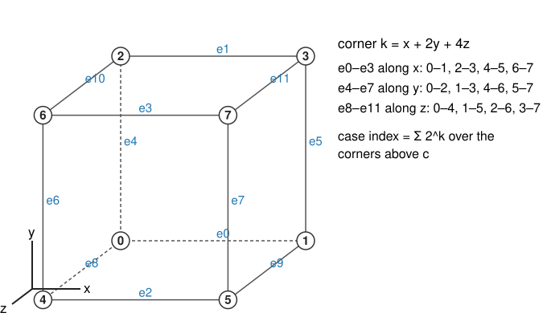
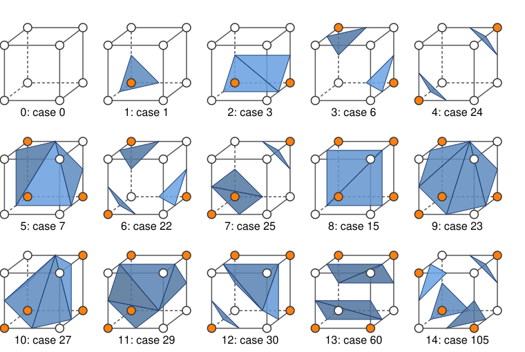

## Goal

By the end of this exercise you should be able to:

- run **one cube** of marching cubes by hand: case index, crossed edges, vertices by linear interpolation, triangles,
- decide whether two cases are **rotations** of each other, and count the cases of a **tetrahedron**,
- explain how an **ambiguous face** leads to a **crack**, and how a consistent rule or the asymptotic decider prevents it,
- compute a **normal from the image gradient**, with the voxel spacing, and say which way it points.

Do the pen-and-paper part first, then the two demos. Questions marked *(math)* are for those who want the derivations; the concept questions do not depend on them.

## Background

{width="75%"}

| Idea | What it means |
|---|---|
| Corner $k$ | offsets $(x, y, z)$ with $k = x + 2y + 4z$ |
| Case index | $\sum 2^k$ over the corners above $c$: 0 … 255 |
| Edges | e0–e3 along $x$ (0–1, 2–3, 4–5, 6–7), e4–e7 along $y$ (0–2, 1–3, 4–6, 5–7), e8–e11 along $z$ (0–4, 1–5, 2–6, 3–7) |
| Vertex | on a crossed edge from corner $a$ to $b$: $t = (c - I_a)/(I_b - I_a)$ |
| Triangles | marching squares on the 6 faces, chain the segments into loops, fan-triangulate each loop |
| Classes | 23 under the 24 rotations; 15 with the complement as well |
| Normal | $\mathbf n = -\nabla I/\lVert\nabla I\rVert$ for a bright object; $\partial_x I \approx (I_{x+1} - I_{x-1})/(2\Delta x)$ |

{width="80%"}

## By hand

**B1.** A cube has the corner values $I_0, \dots, I_7 = 7, 3, 2, 1, 6, 4, 1, 0$, and $c = 5$.
(a) Which corners are above $c$? What is the case index?
(b) Which edges are crossed? (Use the edge list.)
(c) Compute $t$ and the vertex position $(x, y, z)$ in the unit cube for each crossed edge.
(d) How many triangles does the cube get, and what shape do they form? Which of the 15 classes is it?

**B2.** (a) Case 3 (corners 0 and 1 above) and case 10 (corners 1 and 3 above): show that a rotation of the cube maps one to the other. Which rotation?
(b) Is case 9 (corners 0 and 3 above) a rotation of case 3? Why or why not?
(c) Case 1 and case 254 (all corners except 0 above) give the same surface with opposite normals. Are they in the same class of 23? Of 15?

**B3.** **Marching tetrahedra.** A tetrahedron has 4 corners, so 16 cases.
(a) List the cases by the number of corners above $c$ (0 to 4). How many cases has each group?
(b) Group them into classes: what does the surface look like in each? How many triangles?
(c) Why is no tetrahedron case ambiguous?

**B4.** Take case 1 (only corner 0 above, all values 0.8 or 0.2, $c = 0.5$).
(a) How many triangles does marching cubes produce?
(b) The 6-tetrahedron split cuts the cube into 6 tetrahedra that all share the diagonal from corner 0 to corner 7. How many of them contain corner 0, and how many triangles do they produce in total? (Each contains corner 0 and three corners below.)
(c) What does this say about the size of tetrahedral meshes?

**B5.** **Gradient normal.** Around a grid point, the six face neighbours have the values $I(x \pm 1) = 80, 40$, $I(y \pm 1) = 60, 60$, $I(z \pm 1) = 90, 30$ (the "+" neighbour first).
(a) With spacing $(1, 1, 1)$: compute $\nabla I$ by central differences and the outward normal $\mathbf n$ of a bright object.
(b) The same with spacing $(1, 1, 2)$ (the $z$ neighbours are 2 units away). How much does the normal tilt?
(c) The object is **dark** on a bright background. Which way does the outward normal point now?

**B6.** **Cracks.** Two cubes share a face whose corners (going round) have the values $8, 4, 7, 3$, and $c = 5$.
(a) Why is this face ambiguous? What does each of the two rules (separate, join) draw on it?
(b) The left cube uses "always separate", the right cube "always join". What happens along the shared face?
(c) Both use the asymptotic decider. What do they draw, and why can they not disagree?

**B7.** A smooth surface extracted from a volume has about 3 triangles per unit of area (in voxel units) and 2 triangles per vertex. Estimate the number of triangles and vertices for a sphere of radius 20 voxels. How many voxels does the ball contain?

::: {.callout-note collapse="true" title="Solutions"}
**B1.** (a) Corners 0 (value 7) and 4 (value 6). Case $2^0 + 2^4 = 17$.
(b) Edges with one corner above: from corner 0 to 1 (e0) and to 2 (e4); from corner 4 to 5 (e2) and to 6 (e6). Edge e8 (0–4) is not crossed: both ends are above.
(c)

| edge | values | $t$ | vertex |
|---|---|---|---|
| e0 (0 → 1) | 7 → 3 | $(5 - 7)/(3 - 7) = 0.5$ | $(0.5, 0, 0)$ |
| e4 (0 → 2) | 7 → 2 | $(5 - 7)/(2 - 7) = 0.4$ | $(0, 0.4, 0)$ |
| e2 (4 → 5) | 6 → 4 | $(5 - 6)/(4 - 6) = 0.5$ | $(0.5, 0, 1)$ |
| e6 (4 → 6) | 6 → 1 | $(5 - 6)/(1 - 6) = 0.2$ | $(0, 0.2, 1)$ |

(d) One loop of 4 vertices, a quadrilateral cutting off the edge 0–4: **2 triangles**. It is the "edge" class (class 2 of 15, representative case 3), rotated.

**B2.** (a) A 90° rotation about the $z$ axis (through the centres of the front and back faces) maps corner 0 → 1, 1 → 3, 3 → 2, 2 → 0 (and 4 → 5 → 7 → 6 → 4): the edge 0–1 goes to the edge 1–3. So case 3 becomes case 10.
(b) No. Corners 0 and 1 are joined by a cube edge (distance 1), corners 0 and 3 by a face diagonal (distance $\sqrt2$). Rotations keep distances, so they cannot map one pair to the other. Case 9 is in another class (the "face diagonal" class, 3 of 15), and it has an ambiguous face.
(c) Under rotations alone, no: one corner above and seven corners above are different classes of the 23 (rotations do not change the number of corners above). With the complement, yes: both are class 1 of the 15.

**B3.** (a) 0 corners above: 1 case; 1: 4; 2: 6; 3: 4; 4: 1. Total $1 + 4 + 6 + 4 + 1 = 16$.
(b) Three classes: nothing (0 or 4 above: 2 cases); one corner different from the other three (1 or 3 above: 8 cases): a triangle cutting off that corner; two and two (6 cases): a quadrilateral, 2 triangles.
(c) Every pair of corners of a tetrahedron is joined by an edge, so there is no diagonal pair on a face, and the interpolant inside is linear (its level set is a plane), so there is only one way to cut.

**B4.** (a) 1 triangle.
(b) All 6 tetrahedra contain corner 0 (it is on the shared diagonal), each with three corners below: 6 triangles.
(c) Tetrahedral meshes are larger (here 6 against 1; on whole surfaces typically 2–4 times), with smaller and thinner triangles.

**B5.** (a) $\nabla I = \big((80 - 40)/2,\; (60 - 60)/2,\; (90 - 30)/2\big) = (20, 0, 30)$, length 36.06. $\mathbf n = -\nabla I/\lVert\nabla I\rVert = (-0.555, 0, -0.832)$.
(b) $\partial_z I = (90 - 30)/(2 \cdot 2) = 15$: $\nabla I = (20, 0, 15)$, length 25, $\mathbf n = (-0.8, 0, -0.6)$. The angle from the $z$ axis goes from $\arctan(0.555/0.832) = 33.7°$ to $\arctan(0.8/0.6) = 53.1°$: a tilt of about 19°.
(c) For a dark object the inside has low values, so outward is the direction of increasing $I$: $\mathbf n = +\nabla I/\lVert\nabla I\rVert = (0.555, 0, 0.832)$ (spacing 1).

**B6.** (a) The corners with 8 and 7 (diagonal) are above 5, the ones with 4 and 3 below: a 2D saddle. "Separate" draws two segments, each cutting off one bright corner; "join" draws two segments cutting off the two dark corners.
(b) The left cube's triangles end on the face along the "separate" segments, the right cube's along the "join" segments. The crossing points are the same four, but they are connected differently: the triangle edges on the face do not match, and the surface has a hole there, a **crack** (each of those edges belongs to one triangle only).
(c) Both compute $f^\ast = (8 \cdot 7 - 4 \cdot 3)/(8 + 7 - 4 - 3) = 5.5 > 5$ from the same four values and both join. The decision depends only on the face, so neighbours agree.

**B7.** Area $4\pi \cdot 20^2 = 5027$ voxel²: about $3 \cdot 5027 \approx 15\,000$ triangles and $7\,500$ vertices. The ball has $\tfrac43\pi \cdot 20^3 \approx 33\,500$ voxels: the mesh grows with the area ($r^2$), the voxel count with the volume ($r^3$).
:::

### Math questions

**B8.** *(math)* Count the 23 classes with Burnside's lemma: list the 24 rotations of the cube by type, the cycles of the corner permutation of each type, and the number of cases each fixes. Then extend to the 48 symmetries "rotation, optionally followed by complement" and show you get 15.

**B9.** *(math)* Show that the gradient of $I$ is perpendicular to the level set $\{I = c\}$, and that for a bright object $-\nabla I$ points outwards. What goes wrong when $\nabla I = 0$ on the surface?

**B10.** *(math)* Show that the linear interpolant $f = \sum_i \lambda_i I_i$ on a tetrahedron is an affine function of $\mathbf x$, that its level set is a plane, and that a plane meets a tetrahedron in a triangle or a convex quadrilateral (or nothing). Why does the trilinear interpolant on a cube not have this property?

::: {.callout-note collapse="true" title="Solutions (math)"}
**B8.** Burnside: classes $= \frac{1}{|G|}\sum_{g}|\mathrm{Fix}(g)|$, and a case is fixed by $g$ when every cycle of $g$'s corner permutation is all above or all below: $2^{\#\text{cycles}}$ cases.

| type | count | cycles | fixed |
|---|---|---|---|
| identity | 1 | 8 one-cycles | 256 |
| ±90° about face axes | 6 | 2 four-cycles | 4 |
| 180° about face axes | 3 | 4 two-cycles | 16 |
| ±120° about body diagonals | 8 | 2 one-cycles, 2 three-cycles | 16 |
| 180° about edge axes | 6 | 4 two-cycles | 16 |

Sum $256 + 24 + 48 + 128 + 96 = 552$, and $552/24 = 23$. With complement: "rotate, then complement" fixes a case when every cycle alternates above/below, which needs every cycle to have even length; then each cycle has 2 alternating patterns. The identity, the 120° rotations (cycles of length 1 and 3) fix nothing; 90° rotations fix $2^2 = 4$ each (24), face 180° fix $2^4 = 16$ each (48), edge 180° fix 16 each (96): 168 in total. $(552 + 168)/48 = 720/48 = 15$.

**B9.** For a curve $\mathbf x(s)$ in the level set, $\frac{d}{ds}I(\mathbf x(s)) = \nabla I \cdot \mathbf x'(s) = 0$, so $\nabla I$ is perpendicular to all tangent directions. $\nabla I$ points to increasing $I$; inside a bright object $I > c$, so $+\nabla I$ points inwards and $-\nabla I$ outwards. Where $\nabla I = 0$ the level set need not be a smooth surface (a saddle or a plateau) and the direction is undefined: normalising divides by (nearly) zero, and noise decides the result.

**B10.** The barycentric weights are the solution of the linear system $\mathbf x = \sum\lambda_i\mathbf p_i$, $\sum\lambda_i = 1$, so they are affine functions of $\mathbf x$, and so is $f$: $f(\mathbf x) = \mathbf a \cdot \mathbf x + b$. Its level set $\mathbf a \cdot \mathbf x = c - b$ is a plane (if $\mathbf a \ne 0$). A plane splits the 4 corners into two groups (1 + 3 or 2 + 2) and cuts the 3 or 4 edges between the groups: a triangle or a quadrilateral, convex as the intersection of two convex sets. The trilinear interpolant on a cube contains the terms $xy$, $yz$, $xz$, $xyz$: its level sets are curved (hyperbolic on the faces), and can be disconnected inside one cube, so the corner signs do not determine the topology.
:::

## Explore: one cube {#explore-cube}

One marching-cubes cell, drawn with the corner numbering of the figure above (drag to rotate; *front*, *side*, *top* and *3/4 view* buttons). **Click a corner** to flip it to the other side of $c$ (orange = above) and select it; the first slider sets the selected corner's value. The readout gives the bits, the case index, the class among the 15 and the 23 and the rotation to the class representative (**rotate to its representative** animates it). Ambiguous faces are tinted purple; the **face rule** decides how they are cut. **5 / 6 tetrahedra** show the tetrahedral split and its triangles. **Neighbour cube** adds a second cube on the $+x$ side with its own face rule; cracks are drawn in red.

```{=html}
<link rel="stylesheet" href="../demos/dist/demo.css">
<div data-demo="mccube" data-preset="one"></div>
<script src="../demos/dist/mccube.js"></script>
```

**C1.** Preset **one corner**. Read the case and class. Click corner 1: what are the case and the class now? Click **rotate to its representative** and describe the rotation.

**C2.** Preset **values: vertices slide**. Which corners are above $c = 0.5$, and what is the case? Check the vertex on edge 0–1 by hand ($I_0 = 0.9$, $I_1 = 0.35$) and the one on edge 0–4 ($I_4 = 0.45$). Move $c$ up to 0.55: which vertex moves furthest along its edge, and why?

**C3.** Preset **the 15 classes**: step through all of them. Which classes have 4 triangles? Find the class whose single loop is a hexagon. Which classes have an ambiguous face?

**C4.** Preset **an ambiguous face** (case 9). How many triangles do **separate** and **join** give? What does **decider** choose, and why exactly that? Now click corner 0 twice (it flips and flips back, and is selected) and set its value to 0.9: what does the decider do now?

**C5.** Preset **a crack**. How many crack edges are there? Set the neighbour's rule to **separate**; then set both cubes to **decider**. When is the surface closed?

**C6.** Preset **tetrahedra instead** (case 9 with 6 tetrahedra). How many triangles? Switch to 5 tetrahedra and to marching cubes. Then load **one corner** and compare the three algorithms again (B4).

::: {.callout-note collapse="true" title="Solutions"}
**C1.** Case 1, class 1 of 15 and of 23 (already the representative). With corner 1 also above: case 3, class 2 (representative 3 itself, so no rotation). (Other edges need a rotation: with corners 1 and 3 above, case 10, the demo turns the cube by 120° about a body diagonal to reach case 3; a 90° turn about the $z$ axis would do as well, B2.)

**C2.** Corners 0 (0.9) and 2 (0.6): case $1 + 4 = 5$, the edge class (2 of 15), 2 triangles. Edge 0–1: $t = (0.5 - 0.9)/(0.35 - 0.9) = 0.727$, vertex $(0.73, 0, 0)$. Edge 0–4: $t = (0.5 - 0.9)/(0.45 - 0.9) = 0.889$, vertex $(0, 0, 0.89)$. At $c = 0.55$ the case stays 5; a vertex moves by $\Delta t = \Delta c/|I_b - I_a|$, so the one on the edge with the smallest difference of values moves furthest: edge 2–6 (0.6 → 0.3), from $t = 0.33$ to $0.17$. Edge 0–1 moves only from 0.73 to 0.64.

**C3.** Classes 9 to 14 have 4 triangles (with the "separate" rule). Class 9 (case 23: corner 0 and its three neighbours 1, 2, 4) has a single hexagonal loop. Classes 3, 6, 7, 12, 13, 14 (representatives 6, 22, 25, 30, 60, 105) have at least one ambiguous face: 6 of the 15.

**C4.** Separate: 2 triangles (two corner pieces). Join: 4 triangles (one band across the cube). The decider computes $f^\ast = (0.8 \cdot 0.8 - 0.2 \cdot 0.2)/(0.8 + 0.8 - 0.2 - 0.2) = 0.5 = c$, the borderline, and does not join (it joins only for $f^\ast > c$): 2 triangles. With $I_0 = 0.9$: $f^\ast = (0.72 - 0.04)/1.3 = 0.523 > 0.5$: it joins, 4 triangles.

**C5.** 4 crack edges (red). With the neighbour on "separate" (the same as the left cube) the crack closes: 0. With both on "decider" it closes too. The surface is closed whenever both cubes cut the shared face the same way, which a rule that depends only on the face's own values guarantees.

**C6.** Case 9 with 6 tetrahedra: 8 triangles; with 5 tetrahedra: 2; with marching cubes ("separate"): 2. For one corner (case 1): marching cubes 1, 5 tetrahedra 1 (corner 0 is cut off by one corner tetrahedron), 6 tetrahedra 6. The count depends on how the corners sit relative to the split.
:::

## Explore: marching cubes on a volume {#explore}

Marching cubes on a whole volume (48³ voxels, or the nuclei stack), recomputed on every change; drag to rotate. Choose the volume, $c$ (slider or histogram), blur $\sigma$ (voxels) and noise; **face normals** shade each triangle flat, **gradient normals** use $-\nabla I$; **ignore the z spacing** treats the voxels as cubes; **cubes / 6 / 5 tetrahedra** switch the algorithm; the face rule (decider, separate, complement as in the 15-case table) applies to cubes. Red lines are boundary edges (cracks). **Show an xy slice** adds a slice with its marching-squares contour at the same $c$. The readout gives vertices, triangles, area, volume, components and the Euler characteristic $\chi = V - E + F$ (2 for each closed surface without holes, 0 for a torus; more in the next unit).

```{=html}
<link rel="stylesheet" href="../demos/dist/demo.css">
<div data-demo="marchcubes" data-preset="merge"></div>
<script src="../demos/dist/marchcubes.js"></script>
```

**M1.** Preset **two blobs merge** ($c = 0.6$). How many components? Lower $c$ in steps of 0.01. At which $c$ do the two surfaces become one? What happens to $\chi$? (The blobs are two Gaussians with value 1 at their centres, 20 voxels apart, $\sigma = 6$: what is the value halfway between them?)

**M2.** Preset **a torus has a hole**. Read $\chi$ and the number of components. Compare the area and volume with the true torus (tube radius 5.5, centre-line radius 13: area $4\pi^2 R r$, volume $2\pi^2 R r^2$). Switch to **6 tetrahedra**: how many triangles, and how does the area change?

**M3.** Preset **noise: many tiny surfaces**. How many components and triangles? Compare the area with the noise-free sphere (switch noise to 0). Then preset **blur first**: what happens to components, area and volume? Why is the blurred volume smaller than the true $\frac43\pi \cdot 15^3$?

**M4.** Preset **faceted vs gradient normals**. With wireframe on, switch between face and gradient normals. Are the triangles different? Explain what the gradient normals add.

**M5.** Preset **wrong z spacing** (an ellipsoid sampled with $\Delta z = 2.5$ voxels). Compare area and volume with "ignore the z spacing" on and off. By what factor does the volume change, and why exactly that factor?

**M6.** Preset **cracks from inconsistent faces**. How many cracks are there with the complement rule? Switch to decider and to separate. Then try 6 tetrahedra.

**M7.** Preset **a slice is a contour** (torus). How many contours does the slice show, and how do they relate to the surface? Move the slice to the top of the torus and above it.

**M8.** Preset **nuclei stack** (the volume of `volumes3d/`, values scaled so that background ≈ 0.05 and nuclei ≈ 1). How many components are there, and what is the total volume in µm³? (The true volumes of the four ellipsoids add up to 79.2 µm³.) Lower $c$ to 0.3: what happens to the volume?

::: {.callout-note collapse="true" title="Solutions"}
**M1.** 2 components ($\chi = 4$: two sphere-like surfaces). At $c = 0.50$ still 2, at $c = 0.49$ one component with $\chi = 2$. Halfway between the centres each Gaussian has the value $e^{-10^2/(2 \cdot 36)} = 0.249$, together $0.499$: the saddle value, where the two surfaces touch.

**M2.** $\chi = 0$, 1 component: a closed surface with one hole. Area 2816.0 and volume 7698.4 (voxel units) against the true $4\pi^2 \cdot 13 \cdot 5.5 = 2822.7$ and $2\pi^2 \cdot 13 \cdot 5.5^2 = 7762.4$: −0.2 % and −0.8 % (the tube's edge is a smooth ramp, which shifts the half-way level slightly). With 6 tetrahedra: 24 216 triangles instead of 7680 (3.2 times), area 2828.8, still $\chi = 0$.

**M3.** Noise: 4324 components and 56 054 triangles; the area is 7351.7 against 2824.6 without noise (the true sphere: 2827.4): the many tiny surfaces and the roughness add area. Blur first ($\sigma = 1.5$): 1 component, area 2772.3, volume 13 670.9 against $\frac43\pi \cdot 15^3 = 14\,137.2$. Blurring a convex object moves its half-way level inwards (a curved edge loses more brightness to the outside than it gains), so the surface shrinks; the effect grows with $\sigma$ and with the curvature.

**M4.** The triangles are identical; only the normals used for shading differ. Face normals are constant per triangle (facets visible); gradient normals vary smoothly from vertex to vertex because they come from the image, so the same coarse mesh looks like a smooth sphere.

**M5.** With the correct spacing: area 1976.7, volume 7608.9 (true $\frac43\pi \cdot 17 \cdot 9 \cdot 12 = 7690.6$). Ignoring it: area 1184.6, volume 3043.6. The volume changes by exactly $1/2.5 = 0.4$: every vertex's $z$ is scaled by $1/2.5$, and volume scales with the product of the three scale factors. The area changes by a factor between 0.4 and 1 (here 0.60), depending on how the surface is oriented.

**M6.** Complement rule: 296 crack edges (red), and many more components and a jumpy $\chi$. Decider and separate: 0 cracks. 6 tetrahedra: 0 cracks, but about 3 times the triangles.

**M7.** Two closed contours, the outer and the inner circle of the torus' cross-section in that plane: the slice of an isosurface is an isocontour, and the yellow curve lies on the surface. Moving up, the two circles approach each other (the ring-shaped cross-section gets thinner) and vanish together at the top of the tube; above the torus, none.

**M8.** 4 components (A, B, C, D), volume 77.8 µm³ (area 146.6 µm²), against 79.2 µm³ for the ideal ellipsoids. At $c = 0.3$: 95.9 µm³, larger, because the surfaces move out into the blurred edges. Which $c$ is "right" is the subject of the next unit.
:::

## Where this leads

The mesh is a measurement instrument: the next unit computes **areas and volumes** from it, compares them with counting voxels, and looks at the choice of $c$, smoothing, anisotropic voxels and mesh size. Rendering the mesh (projection, rasterisation, Lambert and Phong shading) is the 3D-graphics day.
