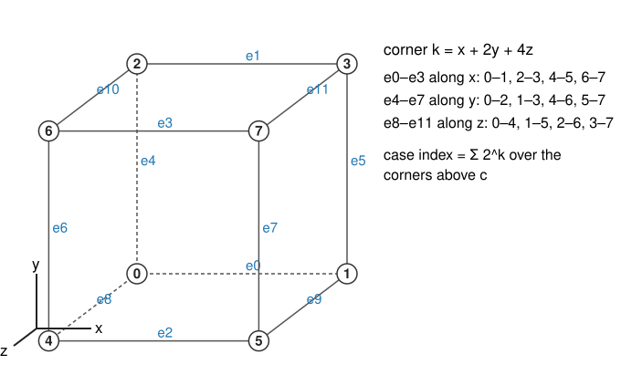
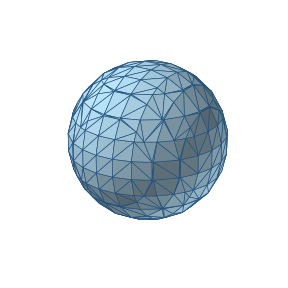
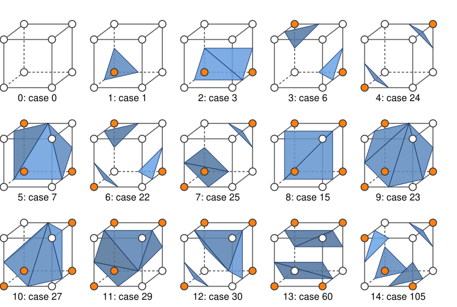
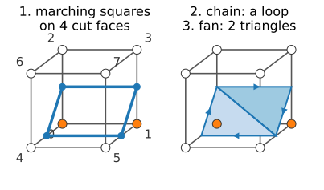
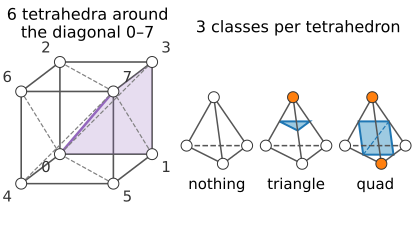
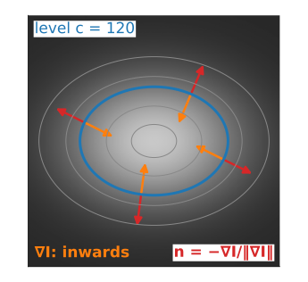

## About this lecture

Marching squares drew the boundary $\{I = c\}$ of a 2D image as curves. The same idea in a volume gives a **surface** made of triangles: **marching cubes** (Lorensen & Cline, 1987), the standard way to turn a 3D image into a 3D model.

- A cell is a **cube of 8 voxels**: 256 cases, which **symmetry** reduces to 23 or 15.
- The **triangle table**, and how to generate it from marching squares on the cube's faces.
- **Ambiguous faces**, cracks, and how to avoid them; **marching tetrahedra**.
- **Normals from the image gradient**: smooth shading for free.

*Slides titled **The math** give the formulas and proofs; the ideas are complete without them.*

::: notes
Builds directly on the previous unit (marching squares, crossing points, saddle cells, the asymptotic decider) and on `volumes3d/` (spacing, trilinear interpolation). Rendering (projection, shading) is the 3D-graphics day's; here it is a pointer. Corner numbering convention of the course: k = x + 2y + 4z, printed on the exercise sheet.
:::

## The same idea, one dimension up

:::: {.columns}
::: {.column width="55%"}
{width="100%"}
:::
::: {.column width="45%"}
- A **cell** = the cube between 8 neighbouring voxel centres. Corner $k = x + 2y + 4z$.
- Each corner above or below $c$: an 8-bit **case index**, $2^8 = 256$ cases.
- An edge with corners on opposite sides is **crossed** once; the crossing point by linear interpolation, $t = (c - I_a)/(I_b - I_a)$, as in 2D.
- The crossing points are connected by **triangles**: up to 5 per cube.
:::
::::

## Shared edges: one closed mesh

:::: {.columns}
::: {.column width="62%"}
- A cube edge is shared by up to 4 cubes, and each computes the same crossing point. Store the point **once** per grid edge and let all triangles **index** it: a mesh with shared vertices, not a soup of loose triangles.
- With a consistent rule on every face, the triangles of neighbouring cubes meet edge to edge: the surface is **closed** (watertight), apart from where it leaves the volume. Pad the volume with background to close it.
- **One pass** over the cells: $n^3$ cubes for an $n^3$ volume. The output grows with the **area** of the surface, about $n^2$ triangles, not with the volume.
- For a smooth surface: about **2 triangles per vertex**, and about 3 triangles per unit of area (in voxel units).
:::
::: {.column width="38%"}
{fig-alt="A shaded marching-cubes mesh of a sphere of radius 4.3 voxels on a 12 by 12 by 12 grid, with the triangle edges drawn: a closed surface of 312 shared vertices and 620 triangles." width="100%"}

A sphere of radius 4.3 voxels: 620 triangles ≈ 2 per vertex.
:::
::::

## 256 cases, but only 15 shapes

{width="60%"}

- **Rotations**: turning the cube turns the case into another case with the same surface, turned. The cube has 24 rotations; they group the 256 cases into **23 classes**.
- **Complement**: swapping inside and outside gives the same surface with the normals flipped. Rotations + complement: **15 classes** (the table of Lorensen & Cline). As we will see, the complement step is not innocent.

## The math: counting classes (Burnside) {.math}

The number of classes = the **average number of cases left unchanged** by a rotation. A case is unchanged when all corners in each cycle of the corner permutation have the same state: $2^{\#\text{cycles}}$ cases.

| rotation | how many | corner cycles | cases fixed |
|---|---|---|---|
| identity | 1 | 8 | $2^8 = 256$ |
| ±90° about a face axis | 6 | two 4-cycles | $2^2 = 4$ |
| 180° about a face axis | 3 | four 2-cycles | $2^4 = 16$ |
| ±120° about a body diagonal | 8 | 2 fixed, two 3-cycles | $2^4 = 16$ |
| 180° about an edge axis | 6 | four 2-cycles | $2^4 = 16$ |

$$\frac{256 + 6 \cdot 4 + 3 \cdot 16 + 8 \cdot 16 + 6 \cdot 16}{24} = \frac{552}{24} = 23.$$

With the complement as well (48 symmetries; a complement-rotation fixes a case when every cycle has even length and alternates), the same count gives 15.

## Generating the triangle table

:::: {.columns}
::: {.column width="52%"}
The table lists, for each of the 256 cases, which edges the triangles connect. We do not copy it; we **generate** it:

1. The surface meets each **face** of the cube in a marching-squares contour: run marching squares on the 6 faces (with a rule for saddle faces).
2. Every crossed edge belongs to two faces, so the face segments **chain** into closed loops around the cube.
3. **Triangulate** each loop as a fan (a polygon of $m$ points gives $m - 2$ triangles).

- Case 1 (one corner above): one loop of 3 points, 1 triangle. Case 3 (an edge): a loop of 4, 2 triangles.
- The face rule is all the table "knows": change the rule, and you get a different table.
:::
::: {.column width="48%"}
{fig-alt="Case 3, corners 0 and 1 above c (orange). Left: marching squares on the four faces that have a sign change gives four segments (blue) through the midpoints of the edges 0–2, 1–3, 1–5 and 0–4. Right: chained into one loop of 4 points, which a fan splits into 2 triangles." width="100%"}
:::
::::

## Try it: one cube

```{=html}
<link rel="stylesheet" href="../demos/dist/demo.css">
<div data-demo="mccube" data-preset="one"></div>
<script src="../demos/dist/mccube.js"></script>
```

::: notes
Click corners to flip them (orange = above c). Readouts: bits, case index, class among 15 and among 23, the rotation to the representative ("rotate to its representative" animates it). Tour: "one corner" (case 1, one triangle); click corner 1 too: case 3, two triangles, a quad. "Values: vertices slide": corners 0.9, 0.35, 0.6, … with c = 0.5; move c and the selected corner's value: the vertices slide along the edges (on edge 0–1, t = 0.73). "The 15 classes": step through them; class 9 (case 23) is a hexagon. "An ambiguous face": case 9, face −z tinted; switch separate/join: 2 triangles or 4.
:::

## Ambiguous faces and cracks

- A face with diagonal corners above is a 2D **saddle**: the surface may separate or join the two bright corners on that face. 6 of the 15 classes contain such a face (120 of the 256 cases).
- The face is shared with the **neighbouring cube**. If the two cubes choose differently, their triangles end at different points on that face: a **crack** (a hole) in the surface.
- The 15-class table makes exactly this mistake (Dürst, 1988): using the complement swaps "separate" for "join" in cases with many corners above, so neighbours can disagree.
- Fixes:
  - one **consistent rule** for all faces (e.g. always separate; 23 classes, no complement): closed, but sometimes the wrong topology;
  - the **asymptotic decider** on each face (Nielson & Hamann, 1991): consistent, because both cubes see the same 4 face values, and usually the right topology;
  - ambiguities **inside** the cube (tunnels) need more cases (Chernyaev's 33 cases, 1995; Lewiner et al., 2003).

## Try it: a crack

```{=html}
<link rel="stylesheet" href="../demos/dist/demo.css">
<div data-demo="mccube" data-preset="crack"></div>
<script src="../demos/dist/mccube.js"></script>
```

::: notes
Two cubes share the +x face of the left one, which is ambiguous (corners 1 and 7 above). The left cube separates, the right cube joins: their segments on the shared face differ, and the red lines are the 4 crack edges (edges with a triangle on one side only). Set the neighbour's rule to separate, or both to decider: the crack closes. Then "tetrahedra instead".
:::

## Marching tetrahedra

:::: {.columns}
::: {.column width="52%"}
- Split each cube into **tetrahedra** (5 or 6) and run the same idea per tetrahedron: 4 corners, $2^4 = 16$ cases.
- Up to symmetry only **3**: nothing (all in or all out), **one corner** separated (1 triangle), **two and two** (a quad, 2 triangles).
- **Never ambiguous**: no tetrahedron has a face with diagonal corners (its faces are triangles).
- Costs: more triangles (often 2–4 times), thin triangles, and a directional bias from the chosen diagonals; the split must match between neighbouring cubes (the 5-tetrahedron split alternates between neighbours).
:::
::: {.column width="48%"}
{fig-alt="Left: a cube with corners numbered 0 to 7, split into 6 tetrahedra that all share the diagonal from corner 0 to corner 7; one of them (0, 1, 3, 7) is shaded. Right: the three classes of a tetrahedron: no corner above c gives nothing, one corner above gives one triangle, two corners above give a quadrilateral made of two triangles." width="100%"}

On the sphere of the earlier slide: 1896 triangles instead of 620.
:::
::::

## The math: why a tetrahedron is unambiguous {.math}

- Inside a tetrahedron with corners $\mathbf p_0, \dots, \mathbf p_3$ every point is $\sum \lambda_i \mathbf p_i$ with barycentric weights $\lambda_i \ge 0$, $\sum\lambda_i = 1$. The natural interpolant is $f = \sum \lambda_i I_i$, which is **linear** (affine) in $\mathbf x$.
- The level set $\{f = c\}$ of an affine function is a **plane**. A plane cuts a tetrahedron in nothing, a triangle or a quadrilateral, always connected: no choice to make.
- On a shared triangular face, $f$ is the same affine function seen from both sides, so neighbours agree automatically.
- The cube's trilinear interpolant is not affine (its $xy$, $yz$, $xz$, $xyz$ terms bend the level set): that is where the ambiguity comes from.

## Normals from the image

:::: {.columns}
::: {.column width="58%"}
To shade a surface we need its **normal** at every vertex. A level set has one for free:

- Moving along the surface, $I$ stays equal to $c$; moving across it, $I$ changes fastest. So the normal points along the **gradient** $\nabla I$.
- For a **bright** object, $\nabla I$ points inwards (towards higher values): the outward normal is $\mathbf n = -\nabla I / \lVert\nabla I\rVert$.
- Compute $\nabla I$ at the voxels by **central differences** (or Sobel, `kernels/`), interpolate it trilinearly to each vertex, normalise.
- Result: smooth shading from a coarse mesh, because the normals come from the image, not from the facets.
:::
::: {.column width="42%"}
{fig-alt="A bright elliptical blob on a dark background with grey level lines and the level line at c = 120 in blue. At four points on it, an orange arrow (the gradient) points inwards, towards brighter values, and a red arrow (the normal, minus the gradient) points outwards; both are perpendicular to the level line." width="100%"}
:::
::::

## The math: gradient normals {.math}

- If $\mathbf x(s)$ is any curve on the surface, $I(\mathbf x(s)) = c$, so $\nabla I \cdot \mathbf x'(s) = 0$: the gradient is perpendicular to every tangent direction.
- Central differences with spacing: $\partial_x I \approx \dfrac{I[i+1] - I[i-1]}{2\Delta x}$, and likewise with $\Delta y$, $\Delta z$. Divided by voxels instead, the $z$ component is $\Delta z/\Delta x$ times too large and the normals tilt.
- At a vertex $\mathbf v$ on an edge: $\nabla I(\mathbf v) \approx$ trilinear interpolation of the 8 voxel gradients around it (or linear along the edge).
- **Face normals** instead: $\mathbf n = (\mathbf b - \mathbf a) \times (\mathbf c - \mathbf a)$ per triangle; constant per facet, so the mesh looks faceted. Shading with normals (Lambert, Phong) is the 3D-graphics day.

## When gradient normals fail

- **Noise**: the gradient of a noisy image points in random directions; the surface looks speckled. Blur first.
- **Flat regions**: where $\lVert\nabla I\rVert \approx 0$ (a plateau touching $c$), the direction is undefined.
- **Binary images** (a 0/1 mask): central differences give only a few directions (combinations of $-1, 0, 1$), so the normals are as blocky as the mask. Blur the mask slightly first (last unit).
- **Wrong spacing** in the differences: tilted normals, wrong lighting.

## Try it: marching cubes on a volume

```{=html}
<link rel="stylesheet" href="../demos/dist/demo.css">
<div data-demo="marchcubes" data-preset="merge"></div>
<script src="../demos/dist/marchcubes.js"></script>
```

::: notes
48³ volumes, extracted on every change. Tour: "two blobs merge": lower c from 0.6; at c = 0.49 the two components become one (their saddle value is 0.499); χ drops from 4 to 2. "A torus has a hole": 1 component, χ = 0. "Noise": 4324 components (thousands of tiny surfaces); "blur first" (σ = 1.5): one surface again. "Faceted vs gradient normals" with wireframe: the same triangles, shaded two ways. "Wrong z spacing": the ellipsoid volume drops by 0.4 (7609 → 3044). "Cracks": the complement rule on a noisy sphere gives 296 boundary edges (red); the decider gives none. Switch to 6 tetrahedra: about 3 times the triangles.
:::

## Summary

- **Marching cubes**: per cube of 8 voxels, case index (256) → crossed edges → triangles; vertices by linear interpolation, shared between cubes: a closed, indexed mesh in one pass.
- **Symmetry**: 24 rotations → 23 classes; with the complement → 15.
- The **triangle table** = marching squares on the 6 faces + chaining into loops + fans; the face rule decides it.
- **Ambiguous faces** must be resolved the same way by both neighbours (consistent rule or asymptotic decider), or the surface **cracks**. **Marching tetrahedra** is never ambiguous, at the cost of more triangles.
- **Normals** $\mathbf n = -\nabla I/\lVert\nabla I\rVert$ from the image give smooth shading; blur noisy and binary images first.
