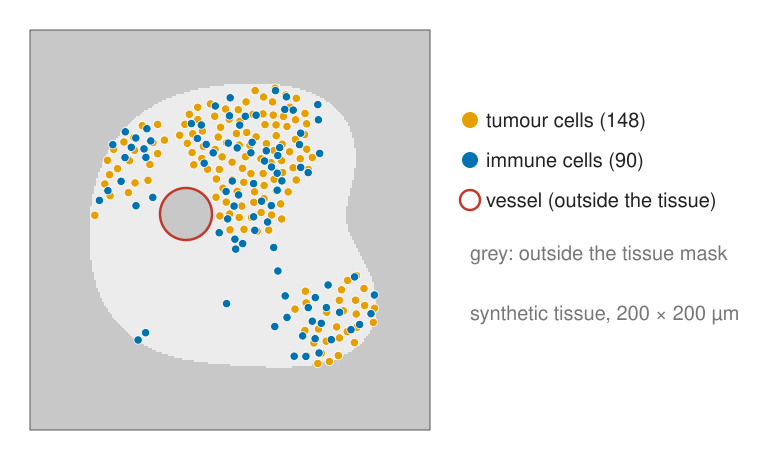
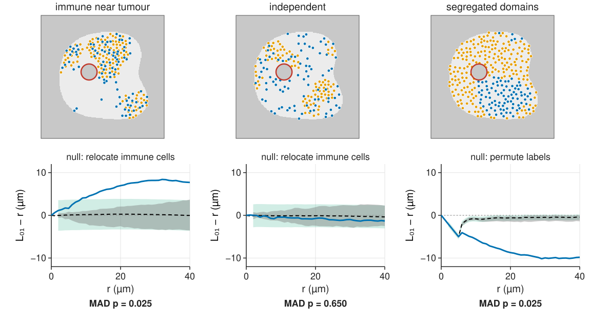
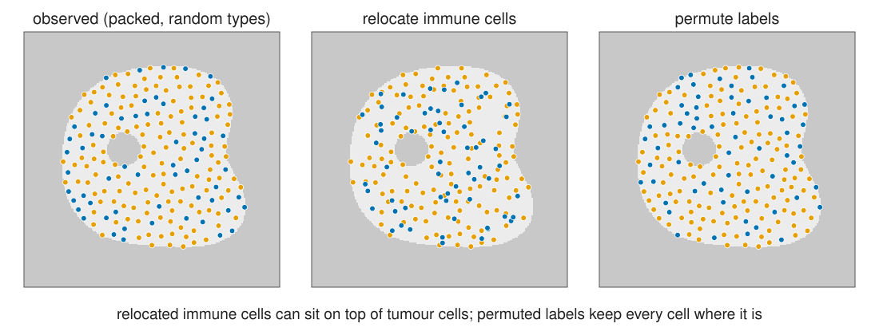
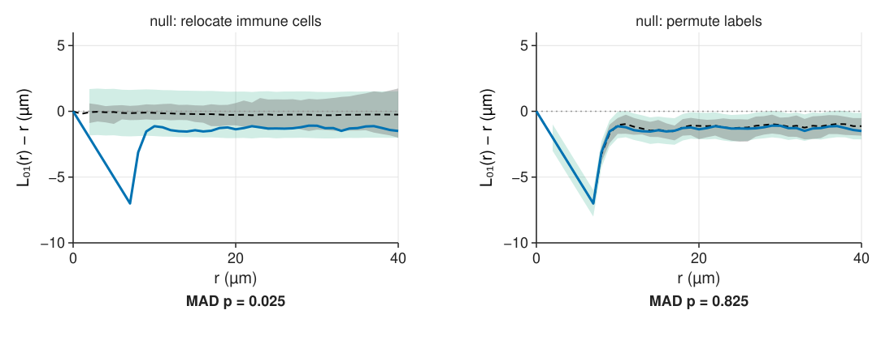
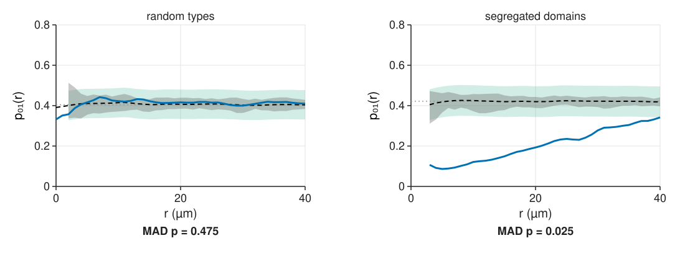
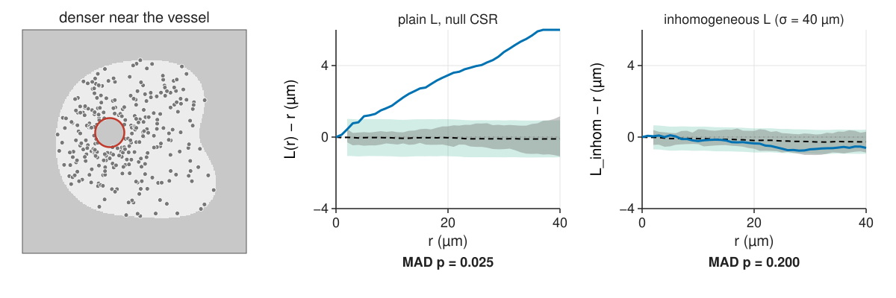
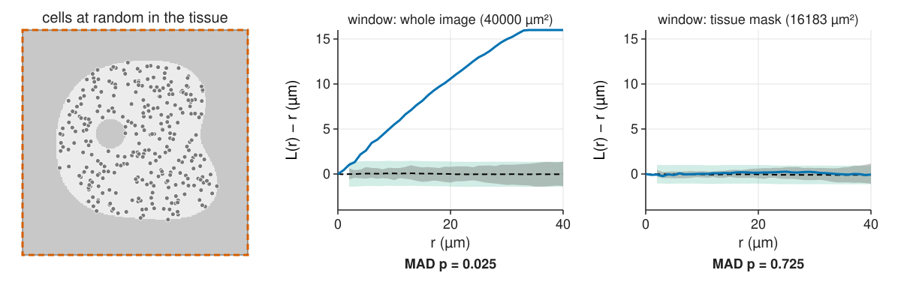
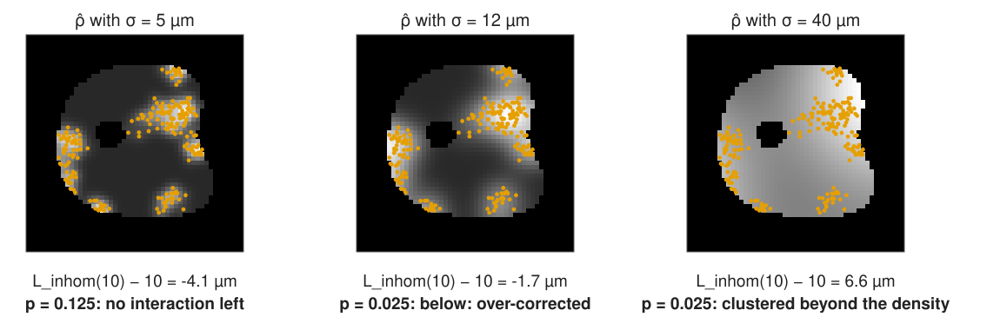

## About this lecture

Real tissue has **several cell types** and a density that **changes** across the tissue. Both need new null models.

- **Marks**: each point carries a type (or a size).
- **Cross-K / cross-L**: type-2 cells around type-1 cells.
- **Two null models, two questions**: independence vs random labelling.
- The **mark connection function**: which types sit next to each other.
- **Inhomogeneous intensity**: when "clustered" only means "denser here", the right window and the **inhomogeneous K**.
- The **honest limit**: density and clustering cannot always be separated.

*Slides titled **The math** give the formulas and proofs; the ideas are complete without them.*

::: notes
Last core unit of the spatial statistics day. Demo: celltypes, a synthetic tissue (mask 16 183 µm² with a vessel) of tumour cells (orange, type 0) and immune cells (blue, type 1). All envelopes: 39 simulations, MAD test over r = 2–40 µm, deviation from the mean of the simulated curves.
:::

## Marks: two cell types

{width="75%" fig-align="center" fig-alt="A synthetic tissue section (light) in a 200 × 200 µm image (grey outside), with a round vessel. 148 tumour cells (orange) in nests and 90 immune cells (blue), most of them close to the tumour nests."}

Each cell carries a **mark**: its type (from a multiplexed stain, a classifier), or a number (size, intensity). Questions: do the types **attract** (immune cells near tumour cells), **repel** (segregated domains), or **ignore** each other? Is each type's own pattern clustered?

## Cross-K and cross-L

{width="100%" fig-alt="Three tissues with their cross-L of immune cells around tumour cells against envelopes. Immune cells near tumour cells: the curve rises far above the band (L01 − r = 4.1 µm at 10 µm), p = 0.025. Independent types: inside the band, p = 0.65. Segregated domains: far below (−5.6 at 10 µm), p = 0.025."}

Count **type-1** cells around **type-0** cells, compare with $\pi r^2$: $K_{01}(r)$, and $L_{01}(r) - r$. Above 0: attraction; below: segregation. (The [object colocalisation unit](../coloc-objects/lec.qmd) used it for two-colour spots.)

## The math: cross-K {.math}

$$\rho_1 K_{01}(r) = E[\text{number of type-1 points within } r \text{ of a typical type-0 point}].$$

- Estimator (translation weights as in unit 3):
$$\hat K_{01}(r) = \frac{|W|}{n_0 n_1}\sum_{i \in 0}\sum_{j \in 1} w_{ij}\,[d_{ij} \le r].$$
- If the two types are **independent** and one of them is stationary, $K_{01}(r) = \pi r^2$, **whatever** pattern each type has on its own (clustered nests, regular spacing).
- Symmetric: $K_{01} = K_{10}$ in theory; estimates differ slightly with corrections.
- Cross pair correlation $g_{01} = K_{01}'/(2\pi r)$.

## Two null models, two questions

**Independence**: two populations that arrived separately; is their arrangement related?

- Keep each type's own pattern, move one type as a whole: **shift** it (toroidal wrap, only in a rectangle) or **relocate** its points at random **inside the tissue**.

**Random labelling**: the cells are where they are; is the **type** distributed at random over them? (Which cells become activated, which divide?)

- Keep all positions, **permute the labels**.
- Under it $K_{00} = K_{11} = K_{01} = K$ (of all cells): test $K_{01} - K$ or $K_{11} - K_{00}$.
- Clustered positions do not disturb this test: it conditions on them.

## Picking the wrong null

{width="100%" fig-alt="A packed tissue of 202 cells with random types; one simulation that relocates the immune cells at random in the tissue (they now overlap tumour cells and leave gaps); one simulation that permutes the labels (the same positions, types shuffled)."}

Relocated immune cells may land on top of tumour cells, which no real cell can do. Permuted labels keep every cell where it is and only shuffle the types.

## The two nulls disagree

{width="90%" fig-align="center" fig-alt="Cross-L of the packed tissue. Against relocation: the observed curve is −7 µm at 7 µm, far below the band (no immune cell can be closer than 7.5 µm to any other cell), p = 0.025: 'repulsion'. Against permuted labels the band follows the same dip and the curve stays inside, p = 0.83."}

Cells cannot overlap, so no immune cell is within 7.5 µm of a tumour cell. **Relocation** ignores that and reports "repulsion" (p = 0.025). **Permuting labels** respects it: random (p = 0.83). In packed tissue, random labelling asks the right question.

## The math: random labelling {.math}

Give each point of a process with K function $K$ type 1 with probability $p_1$ and type 0 with $p_0 = 1 - p_1$, independently of everything else.

- A pair at distance $r$ is a 1–1, 0–0 or mixed pair with probabilities $p_1^2$, $p_0^2$, $2p_0p_1$, **whatever** $r$ is. So the type-specific pair densities are $p_ap_b\rho^2g(r)$ and
$$K_{00} = K_{11} = K_{01} = K.$$
- Mark connection function: $p_{01}(r) = 2p_0p_1$ (mixed pairs, either order) for all r.
- **Independence** instead: $K_{01} = \pi r^2$, but $K_{00}$ and $K_{11}$ are free.
- Toroidal shift preserves each type's second-order structure exactly in a rectangle (the wrapped pattern is stationary on the torus). In an irregular mask the shifted points fall outside the tissue or onto the vessel: use relocation (if each type is roughly CSR within the mask) or a model of each type.

## The mark connection function

:::: {.columns}
::: {.column width="58%"}
{width="100%" fig-alt="Mark connection function p01(r) with permuted-label envelopes. Random types: around 0.42, inside the band, p = 0.48. Segregated domains: 0.09 at 5 µm, 0.12 at 10, 0.19 at 20, far below 0.42, p = 0.025."}
:::
::: {.column width="42%"}
Of the pairs at distance r, which fraction is a tumour–immune pair?

- Random labels: $2p_0p_1$ at every r (30 % immune: $2 \cdot 0.3 \cdot 0.7 = 0.42$).
- **Below**: neighbours tend to be of the same type (segregation). **Above**: mixing.
- Easy to read for many types: a matrix of curves $p_{ab}(r)$.
- For a continuous mark (cell size): the **mark correlation** asks whether neighbours of large cells are large.
:::
::::

## Try it: two types

```{=html}
<link rel="stylesheet" href="../demos/dist/demo.css">
<div data-demo="celltypes" data-preset="packedReloc"></div>
<script src="../demos/dist/celltypes.js"></script>
```

::: notes
Tissue left (orange tumour, blue immune, red vessel), curve right with the pointwise band (grey), the global MAD band (green) and the null mean (dashed); choose the null below the plot; presets in the drop-down. Tour, cross-L tab: "packed tissue: relocation says repulsion" (202 cells): −7 µm at 7 µm, p = 0.025. Switch the null to "permute labels": p = 0.83. "attraction" (148 tumour, 90 immune): L01 − r = 4.1 at 10 µm, p = 0.025. "independent": p = 0.65. "segregated domains" with permuted labels: −5.6 at 10 µm, p = 0.025. Try "toroidal shift" in the tissue: the readout warns that shifted cells outside the mask are lost.
:::

## An uneven density

{width="100%" fig-alt="Cells denser near the vessel, without interaction. Plain L − r against CSR: far above the band (3.5 µm at 20 µm), p = 0.025, 'clustered'. Inhomogeneous L with ρ̂ at bandwidth 40 µm against inhomogeneous Poisson simulations: inside, p = 0.20."}

Cells are denser near the vessel, but do not interact. The plain K says "clustered" at every r: pairs are found more often where the density is high. A **first-order** effect read as a **second-order** one (unit 1).

## Three responses

1. **The right window**: use the tissue mask, not the image. Often the biggest "effect" disappears (next slide).
2. **Inhomogeneous K**: weight each pair by $1/(\hat\rho(\mathbf x_i)\,\hat\rho(\mathbf x_j))$, with $\hat\rho$ the kernel estimate of unit 1 (or a model of ρ from a covariate, e.g. the distance to the vessel). Same reading: $L_\text{inhom} - r = 0$ means "no interaction beyond the density". Null: inhomogeneous Poisson from $\hat\rho$.
3. **Random labelling** for typed questions: it conditions on the positions and ignores the density altogether.

## The window matters

{width="100%" fig-alt="Cells placed at random inside a tissue mask that fills 40 % of the image. With the whole image as the window, L − r climbs to 10.6 µm at 20 µm, p = 0.025: 'clustered'. With the tissue mask as the window: L − r ≈ 0, inside the band, p = 0.73."}

The same random cells: "clustered" when the empty glass around the tissue is counted as searched, random when the window is the tissue (16 183 of 40 000 µm²).

## The math: the inhomogeneous K {.math}

Baddeley, Møller & Waagepetersen (2000):

$$\hat K_\text{inhom}(r) = \frac{1}{|W|}\sum_{i \ne j}\frac{w_{ij}\,[d_{ij} \le r]}{\hat\rho(\mathbf x_i)\,\hat\rho(\mathbf x_j)}.$$

- For an inhomogeneous Poisson process the pair density is $\rho(\mathbf u)\rho(\mathbf v)$; dividing each pair by the true $\rho(\mathbf x_i)\rho(\mathbf x_j)$ cancels it pair by pair, and with the translation weights the expectation is $\pi r^2$ (the argument of unit 3 with $g \equiv 1$).
- More generally it equals $\pi r^2$ whenever $g(\mathbf u, \mathbf v)$ depends only on $\mathbf u - \mathbf v$ ("second-order intensity-reweighted stationarity").
- Use the **leave-one-out** estimate $\hat\rho(\mathbf x_i) = \sum_{j \ne i}k_\sigma(\mathbf x_i - \mathbf x_j)/e(\mathbf x_i)$; including the point itself biases $\hat K_\text{inhom}$ down.
- The null simulations draw from $\hat\rho$ and **re-estimate** $\hat\rho$ with the same bandwidth.

## The honest limit

{width="100%" fig-alt="Clustered cells (221) with the kernel intensity at bandwidths 5, 12 and 40 µm. At 5 µm ρ̂ follows each cluster: L_inhom(10) − 10 = −4.1, p = 0.125, no interaction left. At 12 µm: −1.7, p = 0.025, below the envelope (over-corrected). At 40 µm: +6.6, p = 0.025, clustered beyond the density."}

From **one** pattern, "uneven density" and "clustering" cannot be fully separated. A bandwidth small enough to follow the clusters explains them away as density; a large one leaves them as interaction. Fix the bandwidth from a scale argued **in advance** (tissue structure, not cell clusters), or model ρ from a covariate or another cell type.

## Try it: an uneven density

```{=html}
<link rel="stylesheet" href="../demos/dist/demo.css">
<div data-demo="celltypes" data-preset="gradientL"></div>
<script src="../demos/dist/celltypes.js"></script>
```

::: notes
"density gradient: plain L says clustered" (L tab, null CSR): L − r = 3.5 at 20 µm, p = 0.025. Inhomogeneous L tab, "inhomogeneous L: no interaction" (σ = 40 µm, ρ̂ drawn under the tissue): p = 0.20. "bandwidth too small" (clustered cells, σ = 5): p = 0.125, the clusters vanish into ρ̂; "large bandwidth" (σ = 40): p = 0.025, clusters stay. Cross-L tab with the gradient: "relocation says attraction" (p = 0.025: both types crowd near the vessel), "random labelling ignores the gradient" (p = 0.90). L tab, "the image as the window": random cells look clustered (10.6 µm at 20 µm); "the tissue mask": p = 0.73. The bandwidth slider redraws when released (39 simulations take a few hundred ms).
:::

## Where this leads

- **Tissue-scale analysis** of multiplexed images: the neighbourhood composition of each cell, cell–cell interaction maps between many types (the same counts, per cell instead of averaged).
- **Finding** the clusters, not just detecting clustering: density-based clustering, [k-means](../kmeans/lec.qmd), and fitting cluster models (κ, σ) to $\hat K$.
- Two-colour spots: [object colocalisation](../coloc-objects/lec.qmd); tracks: the same null-model logic in time ([track analysis](../track-analysis/lec.qmd)).
- Experiments: one summary per image, experiments as n ([envelopes](../envelopes/lec.qmd), [replicates](../replicates/lec.qmd)).

## Summary

- **Marks** turn one pattern into several; **cross-K / cross-L** count one type around another.
- **Independence** (shift or relocate one type) and **random labelling** (permute types) answer different questions. In packed tissue, relocation invents repulsion; permutation does not.
- Under random labelling all $K_{ab}$ are equal and $p_{01} = 2p_0p_1$; the **mark connection function** shows mixing or segregation.
- An **uneven density** looks like clustering. Use the **tissue mask**, the **inhomogeneous K** (pairs weighted by $1/\hat\rho\hat\rho$), or random labelling.
- From one pattern, density and clustering are separated only by a **bandwidth chosen in advance**.
