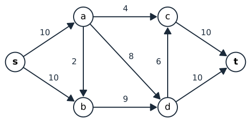
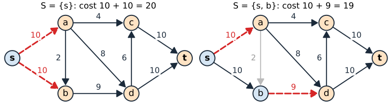
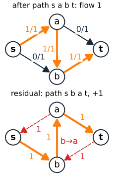
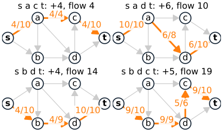
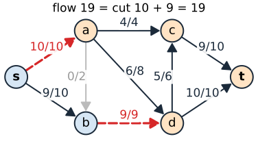

## About this lecture

Last time: segmentation = the labelling with the smallest energy. Next time we will see that this is a **minimum cut** of a graph. Today: how to find one.

- Directed graphs with **capacities**, a source $s$ and a sink $t$.
- An **s–t cut** and its cost.
- A **flow**, and why no flow can be larger than any cut.
- **Augmenting paths** in the **residual graph**: Ford–Fulkerson.
- The **max-flow / min-cut theorem**: the largest flow equals the smallest cut, and the algorithm hands us that cut.

Slides titled **The math** give the formulas and proofs; the ideas are complete without them.

## Graphs with capacities

:::: {.columns}
::: {.column width="44%"}
- Nodes $V$, directed edges $(u, v)$, each with a **capacity** $c(u, v) \ge 0$.
- Two special nodes: the **source** $s$ and the **sink** $t$.
- Think of pipes: $c(u, v)$ is how much water per second the pipe from $u$ to $v$ can carry.

Example used in the demo: on the right.
:::
::: {.column width="56%"}
{width="100%"}
:::
::::

## s–t cuts

An **s–t cut** splits the nodes into two sets, $S \ni s$ and $T \ni t$. Its cost is the total capacity of the edges **from $S$ to $T$**:

$$c(S, T) = \sum_{u \in S,\; v \in T} c(u, v).$$

- Edges from $T$ back to $S$ do **not** count.
- Every path from $s$ to $t$ must cross from $S$ to $T$ at least once: removing the cut edges disconnects $t$ from $s$.
- With $n$ nodes there are $2^{n-2}$ cuts (each node other than $s, t$ goes left or right).

{width="88%" fig-align="center"}

## Flows

A **flow** assigns $f(u, v)$ to every edge with

- **capacity**: $0 \le f(u, v) \le c(u, v)$,
- **conservation**: at every node other than $s$ and $t$, flow in = flow out.

Its **value** $|f|$ is the net flow out of $s$, which equals the net flow into $t$.

**No flow is larger than any cut**: every unit of water from $s$ to $t$ has to pass through the cut edges, and they carry at most their capacities. So the largest flow is at most the smallest cut. The surprise is that they are **equal**.

## Augmenting paths and the residual graph

Given a flow $f$, the **residual graph** says how the flow can still change:

- a **forward** arc $u \to v$ with residual capacity $c(u, v) - f(u, v)$ (room left),
- a **backward** arc $v \to u$ with residual capacity $f(u, v)$ (flow that can be **undone**).

An **augmenting path** is a path from $s$ to $t$ in the residual graph. Its **bottleneck** $b$ is its smallest residual capacity. Push $b$ along it: add $b$ on forward arcs, subtract $b$ on backward arcs. The flow stays valid and grows by $b$.

## Why backward arcs are needed

:::: {.columns}
::: {.column width="52%"}
Four nodes, all capacities 1: $s\!\to\!a$, $s\!\to\!b$, $a\!\to\!b$, $a\!\to\!t$, $b\!\to\!t$. Maximum flow: 2.

- Suppose we first push 1 along $s \to a \to b \to t$.
- Now $s\!\to\!a$ and $b\!\to\!t$ are full. Using only forward arcs, $t$ is unreachable: stuck at 1.
- In the residual graph there is the backward arc $b \to a$: the path $s \to b \to a \to t$ pushes 1 more, and **cancels** the flow on $a \to b$.

Backward arcs let the algorithm **change its mind**, so the order in which paths are found does not matter for the result.
:::
::: {.column width="48%"}
{width="58%" fig-align="center"}
:::
::::

## Ford–Fulkerson

:::: {.columns}
::: {.column width="45%"}
1. Start with $f = 0$.
2. Find a path from $s$ to $t$ in the residual graph. If there is none, stop.
3. Push its bottleneck along it; go to 2.

- With integer capacities each step adds at least 1, so it stops.
- **Edmonds–Karp**: choose the **shortest** path (breadth-first search). Then the number of steps is at most $O(|V|\,|E|)$, whatever the capacities.
- In the example: $s\,a\,c\,t$ (4), $s\,a\,d\,t$ (6), $s\,b\,d\,t$ (4), $s\,b\,d\,c\,t$ (5): flow 19.
:::
::: {.column width="55%"}
{width="100%"}
:::
::::

## Max-flow = min-cut

:::: {.columns}
::: {.column width="54%"}
**Theorem** (Ford & Fulkerson, 1956): the largest possible flow equals the cost of the smallest cut.

- When no augmenting path is left, colour the nodes you can **still reach from $s$** in the residual graph: that set is $S$, the rest is $T$.
- Every edge from $S$ to $T$ is then **full**, and no flow comes back from $T$ to $S$: the flow is exactly the cut.
- So Ford–Fulkerson gives both answers at once: the maximum flow, and a **minimum cut**.
- In the example: $S = \{s, b\}$, cut $c(s,a) + c(b,d) = 10 + 9 = 19$ = flow.
:::
::: {.column width="46%"}
{width="100%"}
:::
::::

## The math: why flow = cut {.math}

**Any flow $\le$ any cut.** Summing "flow out − flow in" over the nodes of $S$ (0 everywhere except $|f|$ at $s$), the edges inside $S$ cancel:

$$|f| = \sum_{S \to T} f(u, v) - \sum_{T \to S} f(u, v) \;\le\; \sum_{S \to T} c(u, v) = c(S, T).$$

**Equality at the end.** Let $S$ = the nodes reachable from $s$ in the final residual graph.

- An edge $u \to v$ from $S$ to $T$ is **full**, $f = c$: otherwise the forward arc would make $v$ reachable.
- An edge $v \to u$ from $T$ to $S$ carries **no flow**: otherwise its backward arc $u \to v$ would make $v$ reachable.
- So both sums above are at their extremes: $|f| = c(S, T)$, and this flow and this cut are both optimal.

## Try it: augmenting paths

```{=html}
<link rel="stylesheet" href="../demos/dist/demo.css">
<div data-demo="maxflow" data-preset="textbook"></div>
<script src="../demos/dist/maxflow.js"></script>
```

::: notes
Edges show flow / capacity. "Next augmenting path" finds the shortest path in the residual graph (orange) and pushes its bottleneck. Tour: step through the example: 4, 6, 4, 5. Tick "show the residual graph" after step 2: grey arcs are room left, red ones flow that can be undone. Press next once more after the last path: no path left, the source side is shaded blue, the cut edges are red and dashed: flow 19 = cut 19. Point out that a→b goes from T to S and is not counted. Then "needs a back-edge": the second path runs b→a backwards and cancels the first path's flow on a→b. "Two minimum cuts": the algorithm returns the cut nearest s; the toggle shows the one nearest t. Clicking an edge lets you change its capacity: raise b→d to 12 and the flow becomes 20.
:::

## Minimum cuts in practice

- The minimum cut need not be unique. The reachable set from $s$ gives the cut **nearest $s$**; the nodes that can still reach $t$ give the one nearest $t$.
- Image graphs have one node per pixel: millions of nodes, but only a few edges each.
- **Boykov–Kolmogorov** (2004): grows search trees from $s$ and $t$ and reuses them between augmentations. Not the best worst case, but very fast on image graphs.
- **Push–relabel**: pushes excess flow locally, node by node, instead of along whole paths; easy to run in parallel.
- Undirected edges (as in images) are two directed edges, one each way.

## Summary

- An **s–t cut** separates $s$ from $t$; its cost is the capacity of the edges from $S$ to $T$.
- Any flow $\le$ any cut. **Max-flow = min-cut.**
- Ford–Fulkerson: push flow along **augmenting paths** in the **residual graph**; backward arcs undo flow.
- When no path is left, the nodes reachable from $s$ form a **minimum cut**.
- Next: segmentation energies as cuts, so that one max-flow gives the best segmentation.
