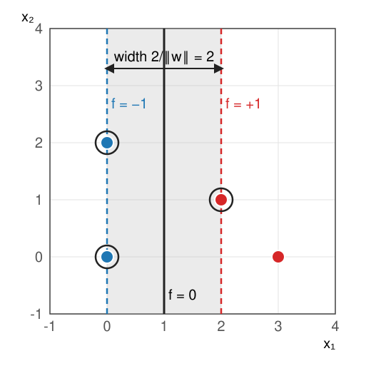

## About this lecture

Last unit: many lines separate the training points. This unit picks **one**: the line with the **widest empty street** around it (Boser, Guyon & Vapnik, 1992; Cortes & Vapnik, 1995).

- The **maximum-margin** line and its **support vectors**.
- Fixing the scale: the street is $-1 \le f \le 1$, its width is $2/\|\mathbf w\|$.
- A worked example **by hand**.
- Overlapping classes: the **soft margin** and the penalty $C$.
- The **hinge loss**, compared with the 0–1, logistic and squared losses.

*Slides titled **The math** give the formulas and proofs; the ideas are complete without them.*

::: notes
The concept layer is the street, the support vectors and what C does. The primal problems are in the math layer; the dual is in the next unit, also in the math layer.
:::

## The widest street

:::: {.columns}
::: {.column width="45%"}
{width="100%"}
:::
::: {.column width="55%"}
Of all lines with zero training errors, take the one with the **widest empty street** around it: the line in the middle, the two edges through the closest points of each class.

- The street's half-width is the **margin**: the distance from the line to the closest training point.
- Here: blue at $(0, 0)$, $(0, 2)$; red at $(2, 1)$, $(3, 0)$. The widest street is $0 \le x_1 \le 2$, the line is $x_1 = 1$, the width 2.
:::
::::

## Support vectors

The points on the **edge of the street** are the **support vectors**: here $(0, 0)$, $(0, 2)$ and $(2, 1)$.

- Move any **other** point, without entering the street: **nothing changes**. The point $(3, 0)$ could be anywhere to the right of $x_1 = 2$.
- Move a support vector: the street moves with it.
- The classifier depends on a **few** training points, the ones that are hard to classify. A forest or a nearest-mean rule uses all of them.

## Why a wide street?

- **Robustness**: features are noisy (a pixel's smoothed intensity, an object's measured area). A point that moves a little should not cross the line. The wider the street, the larger the change it survives.
- **Generalisation** (stated, not proven here): among separating lines, a wider margin goes with a smaller expected error on new points. The theory bounds the error by the margin relative to the spread of the data, not by the number of features.
- A **unique** answer: the widest street is a single, well-defined line; "any line with zero errors" is not.

## Fixing the scale

Unit 1: $(\mathbf w, b)$ and $(c\mathbf w, cb)$ give the same line. Choose the scale so that the **closest points have $f = \pm 1$**:

- The street is $-1 \le f(\mathbf x) \le 1$; its edges are the lines $f = -1$ and $f = +1$.
- Each edge lies at distance $1/\|\mathbf w\|$ from the line: the width is $\mathbf{2/\|w\|}$.
- Every training point on its side, outside the street: $y_i\,f(\mathbf x_i) \ge 1$.

**Widest street = smallest $\|\mathbf w\|$** such that all $y_i f(\mathbf x_i) \ge 1$.

Example: $f = x_1 - 1$, so $\mathbf w = (1, 0)$, $b = -1$, width $2/1 = 2$. Check: $y\,f = 1, 1, 1, 2$ for $(0,0)$, $(0,2)$, $(2,1)$, $(3,0)$.

## The math: the hard-margin problem {.math}

The edges $f = \pm 1$ are at distance $|{\pm 1}|/\|\mathbf w\|$ from $f = 0$ (unit 1's distance formula), so the width is $2/\|\mathbf w\|$. Maximising it is minimising $\|\mathbf w\|$, or more conveniently

$$\min_{\mathbf w, b}\ \tfrac12\|\mathbf w\|^2 \quad\text{subject to}\quad y_i(\mathbf w\cdot\mathbf x_i + b) \ge 1, \quad i = 1, \dots, n.$$

- A **convex quadratic** objective with **linear** constraints: one optimum, no local minima. (A neural network's loss has many; the neural networks day.)
- Feasible only if the data are separable. The constraints that hold with equality belong to the support vectors.
- Solved in the next unit through its **dual**, in which only dot products $\mathbf x_i\cdot\mathbf x_j$ appear.

## Try it: the widest street

```{=html}
<link rel="stylesheet" href="../demos/dist/demo.css">
<div data-demo="svm2d" data-preset="byhand" data-kernel="linear"></div>
<script src="../demos/dist/svm2d.js"></script>
```

::: notes
Linear kernel function only. Line f = 0 solid, edges f = ±1 dashed, the street grey, support vectors ringed. Tour: "the by-hand example": x₁ = 1, width 2, 3 support vectors. Drag (3, 0) up, down, right: nothing changes. Drag it left into the street: the street shrinks. Drag (2, 1) instead: the line turns. "Move a non-support vector": 8 points, still 3 support vectors; drag the unringed ones freely. Click to add a red point inside the street: the street narrows.
:::

## Real data overlap: the soft margin

Most data cannot be separated, or only by a very narrow street dictated by one odd point.

- Allow points **inside the street** or even on the **wrong side**, at a price.
- The **slack** $\xi_i \ge 0$ of a point is how far it falls short of $y_i f = 1$: $\xi_i = \max(0, 1 - y_i f(\mathbf x_i))$. Inside the street: $0 < \xi_i < 1$. Wrong side: $\xi_i > 1$.
- Minimise "narrowness + $C$ × total slack". $C$ sets the price of a violation:
  - **small $C$**: violations are cheap → a **wide** street, many points inside it, a smooth, stable line;
  - **large $C$**: violations are expensive → a **narrow** street, few violations, sensitive to single outliers.
- Support vectors are now all points **on or inside** the street (and on the wrong side).

## The math: the soft-margin problem {.math}

$$\min_{\mathbf w, b, \boldsymbol\xi}\ \tfrac12\|\mathbf w\|^2 + C\sum_i \xi_i \quad\text{subject to}\quad y_i f(\mathbf x_i) \ge 1 - \xi_i,\quad \xi_i \ge 0.$$

At the optimum each $\xi_i$ is as small as allowed: $\xi_i = \max(0, 1 - y_i f(\mathbf x_i))$. Substituting gives an **unconstrained** problem:

$$\min_{\mathbf w, b}\ \tfrac12\|\mathbf w\|^2 + C\sum_i \max\big(0,\ 1 - y_i(\mathbf w\cdot\mathbf x_i + b)\big).$$

- A regulariser plus a data term, as everywhere in the course: dividing by $C$ gives $\sum_i \text{loss}_i + \lambda\cdot\tfrac12\|\mathbf w\|^2$ with $\lambda = 1/C$. Large $C$ = weak regularisation.
- Still convex. The hinge has a kink at $y f = 1$, but (sub)gradient descent works: step against $\mathbf w - C\sum_{i:\,y_i f_i < 1} y_i\mathbf x_i$ (and $-C\sum_{i:\,y_i f_i < 1} y_i$ for $b$). Only the violating points pull.

## Try it: an outlier, and overlapping classes

```{=html}
<link rel="stylesheet" href="../demos/dist/demo.css">
<div data-demo="svm2d" data-preset="outlier" data-kernel="linear"></div>
<script src="../demos/dist/svm2d.js"></script>
```

::: notes
Yellow segments: slack, from a violating point to its edge of the street; dashed rings: support vectors inside the street or on the wrong side (α = C). Tour: "one outlier": at C = 1000 the street squeezes past the outlier: width 0.61, 0 errors. Lower C to 1: the outlier is given up (1 error), the width jumps to 1.94. At C = 0.1: width 2.89, 8 support vectors. "Overlapping classes": sweep C from 0.01 (46 support vectors, width 4.09) to 1000 (7 support vectors, width 0.86); the training errors stay at 3 or 4. "C large = narrow street".
:::

## Losses: what does the SVM minimise?

Write the margin value $m = y\,f(\mathbf x)$: positive = correct side, $\ge 1$ = outside the street.

| loss | formula | |
|---|---|---|
| 0–1 | $1$ if $m \le 0$, else $0$ | what we care about; flat with a jump |
| **hinge** | $\max(0,\ 1 - m)$ | 0 outside the street, grows **linearly** |
| logistic | $\log_2(1 + e^{-m})$ | never exactly 0; every point has a say |
| squared | $(1 - m)^2$ | also punishes points that are "too correct" |

- The 0–1 loss cannot be minimised by walking downhill: its slope is 0 or undefined.
- The hinge is the closest **convex** stand-in: zero for safe points, so only the support vectors matter.
- The hinge is a **ReLU** of $1 - m$: the same bend as the neural networks day's units. The logistic loss is that day's cross-entropy loss (in bits): an SVM and a logistic neuron differ only in the loss.

## The losses by hand

Five points with $y\,f = 2,\ 1,\ 0.5,\ 0,\ -1$:

| $y f$ | 2 | 1 | 0.5 | 0 | −1 | total |
|---|---|---|---|---|---|---|
| 0–1 | 0 | 0 | 0 | 1 | 1 | 2 |
| hinge | 0 | 0 | 0.5 | 1 | 2 | 3.5 |
| logistic | 0.18 | 0.45 | 0.68 | 1 | 1.90 | 4.21 |
| squared | 1 | 0 | 0.25 | 1 | 4 | 6.25 |

- The point at $y f = 0.5$ is **correct** but inside the street: the hinge charges it, the 0–1 loss does not.
- The point at $y f = 2$ is safe: the hinge ignores it; the squared loss punishes it as much as the point on the line.

## Try it: four losses

```{=html}
<link rel="stylesheet" href="../demos/dist/demo.css">
<div data-demo="hingeloss" data-preset="outlier"></div>
<script src="../demos/dist/hingeloss.js"></script>
```

::: notes
Top left: the losses against y f, with the data points as dots. Top right: the average loss against the threshold t. Bottom: the data on a line, f(x) = a(x − t); drag to move t; bars = each point's loss. Tour: "an outlier": the outlier's squared loss (30.25) is larger than all the others together (total 40.75); its hinge loss 5.5. "Move t to the minimum of": 0–1 stays at 5, hinge 4.75, squared 4.39, logistic 4.03. "Points far on the right side": hinge total 0 at t = 5, the logistic loss still 1.41. "0–1 has flat steps": the right plot.
:::

## Summary

- The SVM picks the line with the **widest street**: $-1 \le f \le 1$ empty, width $2/\|\mathbf w\|$.
- Only the **support vectors** (on or inside the street) determine it; other points can move freely.
- **Soft margin**: points may violate the street at a cost $C$ per unit of slack. Small $C$ = wide, smooth, tolerant; large $C$ = narrow, sensitive to outliers.
- The SVM minimises $\tfrac12\|\mathbf w\|^2 + C\sum_i$ **hinge**$(y_i f_i)$: zero for safe points, linear for violations. Convex: one optimum.
