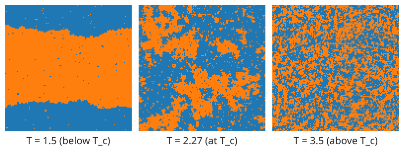

## About this lecture

Last unit: the Gibbs distribution $p(\mathbf s) \propto e^{-E(\mathbf s)/T}$, and why its normaliser $Z$ is out of reach for an image. Today: we **draw samples** anyway, one pixel at a time.

- The **local rule**: a pixel given its neighbours is a coin flip with a known bias.
- Two samplers: **Gibbs** (redraw the pixel) and **Metropolis** (propose a flip, maybe accept).
- Why they work: a random walk whose long-run distribution is the Gibbs distribution.
- What samples of a large lattice look like: the **phase transition** at $T_c \approx 2.27$.
- **Simulated annealing**: sample while cooling, to find low energies.

*Slides titled **The math** give the formulas and proofs; the ideas are complete without them.*

::: notes
Notation as in unit 1: spins ±1, coupling J, field h, temperature T; neighbours are the 4-neighbours; the large lattice is periodic (a torus), so every site has 4 neighbours. The demos: isingenum (the 3 × 3 lattice, now in sample mode) and isinglattice (256 × 256).
:::

## A sample is the best picture of a distribution

{width="100%"}

Each panel is one random state of a $128 \times 128$ Ising lattice ($J = 1$, $h = 0$), drawn by the methods of this unit (500 sweeps from random spins).

- We cannot list $2^{16384}$ probabilities, but a few **typical states** tell us what the model believes.
- Cold: large regions that agree. Hot: noise. In between, at $T_c$: clusters of every size.

## One pixel at a time: no $Z$ needed

Change only pixel $p$. Its two possible values give two states that differ in $s_p$ alone; their energy difference involves only $p$ and its **neighbours**.

- The neighbours "vote": the **local field** $u_p = J\cdot(\text{sum of the 4 neighbouring spins}) + h$.
- Given its neighbours, the pixel is $+1$ with probability
$$p(s_p = +1 \mid \text{neighbours}) = \frac{1}{1 + e^{-2u_p/T}}$$
a **logistic** curve in the vote.
- Example: neighbours $(+, +, +, -)$, $J = 1$, $h = 0$: $u_p = 2$. At $T = 2$: $1/(1 + e^{-2}) = 0.88$. At $T = 1$: 0.98; at $T = 4$: 0.73.
- **Markov property**: given its neighbours, a pixel does not care about the rest of the image. Hence "Markov random field".

## The math: the local conditional {.math}

Write $\mathbf s^+$ and $\mathbf s^-$ for the state with $s_p = +1$ and $s_p = -1$, everything else fixed. Every term of $E$ that does not contain $s_p$ is the same in both, so

$$E(\mathbf s^-) - E(\mathbf s^+) = 2J\sum_{q \sim p}s_q + 2h = 2u_p.$$

The ratio of probabilities needs no $Z$:

$$\frac{p(\mathbf s^+)}{p(\mathbf s^-)} = e^{2u_p/T} \quad\Longrightarrow\quad p(s_p = +1 \mid \text{rest}) = \frac{e^{2u_p/T}}{e^{2u_p/T} + 1} = \frac{1}{1 + e^{-2u_p/T}}.$$

It depends on the rest of the image only through the neighbours (via $u_p$): the Markov property. Flipping $p$ changes the energy by $\Delta E = 2s_pu_p$.

## Two samplers

Visit the pixels one after the other (a **sweep** visits each once).

- **Gibbs sampler** (heat bath; Geman & Geman, 1984): draw the pixel anew from its local conditional, i.e. set $+1$ with probability $1/(1 + e^{-2u_p/T})$.
- **Metropolis** (Metropolis et al., 1953): propose to **flip** the pixel. Compute $\Delta E$:
  - $\Delta E \le 0$ (downhill): always accept;
  - $\Delta E > 0$ (uphill): accept with probability $e^{-\Delta E/T}$.

Uphill moves are what make it a sampler and not a minimiser. A flip with $\Delta E = 4$ is accepted with probability $e^{-2} = 0.14$ at $T = 2$, but only $e^{-8} = 0.0003$ at $T = 0.5$.

## Try it: sampling the $3 \times 3$ lattice

```{=html}
<link rel="stylesheet" href="../demos/dist/demo.css">
<div data-demo="isingenum" data-preset="sample"></div>
<script src="../demos/dist/isingenum.js"></script>
```

::: notes
Sample mode: one step = one randomly chosen site, updated by Gibbs or Metropolis; the circled site is the last one visited (dashed: rejected / unchanged). The red dots are the fraction of steps spent at each energy level, the bars the exact values from enumeration. Tour: "sample: converges" (T = 3, Gibbs), play at 10 steps per frame, then 100 and 1000: after 100 steps the dots are far off (total-variation distance 0.35), after 1000 close (0.07), after 100 000 within 0.01. Then "sample: low T, stuck" (T = 1, Metropolis, magnetisation tab): the energy histogram looks right, but the chain never leaves the m = +1 side, although m = −1 has the same probability. Leaving needs a flip with ΔE = 8: e^−8 = 0.0003 per try, and then many more uphill steps.
:::

## Why does this work? A random walk on states

The sampler moves from state to state at random: a **Markov chain**. Two states, $a$ (energy 0) and $b$ (energy 1), $T = 1$, Metropolis:

- From $a$: propose $b$, uphill by 1: go with probability $e^{-1} = 0.37$, else stay.
- From $b$: propose $a$, downhill: always go.

$$P = \begin{bmatrix} 0.63 & 0.37 \\ 1 & 0 \end{bmatrix} \quad (\text{row} = \text{from}, \text{column} = \text{to})$$

- Run long: the fraction of time in $a$ and $b$ settles at $\boldsymbol\pi = (0.73, 0.27)$, whatever the start.
- That is exactly the Gibbs distribution: $1/(1 + e^{-1}) = 0.73$.
- **Balance**: in the long run, traffic $a \to b$ ($0.73 \cdot 0.37 = 0.27$) equals traffic $b \to a$ ($0.27 \cdot 1$).

## The math: stationary distribution and detailed balance {.math .smaller}

A Markov chain with transition matrix $P$ ($P_{ab}$ = probability to go from $a$ to $b$; rows sum to 1) moves a distribution $\boldsymbol\pi$ (a row vector) to $\boldsymbol\pi P$. A **stationary** distribution satisfies

$$\boldsymbol\pi P = \boldsymbol\pi: \quad \boldsymbol\pi \text{ is a left eigenvector of } P \text{ with eigenvalue } 1.$$

If every state can reach every other (and the chain is not periodic), it is unique and the chain converges to it from any start.

**Detailed balance**: $\pi_aP_{ab} = \pi_bP_{ba}$ for all pairs. Summing over $a$: $\sum_a\pi_aP_{ab} = \pi_b\sum_aP_{ba} = \pi_b$, so detailed balance implies stationarity.

Metropolis with a symmetric proposal and $E_b > E_a$: $P_{ab} = q\,e^{-(E_b - E_a)/T}$, $P_{ba} = q$. Then

$$\pi_aP_{ab} = \frac{e^{-E_a/T}}{Z}\,q\,e^{-(E_b - E_a)/T} = \frac{e^{-E_b/T}}{Z}\,q = \pi_bP_{ba}.$$

The Gibbs sampler satisfies it too (it is a Metropolis–Hastings move that is always accepted). Note: $Z$ never had to be computed.

## In practice: burn-in and mixing

- **Burn-in**: the chain starts somewhere arbitrary (the noisy image, random spins). The first sweeps are not yet samples of the Gibbs distribution: discard them.
- **Correlated samples**: consecutive states differ in a few pixels. 1000 sweeps are worth far fewer than 1000 independent samples.
- **Mixing**: at low $T$ the chain can stay in one region of states for a very long time. On the $3 \times 3$ lattice at $T = 1$ it never leaves "mostly $+1$" in 100 000 steps, although "mostly $-1$" is as probable.
- No convergence proofs here: in practice, run longer, start from several states, and check that the answers agree.

## The phase transition

On a large lattice (here $256 \times 256$, periodic, $h = 0$) the samples change character at the **critical temperature** $T_c = 2/\ln(1 + \sqrt2) \approx 2.27$ (for $J = 1$; Onsager, 1944):

- **Below $T_c$**: domains grow and one sign takes over the lattice: a **magnetisation** $|m|$ well above 0 (0.91 at $T = 2$).
- **Above $T_c$**: noise with small clusters; $m \approx 0$.
- **At $T_c$**: clusters of all sizes, from single pixels to the whole lattice.

The model has no preferred sign, but below $T_c$ the lattice picks one: **spontaneous symmetry breaking**. A tiny field $h$ decides which.

## Try it: a large lattice

```{=html}
<link rel="stylesheet" href="../demos/dist/demo.css">
<div data-demo="isinglattice" data-preset="coarsen"></div>
<script src="../demos/dist/isinglattice.js"></script>
```

::: notes
256 × 256 periodic lattice, checkerboard Metropolis sweeps (about 2.5 ms per sweep in the browser, so several per frame). Tour: "cold: domains coarsen" (T = 1.5 from random spins): domains grow, the domain-wall length falls (9740 disagreeing pairs after 10 sweeps, 1618 after 1000) and with this seed one sign wins (m = 0.986 at sweep 1000). "hot: noise" (T = 5): m stays near 0, E/n ≈ −0.42. "at T_c": clusters of all sizes; E/n approaches −1.40 (the exact value for the infinite lattice is −√2 = −1.414). "a small field decides" (T = 1.8, h = 0.05): m = 0.82 after 20 sweeps, 0.96 after 50; with h = 0 the lattice is still undecided after 400 sweeps (m = −0.21). T-scan tab: run it, ⟨|m|⟩ against T follows Onsager's curve below T_c (0.912 against 0.911 at T = 2) and is small but not zero above it (a finite lattice).
:::

## The math: Onsager's results {.math}

For the infinite square lattice with $h = 0$ (Onsager 1944; Yang 1952):

$$T_c = \frac{2J}{\ln(1 + \sqrt2)} \approx 2.269\,J, \qquad |m| = \Big(1 - \sinh(2J/T)^{-4}\Big)^{1/8} \text{ for } T < T_c, \quad 0 \text{ above}.$$

Energy per spin at $T_c$: $-\sqrt2\,J$.

**No transition in 1D.** For a chain, the transfer matrix of unit 1 gives the free energy per spin $-T\ln\mu_1$ with $\mu_1 = 2\cosh(J/T)$ (for $h = 0$): a smooth function of $T$ for every $T > 0$. A single disagreeing pair cuts a chain into two domains at a finite energy cost $2J$, so at any $T > 0$ such walls appear with density about $e^{-2J/T}$ and destroy long-range order. In 2D a wall around a domain costs energy proportional to its **length**, which wins against the entropy of the wall below $T_c$.

## Critical slowing down

Near $T_c$ local updates become **slow**: big clusters must be dismantled one pixel at a time.

Start a $128 \times 128$ lattice with all spins $+1$ and count the sweeps until $|m| < 0.1$ (the true value above $T_c$ is 0):

| $T$ | 4 | 3 | 2.5 | 2.3 | 2.27 |
|---|---|---|---|---|---|
| sweeps | 2 | 6 | 29 | 1580 | 3245 |

- For measurements near $T_c$, physicists use **cluster algorithms** that flip whole clusters at once (Swendsen & Wang, 1987); named only here.
- For images, the lesson is general: a sampler with local moves can be very slow when the distribution has large-scale structure.

## Simulated annealing

To find a **low-energy** state (Kirkpatrick et al., 1983; Geman & Geman, 1984): sample while **lowering** $T$.

- At high $T$ the chain moves freely between regions; as $T$ drops, it settles into deeper and deeper valleys of the energy.
- **Cool slowly enough** and it ends in a ground state.
- **Quench** (drop $T$ at once): domains freeze where they are. A domain wall that is flat across the whole periodic lattice cannot move by single flips without raising the energy: a **local minimum**.
- In the demo ($128 \times 128$): quench to $T = 0.5$ from random spins: two stripes remain ($m \approx 0.1$) however long we wait. Cooling from 3.5 to 0.5 over 300 sweeps: one domain ($m = -1$), a ground state.

## The math: cooling schedules {.math}

- **Logarithmic**: $T_k = c/\ln(k + 2)$. Geman & Geman (1984) proved that for $c$ large enough the chain ends in a ground state with probability 1. Impractically slow: halving $T$ needs squaring $k$.
- **Geometric**: $T_k = T_0\,r^k$ with $r$ slightly below 1 (e.g. from $T_0$ to $T_1$ in $K$ sweeps: $r = (T_1/T_0)^{1/K}$). No guarantee; what people use.
- At each temperature the chain should be close to its stationary distribution before $T$ drops further. Near $T_c$ that takes longest (critical slowing down): cool slowest there.

## Summary

- Given its neighbours, a pixel is $+1$ with probability $1/(1 + e^{-2u_p/T})$: a logistic function of the neighbours' vote. No $Z$ needed.
- **Gibbs**: redraw each pixel from this rule. **Metropolis**: propose a flip; accept downhill always, uphill with $e^{-\Delta E/T}$.
- Both are **Markov chains** whose long-run distribution is the Gibbs distribution (**detailed balance**). Discard the **burn-in**; watch out for slow **mixing**.
- The 2D Ising model has a **phase transition** at $T_c \approx 2.27$: ordered domains below, noise above, all scales at $T_c$, where local samplers slow down.
- **Simulated annealing** cools while sampling; a **quench** freezes into a local minimum.
