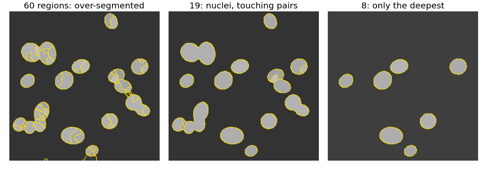
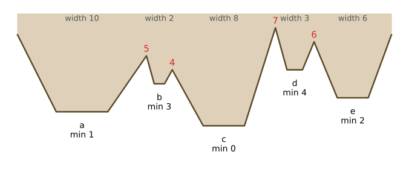
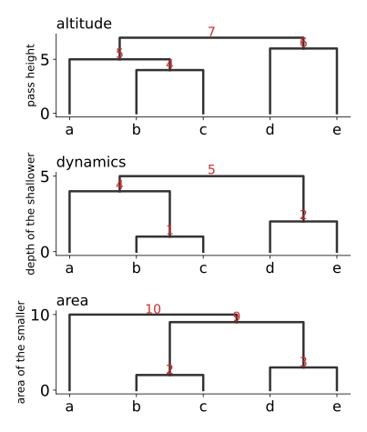
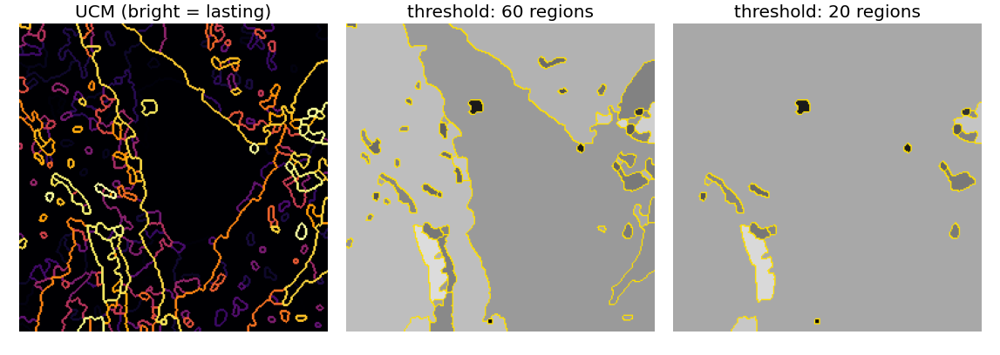
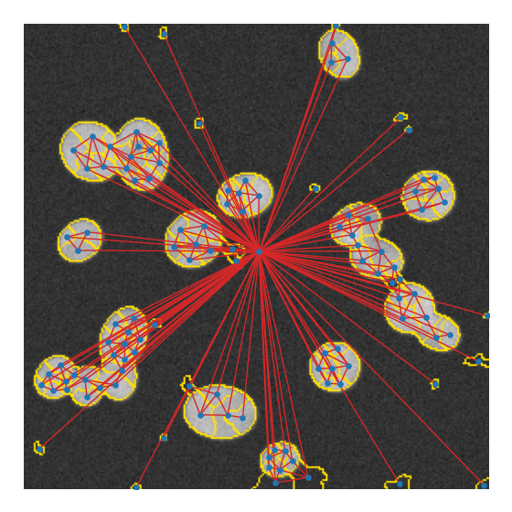
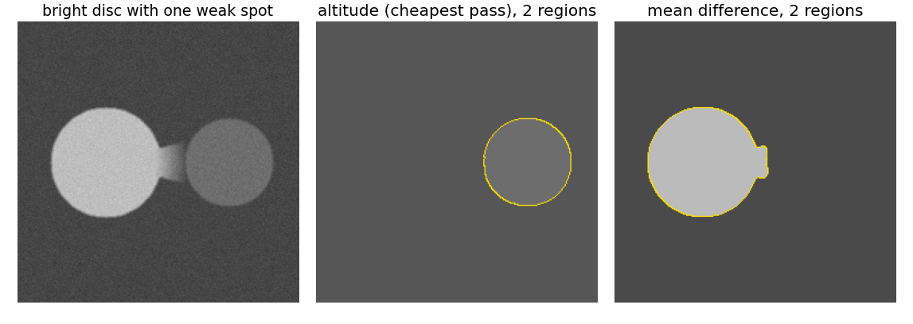
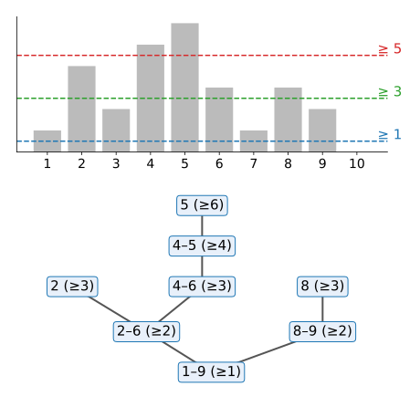

## About this lecture

Single linkage cut its tree at **one** threshold; the watershed stopped when the markers' floods met. Today we **keep every merge**: one tree that contains all segmentations at once.

- Why a **hierarchy**: there is rarely one right scale.
- The **merge tree** (dendrogram), and cutting it at a level.
- Changing the merge order with **attributes**: altitude, dynamics, area, volume.
- The **ultrametric contour map**: the whole hierarchy in one image.
- **Region adjacency graphs** and greedy merging; the **component tree**.
- Choosing a cut, and the failure modes.

*Slides titled **The math** give the formulas and proofs; the ideas are complete without them.*

## Recall: merging basins

The [gradient watershed unit](../ws-gradient/lec.qmd) ended with a tree: merge watershed basins across their **lowest pass**, one pair at a time. Cutting that tree at a height $h$ gave the same result as flooding from the h-minima.

- The [spanning-tree unit](../mst-seg/lec.qmd): Kruskal's merge order is also a tree (single linkage).
- The [watershed as a spanning forest](../ws-msf/lec.qmd): the basins are the trees of a forest; their passes are the edges between them.

Today this tree is the object of study, not a by-product.

## Why a hierarchy

:::: {.columns}
::: {.column width="40%"}
There is rarely **one** right scale: a part of a nucleus, a nucleus, a pair of touching nuclei, a cluster of cells.

- Compute **all** segmentations at once, as a **nested** family: each one is obtained from the finer one by merging regions.
- Decide later: by a threshold, by clicking, or by a measurement (size, shape, a score).

Right: one hierarchy of a synthetic nuclei image, cut at three levels. Of 18 true nuclei, 8, 13 and 7 are matched (IoU ≥ 0.5) at 60, 19 and 8 regions: no single level is right for all.
:::
::: {.column width="60%"}
{fig-alt="Three cuts of one hierarchy of a synthetic image of touching nuclei, shown as mean grey levels with yellow boundaries: 60 regions, several nuclei split into parts; 19 regions, most nuclei whole but touching pairs merged; 8 regions, only the deepest basins remain and many dim nuclei have merged with the background." width="100%"}
:::
::::

## The merge tree (dendrogram)

:::: {.columns}
::: {.column width="44%"}
- **Leaves** = the initial regions (pixels, watershed basins, superpixels).
- Each **merge** creates a parent node at the **level** where it happens.
- **Cut** the tree horizontally at level $t$: every subtree below the cut is one region.
- Raising $t$ only **merges**, never splits: the partitions are **nested**.

Right: five basins a–e of a 1D landscape. Merged across their passes in increasing order: b+c at 4, then a at 5, d+e at 6, all at 7 (next slide, top tree). A cut between 5 and 6 gives $\{a, b, c\}, \{d\}, \{e\}$.
:::
::: {.column width="56%"}
{fig-alt="A 1D landscape with five basins a to e with minima 1, 3, 0, 4, 2 and widths 10, 2, 8, 3, 6. The passes between neighbouring basins are 5 (a|b), 4 (b|c), 7 (c|d) and 6 (d|e)." width="100%"}
:::
::::

## The MST already is a hierarchy

- **Kruskal's merge order** (the [spanning-tree unit](../mst-seg/lec.qmd)) is a merge tree: every "join" is a merge at level $d$. Cutting it at $t$ is single linkage at $t$.
- For watershed basins with pass heights, the same tree is the hierarchy by **altitude**: the order in which basins meet when the water rises.
- Its weakness is the weakness of single linkage: a region merges as soon as **one** low pass connects it, whatever its size or depth.

The top tree on the next slide is this hierarchy for the five basins.

## Changing the order: attributes

:::: {.columns}
::: {.column width="56%"}
Same graph, same spanning tree, **different order**. Flood by altitude as before, but each time two regions meet, give that merge the **attribute of the smaller one** (the one that would disappear):

- **dynamics**: its depth, pass height minus its minimum ([morphological reconstruction unit](../morph-reconstruct/lec.qmd));
- **area**: its number of pixels;
- **volume**: area × depth (the water it holds).

Then sort the merges by these new values. Five basins (right):

- altitude: three regions $\{a, b, c\}, \{d\}, \{e\}$;
- dynamics: b (1), d (2), a (4), e (5): $\{a\}, \{b, c\}, \{d, e\}$;
- area: b (2), d (3), then $\{d, e\}$ (9) before a (10): also $\{a\}, \{b, c\}, \{d, e\}$.
:::
::: {.column width="44%"}
{fig-alt="Three dendrograms of the five basins a to e, stacked. Altitude: b and c merge at 4, a joins at 5, d and e merge at 6, everything at 7. Dynamics: b and c at 1, d and e at 2, a joins b and c at 4, the two groups at 5. Area: b and c at 2, d and e at 3, the two groups at 9, a last at 10." width="100%"}
:::
::::

## The math: extinction values and ultrametrics {.math}

- **Extinction values** (Vachier & Meyer; Najman & Schmitt 1996). In the altitude flooding, when two components $C_1$, $C_2$ meet at pass $h$, the one with the smaller attribute $A$ "dies"; its extinction value is $\min(A(C_1), A(C_2))$, with $A$ = $h - \min C$ (dynamics), $|C|$ (area) or $|C|(h - \min C)$ (volume). Re-weighting each MST edge by this value and sorting gives the attribute hierarchy. For dynamics, cutting it at $h$ gives exactly the **h-minima** watershed.
- **Ultrametric.** For a merge tree, let $u(p, q)$ be the level at which $p$ and $q$ first share a region (their lowest common ancestor). Then
$$u(p, r) \le \max\big(u(p, q),\ u(q, r)\big),$$
because at level $\max(u(p,q), u(q,r))$ $p$ shares a region with $q$ and $q$ with $r$, and the regions at one level are disjoint. Conversely every ultrametric defines a hierarchy (its "balls" are nested). For the single-linkage tree, $u$ is the **minimax distance**.

## The ultrametric contour map

:::: {.columns}
::: {.column width="40%"}
Give every boundary between two leaves the **level at which it disappears** (the ultrametric of the two leaves): one grey image, the **UCM**.

- **Thresholding** the UCM at $t$ gives the partition at $t$: boundaries brighter than $t$ remain.
- Strong, lasting boundaries are bright; boundaries that vanish early are dark.

Right: the micrograph's dynamics hierarchy (310 basins), its UCM, and two thresholds. The best classical contour detectors of the 2010s output exactly such a map.
:::
::: {.column width="60%"}
{fig-alt="Left: the ultrametric contour map of the micrograph's hierarchy on an inferno scale: the nuclear envelope and some cytoplasm boundaries are bright, many small boundaries dark. Middle: thresholded to 60 regions, mean grey levels with yellow boundaries; the background and the cell are split into a few large regions and small dark specks. Right: 20 regions: one large region and specks remain. Micrograph: Robert M. Hunt, CC BY 3.0, via Wikimedia Commons." width="100%"}
:::
::::

## The math: UCM and closed contours {.math}

- The thresholds $\{\text{UCM} > t\}$ are **nested**: raising $t$ removes boundaries, never adds them; each is the boundary set of the partition at $t$.
- A contour map is a UCM (comes from some hierarchy) iff **every threshold gives closed contours**: no boundary piece ends in the middle of a region. A boundary with a dangling end would separate a region from itself.
- Evaluating a hierarchy: compare every threshold of its UCM with the true boundaries (boundary precision–recall, [object evaluation unit](../object-eval/lec.qmd)); the best single threshold and the best per-image threshold are both reported.

## Region adjacency graphs

:::: {.columns}
::: {.column width="44%"}
A **region adjacency graph** (RAG): one node per region, one edge per touching pair. Nodes and edges carry **statistics**: area, mean grey level, histogram; boundary length, lowest pass, mean gradient along the boundary.

**Greedy merging**: always merge the **most similar** adjacent pair, update the statistics of the new region and its edges, repeat. A priority queue with **lazy updates** (old entries are skipped when popped) keeps it fast.

Right: the RAG of the 115 basins of the nuclei image (one node per basin at its centroid; the big background basin is the hub in the middle).
:::
::: {.column width="56%"}
{fig-alt="The synthetic nuclei image with yellow basin boundaries; a blue dot at the centroid of every basin and red lines between touching basins. Small clusters of dots inside each nucleus are connected to each other, and every nucleus is connected to the large background basin, whose centroid lies in the middle of the image, with many long red lines." width="88%"}
:::
::::

## Greedy merging by a region criterion

A $3 \times 3$ grid of regions with means
$$\begin{bmatrix} 10 & 12 & 30 \\ 11 & 25 & 31 \\ 40 & 26 & 50 \end{bmatrix}$$
merged by **difference of means** (4-neighbours):

1. three pairs with difference 1: 10–11, 30–31, 25–26 (any order);
2. 12 joins $\{10, 11\}$ (mean 10.5): difference 1.5;
3. $\{25, 26\}$ (25.5) joins $\{30, 31\}$ (30.5): difference 5;
4. 40 joins that group (mean 28): 12; then the two big groups (11 and 30.4): 19.4; finally 50: 26.9.

After each merge the means change, so the order is not known in advance: this is **not** single linkage. Variants: **statistical region merging** (merge when the difference is within what noise can explain) and **binary partition trees** (any merging criterion, recorded as a tree).

## Cheapest edge leaks, mean difference does not

:::: {.columns}
::: {.column width="40%"}
A bright disc (190) with **one weak spot** in its boundary (a gentle ramp), and a darker disc (110) with a sharp boundary.

- **Altitude** (cheapest pass): the bright disc's weak spot is the lowest pass in the image, so at 2 regions it has **leaked** into the background, while the dark disc stays separate.
- **Mean difference**: the bright disc differs by 120 from the background, the dark one by 40: the dark disc merges first, the bright one stays (with the ramp wedge attached).

One weak pixel decides a minimum; it hardly changes a mean.
:::
::: {.column width="60%"}
{fig-alt="Three panels. The image: a bright disc on the left with a short grey wedge (a gentle ramp) on its right side, and a darker disc on the right. Altitude hierarchy at two regions: the dark disc is a region, the bright disc has merged with the background. Mean-difference hierarchy at two regions: the bright disc (with the wedge) is a region and the dark disc has merged with the background." width="100%"}
:::
::::

## Try it: merge trees

```{=html}
<link rel="stylesheet" href="../demos/dist/demo.css">
<div data-demo="mergetree" data-preset="altitude"></div>
<script src="../demos/dist/mergetree.js"></script>
```

::: notes
Leaves: watershed basins of the gradient (h-minima 0.7, or 3 for the micrograph). Drag on the dendrogram (bottom; y = merge order) to move the cut; the slider sets the number of regions. Tour: "altitude" at 20 regions: the readout counts nuclei matched with IoU ≥ 0.5. "dynamics vs altitude", "area": compare the counts and which nuclei survive. "UCM thresholds" (micrograph). "cheapest edge leaks…" / "… mean difference does not". "per-branch cut": click a merged pair, press split; click a fragment, press merge up.
:::

## Another tree: the component tree

:::: {.columns}
::: {.column width="44%"}
Threshold the image at every level $t$ and take the **connected components** of $\{f \ge t\}$ ([labelling unit](../label-connectivity/lec.qmd)). Raising $t$ splits and shrinks components: they nest into a tree, the **component tree** (max-tree).

- Region merging builds trees from **edges** (passes between regions); the component tree from **thresholds** (pixel values).
- The leaves of the component tree of $-f$ (min-tree) are the regional minima, the seeds of the basins; the two trees are closely related.
- Attribute filters (keep components of a certain area or shape) are cuts of the component tree.
:::
::: {.column width="56%"}
{fig-alt="Left: a 1D signal of ten values 1, 4, 2, 5, 6, 3, 1, 3, 2, 0 as bars with dashed thresholds at 1, 3 and 5. Right: its component tree: the root pixels 1 to 9 (level 1) splits into 2 to 6 and 8 to 9 (level 2); 2 to 6 splits at level 3 into pixel 2 and 4 to 6; 4 to 6 shrinks to 4 to 5 (level 4) and to pixel 5 (level 6); 8 to 9 shrinks to pixel 8 (level 3)." width="100%"}
:::
::::

## Choosing a cut

- **One global level**: simplest; the same scale everywhere (the h-minima watershed is one such cut).
- **A different level per branch**: choose, in each branch, the node that best fits a criterion (closest to an expected size or shape, highest score of a classifier). Every choice of nodes that covers each leaf exactly once is a valid segmentation.
- **Interactive**: click a region to **merge it up** (replace it by its parent) or **split** it (replace it by its children).
- **Evaluate** the whole hierarchy: the best possible cut for a known truth bounds what any cut rule can reach.

## Failure modes

- **Greedy merging is final**: an early wrong merge is never undone; everything above it inherits the mistake.
- **Attributes need a meaningful scale**: area in pixels changes with the magnification; a fixed area threshold must be stated in µm².
- **Garbage leaves**: a boundary missed by the initial regions (a basin that spans two objects) is missed by every level of the hierarchy.
- The altitude hierarchy inherits **leaks** (one low pass); region criteria inherit **chaining** along ramps (the merged region's mean drifts).

## Summary

- A **merge tree** records every merge with its level; cutting it gives **nested** partitions.
- The MST/Kruskal order is the **altitude** hierarchy; **attributes** (dynamics, area, volume) re-order the merges of the same tree.
- The **ultrametric** $u(p, q)$ (level of the lowest common ancestor) satisfies $u(p, r) \le \max(u(p,q), u(q,r))$; the **UCM** stores the whole hierarchy in one image.
- **RAG** merging with region statistics (difference of means) resists single weak pixels; it is greedy and final.
- The **component tree** builds a hierarchy from thresholds instead of edges.

## Where this leads

- [Superpixels](../superpixels/lec.qmd): a few hundred compact leaves for the RAG.
- Learned boundary probabilities as the RAG weights: [instance segmentation](../instances/lec.qmd) agglomerates network predictions this way.
- 3D: supervoxel hierarchies for volumes (electron microscopy connectomics).
