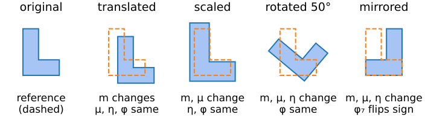
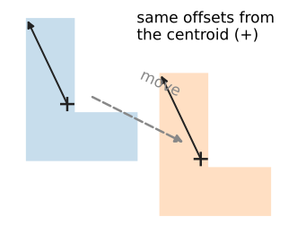
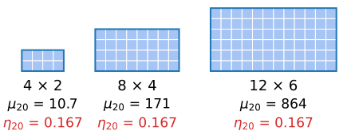
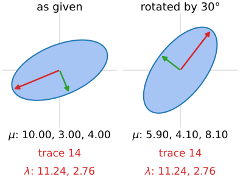
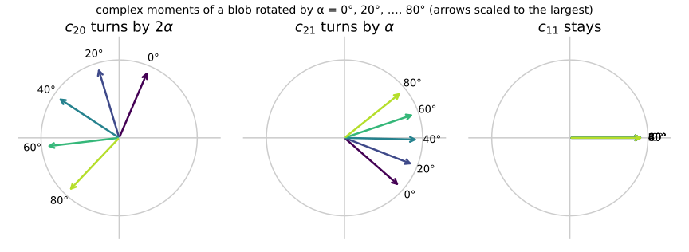
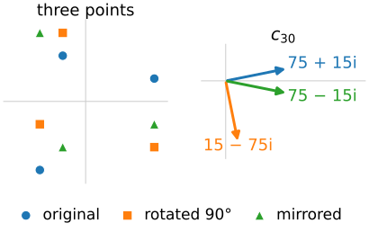
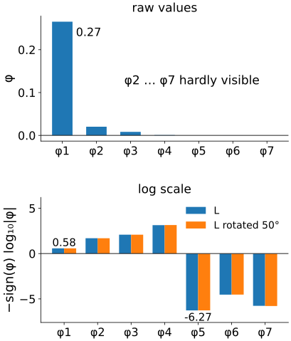
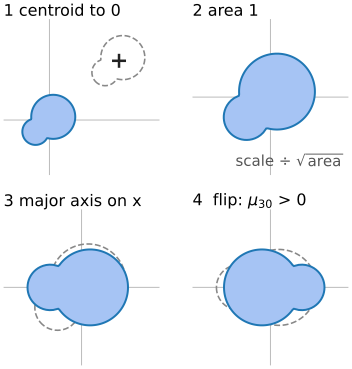

## About this lecture

A nucleus is a nucleus wherever it lies, however large and however turned. Can we describe its shape with numbers that **do not change** when it moves, grows or rotates?

- **Translation**: central moments. **Scale**: normalised moments $\eta_{pq}$.
- **Rotation**: start with order 2 (trace and eigenvalues), then **complex moments** make it systematic: **Hu's seven invariants**.
- **Mirror images**: one invariant changes sign.
- In practice: huge ranges of values, noise, pixels. And the alternative: **normalise the pose** instead.

{fig-alt="An L shape (orange dashed: the original) translated, scaled, rotated by 50 degrees and mirrored. Under each: which numbers change. Translation changes the raw moments m only; scaling also the central moments mu; rotation also the normalised moments eta; mirroring changes m, mu, eta and flips the sign of phi 7." width="78%" fig-align="center" .nostretch}

*Slides titled **The math** give the formulas and proofs; the ideas are complete without them.*

::: notes
Second unit of the moments elective. Assumes the previous unit (moments as weighted sums, the image as a distribution) and the labelling day's central moments and orientation. Geometric transformations as matrices are from the images unit (day 1). In the demos y points down on the canvas; complex moments use y up so that a counter-clockwise rotation on the screen is a positive angle.
:::

## Translation: central moments

:::: {.columns}
::: {.column width="60%"}
Measure positions from the **centroid**: $\mu_{pq} = \sum (x - \bar x)^p (y - \bar y)^q I$ (labelling day). Moving the object moves the centroid with it: every $\mu_{pq}$ stays.

No second pass over the image is needed: expand the powers (binomial theorem), for example

$$\mu_{30} = m_{30} - 3\bar x\, m_{20} + 2\bar x^2 m_{10}.$$

So all central moments up to order $N$ follow from the raw moments up to order $N$.
:::
::: {.column width="40%"}
{fig-alt="Two copies of an L, the second moved down and to the right. In both, an arrow from the centroid to the same corner: the offsets from the centroid are the same." width="100%"}
:::
::::

## The math: central from raw moments {.math}

$(x - \bar x)^p = \sum_{k=0}^{p} \binom{p}{k} x^k (-\bar x)^{p-k}$, so

$$\mu_{pq} = \sum_{k=0}^{p}\sum_{l=0}^{q} \binom pk \binom ql (-\bar x)^{p-k} (-\bar y)^{q-l}\, m_{kl}.$$

Example $p = 3$, $q = 0$: $\mu_{30} = m_{30} - 3\bar x m_{20} + 3\bar x^2 m_{10} - \bar x^3 m_{00}$; with $m_{10} = \bar x m_{00}$ the last two terms combine to $2\bar x^2 m_{10}$.

Numerically: the terms are large and nearly cancel, which is one more reason to use coordinates in $[-1, 1]$.

## Scale: normalised moments

:::: {.columns}
::: {.column width="56%"}
Make the object $s$ times larger. Each pixel's distance from the centroid grows by $s$, and there are $s^2$ times as many pixels:

$$\mu'_{pq} = s^{p+q+2}\,\mu_{pq}.$$

Divide by the right power of the area $\mu_{00}$ (which grows by $s^2$):

$$\eta_{pq} = \frac{\mu_{pq}}{\mu_{00}^{\,1 + (p+q)/2}} \quad\text{does not change.}$$
:::
::: {.column width="44%"}
{fig-alt="Rectangles of 4 by 2, 8 by 4 and 12 by 6 pixels. mu 20 grows from 10.7 to 171 to 864; eta 20 is 0.167 for all three." width="100%"}
:::
::::

- Rectangle $4 \times 2$: $\eta_{20} = 1/6$. Rectangle $8 \times 4$ or $12 \times 6$: still $1/6$.
- Grey images: a contrast change $a\,I$ multiplies every $\mu_{pq}$ by $a$, so $\eta_{pq}$ changes by $a^{-(p+q)/2}$. Dividing instead by $\mu_{00}\,\sigma^{p+q}$, with the spread $\sigma^2 = (\mu_{20} + \mu_{02})/\mu_{00}$, cancels scale **and** contrast.

## The math: the scaling law {.math}

$f'(x, y) = f(x/s, y/s)$ (the image $f$ enlarged $s$ times, about the origin). Substitute $x = s u$, $y = s v$, $dx\,dy = s^2\,du\,dv$:

$$\mu'_{pq} = \iint x^p y^q f(x/s, y/s)\,dx\,dy = \iint (su)^p (sv)^q f(u, v)\, s^2\,du\,dv = s^{p+q+2}\mu_{pq}.$$

With $\mu'_{00} = s^2 \mu_{00}$: $\eta'_{pq} = s^{p+q+2}\mu_{pq} / (s^2\mu_{00})^{1+(p+q)/2} = \eta_{pq}$.

## Rotation at order 2

:::: {.columns}
::: {.column width="56%"}
Rotate the object: $\eta_{20}, \eta_{11}, \eta_{02}$ all change (the matrix $S$ turns). But two combinations do not:

$$\phi_1 = \eta_{20} + \eta_{02}, \qquad \phi_2 = (\eta_{20} - \eta_{02})^2 + 4\eta_{11}^2.$$

Linear algebra names them: $\phi_1$ is the **trace** of $S$ (scaled), $\phi_2$ the squared **difference of the eigenvalues**. Rotation turns the eigenvectors, never the eigenvalues.

Example with $\mu_{20} = 10$, $\mu_{11} = 3$, $\mu_{02} = 4$: rotated by 30° they become 5.90, 4.10, 8.10. The trace stays 14, and $(\mu_{20} - \mu_{02})^2 + 4\mu_{11}^2$ stays 72.

- The **disc** has the smallest $\phi_1$ of all shapes: $1/(2\pi) = 0.159$. A square has $1/6 = 0.167$, the $4 \times 2$ rectangle $0.208$.
:::
::: {.column width="44%"}
{fig-alt="The ellipse of the second moments 10, 3, 4 with its two principal axes, and the same ellipse rotated by 30 degrees, with moments 5.90, 4.10, 8.10. Both have trace 14 and eigenvalues 11.24 and 2.76." width="100%"}
:::
::::

## The math: why the trace and the eigenvalue gap survive {.math}

Rotating the object by $\alpha$ rotates every pixel position by $Q = \begin{psmallmatrix}\cos\alpha & -\sin\alpha\\ \sin\alpha & \cos\alpha\end{psmallmatrix}$, and the second-moment matrix becomes $M' = Q M Q^\top$ with $M = \begin{psmallmatrix}\mu_{20} & \mu_{11}\\ \mu_{11} & \mu_{02}\end{psmallmatrix}$.

- $\operatorname{tr}(QMQ^\top) = \operatorname{tr}(M Q^\top Q) = \operatorname{tr} M$.
- $QMQ^\top$ has the same eigenvalues $\lambda_1 \ge \lambda_2$ as $M$. With $\operatorname{tr} = \lambda_1 + \lambda_2$ and $\det = \lambda_1\lambda_2$: $(\mu_{20} - \mu_{02})^2 + 4\mu_{11}^2 = \operatorname{tr}^2 - 4\det = (\lambda_1 - \lambda_2)^2$.
- Disc of radius $r$: $\mu_{20} = \mu_{02} = \pi r^4/4$, $\mu_{00} = \pi r^2$, so $\phi_1 = 2 \cdot \frac{\pi r^4/4}{\pi^2 r^4} = \frac{1}{2\pi}$.

## Complex moments: rotation becomes a phase

Write a position as a complex number $z = x + iy$ (with $y$ pointing **up**). Rotating by $\alpha$ multiplies $z$ by $e^{i\alpha}$. Define

$$c_{pq} = \sum (x + iy)^p (x - iy)^q\, I \quad (\text{central coordinates}).$$

Rotation by $\alpha$ multiplies $c_{pq}$ by $e^{i(p - q)\alpha}$: the arrow $c_{pq}$ in the complex plane **turns $(p - q)$ times as fast** as the object, and keeps its length.

- $c_{11} = \sum (x^2 + y^2) I$: never turns ($p = q$). It is $\mu_{20} + \mu_{02}$.
- $|c_{pq}|$: invariant. So is any **product whose turns cancel**, e.g. $c_{30}\,c_{12}^3$ (turns $3\alpha - 3\alpha = 0$), $c_{20}\,c_{12}^2$.

{fig-alt="Three dials for a blob rotated by 0 to 80 degrees in steps of 20 (arrows scaled to the largest per dial): the arrow of c20 turns twice as fast as the blob, c21 turns with it, c11 does not move." width="72%" fig-align="center" .nostretch}

## Try it: complex moments as arrows

```{=html}
<link rel="stylesheet" href="../demos/dist/demo.css">
<div data-demo="momentphase" data-preset="blob" data-autoplay="off"></div>
<script src="../demos/dist/momentphase.js"></script>
```

::: notes
Complex moments of the normalised central moments (y up). Each dial is scaled to the size the moment had when the shape was loaded (relative to c11), so a moment that is zero shows as a dot. Tour: "rotate slowly" (press play): c20 turns twice as fast as the shape, c30 three times, c21 with it, c12 backwards; c11 and the product c30·c12³ do not move; the orange trails are circles. Stop, then "mirror": every arrow is reflected in the real axis (conjugated): the product too, so Re stays and Im changes sign. "3-fold symmetry": c20, c21 and c12 are about 0 (0.0017 and 0.0006 of c11 to the right power), only c11 and c30 remain. "a rectangle": all order-3 moments are 0 (point symmetry), c20 turns with 2α.
:::

## The math: complex moments and Hu's invariants {.math .smaller}

In polar form $x + iy = \rho e^{i\theta}$: $c_{pq} = \iint \rho^{p+q} e^{i(p-q)\theta} f\,dx\,dy$. Rotating the image by $\alpha$ replaces $\theta$ by $\theta + \alpha$ for every pixel: $c'_{pq} = e^{i(p-q)\alpha} c_{pq}$. Real image: $c_{qp} = \overline{c_{pq}}$.

**Hu's seven invariants** (Hu, 1962), with $c$ computed from the normalised moments $\eta$:

| | | |
|---|---|---|
| $\phi_1 = c_{11}$ | $\phi_2 = \lvert c_{20}\rvert^2$ | $\phi_3 = \lvert c_{30}\rvert^2$ |
| $\phi_4 = \lvert c_{21}\rvert^2$ | $\phi_5 = \operatorname{Re}(c_{30}\,c_{12}^3)$ | $\phi_6 = \operatorname{Re}(c_{20}\,c_{12}^2)$ |
| $\phi_7 = \operatorname{Im}(c_{30}\,c_{12}^3)$ | | |

In real form, e.g. $\phi_3 = (\eta_{30} - 3\eta_{12})^2 + (3\eta_{21} - \eta_{03})^2$, and $\phi_5, \phi_7$ are long polynomials of order 12 in $\eta$; image libraries list them in that form.

## Mirror images

:::: {.columns}
::: {.column width="55%"}
A reflection $y \to -y$ turns $x + iy$ into $x - iy$: every $c_{pq}$ is **conjugated**.

- $|c_{pq}|$ and every real part stay: $\phi_1, \dots, \phi_6$ do not change.
- $\phi_7 = \operatorname{Im}(c_{30} c_{12}^3)$ **changes sign**: a "skew invariant".
- Use: $\phi_7$ tells a shape from its mirror image (b from d, a left from a right hand). If mirror images should count as the same, use $|\phi_7|$.

Three points $(3, 1), (-1, 2), (-2, -3)$: $c_{20} = 14i$. Rotated by 90°: $-14i$. Mirrored: also $-14i$! But $c_{30}$: $75 + 15i$ → $15 - 75i$ (rotated) vs $75 - 15i$ (mirrored).
:::
::: {.column width="45%"}
{fig-alt="Left: the three points, their rotation by 90 degrees and their mirror image. Right: c30 as arrows in the complex plane: 75 + 15i for the original, 15 − 75i rotated, 75 − 15i mirrored (the reflection of the original arrow in the real axis)." width="100%"}
:::
::::

## Try it: which numbers survive?

```{=html}
<link rel="stylesheet" href="../demos/dist/demo.css">
<div data-demo="moments" data-mode="invariants" data-preset="rotate" data-presets="translate,scale,rotate,mirror,small,square" data-shapectl="off" data-rows="compact"></div>
<script src="../demos/dist/moments.js"></script>
```

::: notes
Dashed orange: the reference shape; blue: the current one, both digitised on the same pixel grid. Change column: green below 1 %, red from 10 %. Tour: "translate" (by 8, 6 pixels): m10 changes 22 %, everything from μ on is identical. "scale" (0.75 → 1.25): μ changes, η does not (φ1 by 0.11 %, digitisation). "rotate" (50°): μ and η change completely, φ1, φ2, φ3 within 0.5 %, φ4 2.8 %, φ7 4.5 % (pixels!). Tick "grey edges": all φ within 0.5 %. "mirror": only φ7 changes sign (≥ 100 %). "small shape": a 30 % L, rotated 45°: φ2 13 %, φ4 39 %, φ5 and φ6 even change sign. "square": λ1 = λ2, the inset says the pose is ambiguous; all φ from φ2 on are 0.
:::

## In practice

:::: {.columns}
::: {.column width="60%"}
- **Huge range of values.** For the L of the demo: $\phi_1 = 0.27$, $\phi_5 = -5 \times 10^{-7}$. Compare features as $-\operatorname{sign}(\phi)\log_{10}|\phi|$: 0.58 and −6.27.
- **Noise and pixels.** High orders weight the boundary heavily; small or noisy shapes change their high invariants by tens of per cent when rotated. Invariance holds for the continuous image; a digitised shape is only approximately invariant.
- **Neither independent nor complete.** $\phi_3$ follows from $\phi_4, \phi_5, \phi_7$; and Hu's set does not use all the information of order 3. Flusser (2000) gives an independent, complete set built the same way from $c_{pq}$.
- **Slanted views**: an affine transformation (shear) needs **affine moment invariants** (Flusser & Suk), named here only.
:::
::: {.column width="40%"}
{fig-alt="Hu's seven invariants of the L of the demo. Raw values: phi 1 is 0.27, the others are barely visible. On the log scale minus sign times log10 of the absolute value, all seven are readable (0.58 for phi 1, −6.27 for phi 5), and the L rotated by 50 degrees gives nearly the same bars." width="100%"}
:::
::::

## Pose normalisation instead of invariants

:::: {.columns}
::: {.column width="58%"}
Bring every shape into a **standard pose**, then compare anything (moments, pixels):

1. translate the centroid to the origin;
2. scale to area 1;
3. rotate the major axis (the labelling day's orientation) onto $x$;
4. fix the remaining 180° ambiguity by the sign of $\mu_{30}$ (heavier side to the left, say).

Fails when $\lambda_1 \approx \lambda_2$ (square, star, gear: no major axis) or $\mu_{30} \approx 0$. For a shape with $k$-fold symmetry, use the phase of $c_{k0}$ instead: it turns by $k\alpha$.

The snakes elective aligns shapes by Procrustes, which needs corresponding **landmarks**; pose normalisation needs none, at the price of these failure cases.
:::
::: {.column width="42%"}
{fig-alt="The four steps on a pear shape: move the centroid to the origin, scale to area 1, rotate the major axis onto x, and rotate by 180 degrees so that mu 30 is positive (the heavy bulb on the left). The dashed outline is the shape before each step." width="100%"}
:::
::::

## The math: the pose from the moments {.math}

- Centroid $(\bar x, \bar y) = (m_{10}, m_{01})/m_{00}$; scale factor $1/\sqrt{\mu_{00}}$.
- Major axis angle (labelling day): $\theta = \tfrac12 \operatorname{atan2}(2\mu_{11}, \mu_{20} - \mu_{02})$; rotating by $-\theta$ makes $\mu_{11} = 0$ and $\mu_{20} \ge \mu_{02}$.
- After that rotation, if $\mu_{30} < 0$ rotate by another 180° ($\mu_{30} \to -\mu_{30}$).
- In complex terms: $\theta = \tfrac12 \arg c_{20}$ (defined only when $c_{20} \ne 0$, i.e. $\lambda_1 \ne \lambda_2$). For $k$-fold symmetry all $c_{pq}$ with $p - q$ not a multiple of $k$ vanish; $\tfrac1k \arg c_{k0}$ gives the pose up to the symmetry.

## Summary

- **Translation**: central moments $\mu_{pq}$ (from the raw ones by the binomial theorem).
- **Scale**: $\eta_{pq} = \mu_{pq}/\mu_{00}^{1 + (p+q)/2}$.
- **Rotation**: complex moments $c_{pq}$ turn by $(p - q)\alpha$; magnitudes and phase-cancelling products are invariant: **Hu's $\phi_1 \dots \phi_7$**. Order 2: trace and eigenvalue gap of $S$.
- **Mirror**: $c_{pq}$ is conjugated; only $\phi_7$ changes sign.
- In practice: log-scale the values, expect discretisation errors for small shapes and high orders, or **normalise the pose** (fails for $\lambda_1 \approx \lambda_2$).
