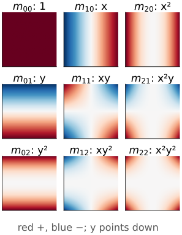
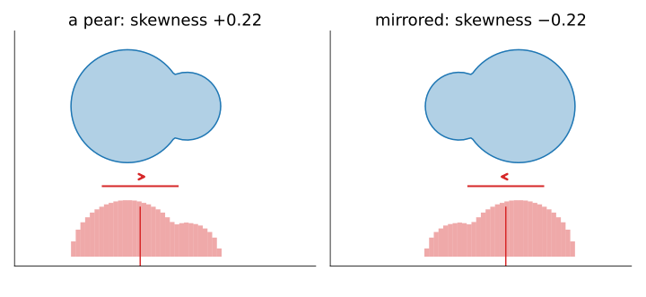

## About this lecture

The labelling day summarised an object by its area, centroid and equivalent ellipse: moments up to order 2. Today: **all** the orders, and what they mean.

- A **moment** is a weighted sum of the image: the weight is $x^p y^q$.
- Read the image as a **2D distribution**: mean, spread, **skewness**, **kurtosis**.
- Infinitely many moments determine the image; a few describe its **coarse shape** (the link to Fourier).
- Computing them: a matrix sandwich, coordinates in $[-1, 1]$, and the pixel as a point or a square.

*Slides titled **The math** give the formulas and proofs; the ideas are complete without them.*

::: notes
First unit of the moments elective. Assumed from the labelling day (regionprops/): m00, centroid, central moments to order 2, the matrix S, the equivalent ellipse. Assumed from day 1: the Fourier unit (a coefficient is an inner product with a basis function) and the PCA unit (covariance). Coordinates: x right, y down, pixel centres at integers, as on the labelling day.
:::

## Recall: a shape in a few numbers

From the labelling day (regionprops): sums over the pixels of one object.

- **Area** $m_{00}$, **centroid** $(\bar x, \bar y)$, **second central moments** $\mu_{20}, \mu_{11}, \mu_{02}$.
- $S = \mu / m_{00}$ is the covariance of the pixel positions (the PCA unit): its eigenvectors give the orientation, its eigenvalues the **equivalent ellipse**.

The ellipse is a summary, not the shape. An L, a pear and a solid ellipse can share it. To tell them apart we need **higher orders**.

## One weight per moment

{width="46%" style="float:right; margin-left:1em"}

The **moment of order $p + q$** is the image summed with the weight $x^p y^q$:

$$m_{pq} = \sum_x \sum_y x^p\, y^q\, I(x, y).$$

- $m_{00}$: weight 1, the total mass (the area of a mask).
- $m_{10}$, $m_{01}$: weights $x$ and $y$, the balance point.
- $m_{20}$, $m_{11}$, $m_{02}$: how far the mass lies from the axes.
- Order 3, 4, …: weights that grow faster towards the edges.

A mask and a grey image use the **same** formula ($I$ = 0/1 or the grey value). Up to order $N$ there are $(N+1)(N+2)/2$ moments: 6 up to order 2, 15 up to order 4.

## The math: a moment is an inner product {.math}

Continuous image $f(x, y)$:

$$m_{pq} = \iint x^p y^q f(x, y)\,dx\,dy = \langle f,\ x^p y^q\rangle,$$

the inner product of $f$ with the **monomial** $x^p y^q$; the discrete sum is its Riemann sum with one sample per pixel.

- Same idea as a Fourier coefficient, $F(u, v) = \langle f, e^{2\pi i(ux + vy)}\rangle$: project the image onto a basis function. Here the basis is $\{x^p y^q\}$.
- **Central** moments use $x - \bar x$ and $y - \bar y$: $\mu_{pq} = \langle f, (x - \bar x)^p (y - \bar y)^q\rangle$.
- Number of pairs with $p + q \le N$: $\sum_{k=0}^{N} (k + 1) = (N+1)(N+2)/2$.

## The image as a distribution

Divide by the mass: $I / m_{00}$ is a **probability density** on the plane. Its moments are the familiar statistics.

| order | central moment ÷ $m_{00}$ | reads as |
|---|---|---|
| 1 | $\bar x$, $\bar y$ | mean (centroid) |
| 2 | $\mu_{20}, \mu_{11}, \mu_{02}$ | covariance $S$: spread and orientation |
| 3 | $\mu_{30}$, $\mu_{03}$, … | **skewness**: which way the mass leans |
| 4 | $\mu_{40}$, $\mu_{04}$, … | **kurtosis**: flat-topped or peaked |

$\mu_{p0}$ only involves $x$: it is a moment of the **marginal**, the column sums of the image (the projection onto the $x$-axis).

## Skewness: a pear and its mirror image

{width="80%"}

Skewness along $x$: $\gamma_x = \mu_{30} / (m_{00}\, \mathrm{sd}_x^3)$, with $\mathrm{sd}_x = \sqrt{\mu_{20}/m_{00}}$.

- The pear has its bulk on the left and a thin tail to the right: $\mu_{30} > 0$, $\gamma_x = +0.22$.
- Its mirror image has the same $m_{00}$, centroid distance and $S$, but $\gamma_x = -0.22$. Order 2 cannot tell them apart; order 3 can.

## Try it: moments of any order

```{=html}
<link rel="stylesheet" href="../demos/dist/demo.css">
<div data-demo="moments" data-mode="higher" data-preset="pear" data-presets="pear,mirror,square,disc,L,grey" data-shapectl="off"></div>
<script src="../demos/dist/moments.js"></script>
```

::: notes
The labelling day's shape canvas with the "higher" mode. Table: central (or raw) moments divided by m00 up to order 4, red positive, blue negative, the colour strength compares a cell with the largest of its order. Bars on the canvas: the marginals along x (bottom, red) and y (right, green), with mean, ±1 sd and a skewness arrow. Tour: "a pear": m00 = 548, μ20/m00 = 63.50, μ30/m00 = +115, skewness +0.226. "its mirror image": everything the same except the odd orders in x: −115, −0.226. "square: kurtosis" (side 30): kurtosis 1.797 (the uniform distribution has 1.8); "disc with the same S" (radius 30/√3 = 17.3): μ20/m00 = 74.47 vs 74.92, kurtosis 1.990 (2 for the semicircle). The ellipses coincide. "L": μ11/m00 = 44.44, skewness +0.712 along x and −0.567 along y. "grey vs binary": the same ellipse, brighter on the right: the mean moves from 29.50 to 32.18 and the skewness becomes −0.276.
:::

## Kurtosis: a square and a disc with the same $S$

A square of side $a$ and a disc of radius $r = a/\sqrt3$ have the **same** covariance: $a^2/12 = r^2/4$ along every axis. Their equivalent ellipses are the same circle.

Order 4 separates them. The kurtosis $\mu_{40} / (m_{00}\,\mathrm{sd}^4)$ of the marginal:

- **square**: the marginal is flat (uniform): **1.8**;
- **disc**: the marginal is a half-ellipse, higher in the middle: **2.0**;
- a Gaussian blob: **3**.

In the demo (side 30 pixels): 1.797 and 1.990.

## The math: marginals, skewness, kurtosis {.math}

The marginal $g(x) = \int f(x, y)\,dy$ has the moments

$$\int (x - \bar x)^p g(x)\,dx = \iint (x - \bar x)^p f(x, y)\,dx\,dy = \mu_{p0}.$$

Standardised: $\gamma = \mu_{30}/(m_{00}\sigma^3)$, $\kappa = \mu_{40}/(m_{00}\sigma^4)$ with $\sigma^2 = \mu_{20}/m_{00}$.

- Uniform on $[-\tfrac a2, \tfrac a2]$: $\sigma^2 = a^2/12$, $\mu_{40}/m_{00} = a^4/80$, so $\kappa = 144/80 = 1.8$.
- Disc of radius $r$: $g(x) \propto \sqrt{r^2 - x^2}$ (semicircle), $\sigma^2 = r^2/4$, $\mu_{40}/m_{00} = r^4/8$, $\kappa = 2$.
- A reflection $x \to -x$ multiplies $\mu_{pq}$ by $(-1)^p$: odd orders in $x$ change sign.

## How many moments determine an image?

- **All of them**: a bounded image of finite extent is determined by its infinite set of moments (Hu, 1962). Stated here, not proved.
- **A few** describe the coarse shape: mass, position, spread, lean, peakedness.
- Why "coarse"? Moments are the **Taylor coefficients of the Fourier transform at zero frequency**. Low orders fix the spectrum near the origin, that is the slow, large-scale variation. Fine detail lives at high frequencies and needs high orders.

Getting the image **back** from finitely many moments is the question of the orthogonal-moments unit.

## The math: moments and the Fourier transform {.math}

Expand the kernel of the Fourier transform in a Taylor series:

$$F(u, v) = \iint f(x, y)\, e^{-2\pi i (ux + vy)}\,dx\,dy = \sum_{p, q \ge 0} \frac{(-2\pi i)^{p+q}}{p!\,q!}\, m_{pq}\, u^p v^q.$$

- $F(0, 0) = m_{00}$; $\partial F/\partial u\,(0,0) = -2\pi i\, m_{10}$; in general $m_{pq}$ is a derivative of $F$ at the origin.
- If all moments are known (and the series converges, true for bounded $f$ of finite support), $F$ is known everywhere, hence $f$.
- Truncating at order $N$ fixes $F$ only in a neighbourhood of $(0, 0)$: low frequencies.

## Computing moments

- **Separable**: $m_{pq} = \sum_y y^q \big(\sum_x x^p I(x, y)\big)$. With the matrices $(V_x)_{xp} = x^p$ and $(V_y)_{yq} = y^q$, all moments at once are one **matrix sandwich** $M = V_x^\top I\, V_y$: cost about $N$ times the number of pixels.
- **Scale the coordinates** to $[-1, 1]$ first. In pixel units $255^{10} \approx 1.2 \times 10^{24}$: with 16 significant digits, everything below $10^{8}$ in such a sum is lost.
- **Pixel as a point or as a square.** Summing $x^2$ at the pixel centre ignores the pixel's own width. Integrating over the unit square adds $\int_{-1/2}^{1/2} t^2\,dt = \tfrac1{12}$ per pixel: $\mu_{20}$ grows by exactly $m_{00}/12$. Small for a large object, the whole story for a single pixel (0 vs 1/12).

## The math: moments of a polygon (Green's theorem) {.math}

For a region bounded by a polygon (a snake, a traced contour) the area integral becomes a sum over edges. Green's theorem: $\iint_\Omega \big(\tfrac{\partial Q}{\partial x} - \tfrac{\partial P}{\partial y}\big) = \oint_{\partial\Omega} P\,dx + Q\,dy$. With vertices $(x_i, y_i)$, $i = 0, \dots, n-1$ (counter-clockwise, indices mod $n$) and $c_i = x_i y_{i+1} - x_{i+1} y_i$:

$$m_{00} = \tfrac12 \sum_i c_i \quad\text{(the shoelace formula of the labelling day)},\qquad m_{10} = \tfrac16 \sum_i (x_i + x_{i+1})\, c_i.$$

Every $m_{pq}$ has such an edge formula (Steger, 1996). The same idea in 3D (divergence theorem) gives the moments of a closed mesh.

## Moments elsewhere: a moment-preserving threshold

The **histogram** is a 1D image of grey levels (the thresholding day). Its moments $\sum_g g^k\, h(g)$ are the mean grey level, the variance, …

**Tsai's threshold** (1985) chooses two grey levels and a threshold so that the binary image has the **same first three moments** as the original histogram. Same definitions, one dimension, a different use.

## Summary

- $m_{pq} = \sum x^p y^q I$: the image projected onto the monomial $x^p y^q$; $(N+1)(N+2)/2$ moments up to order $N$.
- As a distribution: order 1 = mean, 2 = covariance, 3 = **skewness** (which way it leans; flips under mirroring), 4 = **kurtosis** (square 1.8, disc 2.0).
- All moments determine the image; low orders describe the coarse shape (Taylor coefficients of the spectrum at zero frequency).
- Compute separably, in coordinates scaled to $[-1, 1]$; a pixel as a square adds $1/12$ per pixel to $\mu_{20}$.
