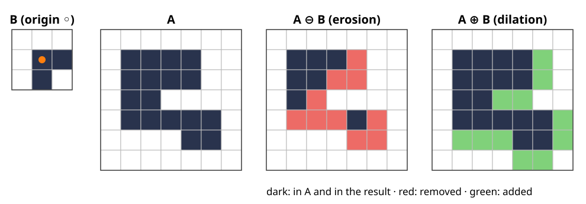

## About this lecture

A thresholded image is a mask of 0s and 1s, and it is rarely clean: specks of noise, small holes, objects that touch through a thin bridge. Blurring the mask makes it grey again. **Mathematical morphology** works on the shapes directly and keeps the image binary.

- A binary image is a **set** of pixels; a **structuring element** (SE) is a small probe shape.
- **Erosion**: keep the pixels where the SE **fits** inside the object.
- **Dilation**: keep the pixels where the SE **hits** the object.
- The same sliding window as a convolution, with **min** and **max** instead of a weighted sum.
- Properties: duality, separable SEs, boundaries, and what happens at the image border.

*Slides titled **The math** give the formulas and proofs; the ideas are complete without them.*

## Where we start

- From the thresholding day: a threshold turns a grey image into a **mask**, 1 = foreground (object), 0 = background.
- Typical defects: isolated **specks** (noise above the threshold), **holes** inside objects, **gaps** that split one object, thin **bridges** that join two.
- A linear filter (a blur, from the kernels unit) would smear the mask into grey values, and we would have to threshold again.

Wanted: operations that take a mask and return a mask, and that act on **shape**: "remove what is thinner than 3 pixels", "fill what is narrower than 3 pixels".

## A binary image is a set

Write the mask as the **set** $A$ of its foreground pixels: $A = \{(x, y) : \text{pixel } (x, y) \text{ is } 1\}$.

- Union $A \cup C$, intersection $A \cap C$, complement $A^c$ (the background) are pixel-wise OR, AND, NOT.
- **Translate** $A_z$: the set shifted by the vector $z$.
- **Reflect** $\check B$: the set mirrored through the origin, every $b$ replaced by $-b$.

A **structuring element** $B$ is a small set with a marked **origin**: a 3-pixel cross, a $3 \times 3$ square, a digital disc, a line, an L-shape. It plays the role of the kernel in a convolution.

## The math: sets and translates {.math}

Pixels are integer vectors $x = (x_1, x_2) \in \mathbb{Z}^2$ ($x_1$ right, $x_2$ down).

$$A_z = \{a + z : a \in A\}, \qquad \check B = \{-b : b \in B\}, \qquad A^c = \mathbb{Z}^2 \setminus A.$$

- De Morgan: $(A \cup C)^c = A^c \cap C^c$ and $(A \cap C)^c = A^c \cup C^c$.
- Translation commutes with all of these: $(A \cap C)_z = A_z \cap C_z$, $(A^c)_z = (A_z)^c$.
- An image is a finite window of $\mathbb{Z}^2$; what lies outside it is a **convention** (later in this lecture).

## Erosion: where does the SE fit?

Place the SE with its origin on pixel $x$. Keep $x$ if **every** SE pixel lands on the object:

$$A \ominus B = \{x : B_x \subseteq A\}.$$

{width=100%}

- 17 pixels in, 7 out. Everything gets thinner; parts thinner than the SE vanish.
- With the origin inside $B$, erosion only ever **removes** pixels.

## Dilation: where does the reflected SE hit?

Keep $x$ if the **reflected** SE placed at $x$ **hits** at least one object pixel:

$$A \oplus B = \{x : \check B_x \cap A \ne \emptyset\} = \{a + b : a \in A,\ b \in B\}.$$

- The second form: put a copy of $B$ on **every** object pixel and take the union. A single pixel dilates to a copy of $B$ itself.
- In the figure: 17 pixels become 28. Objects grow, holes and gaps narrower than the SE close.
- Why the reflection? For an asymmetric SE like the L, "paste $B$ on every pixel" and "look through $B$ at each pixel" differ by a mirror image, exactly as convolution and correlation differ by a flip of the kernel.

## The math: two ways to write each {.math}

$$A \ominus B = \{x : x + b \in A \ \ \forall b \in B\} = \bigcap_{b \in B} A_{-b}, \qquad A \oplus B = \bigcup_{b \in B} A_b .$$

- Erosion: $x \in A_{-b} \iff x + b \in A$; "for all $b$" is an intersection.
- Dilation: $x \in A_b \iff x - b \in A$; "for some $b$" is a union. The same condition reads $\check B_x \cap A \ne \emptyset$, since $x - b$ ranges over $\check B_x$.
- $A \oplus B$ is the **Minkowski sum** of the two sets; it is commutative, $A \oplus B = B \oplus A$, and associative. Erosion is neither.

## Same window as a convolution, min/max instead of a sum

Write the mask as 0/1 values. Then (from the kernels unit: slide a window, combine the values under it)

$$(A \ominus B)(x) = \min_{b \in B} A(x + b), \qquad (A \oplus B)(x) = \max_{b \in B} A(x - b).$$

- A **flat** SE is a window with no weights: erosion is a **min filter**, dilation a **max filter**.
- **Shift-invariant** like a convolution: shift the image, the result shifts the same way.
- **Not linear**: $\max(f + g) \ne \max f + \max g$ in general, so no superposition, no frequency response.
- The same formulas work on grey images (the grey-level unit of this day).

## The math: what min and max do and do not satisfy {.math}

- Not linear: $f = (0, 1)$, $g = (1, 0)$ on a two-pixel window: $\max f + \max g = 2$ but $\max(f + g) = 1$.
- But they distribute over the lattice operations: $(A \cup C) \oplus B = (A \oplus B) \cup (C \oplus B)$ and $(A \cap C) \ominus B = (A \ominus B) \cap (C \ominus B)$. In grey values: $\max$ distributes over pointwise $\max$, like a linear map over sums ("max-plus algebra": max plays the role of $+$).
- **Increasing**: $A \subseteq A' \Rightarrow A \ominus B \subseteq A' \ominus B$ and $A \oplus B \subseteq A' \oplus B$.
- If $0 \in B$: $A \ominus B \subseteq A \subseteq A \oplus B$ (take $b = 0$).

## Try it: erosion and dilation step by step

```{=html}
<link rel="stylesheet" href="../demos/dist/demo.css">
<div data-demo="morphgrid" data-preset="fits"></div>
<script src="../demos/dist/morphgrid.js"></script>
```

::: notes
Left: the SE editor (click cells, "set origin" then click a cell), SE presets and the border convention. Middle: the image (click or drag to paint). Step moves the SE in scan order; the dots on the SE cells are filled where they land on the set; the log writes the decision. Tour: "erosion: where it fits" with the cross: step a few pixels, then "end": 42 pixels become 8, the line disappears. "dilation adds a layer" (square): 20 become 49, the hole closes. "the L-shape: why reflect": a single pixel dilated by the L becomes the L itself, while the window drawn at each pixel is the mirrored L. Back with "◀ back" to show a decision again.
:::

## Duality: eroding the object = dilating the background

$$(A \ominus B)^c = A^c \oplus \check B .$$

- In words: a pixel is **not** in the erosion if the SE placed there **hits the background** somewhere. That is a dilation of the background.
- So a filter on objects is also a filter on the background: erosion shrinks the objects and grows the background, and the reflection $\check B$ is needed when $B$ is asymmetric.
- Check with the L in the figure: the complement of $A^c \oplus \check B$ is exactly the 7 pixels of $A \ominus B$ (exercise).

## The math: duality and adjunction {.math}

Duality: $x \notin A \ominus B \iff \exists b \in B : x + b \in A^c \iff \exists b' \in \check B : x - b' \in A^c \iff x \in A^c \oplus \check B$.

**Adjunction** (the pair is "adjoint", like a linear map and its transpose):

$$A \oplus B \subseteq C \iff A \subseteq C \ominus B .$$

Proof: both say "$a + b \in C$ for all $a \in A$, $b \in B$". Consequences: $(A \oplus B) \ominus B \supseteq A$ and $(C \ominus B) \oplus B \subseteq C$, the closing and opening of the next unit.

## Two lines make a square

Dilation is associative: $A \oplus (B_1 \oplus B_2) = (A \oplus B_1) \oplus B_2$.

- A $3 \times 3$ square is a row of 3 dilated by a column of 3, so dilating by the square = dilating by the row, then by the column. A $15 \times 15$ square: 30 comparisons per pixel instead of 225. The separable-kernel trick of the kernels unit, again.
- A disc is approximated by lines in a few directions (an octagon from 4 lines).
- A line of any length costs about 3 comparisons per pixel with the **van Herk / Gil–Werman** algorithm (running min/max over blocks): the cost no longer depends on the SE size.
- Erosion decomposes the same way: $A \ominus (B_1 \oplus B_2) = (A \ominus B_1) \ominus B_2$.

## Boundaries

The **inner boundary** of an object: the pixels that erosion removes,

$$\partial A = A \setminus (A \ominus B).$$

- With the **cross**, a pixel is interior if its 4 neighbours are in $A$; the boundary is a thin contour that is **8-connected** (it may step diagonally).
- With the **square**, a pixel is interior only if all 8 neighbours are in $A$; the boundary is thicker and **4-connected**.
- Course convention (the labelling and watershed days use it too): objects 8-connected, background 4-connected.

## At the image border

Erosion near the edge asks about pixels **outside** the image. A convention decides:

- **outside = 0**: the image is surrounded by background; erosion eats into every object that touches the edge.
- **outside = 1** (or "ignored"): the outside never removes anything; an object cut by the edge is not eroded from that side.
- Example (the demo's "border convention"): 36 pixels, eroded by the $3 \times 3$ square: 10 with outside = 0, 16 with outside = 1.

Neither is right in general: an object cut by the image edge continues outside, or it does not. The same question as zero vs replicate padding for convolutions.

## Try it: duality and the border

```{=html}
<link rel="stylesheet" href="../demos/dist/demo.css">
<div data-demo="morphgrid" data-preset="duality"></div>
<script src="../demos/dist/morphgrid.js"></script>
```

::: notes
"duality": erosion by the L with "show duality" on; the second grid shows (Aᶜ ⊕ B̌)ᶜ computed from the background. Press "end": the note says the two are identical. Switch the border to "= 1": still identical (the dual uses the opposite border value). "two lines make a square": dilation by a row, then a column; the final note says it equals the dilation by the 3 × 3 square. "border convention": erosion by the square, outside = 0 gives 10 pixels, = 1 gives 16.
:::

## Summary

- A binary image is a **set**; a **structuring element** is a small probe set with an origin.
- **Erosion** $A \ominus B$: where $B$ fits (a min filter). **Dilation** $A \oplus B$: where $\check B$ hits, the union of copies of $B$ (a max filter).
- Nonlinear but shift-invariant; increasing; with the origin in $B$, erosion shrinks and dilation grows.
- **Duality**: eroding the objects = dilating the background with the reflected SE.
- Large SEs decompose into lines; the **border convention** matters.
- Everything carries over to 3D with a ball as SE (the 3D elective: a closing of a segmented stack before surface extraction removes tiny cavities).
- Next unit: **opening and closing**, which undo the shrinking and growing, and the **distance transform**.
