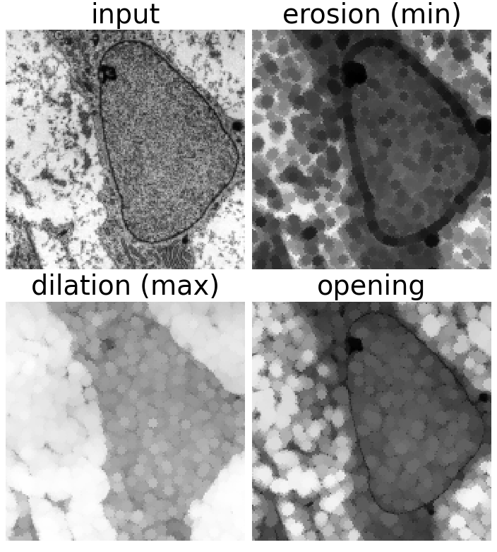
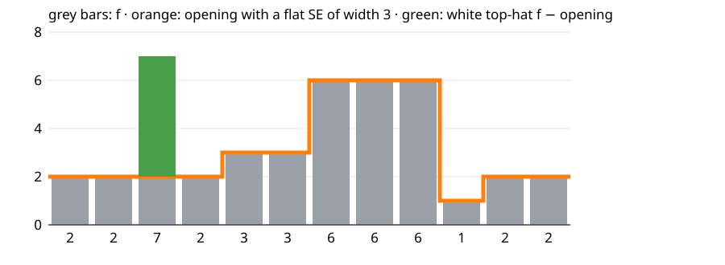
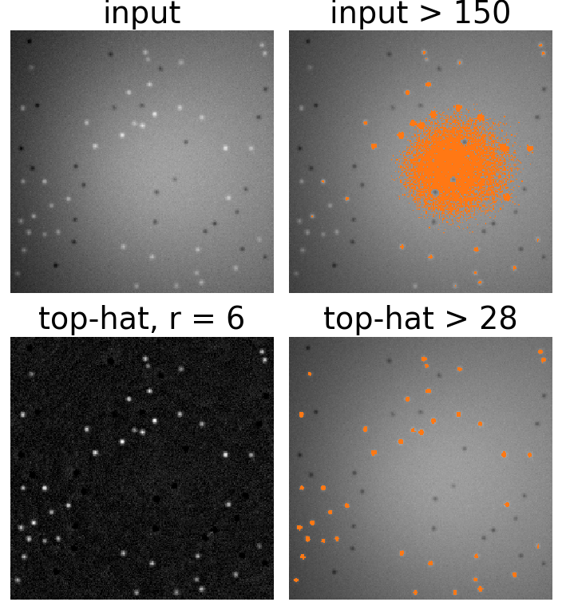
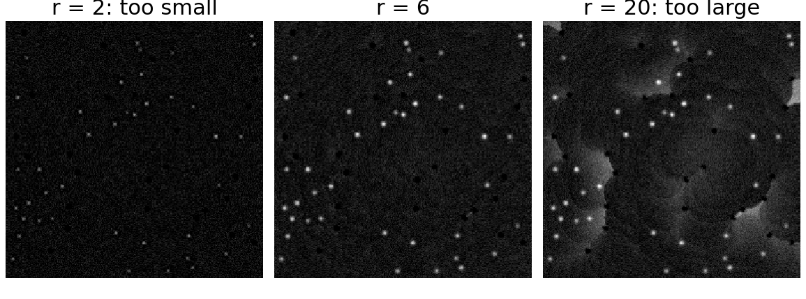
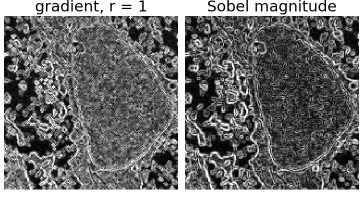
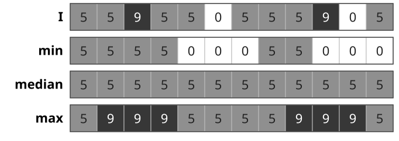

## About this lecture

Erosion and dilation were already written as a min and a max over the SE. Nothing in those formulas needs the image to be binary: applied to a grey image, they give the **min filter** and the **max filter**, and every construction of the last two units carries over.

- A grey image as a **landscape**; erosion, dilation, opening and closing seen as a bar pushed up from below or down from above.
- **Top-hat**: image minus its opening. Removes an uneven background, so that one threshold works.
- **Morphological gradient**: dilation minus erosion. An edge detector without direction or ringing.
- **Rank filters**: min, median, max as one family.

*Slides titled **The math** give the formulas and proofs; the ideas are complete without them.*

## Min and max filters

With a **flat** SE $B$ (a window, no weights), for a grey image $I$:

$$(I \ominus B)(x) = \min_{b \in B} I(x + b), \qquad (I \oplus B)(x) = \max_{b \in B} I(x - b).$$

:::: {.columns}
::: {.column width="58%"}
- Erosion: every pixel takes the **darkest** value in its window. Bright details narrower than $B$ shrink or vanish, dark ones grow.
- Dilation: the **brightest** value. Bright details grow, dark ones shrink.
- Opening $I \circ B$ and closing $I \bullet B$: as before, erode then dilate, or the other way round.
- On a 0/1 image these are exactly the binary operations.
:::
::: {.column width="42%"}
{width=74%}
:::
::::

::: notes
Micrograph: transmission electron micrograph of a mesenchymal stem cell, Robert M. Hunt, CC BY 3.0, via Wikimedia Commons.
:::

## The image as a landscape

Draw $I$ as a profile (1D) or a relief (2D): height = grey level.

{width=62%}

- **Opening**: push the SE, a horizontal bar of width $w$, up from **below** as far as it goes. The top of the bar traces $I \circ B$. A bright peak narrower than the bar is cut off at the level where it becomes wider than the bar; a wide peak is kept.
- **Closing**: push the bar **down from above**. Dark valleys narrower than the bar are filled.
- The bar never goes above the profile (opening) or below it (closing): opening $\le I \le$ closing.

## Example: 12 samples, width 3

{width=85%}

$I = 2\,2\,7\,2\,3\,3\,6\,6\,6\,1\,2\,2$. Erosion (min over 3) $= 2\,2\,2\,2\,2\,3\,3\,6\,1\,1\,1\,2$; opening $= 2\,2\,2\,2\,3\,3\,6\,6\,6\,1\,2\,2$.

The one-sample peak (7) is cut down to 2; the three-sample plateau (6 6 6) survives. With width 5 it would be cut down to 3 too.

## The math: grey levels as stacked sets {.math}

**Threshold decomposition**: for a flat SE, erosion commutes with thresholding,

$$\{x : (I \ominus B)(x) \ge t\} = \{x : I(x) \ge t\} \ominus B \quad \text{for every level } t,$$

because $\min_b I(x + b) \ge t \iff I(x + b) \ge t$ for all $b$. The same holds for dilation, opening and closing. So grey-level morphology with a flat SE = binary morphology applied to every threshold of $I$, stacked again.

- Opening keeps the part of each level set $\{I \ge t\}$ that the SE fits into: a peak survives up to the level where it is still at least as wide as $B$.
- The "landscape" is the **umbra** $\{(x, t) : t \le I(x)\}$; a flat SE is a horizontal segment pushed around in it.

## Try it: rolling the SE under and over a profile

```{=html}
<link rel="stylesheet" href="../demos/dist/demo.css">
<div data-demo="morph1d" data-preset="narrow"></div>
<script src="../demos/dist/morph1d.js"></script>
```

::: notes
The orange bar is the SE at the chosen position, pushed up under the profile (or down over it); "sweep" moves it along and leaves the trace, which is the opening (closing). Drag the round handles to change the profile. Tour: "narrow peak goes, wide peak stays": w = 11; sweep: the trace runs under the narrow peak and over the plateau. Raise w past the plateau width (23): it goes too. "peaks on a slope": opening (orange) follows the slope, the white top-hat (green) is flat with the peaks on it. "noise: min, median, max": salt-and-pepper on a step; only the median removes both kinds and keeps the step sharp. "a line across the cell": closing from above, black top-hat picks out the dark granules.
:::

## Top-hat: remove the background

**White top-hat**: the image minus its opening,
$$\mathrm{WTH}(I) = I - I \circ B \ \ge 0 .$$

:::: {.columns}
::: {.column width="60%"}
- The opening is a **background estimate**: it follows everything wider than $B$ and cuts off the bright details narrower than $B$.
- The top-hat keeps exactly those details, on a flat zero background, whatever the background brightness was.
- **Black top-hat** $I \bullet B - I$: the same for **dark** details (granules, cracks, dark spots).

Classic use: **uneven illumination** (a vignetted microscope field, a light gradient). On the raw image, no single threshold separates spots from background (the thresholding day showed this failure); on the top-hat, one threshold does.
:::
::: {.column width="40%"}
{width=74%}
:::
::::

## Choosing the SE

$B$ must be **larger than the objects** and **smaller than the background variation**.

- Too small: the opening still follows the spots partly, the top-hat cuts their tops off; weak spots get lost.
- Too large: the opening can no longer follow the background where it curves; part of the background (and the noise) leaks into the top-hat.
- Spots of radius $\approx 3$ on a background that varies over 50 pixels: a disc of radius 5–8.

{width=74%}

Some image programs offer this as "rolling-ball background subtraction": an opening with a ball-shaped (non-flat) SE.

## The math: top-hat facts {.math}

- $\mathrm{WTH}(I) \ge 0$ because the opening is anti-extensive, $I \circ B \le I$.
- Adding a constant changes nothing: $(I + c) \circ B = I \circ B + c$, so $\mathrm{WTH}(I + c) = \mathrm{WTH}(I)$.
- A linear ramp is its own opening (in 1D, away from the ends): erosion of $ax$ by a window of half-width $k$ is $a(x - k)$ for $a > 0$, and dilating that back gives $ax$. So slopes are background: their top-hat is 0.

## Try it: top-hat on an uneven background

```{=html}
<link rel="stylesheet" href="../demos/dist/demo.css">
<div data-demo="tophat" data-preset="fails" data-profile="0"></div>
<script src="../demos/dist/tophat.js"></script>
```

::: notes
Three panels: input, result of the chosen operation (disc radius r), threshold overlay (orange = above t). The threshold can act on the input or on the result; for the synthetic image the readout counts the true spots found and the false objects. Tour: "one threshold fails": threshold the input at 150: 29 of 40 spots found and 250 false objects (the bright half of the background). "top-hat flattens the background": white top-hat r = 6, threshold the result at 28: all 40 spots, no false objects. "SE too small" (r = 2): 37 of 40. "SE too large" (r = 20): still 40, but 148 false objects. "granules in the cell": black top-hat. In the exercise page the profile line is shown below the panels.
:::

## Non-flat SEs: the rolling ball

A **non-flat** SE has a height $s(b)$ at each offset (a cap, a paraboloid, a ball):

$$(I \oplus s)(x) = \max_{b} \big(I(x - b) + s(b)\big), \qquad (I \ominus s)(x) = \min_b \big(I(x + b) - s(b)\big).$$

- Opening with a ball: roll a ball under the landscape; the highest points it reaches are the background. Narrow peaks and steep ridges are cut off more gently than with a flat bar.
- Flat SE = all heights 0: the min and max filters again.

{width=62%}

## The math: max-plus convolution {.math}

Replace $(+, \times)$ by $(\max, +)$ in a convolution $\sum_b I(x - b)\,s(b)$ and you get the dilation $\max_b \big(I(x - b) + s(b)\big)$.

- It distributes over pointwise max like a convolution over sums: $(I \vee J) \oplus s = (I \oplus s) \vee (J \oplus s)$, and it commutes with adding a constant, $(I + c) \oplus s = (I \oplus s) + c$.
- It is shift-invariant and associative: $(I \oplus s_1) \oplus s_2 = I \oplus (s_1 \oplus s_2)$ (a large parabola = several small ones).
- There is no Fourier convolution theorem, but there is an analogue: the **slope transform** (Legendre–Fenchel) turns dilation into addition. Further reading only.

## Morphological gradient

$$\nabla_B I = (I \oplus B) - (I \ominus B)$$

the largest minus the smallest value in the window: large at edges, 0 in flat regions.

:::: {.columns}
::: {.column width="56%"}
- **Inner** gradient $I - (I \ominus B)$ and **outer** gradient $(I \oplus B) - I$: the two halves, on either side of the edge.
- A step of height 10 with the $3$-wide window: gradient $0\,0\,0\,10\,10\,0\,0\,0$ (two samples wide). A ramp with slope 2: gradient 4 everywhere (2 × slope).
- Compared with **Sobel** (the kernels unit): no sign and no direction, but the same response in every direction; thicker edges; no ringing or overshoot; and it is a **range** (max − min in the window), not a slope: on a smooth edge it grows with the SE size, a derivative does not.
:::
::: {.column width="44%"}
{width=100%}
:::
::::

::: notes
Micrograph: transmission electron micrograph of a mesenchymal stem cell, Robert M. Hunt, CC BY 3.0, via Wikimedia Commons.
:::

## Rank filters: min, median, max

Sort the values in the window. Take the **smallest** (erosion), the **middle** one (median), or the **largest** (dilation). Any other rank gives something in between.

- **Salt-and-pepper** noise (isolated very bright and very dark pixels): the min removes the salt but spreads the pepper, the max the opposite. The **median** removes both and keeps steps sharp. (The median as a denoiser was introduced on the deconvolution day; here it is one member of the rank-filter family.)
- All rank filters are nonlinear, shift-invariant, and commute with thresholding (a flat-SE property).
- Example: $5\,5\,9\,5\,5\,0\,5\,5\,5\,9\,0\,5$, window 3: the median gives all 5s.

{width=58%}

## Try it: gradient and noise

```{=html}
<link rel="stylesheet" href="../demos/dist/demo.css">
<div data-demo="morph1d" data-preset="gradient"></div>
<script src="../demos/dist/morph1d.js"></script>
```

::: notes
"gradient vs derivative": a steep step (50 → 200 over two samples) and a ramp, w = 3. The gradient (pink) reaches the full step height, 150, at the middle sample and is 3 samples wide; |derivative| (dashed) peaks at 75. On the ramp the gradient is 9.3, twice the derivative (4.7). Raise w to 5 and 9: the gradient widens to 5 and 9 samples and grows on the ramp (18.7, 37.3); the derivative does not change. A morphological gradient is the range in the window, not a slope. "noise: min, median, max": w = 5; min (blue) spreads the dark noise, max (red) the bright noise, the median (cyan) removes both.
:::

## Summary

- Grey-level erosion/dilation with a flat SE = **min/max filters**; opening pushes a bar up under the landscape, closing pushes it down.
- Flat-SE morphology commutes with thresholding: it is binary morphology on every level set.
- **White top-hat** $I - I \circ B$ keeps bright details smaller than $B$ on a flat background; **black top-hat** $I \bullet B - I$ the dark ones. Choose $B$ larger than the objects, smaller than the background variation.
- Non-flat SEs (rolling ball) = dilation as a **max-plus convolution**.
- **Gradient** $(I \oplus B) - (I \ominus B)$: unsigned, isotropic edges. **Median**: the rank filter between min and max.
