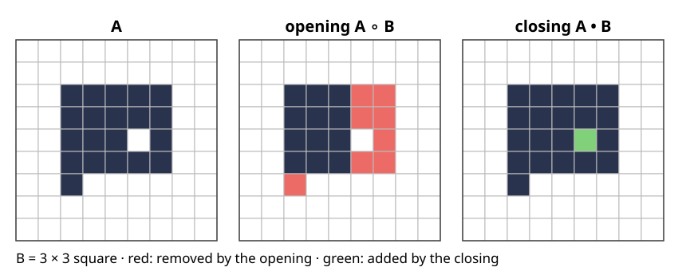
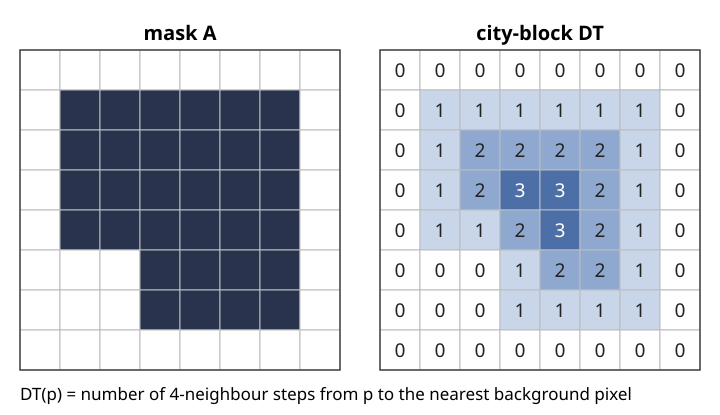

## About this lecture

Last unit: erosion (where the SE fits) and dilation (where it hits). Erosion removes small things but shrinks everything; dilation fills small gaps but grows everything. Combined, they filter by **size and shape** without changing what is large enough.

- **Opening** = erode, then dilate: removes what the SE does not fit into. **Closing** = the same for the background.
- Their properties: increasing, idempotent (like a projection), dual.
- **Granulometry**: openings with growing discs measure a size distribution without segmenting a single object.
- The **distance transform**: distance from each object pixel to the background. Erosion by a disc of radius $r$ is a single threshold of it.

*Slides titled **The math** give the formulas and proofs; the ideas are complete without them.*

## Opening: roll the SE around inside

$$A \circ B = (A \ominus B) \oplus B .$$

- The erosion keeps the positions where $B$ fits; the dilation puts a copy of $B$ back on each of them.
- So the opening is the **union of all copies of $B$ that fit inside $A$**: roll the SE around inside the object, keep every pixel it can reach.
- What it removes: specks, thin protrusions and bridges, corners sharper than $B$. What it keeps: everything $B$ fits into, unchanged.

{width=85%}

## Closing: roll the SE around outside

$$A \bullet B = (A \oplus B) \ominus B .$$

- The same for the background: roll $B$ around **outside** the object; every pixel it cannot reach becomes object.
- What it fills: holes, gaps and narrow bays smaller than $B$. The rest of the outline stays where it was.
- In the figure: the opening (20 → 12 pixels) removes the protrusion at the bottom and the two-pixel-wide part next to the hole; the closing (20 → 21) fills the hole and keeps everything else.

## Properties

| | opening $A \circ B$ | closing $A \bullet B$ |
|---|---|---|
| compared with $A$ | $\subseteq A$ (removes only) | $\supseteq A$ (adds only) |
| bigger input | bigger output (increasing) | bigger output |
| applied twice | no change: $(A \circ B) \circ B = A \circ B$ | no change |
| duality | $(A \circ B)^c = A^c \bullet \check B$ | |

- **Idempotent** like a projection, $P^2 = P$: once every remaining part is a union of fitting copies of $B$, opening again finds the same copies.
- Increasing + idempotent + only removes: such a filter is called an "opening" in general (an algebraic opening).

## The math: why the opening is idempotent {.math}

$A \circ B = \bigcup\{B_z : B_z \subseteq A\}$: if $x \in (A \ominus B) \oplus B$ then $x = z + b$ with $B_z \subseteq A$, so $x \in B_z$; conversely every fitting $B_z$ lies in the dilation of its own origin $z \in A \ominus B$.

- **Anti-extensive**: a union of subsets of $A$ is a subset of $A$.
- **Idempotent**: every $B_z \subseteq A$ also satisfies $B_z \subseteq A \circ B$ (it is one of the sets in the union). So the fitting copies of $B$ in $A \circ B$ are the same as in $A$, and the union is the same.
- **Duality**: $(A \circ B)^c = \big((A \ominus B) \oplus B\big)^c = (A \ominus B)^c \ominus \check B = (A^c \oplus \check B) \ominus \check B = A^c \bullet \check B$, using the erosion–dilation duality twice.
- At the image border the properties need the adjoint pair: dilation ignores the outside, erosion treats it as object (the demo's "ignored").

## Noise removal and what it costs

- **Opening** removes bright specks (object pixels) smaller than $B$; **closing** fills dark holes smaller than $B$. A noisy mask has both: open, then close (or the other way).
- **Open-then-close ≠ close-then-open**: a speck next to an object may be joined by the closing first and then survive the opening. Repeating with growing SEs ("alternating sequential filters") treats both kinds of noise more evenly.
- What is lost: corners are rounded (to the shape of $B$), thin necks are cut by the opening, thin gaps between two objects are bridged by the closing.

The SE size sets the scale: "noise" is whatever is smaller than $B$.

## Try it: opening and closing

```{=html}
<link rel="stylesheet" href="../demos/dist/demo.css">
<div data-demo="morphgrid" data-mode="openclose" data-preset="speck"></div>
<script src="../demos/dist/morphgrid.js"></script>
```

::: notes
Same grid as last unit, with the border convention "ignored" (the adjoint pair). Tour: "opening removes the speck": end → the speck and the thin arm are red, the block is unchanged (37 → 30). Step through: first the erosion pass, then the dilation brings back what the SE reaches. "closing fills the gap": 65 → 70, the three one-pixel holes and the one-pixel gap between the two lower blocks are filled (green); the three-row gap above them stays. "open∘close ≠ close∘open": open then close gives 36 pixels, the note says close-then-open differs in 31 pixels. "apply twice": the second opening changes nothing (note: same as one opening).
:::

## Size filtering and granulometry

Open with discs of growing radius $r$. Each opening is contained in the previous one: what a disc of radius $r + 1$ fits into, a disc of radius $r$ fits into too.

- The **area left** $a(r) = |A \circ D_r|$ falls from $|A|$ to 0: a cumulative size distribution.
- The **pattern spectrum** $a(r) - a(r + 1)$ counts the pixels that disappear between $r$ and $r + 1$: a **histogram of sizes**, without segmenting or counting any object.
- "Size" here = the radius of the largest disc that fits. A long thin object counts as small; two touching discs do not make one bigger object.
- A line SE measures size in one direction only: openings with a horizontal line keep long horizontal structures (an orientation filter).

## The math: granulometry {.math}

A family of openings $\gamma_r$ is a **granulometry** if $\gamma_r \gamma_s = \gamma_s \gamma_r = \gamma_{\max(r, s)}$: the larger one wins.

- For openings by $B_r$ this holds when every $B_s$ ($s \ge r$) is a union of translates of $B_r$, i.e. $B_s \circ B_r = B_s$. True for squares, diamonds, lines and Euclidean discs; digital discs only approximately, so in practice one uses the union of the openings by all discs of radius $\ge r$.
- Then $a(r) = |\gamma_r(A)|$ is non-increasing, $a(0) = |A|$, and the pattern spectrum $\mathrm{PS}(r) = a(r) - a(r + 1) \ge 0$ sums to $|A|$.
- Each pixel $p$ has a **size** $s(p) = \max\{r : p \in \gamma_r(A)\}$ (the "opening function"); $\mathrm{PS}(r) = |\{p : s(p) = r\}|$.

## Try it: granulometry

```{=html}
<link rel="stylesheet" href="../demos/dist/demo.css">
<div data-demo="granulo" data-preset="sizes"></div>
<script src="../demos/dist/granulo.js"></script>
```

::: notes
Left: the opening at radius r (dark), the removed pixels coloured by the radius at which they disappeared. Right: area left a(r) and the pattern spectrum. Tour: "two sizes, two peaks": discs of radius 6 and 13 give peaks at r = 5 and r = 12 (the largest digital disc that fits in a disc drawn around a non-integer centre is one smaller); at r = 7, 64.7 % is left. "touching discs": the spectrum has one peak at 7 for singles, pairs and chains alike. "lines": horizontal line SE: the vertical bars vanish at r = 2, the horizontal ones between r = 12 and 24 according to their length. "square SE on discs": peaks move to 3–4 and 8–9 (a square of radius r needs a disc of radius r√2).
:::

## The distance transform

For every object pixel $p$: the distance to the nearest background pixel,

$$\mathrm{DT}(p) = \min_{q \notin A} \|p - q\| \qquad (0 \text{ on the background}).$$

:::: {.columns}
::: {.column width="55%"}
{width=100%}
:::
::: {.column width="45%"}
- Picture it as a **mountain** over the object: low at the edge, high in the middle, with **ridges** along the centre lines.
- The metric matters: **city-block** (steps to 4-neighbours), **chessboard** (8-neighbours), **chamfer** (weights 3 and 4 for straight and diagonal steps, $\approx$ Euclidean), exact **Euclidean**.
- By hand: count the steps outwards, ring by ring.
:::
::::

## The math: two passes are enough {.math}

City-block DT by two raster scans, each "minimum over neighbours plus one step":

1. Set $d = 0$ on the background, $\infty$ on the object.
2. **Forward** (top-left to bottom-right): $d(p) \leftarrow \min\big(d(p),\ d(\text{left}) + 1,\ d(\text{up}) + 1\big)$.
3. **Backward** (bottom-right to top-left): $d(p) \leftarrow \min\big(d(p),\ d(\text{right}) + 1,\ d(\text{down}) + 1\big)$.

- Why it works: after the forward pass, $d(r)$ is the distance to the nearest background pixel **above and to the left** of $r$ (paths of right and down steps). The backward pass then adds paths of left and up steps from such an $r$. Any background pixel $q$ is reached through the corner pixel $r$ in $p$'s row and $q$'s column (or $p$'s column and $q$'s row) chosen so that $q$ is above-left of $r$ and $r$ below-right of $p$, with total length $|\Delta x| + |\Delta y|$.
- Chessboard and chamfer: the same scheme with the diagonal neighbours (step weights 1, or 3 and 4).
- The exact Euclidean DT is computed in linear time, separably: one 1D pass per column, then a lower envelope of parabolas per row (Felzenszwalb–Huttenlocher); not derived here.

## Try it: the two-pass distance transform

```{=html}
<link rel="stylesheet" href="../demos/dist/demo.css">
<div data-demo="morphgrid" data-mode="distance" data-preset="hand"></div>
<script src="../demos/dist/morphgrid.js"></script>
```

::: notes
Left: the mask (click to edit); right: the distances. Step: the forward pass reads the neighbours above and to the left (the window on the right grid), the log writes min(…) for each pixel. "next stage" jumps a row. After the forward pass the bottom-right corner is too large (4); the backward pass fixes it. At the end the green cells are DT > r (slider r on the left) = the erosion by the diamond of radius r: for the 8 × 8 exercise mask, r = 2 leaves 3 pixels. Switch to chessboard: the green set becomes the erosion by the square.
:::

## Erosion by a disc = a threshold of the DT

$$A \ominus D_r = \{x : \mathrm{DT}(x) > r\}, \qquad A \oplus D_r = \{x : \mathrm{DT}_{A^c}(x) \le r\}$$

with $D_r$ the disc of radius $r$ and $\mathrm{DT}_{A^c}$ the distance to $A$ (the DT of the background).

- The disc fits at $x$ exactly when no background pixel is within distance $r$ of $x$.
- One DT gives the erosion by **every** radius; an opening by any disc is two distance transforms. Fast for large SEs.
- Matching metrics: city-block DT ↔ diamond (the cross dilated by itself), chessboard DT ↔ square.
- Level sets (elective): the boundary of $A \oplus D_r$ is the outline moved outwards at unit speed for a time $r$, the zero level of the signed distance shifted by $r$.

## The math: the threshold identity {.math}

$x \in A \ominus D_r \iff x + b \in A$ for all $\|b\| \le r$ $\iff$ no $q \notin A$ with $\|q - x\| \le r$ $\iff \min_{q \notin A}\|q - x\| > r \iff \mathrm{DT}(x) > r$.

For dilation, by duality: $(A \oplus D_r)^c = A^c \ominus D_r = \{x : \mathrm{DT}_{A^c}(x) > r\}$, since $D_r$ is symmetric ($\check D_r = D_r$).

The same argument works for any norm and its "disc": city-block ($|\Delta x| + |\Delta y| \le r$, a diamond), chessboard ($\max(|\Delta x|, |\Delta y|) \le r$, a square). Pixels outside the image: the DT only sees background inside the image, which corresponds to erosion with the outside "ignored".

## Pointers

- **Skeletons** (elective "Objects"): the centres of the largest discs that fit inside $A$ lie on the ridges of the DT; they form the **skeleton** (medial axis). Hit-or-miss, thinning and skeletons are taught there.
- **Watershed** (day 10): the DT of a mask of touching round cells has one peak per cell; flooding it splits them. Fill holes first (the reconstruction unit of this day).
- **Graph cuts** (day 13): an opening/closing cleans a noisy threshold locally and cheaply, by size alone. A graph cut adds a smoothness term $\lambda \cdot$(boundary length) to an energy and finds the global best labelling; it uses the image values too, not only the mask.

## Summary

- **Opening** $A \circ B$ = erode, then dilate = union of all copies of $B$ inside $A$; removes what is smaller than $B$. **Closing** = the same for the background; fills what is smaller than $B$.
- Both are increasing and **idempotent**; opening only removes, closing only adds; they are dual. Open-then-close ≠ close-then-open.
- **Granulometry**: the area left after openings with growing discs, and its differences, the **pattern spectrum**: a size histogram without segmentation.
- **Distance transform** $\mathrm{DT}(p)$: distance to the background; two raster passes for city-block, chessboard and chamfer, linear time for exact Euclidean.
- **Erosion by a disc of radius $r$ = $\{\mathrm{DT} > r\}$**.
