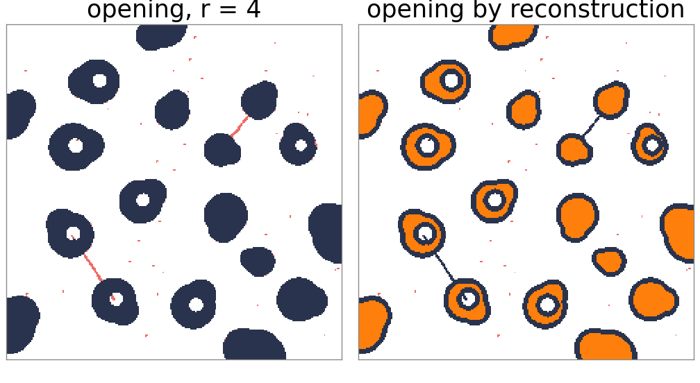
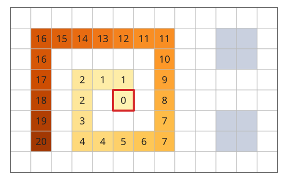
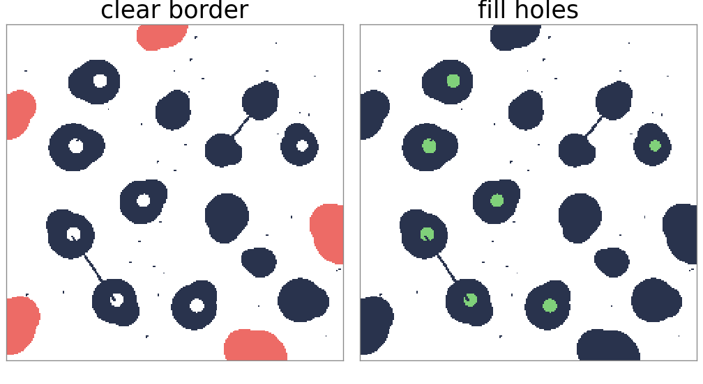
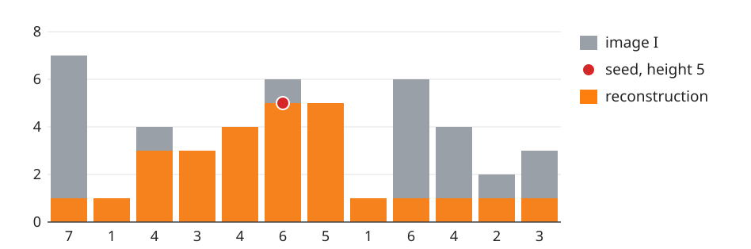
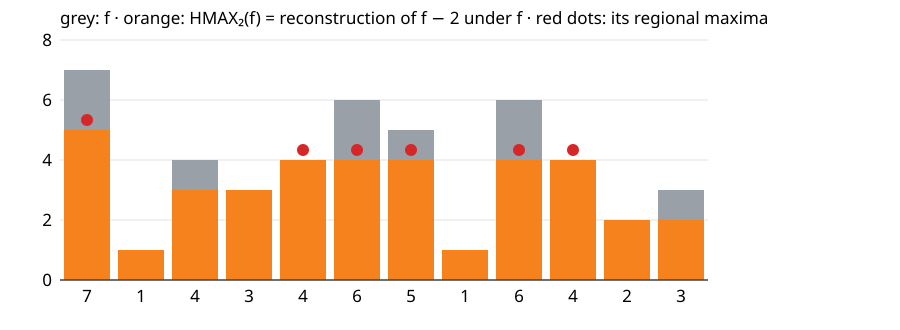
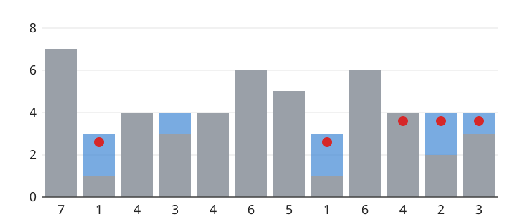
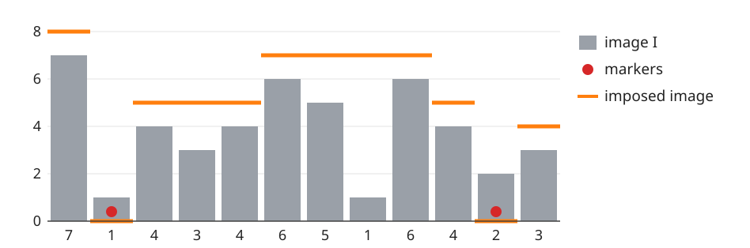

## About this lecture

An opening removes small objects, but it also changes the shapes of the ones it keeps: corners, protrusions and thin bridges are cut. Often we want something sharper: **keep every object that contains a seed, exactly as it was**.

- **Geodesic dilation**: dilate a marker, then clip it to a mask. Repeat until nothing changes: **reconstruction** (a flood fill from the seeds).
- Binary uses: **opening by reconstruction**, **remove objects touching the border**, **fill holes**.
- Grey levels: **h-maxima** and **h-minima** remove peaks and basins shallower than $h$; **minima imposition** forces the minima to chosen markers. These are the tools the watershed day uses.

*Slides titled **The math** give the formulas and proofs; the ideas are complete without them.*

## The problem with opening

:::: {.columns}
::: {.column width="48%"}
- Opening with a disc of radius 4: specks smaller than the disc vanish, as wanted.
- But the cells that remain lose their thin bridges and protrusions, and a cell joined to another by a 2-pixel bridge becomes two objects.
- What we want instead: decide **which objects** to keep (those the disc fits into somewhere) and then keep each of them **whole**.

The trick: use the erosion only to **find** the objects (as seeds), and then grow the seeds back inside the original mask.
:::
::: {.column width="52%"}
{width=100%}
:::
::::

## Geodesic dilation and reconstruction

Two images: a **marker** $M$ (the seeds) and a **mask** $A$, with $M \subseteq A$.

:::: {.columns}
::: {.column width="56%"}
- **Geodesic dilation**: dilate $M$ by the $3 \times 3$ square (one step), then intersect with the mask: $(M \oplus B) \cap A$. The marker grows by one pixel, but only inside $A$.
- Repeat until nothing changes: the **reconstruction** $R_A(M)$.
- Result: every connected component of $A$ that contains a seed, **complete and unchanged**; every component without a seed, gone. It is a **flood fill** from the seeds.
- The square makes the components 8-connected (the course convention for objects); the cross gives 4-connected ones (used for the background).
:::
::: {.column width="44%"}
{width=100%}
:::
::::

## The math: reconstruction {.math}

$$\delta_A(M) = (M \oplus B) \cap A, \qquad R_A(M) = \delta_A^{(k)}(M) \ \text{ for the first } k \text{ with } \delta_A^{(k+1)}(M) = \delta_A^{(k)}(M).$$

- $\delta_A$ is increasing and $M \subseteq \delta_A(M) \subseteq A$ (when $0 \in B$ and $M \subseteq A$), so the iterates grow and stop after at most $|A|$ steps.
- After $k$ steps the marker covers exactly the pixels of $A$ within $k$ steps of $M$ along paths **inside** $A$ (the geodesic distance): hence the name.
- Dual: **geodesic erosion** $(M \ominus B) \cup A$ for $M \supseteq A$, iterated: reconstruction by erosion $R^{\varepsilon}_A(M)$ (fill from the outside in).
- One line for the next day: the connected component of $A$ containing a pixel $p$ is $R_A(\{p\})$. Labelling all components efficiently is the labelling day.

## Three binary tools

- **Opening by reconstruction**: $R_A(A \ominus B)$. The erosion decides which objects survive; the reconstruction gives them back whole.
- **Clear border** (remove objects touching the image edge, which cannot be measured completely): $A \setminus R_A(A \cap \text{frame})$, with the frame = the outermost row and column of pixels.
- **Fill holes**: a hole is background that cannot be reached from outside the image. Reconstruct the background from the frame, $R_{A^c}(A^c \cap \text{frame})$ (4-connected), and take the complement.

All three are "seeds + flood fill", with different seeds and masks.

{width=54%}

## Try it: reconstruction on a mask

```{=html}
<link rel="stylesheet" href="../demos/dist/demo.css">
<div data-demo="reconstruct" data-preset="openrec"></div>
<script src="../demos/dist/reconstruct.js"></script>
```

::: notes
Binary tab: a synthetic mask (15093 pixels, 48 components) with border objects, holes, thin bridges and specks. The replay slider shows the reconstruction one geodesic dilation at a time; orange = the marker. Tour: "opening breaks shapes, reconstruction does not": r = 4; opening by reconstruction removes 60 pixels (only specks), 16 objects remain. Switch to "opening": 203 pixels removed, and the bridges are cut (18 pieces). "clear border": 4165 pixels in 5 objects removed, 25 iterations. "fill holes": 7 holes, 556 pixels, the background flood takes 131 iterations. "one pixel → its blob": click any blob.
:::

## Grey-level reconstruction

Same definition with min and max: marker $M \le I$ pointwise,

$$\delta_I(M) = \min\big(M \oplus B,\ I\big), \quad \text{iterated until stable: } R_I(M).$$

- Picture the image as a landscape and the marker as a lower landscape inside it. Each step lifts the marker to the highest neighbouring marker value, but never above the image.
- A single seed of height $v$ at the top of a hill floods outwards as long as it can stay at or below the landscape; it reaches every point that can be reached **without climbing above $v$**, and on the way it is held down by the lowest pass.

{width=64%}

## h-maxima: remove the low peaks

Marker = the image lowered by $h$: $M = I - h$. Reconstruct:

$$\mathrm{HMAX}_h(I) = R_I(I - h).$$

- Every peak is lowered by $h$; a peak that rises **at most $h$** above the pass to a higher peak (its **dynamic**) is flattened completely and merges with its neighbour.
- **Domes** $I - \mathrm{HMAX}_h(I)$: the top $h$ of every peak.
- **Regional maximum**: a plateau whose neighbours are all lower. The regional maxima of $\mathrm{HMAX}_h(I)$ (the "h-maxima", or extended maxima) mark only the significant peaks: one per nucleus, rather than one per noise bump.

## Example: 12 samples, $h = 2$

{width=80%}

$I = 7\,1\,4\,3\,4\,6\,5\,1\,6\,4\,2\,3$ has 5 regional maxima (7, 4, 6, 6, 3). After reconstructing $I - 2$ (3 iterations): $5\,1\,3\,3\,4\,4\,4\,1\,4\,4\,2\,2$, with 3 regional maxima. The peaks 4 (sample 2) and 3 (sample 11) rise only 1 above their passes and are gone.

## The math: dynamics and h-maxima {.math}

The **dynamic** of a regional maximum: the smallest descent needed to reach a higher point,
$$\mathrm{dyn}(m) = I(m) - \max_{\text{paths } m \to \text{higher point}} \ \min_{\text{path}} I .$$

- $I - h \le \mathrm{HMAX}_h(I) \le I$: the marker only grows, and never above the mask.
- A regional maximum $m$ of $I$ survives as a regional maximum of $\mathrm{HMAX}_h(I)$ exactly when $\mathrm{dyn}(m) > h$ (the global maximum always survives).
- **h-minima**: $\mathrm{HMIN}_h(I) = R^{\varepsilon}_I(I + h)$, reconstruction by erosion. Every basin is filled by $h$; basins of depth at most $h$ are filled to their spill level and disappear as minima.

## h-minima: fill the shallow basins

$$\mathrm{HMIN}_h(I) = R^{\varepsilon}_I(I + h)$$

:::: {.columns}
::: {.column width="42%"}
- Pour water into every basin up to $h$ above its bottom; a basin that overflows at less than $h$ merges with its neighbour.
- The 12-sample signal with $h = 2$: 4 regional minima (1, 3, 1, 2) become 3; the basin at sample 3 (bottom 3, spill level 4) is filled.
- This is how the watershed day chooses its markers: flood only from the minima of $\mathrm{HMIN}_h$, so that noise basins do not each become a region.
:::
::: {.column width="58%"}
{width=100%}
:::
::::

## Try it: reconstruction in 1D

```{=html}
<link rel="stylesheet" href="../demos/dist/demo.css">
<div data-demo="recon1d" data-preset="hmax"></div>
<script src="../demos/dist/recon1d.js"></script>
```

::: notes
Grey bars: the signal I (drag a bar to change it). Orange: the marker M; "step" applies one geodesic dilation; the dashed red line is the dilated marker before clipping, the hatched part is what the mask clips off. The rows under the plot give I and M per sample, so the by-hand exercise can be checked step by step. Tour: "h removes the shallow peaks" (h = 2): 8 regional maxima become 6 after 3 iterations; raise h to 3 and 4 (5 and 3 maxima). "h-minima: basins fill": blue = water; 8 minima become 5. "12 samples (exercise)": the signal of this lecture and of the watershed day. "two markers: imposition": the result has minima only at the two markers.
:::

## Minima imposition

The watershed (day 10) floods from every regional minimum. To flood from **chosen markers** only (one per cell), change the image so that its only minima are the markers, keeping its shape elsewhere:

- $M = 0$ on the markers, very high elsewhere (above $\max I$).
- Reconstruct by erosion of $M$ above $\min(I + 1, M)$: every basin without a marker fills up to its spill level; the markers stay at 0.
- Result: a landscape with exactly one minimum per marker run, and the same passes (dams) as $I$ between them. "Marker-controlled watershed" = watershed of this imposed image.

{width=58%}

## The math: why imposition works {.math}

Let $G = \min(I + 1, M)$: $G = 0$ on markers, $I + 1$ elsewhere. The result $J = R^{\varepsilon}_G(M)$ satisfies $G \le J \le M$.

- On a marker: $J = G = 0$, the lowest possible value, so markers are minima.
- Elsewhere $J \ge I + 1 > 0$. Reconstruction by erosion gives $J(x) = \max\big(G(x), \min_{\text{paths } x \to \text{marker}} \max_{\text{path}} G\big)$: the lowest possible "highest point" on the way to a marker. Take a plateau of $J$ at height $v > 0$ and the best path from one of its pixels to a marker: $J \le v$ along the whole path, and it ends at 0, so it leaves the plateau through a neighbour with $J < v$. The plateau is not a regional minimum.
- The "+1" keeps the markers strictly lower than everything else even where $I$ is already at its minimum.

## A fast algorithm

Iterating geodesic dilations until stable is the definition, but slow: every iteration visits every pixel, and a flood across a large object takes hundreds of iterations (131 for the background of the demo mask).

- **Vincent (1993)**: one raster and one anti-raster pass (as in the two-pass distance transform), then a **first-in-first-out queue** of the pixels that can still propagate. Only pixels on the moving front are revisited.
- Binary reconstruction = a breadth-first flood fill: each pixel enters the queue once. Linear time.
- The watershed day uses the same queue idea, with priorities (a priority queue ordered by grey level).

## Try it: h-maxima on nuclei

```{=html}
<link rel="stylesheet" href="../demos/dist/demo.css">
<div data-demo="reconstruct" data-preset="noise"></div>
<script src="../demos/dist/reconstruct.js"></script>
```

::: notes
Grey tab, synthetic nuclei. Red dots: the regional maxima of HMAX_h (one per significant peak). Tour: "noise: hundreds of maxima": h = 0, 6184 regional maxima (noise and texture). Raise h: 116 at h = 10, 39 at h = 12, 19 at h = 15 ("one dot per nucleus?" preset). At h = 15, 18 of the 22 nuclei have exactly one dot; nuclei that touch share one; one dot is on the background. Views: "reconstruction" shows HMAX_h, "domes / basins" the top h of each peak. "impose two minima" on the micrograph: click to add markers; the imposed landscape has exactly as many minima as markers.
:::

## Summary

- **Reconstruction** $R_A(M)$: dilate the marker step by step, clipped to the mask, until stable; a flood fill that keeps every marked component whole.
- Binary: **opening by reconstruction** (filter by size, keep shapes), **clear border**, **fill holes**; the component of a pixel is its reconstruction (labelling day).
- Grey: $\mathrm{HMAX}_h = R_I(I - h)$ removes peaks of dynamic $\le h$; **h-minima** $R^\varepsilon_I(I + h)$ fill basins of depth $\le h$; regional extrema of the result are robust markers.
- **Minima imposition** makes chosen markers the only minima, for the marker-controlled watershed (day 10).
- Fast: a FIFO queue processes only the moving front.
