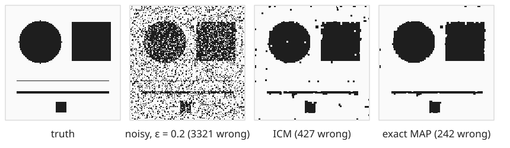
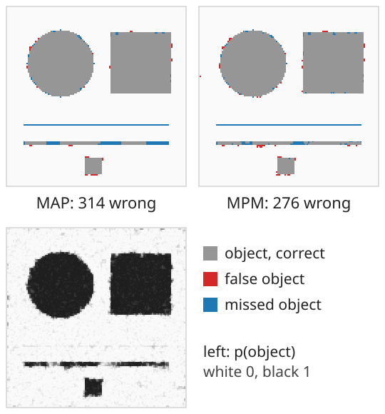
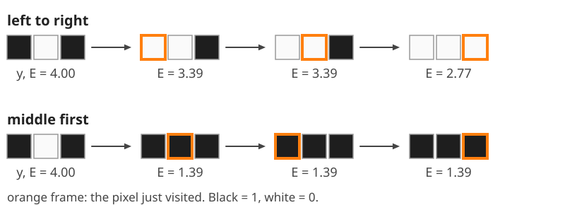
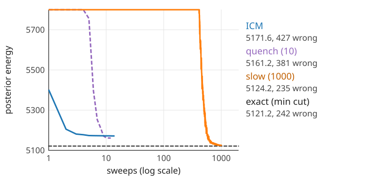
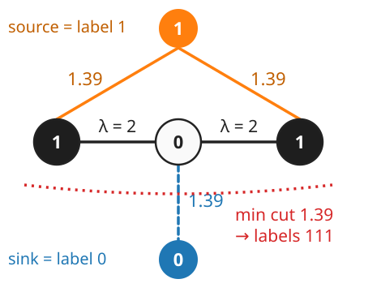
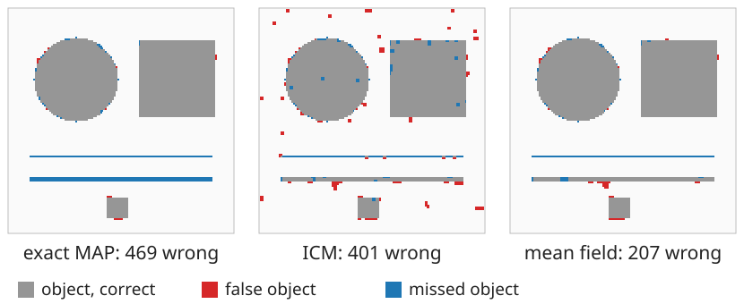
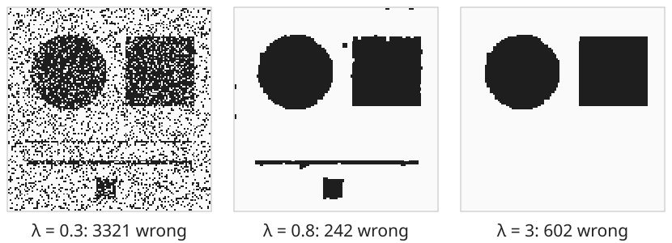

## About this lecture

A binary image was corrupted by noise. We want the clean image back, using what we know about **noise** (the likelihood) and about **images** (the Ising prior).

- **Bayes**: posterior $\propto$ likelihood $\times$ prior; its negative log is an **energy**.
- Two answers: the single most probable image (**MAP**) and the most probable value of each pixel (**MPM**).
- Four ways to compute them: **ICM**, **simulated annealing**, **mean field**, and the **exact** minimum cut.
- What goes wrong: local minima, and a prior weight $\lambda$ that is too large.

*Slides titled **The math** give the formulas and proofs; the ideas are complete without them.*

::: notes
From this unit on the prior weight is λ (= 2J), as on the graph-cut day; J appears only in the math slides that connect to units 1–2. The demo is mrfdenoise: a 128 × 128 binary image, noise, six methods, and an energy plot.
:::

## The problem

{width="100%"}

- **Truth** $\mathbf x$: a binary image (here a disc, a square, a 1-pixel and a 3-pixel line, a small square).
- **Observed** $\mathbf y$: each pixel **flipped** with probability $\varepsilon = 0.2$. Taking $\mathbf y$ as the answer leaves 3321 of 16 384 pixels wrong.
- Right: two estimates from this unit. The exact best image under the model has 242 wrong pixels, but the 1-pixel line is gone. Why, and what else could we have done?

## Recall: Bayes' rule and energies

From the thresholding day ([the two-class Bayes rule](../otsu/lec.qmd)) and the graph-cut day ([segmentation as energy minimisation](../seg-energy/lec.qmd), "the probabilistic view"):

$$\underbrace{p(\mathbf x \mid \mathbf y)}_{\text{posterior}} \;\propto\; \underbrace{p(\mathbf y \mid \mathbf x)}_{\text{likelihood: the noise}}\;\underbrace{p(\mathbf x)}_{\text{prior: what images look like}}$$

- Taking $-\log$ turns the product into a **sum**: posterior energy = data term + prior term.
- Most probable image = **lowest energy**. That is the graph-cut day's energy minimisation, now with a probabilistic meaning for every term.

## The model: noise + Ising prior

Labels $L_p \in \{0, 1\}$ (1 = object), as on the graph-cut day:

$$E(L \mid \mathbf y) = \sum_p D_p(L_p) + \lambda\sum_{(p,q)}[L_p \ne L_q]$$

- **Data term from the noise.** With flip noise, a label that disagrees with $y_p$ costs $\log\frac{1 - \varepsilon}{\varepsilon}$ more than one that agrees: $\log 4 = 1.39$ for $\varepsilon = 0.2$. Rare flips make disagreeing expensive.
- **Prior from the Ising model**: every disagreeing neighbour pair costs $\lambda$ ($= 2J$).
- **$\lambda = 0$ is thresholding**: every pixel keeps its observed value.
- With Gaussian noise on two grey levels (the noise model of [camera noise](../cameranoise/lec.qmd), day 3), $D_p(\ell) = (y_p - \mu_\ell)^2/2\sigma_n^2$: grey values near the middle are uncertain, values far out are sure.

## The math: likelihood, field and posterior {.math .smaller}

Flip noise, independent per pixel: $p(y_p \mid x_p) = 1 - \varepsilon$ if $y_p = x_p$, else $\varepsilon$. In spins ($x_p, y_p = \pm 1$):

$$\log p(y_p \mid x_p) = \tfrac12\log\big(\varepsilon(1 - \varepsilon)\big) + h\,x_py_p, \qquad h = \tfrac12\log\frac{1 - \varepsilon}{\varepsilon}.$$

With the Ising prior $p(\mathbf x) \propto \exp(J\sum x_px_q)$ the posterior is again an Ising model, with a **pixel-dependent field** $h_p = h\,y_p$:

$$E(\mathbf x \mid \mathbf y) = -J\sum_{(p,q)}x_px_q - \sum_p h_px_p \;(+\text{ const}), \qquad p(\mathbf x \mid \mathbf y) \propto e^{-E(\mathbf x \mid \mathbf y)}.$$

In label form (unit 1): $D_p(1) - D_p(0) = -2h_p$, $\lambda = 2J$. Gaussian noise with levels $\mu_0, \mu_1$: $D_p(\ell) = (y_p - \mu_\ell)^2/2\sigma_n^2$, so $h_p = \frac{D_p(0) - D_p(1)}{2}$ is **linear** in $y_p$ (the squares $y_p^2$ cancel). The model's own temperature is $T = 1$; a $T$ in an algorithm below is a knob of the **algorithm**.

## By hand: three pixels

$\mathbf y = (1, 0, 1)$, $\varepsilon = 0.2$ (data cost 1.39 per disagreeing pixel), $\lambda = 2$:

| labelling | 111 | 000 | 001, 100 | 101 = $\mathbf y$ | 011, 110 | 010 |
|---|---|---|---|---|---|---|
| data | 1.39 | 2.77 | 1.39 | 0 | 2.77 | 4.16 |
| boundaries $\times\,\lambda$ | 0 | 0 | 2 | 4 | 2 | 4 |
| energy | **1.39** | 2.77 | 3.39 | 4.00 | 4.77 | 8.16 |
| probability $\propto e^{-E}$ | **0.60** | 0.15 | 0.08 each | 0.04 | 0.02 each | 0.001 |

- The **MAP** fills the hole: $111$. It costs one disagreement with the data (1.39) instead of two boundaries (4).
- With $\lambda < 0.69$ two boundaries would be cheaper, and the MAP would keep $\mathbf y$.

## Two answers: MAP and MPM

:::: {.columns}
::: {.column width="60%"}
The posterior is a distribution over images. Which single image do we report?

- **MAP** (maximum a posteriori): the one most probable image = the lowest energy. All pixels are decided **jointly**.
- **MPM** (maximum of the posterior marginals; Marroquin, Mitter & Poggio, 1987): for each pixel separately, the value it has in **most** of the posterior's probability mass.
- MPM gets, on average, the **fewest wrong pixels**. MAP is the best guess of the **whole** image.
- Marginals come from **sampling** at $T = 1$: run a Gibbs sampler, count how often each pixel is 1. The marginal is also an **uncertainty map**: 0.5 = don't know.
- Three pixels: $p(L_2 = 1) = 0.64$, $p(L_1 = 1) = 0.75$, so MPM is also $111$, but with a clear warning that the middle pixel is uncertain.
:::
::: {.column width="40%"}
{fig-alt="Three panels of the 128 × 128 test image. Top left: the exact MAP, 314 wrong pixels: the 1-pixel line is missing (blue) and the 3-pixel line is partly missing. Top right: the MPM, 276 wrong pixels, similar but with fewer missed pixels on the thick line. Bottom: the marginal probability of object, black inside the disc and the squares, grey (uncertain) along all edges and on the 3-pixel line, and only faintly darker along the 1-pixel line." width="100%"}
:::
::::

## The math: which estimate minimises which loss? {.math}

For an estimate $\hat{\mathbf x}$ and the unknown truth $\mathbf x$ (distributed as the posterior):

- **0–1 loss** ("right only if every pixel is right"): $\mathbb E[1 - [\hat{\mathbf x} = \mathbf x]] = 1 - p(\hat{\mathbf x} \mid \mathbf y)$, minimised by the **MAP**.
- **Number of wrong pixels**: $\mathbb E\sum_p[\hat x_p \ne x_p] = \sum_p\big(1 - p(x_p = \hat x_p \mid \mathbf y)\big)$. Each term depends on one pixel: minimised pixel by pixel by $\hat x_p = \arg\max_v p(x_p = v \mid \mathbf y)$, the **MPM**.

The marginal $p(x_p = v \mid \mathbf y) = \sum_{\mathbf x: x_p = v}p(\mathbf x \mid \mathbf y)$ sums over $2^{n-1}$ images: no closed form. A Gibbs sampler at $T = 1$ estimates it as the fraction of samples (after burn-in) with $x_p = v$.

## Finding the MAP: ICM

**Iterated conditional modes** (Besag, 1986): the Gibbs sampler at $T = 0$.

- Visit the pixels in turn; give each the label with the lower energy **given its neighbours**. Repeat until nothing changes.
- Fast (a few sweeps), and the energy never increases.
- But it stops in the **nearest local minimum**, and the result depends on the **order** of visits.
- Three pixels from $\mathbf y = (1, 0, 1)$, left to right: pixel 1 sees a background neighbour and switches to 0 (1.39 < 2); pixel 2 stays 0, pixel 3 switches for the same reason: $000$, energy 2.77, a local minimum. Visiting the middle pixel first gives $111$, the MAP.

{fig-alt="ICM on the three pixels y = 1 0 1 (black, white, black), ε = 0.2, λ = 2. Left to right: pixel 1 switches to white (energy 3.39), pixel 2 stays white (3.39), pixel 3 switches to white: 000 with energy 2.77, a local minimum. Middle first: pixel 2 switches to black, giving 111 with energy 1.39, and pixels 1 and 3 stay black." width="68%"}

## Annealing and mean field

- **Simulated annealing** ([unit 2](../mcmc/lec.qmd)): Gibbs sampling while $T$ falls from $T_0$ towards 0, then ICM. Slow cooling approaches the lowest energy; a quench behaves like ICM.
- **Mean field**: replace each neighbour by its **average** value and iterate: every pixel holds a number between 0 and 1 instead of a label. Deterministic and smooth; an **approximation** of the marginals (often over-confident). Thresholded at 0.5, it gives an estimate.

{fig-alt="Posterior energy against sweeps on a log axis. ICM drops from 5400 to 5171.6 in 14 sweeps and stops (427 wrong pixels). Annealing with a 10-sweep cooling (quench) ends at 5161.2 (381 wrong). Slow annealing over 1000 sweeps stays high while hot, then falls steeply after about 400 sweeps to 5124.2 (235 wrong), just above the exact minimum-cut energy 5121.2 (242 wrong)." width="64%"}

## The math: mean field {.math}

In spin form, keep for each pixel a mean $m_p \in [-1, 1]$ and replace the neighbours in the local field by their means:

$$m_p \leftarrow \tanh\Big(\frac{J\sum_{q \sim p}m_q + h_p}{T}\Big), \qquad p(x_p = +1) \approx \frac{1 + m_p}{2}.$$

- This is the mean of the local conditional $p(x_p \mid \text{neighbours})$ (unit 2) with the neighbours frozen at their means. Iterated pixel by pixel, it reaches a **fixed point**.
- It is exact when the pixels are independent ($J = 0$: $m_p = \tanh(h_p/T)$). Otherwise it ignores correlations between neighbours and tends to be too sure.
- Mean field minimises a "free energy" over factorised distributions (variational inference, also behind the [VAE day](../vae/lec.qmd)): pointer only.

## The exact MAP: one minimum cut

:::: {.columns}
::: {.column width="56%"}
For **binary** labels and $\lambda \ge 0$ this energy is the graph-cut day's segmentation energy. One max-flow gives its **exact** minimum (Greig, Porteous & Seheult, 1989; recalled from [maximum flow](../maxflow/lec.qmd) and [graph-cut segmentation](../graphcut-seg/lec.qmd)).

- In the demo it is computed once per parameter change ($128 \times 128$: about 50 ms) and drawn as the dashed reference line.
- So for binary images the optimiser is not the problem: we can always compare with the true minimum.
- For more labels the exact MAP is in general NP-hard ([graph-cut day](../graphcut-seg/lec.qmd), α-expansion).
:::
::: {.column width="44%"}
{fig-alt="An s-t graph for y = 1 0 1 with λ = 2: the source (label 1) is joined to pixels 1 and 3 with capacity 1.39, pixel 2 to the sink (label 0) with capacity 1.39, and neighbouring pixels with capacity 2. The minimum cut, cost 1.39, cuts only the edge from pixel 2 to the sink: all three pixels end on the source side, labelling 111." width="88%"}
:::
::::

## Try it: denoising a binary image

```{=html}
<link rel="stylesheet" href="../demos/dist/demo.css">
<div data-demo="mrfdenoise" data-preset="icm"></div>
<script src="../demos/dist/mrfdenoise.js"></script>
```

::: notes
Panels: noisy input, current estimate, and truth / errors (red: false object, blue: missed object, grey: correct object) / marginal p(object). Energy plot: log sweep axis, dashed = exact minimum (min-cut). Tour, ε = 0.2: "ICM: fast, stuck" (λ = 0.8): 14 sweeps, energy 5171.6 against the exact 5121.2; 427 wrong pixels against 242. "Slow cooling" (1000 sweeps): energy 5124.2, 235 wrong: annealing almost reaches the min-cut energy. "Quench" (10 sweeps): 5161.2, like ICM. "MAP vs MPM" (λ = 1.2): Gibbs at T = 1 for 300 sweeps; MPM 276 wrong, MAP 314; switch the third panel to p(object): uncertain pixels along every edge and on the 3-pixel line. "λ too large" (λ = 3): the exact MAP removes both lines and the small square: 602 wrong. "the exact MAP is not the best image" (λ = 1.6): exact 469 wrong, ICM 401, mean field 207.
:::

## Lessons from the comparison

- **ICM is fast but stuck**: its energy stays clearly above the minimum. **Slow annealing** gets close to the min-cut energy; a quench does not.
- **The exact MAP is not always the best image.** Greig et al. (1989) found that for large $\lambda$ the exact MAP was *worse* than approximate solutions. In the demo at $\lambda = 1.6$: exact MAP 469 wrong pixels, ICM 401, mean field 207. The fault is the **prior** (it charges for every boundary pixel, so thin structures are "improbable"), not the optimiser.
- The posterior's best image and the true image are different things. Compare methods by **energy** to judge the optimiser, and by **errors** against a known truth to judge the model.

{fig-alt="Error maps of three estimates at λ = 1.6. Exact MAP: 469 wrong, both lines missing (blue) and the corners of the square rounded. ICM: 401 wrong, scattered errors and parts of the lines kept. Mean field: 207 wrong, the 3-pixel line kept almost completely." width="48%"}

## Choosing $\lambda$

- **Too small**: noise survives. An isolated wrong pixel has 4 disagreeing neighbours; it is removed only if $4\lambda > \log\frac{1 - \varepsilon}{\varepsilon}$: $\lambda > 0.35$ for $\varepsilon = 0.2$. Below that, the MAP is the thresholded image.
- **Too large**: structures vanish, thin ones first. A clean line of width $k$ is removed once $2\lambda > k \log\frac{1-\varepsilon}{\varepsilon}$ (two boundaries against $k$ data costs per unit length): the shrinking bias of the graph-cut day.
- $\varepsilon$ can be estimated from the noise (e.g. in a flat region); $\lambda$ by trial on a synthetic image with known truth, or by **pseudo-likelihood** (Besag, 1974): named only.

{fig-alt="Three exact MAP images. λ = 0.3: identical to the noisy input, 3321 wrong pixels. λ = 0.8: clean disc and squares, the 3-pixel line kept, the 1-pixel line gone, 242 wrong. λ = 3: only the disc and the large square remain, both lines and the small square removed, 602 wrong." width="62%"}

## Summary

- **Posterior energy** = data term from the noise model + $\lambda\cdot$(number of disagreeing neighbours). $\lambda = 0$ is thresholding.
- **MAP**: the most probable image (lowest energy). **MPM**: per pixel, the most probable value; fewest expected wrong pixels; comes with an uncertainty map from sampling.
- **ICM** is greedy and gets stuck; **annealing** gets close to the minimum if cooled slowly; **mean field** is a fast deterministic approximation; the **minimum cut** gives the exact MAP for binary images.
- A better optimiser does not fix a poor prior: for large $\lambda$ the exact MAP loses thin lines and small objects.
