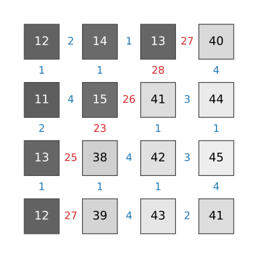
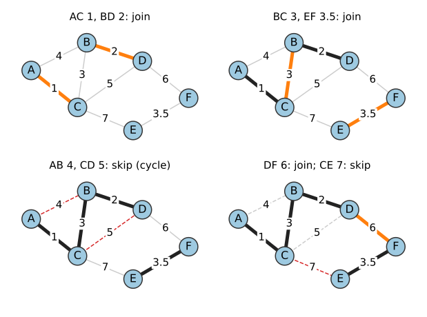
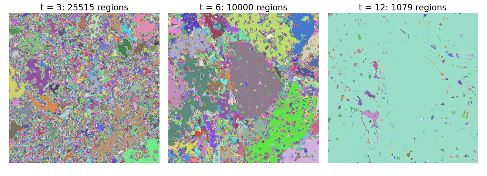
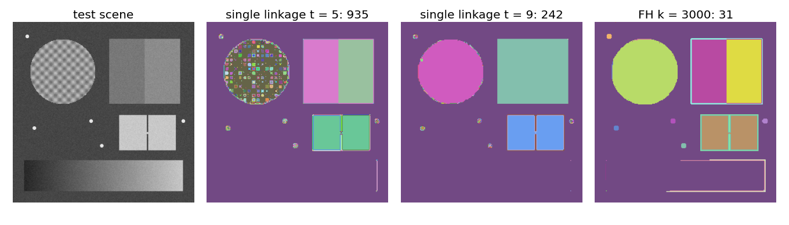
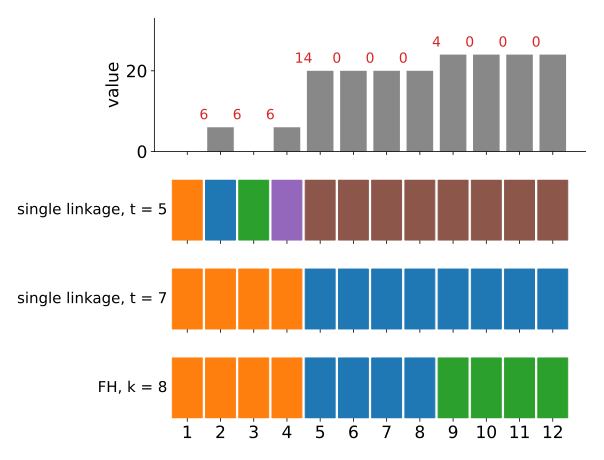
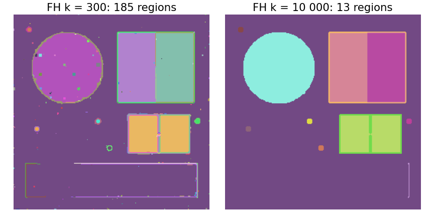
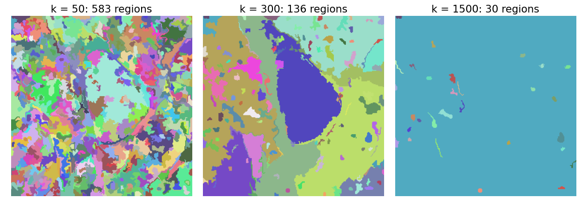
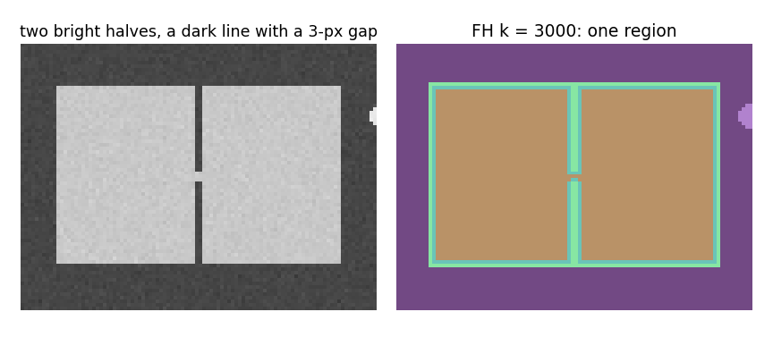

## About this lecture

The [random walker](../random-walker/lec.qmd) and the graph cut need seeds and solve a global problem. Today: **no seeds, no energy**, only a greedy rule on the same pixel graph.

- Edge weights as **dissimilarities**; segmentation as **grouping** across cheap edges.
- The **minimum spanning tree** and **Kruskal's algorithm** (union–find, recalled).
- **Single linkage**: cut the tree at a threshold. Why it **chains**.
- **Felzenszwalb–Huttenlocher (FH)**: an adaptive merge test, $\mathrm{Int}(C) + k/|C|$.
- What $k$ does, what FH guarantees, and where it fails.

*Slides titled **The math** give the formulas and proofs; the ideas are complete without them.*

::: notes
This unit switches from affinities w (large = similar) to dissimilarities d (large = different). The weights are |I_p − I_q| (grey) or a colour distance; after Gaussian pre-smoothing σ ≈ 0.8.
:::

## A switch of view: dissimilarities

:::: {.columns}
::: {.column width="55%"}
Give each edge a **dissimilarity** $d_{pq} = |I_p - I_q|$: small inside a region, large across an edge (a colour distance for colour images).

Segmentation as **grouping**:

- join pixels across **cheap** edges, never across expensive ones;
- no seeds, no energy to minimise: a **greedy rule**, applied to the edges in order of weight.

Right: a $4 \times 4$ image. The blue numbers (≤ 4) lie inside the two regions, the red ones (23 to 28) on the boundary between them.
:::
::: {.column width="45%"}
{fig-alt="A 4 by 4 grid of grey levels: a dark region of values 11 to 15 in the upper left and a bright region of values 38 to 45. Between neighbouring cells the absolute difference is written: small blue numbers 1 to 4 inside the regions, large red numbers 23 to 28 across the boundary, and 1 to 4 again inside the bright region." width="100%"}
:::
::::

## The minimum spanning tree

:::: {.columns}
::: {.column width="40%"}
A **spanning tree** connects all nodes without cycles; the **minimum** spanning tree (MST) has the smallest total weight.

**Kruskal's algorithm**: sort the edges by weight; take each edge unless it closes a cycle.

Right: AC 1, BD 2, BC 3, EF 3.5 are joined; AB 4 and CD 5 would close cycles; DF 6 joins the last two pieces; CE 7 is skipped. Total weight $1 + 2 + 3 + 3.5 + 6 = 15.5$.

**Prim's algorithm** grows one tree instead, always along its cheapest outgoing edge (used in the [watershed unit](../ws-msf/lec.qmd)).
:::
::: {.column width="60%"}
{fig-alt="Four frames of Kruskal's algorithm on six nodes A to F. Frame 1: edges AC (1) and BD (2) are joined (thick). Frame 2: BC (3) and EF (3.5) are joined. Frame 3: AB (4) and CD (5) are skipped (dashed red): they would close a cycle. Frame 4: DF (6) joins the two pieces; CE (7) is skipped." width="100%"}
:::
::::

## Recall: "does it close a cycle?" is union–find

"Would this edge close a cycle?" = "are both ends **already in the same component**?"

- That is exactly the question of [connected-component labelling](../label-connectivity/lec.qmd): **union–find** keeps one representative per component, `find` looks it up, `union` merges two components, in almost constant time.
- Labelling is Kruskal where every edge has weight 0 (foreground neighbours) or ∞ (never joined).
- So Kruskal costs one **sort** of the edges ($m \log m$ for $m$ edges, about 4 per pixel with 8 neighbours) plus a nearly linear pass.

## Try it: Kruskal on a grid

```{=html}
<link rel="stylesheet" href="../demos/dist/demo.css">
<div data-demo="graphgrid" data-preset="kruskal"></div>
<script src="../demos/dist/graphgrid.js"></script>
```

::: notes
Numbers in cells are pixel values, numbers between cells edge weights |Δf|. The list on the right is the edge list in sorted order (current edge highlighted). Step through: joins colour the components; "same component: skip" fades the edge. At the end the thick edges form the MST (19 edges for 20 pixels). Then switch to "single linkage" with t = 3: it stops at the first edge with d ≥ 3. "minimax path": click two cells: the path in the tree and its heaviest edge.
:::

## Single linkage: thresholding the edges

:::: {.columns}
::: {.column width="42%"}
Stop Kruskal at a threshold $t$: join across every edge with $d < t$. The components are the regions.

- Equivalently: build the MST, then **delete its edges heavier than $t$**: the tree falls apart into the regions.
- This **thresholds the edges, not the pixels**: a region can contain very different grey levels, as long as it changes in small steps.

Right: the micrograph, smoothed with σ = 0.8. At $t = 3$ it is shattered into 25 515 regions, at $t = 6$ still 10 000, and at $t = 12$ one region covers almost everything.
:::
::: {.column width="58%"}
{fig-alt="Three single-linkage segmentations of the micrograph in random colours: t = 3 gives 25 515 tiny regions; t = 6 gives 10 000 regions, with the nucleus as one large region but the background in many pieces; t = 12 gives 1079 regions, almost all of the image is one region with small specks." width="100%"}
:::
::::

## The math: the cut property and minimax paths {.math}

- **Cut property.** Split the nodes into two sets $S$, $\bar S$. The cheapest edge $e$ across the split lies in some MST. *Proof*: take an MST $T$ without $e$. Adding $e$ closes a cycle, which crosses the split at least once more, at an edge $e'$ with $d_{e'} \ge d_e$. Swap: $T + e - e'$ is a spanning tree no heavier than $T$. Kruskal only ever adds the cheapest edge between two of its components, so its tree is minimal.
- **Minimax paths.** The unique path between $p$ and $q$ in an MST minimises the **largest** edge weight over all paths from $p$ to $q$. *Proof*: let $e$ be the heaviest edge on the tree path; removing it splits the tree into $S \ni p$ and $\bar S \ni q$, and by the cut property no edge across this split is lighter than $e$. Every path from $p$ to $q$ crosses the split, so its largest edge is at least $d_e$.
- **Single linkage.** $p$ and $q$ are in the same component of $\{d < t\}$ iff their minimax distance is $< t$, iff the MST path between them has no edge $\ge t$: the three definitions agree.

## Chaining: the weakest link decides

:::: {.columns}
::: {.column width="44%"}
Single linkage joins two regions as soon as **one** chain of small steps connects them:

- a **ramp** (gradual change) links its dark and bright ends;
- one low-contrast spot in a boundary is enough to join the regions on both sides.

And one global $t$ cannot serve all regions. Right, with σ = 0.8:

- $t = 5$: the faint step between the two squares (120 / 140) is kept, but the **textured disc** shatters (935 regions in all);
- $t = 9$: the disc holds together, but the two squares **merge**, and the ramp at the bottom has merged with the background at $t = 5$ already.
:::
::: {.column width="56%"}
{fig-alt="Four panels of a synthetic test scene: a textured disc, two flat squares with a faint step between them, two bright halves separated by a dark line with a gap, small bright spots and a ramp. Single linkage at t = 5: the disc is shattered into many small regions, the two squares are separate. At t = 9: the disc is one region, but the two squares form one region. FH with k = 3000: the disc is one region and the squares are separate (31 regions)." width="100%"}
:::
::::

## Felzenszwalb–Huttenlocher: an adaptive test

Kruskal with a different merge test (Felzenszwalb & Huttenlocher, 2004):

- The **internal difference** $\mathrm{Int}(C)$ of a component is the heaviest edge of its spanning tree: how much variation it already tolerates inside.
- Merge $C_1$ and $C_2$ across an edge of weight $d$ only if
$$d \le \min\big(\mathrm{Int}(C_1) + k/|C_1|,\ \mathrm{Int}(C_2) + k/|C_2|\big).$$
- A **textured** region has a large $\mathrm{Int}$ and accepts large steps; a **flat** region only small ones. The term $k/|C|$ lets **small** components merge easily (a single pixel has $\mathrm{Int} = 0$).

Right panel of the previous figure: with $k = 3000$, the disc is one region **and** the squares stay separate.

## FH by hand: texture next to a faint step

:::: {.columns}
::: {.column width="48%"}
$[0, 6, 0, 6, 20, 20, 20, 20, 24, 24, 24, 24]$, $k = 8$. Edges $6, 6, 6, 14, 0, 0, 0, 4, 0, 0, 0$.

1. The six **0-edges** first: two flat components of 4 pixels, $\mathrm{Int} = 0$, threshold $0 + 8/4 = 2$.
2. The **4-edge**: $4 > \min(2, 2)$: **keep apart**.
3. The **6-edges**: singletons have threshold 8: join; $\{1, 2\}$ now has $6 + 8/2 = 10$, $\{1,2,3\}$ has $6 + 8/3 = 8.67$: all three join.
4. The **14-edge**: $\min(6 + 8/4, 0 + 8/4) = 2$: keep apart.

Three regions. Single linkage: $t \le 6$ breaks the texture, $t > 6$ merges across the 4.
:::
::: {.column width="52%"}
{fig-alt="Bar chart of the twelve values 0, 6, 0, 6, 20, 20, 20, 20, 24, 24, 24, 24 with the edge differences 6, 6, 6, 14, 0, 0, 0, 4, 0, 0, 0 in red. Below, three rows of coloured boxes: single linkage at t = 5 gives five regions (the four texture pixels separate, both flat parts together); at t = 7 two regions (texture, and both flat parts together); FH with k = 8 gives three regions: texture, first flat part, second flat part." width="100%"}
:::
::::

## Try it: FH step by step

```{=html}
<link rel="stylesheet" href="../demos/dist/demo.css">
<div data-demo="graphgrid" data-preset="fh1d"></div>
<script src="../demos/dist/graphgrid.js"></script>
```

::: notes
The 1D example of the slide (cells a–l). Step: the readout shows the two thresholds Int + k/|C| for the current edge and the verdict. Note the order: all 0-edges first, then the 4-edge (kept apart), then the 6-edges, then 14. Change k with the slider: at k = 16 the flat parts have threshold 4 and the 4-edge merges (at exactly the threshold); at k = 4 the texture breaks into pieces. Then the 2D presets "texture next to a faint step" (single linkage) and "the same with FH".
:::

## The math: FH's guarantees {.math}

Define $\mathrm{MInt}(C_1, C_2) = \min(\mathrm{Int}(C_1) + \tau(C_1), \mathrm{Int}(C_2) + \tau(C_2))$ with $\tau(C) = k/|C|$, and the **boundary predicate** $D(C_1, C_2)$ = "the cheapest edge between $C_1$ and $C_2$ is heavier than $\mathrm{MInt}$": evidence for a boundary.

- **Not too fine** (Thm. 1): for every pair of neighbouring regions of the result, $D$ is true. *Proof*: let $e$ be the cheapest edge between final regions $A$ and $B$. When $e$ was processed it joined parts $A' \subseteq A$, $B' \subseteq B$ and was rejected, say $d_e > \mathrm{Int}(A') + \tau(A')$. Every later edge has $d \ge d_e$, above $A'$'s threshold, so $A'$ never merges again: $A' = A$. Hence $d_e > \mathrm{Int}(A) + \tau(A) \ge \mathrm{MInt}(A, B)$.
- **Not too coarse** (Thm. 2): no region could be split into two parts that should have stayed apart: every merge happened through the cheapest edge between two components while the test held.
- **Cost**: sort ($m\log m$) + union–find (nearly linear, [labelling unit](../label-connectivity/lec.qmd)). Sorting once and re-running the linear pass for each $k$ makes $k$ interactive.

## What $k$ does: scale, not size

:::: {.columns}
::: {.column width="45%"}
- Larger $k$ → small components merge more easily → **larger regions**. $k$ sets a **scale**: roughly, a region with $|C|$ pixels needs a boundary contrast above $k/|C|$ to stay separate.
- It is **not a minimum size**: a small region with a strong edge survives any $k$, because the test needs **both** thresholds to accept the merge. Right: the five bright spots (radius 2.5, contrast 160) survive at $k = 10\,000$.
- For a real minimum size, a separate **clean-up** pass merges every component smaller than it with a neighbour, cheapest edge first.
:::
::: {.column width="55%"}
{fig-alt="FH on the test scene. k = 300: 185 regions, the textured disc in several parts. k = 10 000: 13 regions; the disc, the squares, the two halves and the background are large regions, and the five small bright spots are still separate regions." width="100%"}
:::
::::

## Pre-smoothing and colour

- **Smooth first**: a Gaussian with σ ≈ 0.8 px (recall the [Gaussian derivatives unit](../canny/lec.qmd)) removes pixel noise, which would otherwise create many tiny regions. Too much smoothing blurs boundaries into ramps of small steps, which single linkage and FH then cross.
- Smoothing turns each sharp boundary into one- or two-pixel ramps: FH often keeps these as **thin boundary regions** (visible in the figures), which a minimum-size pass removes.
- **Colour**: use the [CIELAB distance](../colour-perceptual/lec.qmd) $\Delta E$ between neighbours as $d_{pq}$, so that "small" means "looks similar".

## FH on the micrograph

{fig-alt="FH segmentations of the micrograph in random colours with a minimum size of 20 pixels: k = 50 gives 583 irregular regions; k = 300 gives 136, with the nucleus as one region and the cytoplasm in a few large regions; k = 1500 gives 30 regions, almost everything one region except small dark specks." width="88%" fig-align="center" .nostretch}

$k = 300$ finds the nucleus in one piece; the regions are **irregular**, with stringy borders that follow the texture. At $k = 1500$ the nucleus has merged with its surroundings through a weak part of its envelope.

## Try it: FH and single linkage on an image

```{=html}
<link rel="stylesheet" href="../demos/dist/demo.css">
<div data-demo="fhseg" data-preset="fh"></div>
<script src="../demos/dist/fhseg.js"></script>
```

::: notes
256 × 256; edges sorted once per image and σ, the merge pass re-runs live on k. Tour: "single linkage chains through the ramp" (the ramp joins the background, click it). "texture or faint step, not both": raise t from 5 to 9. "FH: both" (k = 3000; click the disc: Int ≈ 20, threshold Int + k/|C|). "k sets scale, not size" (k = 10 000: spots survive). "minimum size cleanup". "leak through a narrow gap": the two halves are one region. "micrograph" and "colour scene" (Lab distance).
:::

## Failure modes

:::: {.columns}
::: {.column width="48%"}
- **Leaks remain**: the test still uses the **cheapest** edge between two components. A narrow gap in a dark line joins the two bright halves into one region (right), whatever $k$.
- **Irregular, stringy regions** that follow noise and texture.
- **Texture boundaries** weaker than the texture itself are not found: nothing based on neighbouring differences can find them (that needs features: [pixel classification](../pixelclass/lec.qmd)).
- Sensitive to $k$ and to noise; the result jumps when one critical edge changes order.
:::
::: {.column width="52%"}
{fig-alt="Left: a crop of the test scene with two bright rectangles side by side, separated by a dark vertical line that has a 3-pixel gap in the middle. Right: FH with k = 3000 labels both rectangles as one region (same colour); the dark line and thin boundary regions are separate." width="100%"}
:::
::::

## Where FH is used

- Fast **over-segmentation** into irregular **superpixels**: a few hundred regions that respect most boundaries, in a few tens of milliseconds ([superpixels unit](../superpixels/lec.qmd) compares it with SLIC).
- The first step of **object-proposal** pipelines: group FH regions hierarchically into candidate objects.
- The building block of **hierarchies**: Kruskal's merge order *is* a tree of segmentations ([merge-trees unit](../merge-trees/lec.qmd)).

Image libraries ship it under the authors' name ("Felzenszwalb segmentation").

## Summary

- Dissimilarities $d_{pq}$; **Kruskal** builds the minimum spanning tree by sorting edges and joining components (**union–find**).
- **Single linkage** = components of $\{d < t\}$ = MST minus its edges $\ge t$; two pixels are joined iff their **minimax** distance is below $t$.
- It **chains** through the weakest link, and one $t$ cannot fit textured and flat regions at once.
- **FH** merges only if $d \le \mathrm{Int}(C) + k/|C|$ for both components: texture holds together, faint steps between flat regions survive; $k$ sets a **scale**, not a minimum size.
- Fast (a sort), but leaks through narrow gaps and gives irregular regions.

## Where this leads

- [Watershed as a minimum spanning forest](../ws-msf/lec.qmd): seeds plus Prim's algorithm = the watershed; minimax paths explain its leaks.
- [Hierarchical segmentation](../merge-trees/lec.qmd): keep the whole merge order instead of one threshold.
- [Superpixels](../superpixels/lec.qmd): FH as one way to get a few hundred regions.
