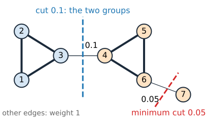
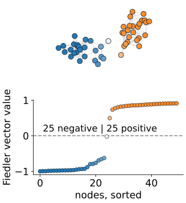
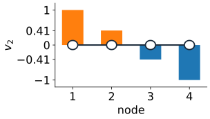
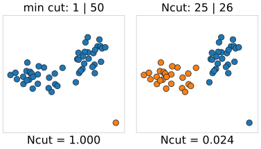
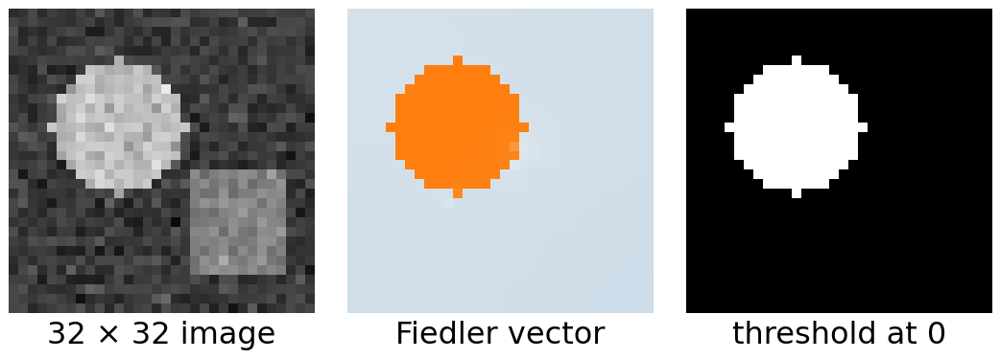

## About this lecture

Graph cuts needed **seeds** (or a fixed intensity model). Can we split an image into two coherent parts **without** telling the computer where they are?

- Without seeds, the minimum cut cuts off a **single node**: we need **balance**.
- The **graph Laplacian** $L = D - W$ turns cuts into quadratic forms.
- Relaxing to real numbers gives an **eigenvector** problem: the **Fiedler vector**.
- **Normalized cuts** (Shi & Malik, 2000): balance by volume, a generalized eigenproblem.
- Your linear algebra at work: symmetric matrices, Rayleigh quotients, eigenvectors.

Slides titled **The math** give the formulas and proofs; the ideas are complete without them.

## Without seeds, the minimum cut is useless

:::: {.columns}
::: {.column width="55%"}
A weighted undirected graph: nodes = pixels (or points), $w_{pq} \ge 0$ = **affinity**, large when $p$ and $q$ look alike and are close. Split the nodes into $A$ and $B$:

$$\text{cut}(A, B) = \sum_{p \in A,\; q \in B} w_{pq}.$$

- The smallest cut over all splits is almost always **one node** against the rest: a node has few edges, a real boundary many.
- Example: two triangles joined by an edge of weight 0.1, plus a pendant node hanging on by 0.05. The minimum cut (0.05) cuts off the pendant node, not the two triangles.

We want a cut that is small **relative to the size** of the parts.
:::
::: {.column width="45%"}
{width="100%"}
:::
::::

## The idea: a smooth vector on the graph

:::: {.columns}
::: {.column width="55%"}
Give every node a number $x_p$, and ask for numbers that **change as little as possible along strong edges**, without all being equal.

- Inside a tightly connected group, the numbers must stay nearly the same.
- Between two groups joined only by weak edges, they are free to jump.
- So the smoothest non-constant assignment is roughly **"+ on one group, − on the other"**: its **sign** splits the graph where the edges are weak.
- This assignment is an **eigenvector** of a matrix built from the graph, the **Fiedler vector**. Computing it is linear algebra, not a search over $2^n$ splits.
- Normalized cuts add one twist: **balance**, so that cutting off a single weakly attached node does not count as a good split.
:::
::: {.column width="45%"}
{width="80%" fig-align="center"}
:::
::::

## The math: the graph Laplacian {.math}

$W$ = the symmetric matrix of weights, $D = \operatorname{diag}(d_p)$ with degrees $d_p = \sum_q w_{pq}$, and

$$L = D - W, \qquad \mathbf{x}^\top L \mathbf{x} = \tfrac12 \sum_{p,q} w_{pq}\,(x_p - x_q)^2 = \sum_{\text{edges}} w_{pq}\,(x_p - x_q)^2.$$

- $L$ is symmetric and **positive semidefinite**; its eigenvalues are $0 = \mu_1 \le \mu_2 \le \dots$
- $L\mathbf{1} = \mathbf{0}$: the constant vector is the eigenvector for $\mu_1 = 0$. The number of zero eigenvalues equals the number of connected components.
- $\mathbf{x}^\top L\mathbf{x}$ is small when $\mathbf{x}$ changes little along heavy edges: a "smoothness" of $\mathbf{x}$ on the graph.

## The math: cuts as quadratic forms {.math}

Encode a split by $x_p = +1$ for $p \in A$ and $x_p = -1$ for $p \in B$. An edge inside a part contributes $(x_p - x_q)^2 = 0$, an edge across contributes $2^2 = 4$:

$$\mathbf{x}^\top L \mathbf{x} = 4\,\text{cut}(A, B).$$

- Minimising over $\mathbf{x} \in \{\pm1\}^n$ is again a hard combinatorial problem, and its minimum is the useless one ($\mathbf{x}$ constant, cut 0).
- **Relax**: allow any real $\mathbf{x}$, but ask for $\mathbf{x} \perp \mathbf{1}$ (both parts present: positive and negative entries) and $\|\mathbf{x}\| = 1$.

## The math: the Fiedler vector {.math}

$$\min_{\mathbf{x} \perp \mathbf{1},\ \|\mathbf{x}\| = 1} \mathbf{x}^\top L \mathbf{x} = \mu_2, \quad\text{attained at the eigenvector } \mathbf{v}_2.$$

- This is the Rayleigh quotient: on the subspace orthogonal to the first eigenvector, the minimum is the next eigenvalue.
- $\mathbf{v}_2$ is the **Fiedler vector**; $\mu_2$ the **algebraic connectivity** (0 if the graph falls apart).
- Split by the **sign** of $\mathbf{v}_2$ (or another threshold).

:::: {.columns}
::: {.column width="68%"}
Path of 4 nodes, weights 1: $\mu = 0,\ 2 - \sqrt2,\ 2,\ 2 + \sqrt2$, and $\mathbf{v}_2 \propto (1,\ \sqrt2 - 1,\ 1 - \sqrt2,\ -1)$: positive on the first two nodes, negative on the last two. The sign splits the path in the middle.
:::
::: {.column width="32%"}
{width="100%"}
:::
::::

## Normalized cut

:::: {.columns}
::: {.column width="55%"}
Balance by **volume**, $\text{vol}(A) = \sum_{p \in A} d_p$ (the total weight attached to $A$):

$$\text{Ncut}(A, B) = \frac{\text{cut}(A, B)}{\text{vol}(A)} + \frac{\text{cut}(A, B)}{\text{vol}(B)}.$$

- Cutting off one weakly attached node: cut $\approx$ its whole volume, so Ncut $\approx 1$. Bad.
- Two big coherent groups joined by weak edges: small cut, large volumes, Ncut $\approx 0$. Good.
- The triangles example: cutting off the pendant node gives Ncut $= 1.004$; separating the triangles gives $0.1/6.1 + 0.1/6.2 = 0.033$.

Minimising Ncut exactly is NP-hard. Relax it the same way.
:::
::: {.column width="45%"}
{width="100%"}
:::
::::

## The math: a generalized eigenproblem {.math}

Shi and Malik (2000) showed that relaxing Ncut gives

$$L\mathbf{x} = \mu\, D\mathbf{x}, \qquad \text{take the eigenvector of the second-smallest } \mu.$$

- With $\mathbf{y} = D^{1/2}\mathbf{x}$: $\;D^{-1/2} L D^{-1/2}\,\mathbf{y} = \mu\,\mathbf{y}$, an ordinary symmetric eigenproblem (the **normalized Laplacian**).
- The trivial solution is again $\mathbf{x} = \mathbf{1}$, $\mu = 0$. Its eigenvalues lie in $[0, 2]$.
- The constraint becomes $\mathbf{x}^\top D \mathbf{1} = 0$: the vector is balanced **by volume**, so nodes with little weight count little.
- Path of 4: $D = \operatorname{diag}(1, 2, 2, 1)$; $\mathbf{x} = (1, \tfrac12, -\tfrac12, -1)$ with $\mu = \tfrac12$.

## From eigenvector to segmentation

1. Build the graph: nodes and affinities $w_{pq}$.
2. Compute the second eigenvector of $L\mathbf{x} = \mu D\mathbf{x}$.
3. **Threshold** it: at 0, or try every split point along the sorted vector and keep the one with the smallest Ncut (a **sweep**).
4. For more than two segments, split each part again, or use several eigenvectors.

{width="56%" fig-align="center"}

For images, Shi & Malik use $w_{pq} = \exp\!\big(-\tfrac{(I_p - I_q)^2}{2\sigma_I^2}\big)\exp\!\big(-\tfrac{\|\mathbf{p} - \mathbf{q}\|^2}{2\sigma_X^2}\big)$ for pixels within a few pixels of each other. $W$ is huge but **sparse**: iterative eigensolvers (Lanczos) need only products $W\mathbf{x}$.

## Try it: Fiedler vectors and normalized cuts

```{=html}
<link rel="stylesheet" href="../demos/dist/demo.css">
<div data-demo="ncut" data-preset="two"></div>
<script src="../demos/dist/ncut.js"></script>
```

::: notes
Left: points coloured by the Fiedler vector (blue negative, orange positive), with the edges cut by the split in red. Top plot: the vector sorted, with the threshold; bottom: Ncut (purple) and the cut (green, scaled) for every split along the sorted vector. Tour: two blobs, split 25 | 25, Ncut 0.0245. Tick "show the minimum cut": same here. Raise σ to 0.15: the minimum cut now cuts off one point, Ncut still splits the blobs. "Blobs + outlier": normalized splits the blobs; untick "normalized": the unnormalized Fiedler vector puts the outlier alone at +1 and everything else near 0. "Two rings": separated at σ = 0.05, cut in half at σ = 0.12. "Image: shapes": the disk; σ = 60 gives a geometric split. Drag points to see the vector change.
:::

## Graph cuts versus normalized cuts

| | graph cuts (s–t) | normalized cuts |
|---|---|---|
| input | seeds or an intensity model | only affinities |
| what is minimised | $E(L)$, data + boundary | Ncut, balanced |
| solution | **exact**, by max-flow | **approximate**: relaxed, then thresholded |
| scope | local decisions, user steers | global structure of the whole image |
| typical use | interactive segmentation | unsupervised grouping, superpixels, clustering |

Both see the image as a graph with affinities; they differ in what makes a "good" cut.

## Summary

- Without seeds, the minimum cut isolates single nodes: we need **balance**.
- Laplacian $L = D - W$: $\mathbf{x}^\top L\mathbf{x} = \sum w_{pq}(x_p - x_q)^2$; for $\pm1$ vectors it is $4 \times$ the cut.
- Relaxation: the **Fiedler vector**, second eigenvector of $L$; threshold it to split.
- **Normalized cut**: cut/vol(A) + cut/vol(B); relaxed to $L\mathbf{x} = \mu D\mathbf{x}$.
- Spectral methods are approximate but global and seed-free; graph cuts are exact but need seeds.
