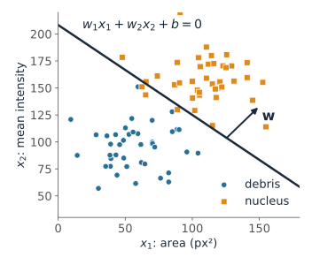
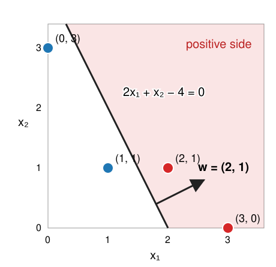
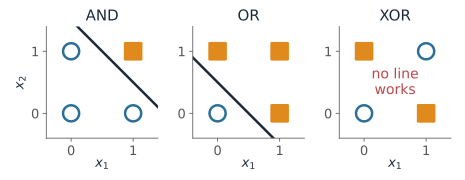
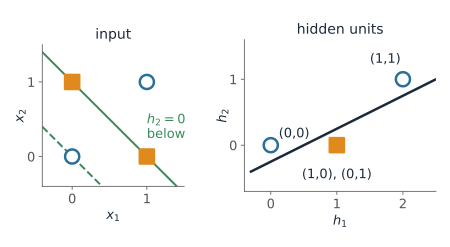
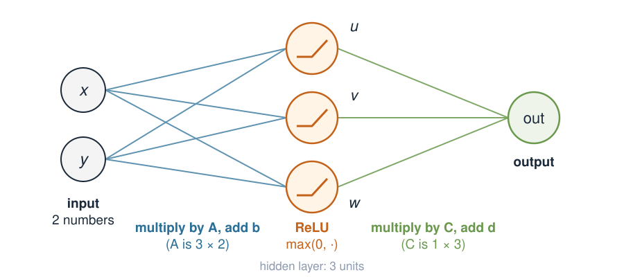
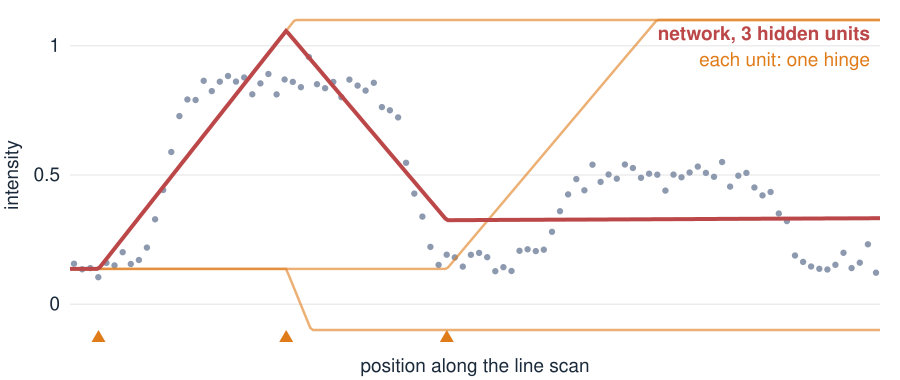
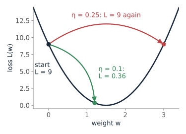
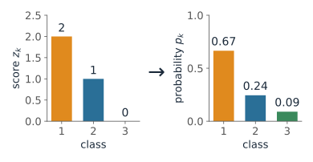
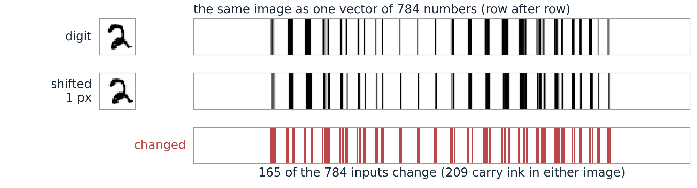

## About this lecture

A **neural network** is a function with many adjustable numbers, fitted to examples. This unit opens the neural-networks day with the smallest networks we can draw.

- One **neuron** = a weighted sum, then a bend: it draws a **line** through feature space. It can do AND and OR, but not **XOR**.
- A network is **matrix × vector, then a bend**, repeated. You have done the matrix part since the first unit.
- Without the bend, any number of layers **collapses to one matrix**.
- With the bend, simple **hinges add up to curves**, and lines add up to any boundary.
- **Many classes**: one output per class, turned into probabilities by **softmax**.
- **Training** = walking downhill on an error, one small step at a time.

*Slides titled **The math** give the formulas and proofs; the ideas are complete without them.*

::: notes
No machine learning is assumed. The aim is to demystify the words network, layer, hidden unit, ReLU, weight, training, learning rate, so that the rest of the neural-networks day (and later the autoencoder units) can use them freely. Later units of the day write the layers as $W^{(1)}, W^{(2)}$: here $A = W^{(1)}$, $C = W^{(2)}$. Adapted from "Beyond linear models" in the 3MB00A course. Keep it light: the picture and the demo carry the unit, the algebra is a few lines.
:::

## Recall: a classifier draws a line

:::: {.columns}
::: {.column width="56%"}
[Thresholding](../histogram/lec.qmd) (day 12) decides "nucleus if intensity $> t$": a cut on **one** measurement. [Day 33](../dtree/lec.qmd) put objects as points in a **feature space** and let a classifier carve it up.

- Two measurements per object (say area and mean intensity): each object is a point in the plane.
- The simplest rule that uses both: a **straight line**, $w_1x_1 + w_2x_2 + b > 0$ means "nucleus".
- The numbers $w_1, w_2, b$ are what we will **learn** from examples.
:::
::: {.column width="44%"}
{fig-alt="Scatter plot of 80 synthetic objects, area on the horizontal axis and mean intensity on the vertical axis: small dim debris (blue circles) at the lower left, large bright nuclei (orange squares) at the upper right, separated by a straight line; an arrow w points across the line towards the nuclei." width="100%"}
:::
::::

::: notes
One slide of recall from thresholding and from the random-forest day, which owns feature space and the train/test vocabulary. A forest carves feature space into boxes; a neuron cuts it with a line; a network combines many lines.
:::

## One neuron

:::: {.columns}
::: {.column width="62%"}
A **neuron** adds its inputs with **weights**, adds a **bias**, then bends the result with an **activation** $\varphi$:

$$\text{out} = \varphi(w_1x_1 + w_2x_2 + b)$$

- **Step** $\varphi$: a hard yes/no, the **perceptron** (1958).
- **Sigmoid** $\varphi(s) = 1/(1 + e^{-s})$: a **probability** between 0 and 1.
- **ReLU** $\varphi(s) = \max(0, s)$: the workhorse of today's networks.

The weights point across the line, to the positive side; the bias moves the line.
:::
::: {.column width="38%"}
{width="100%"}

$\mathbf w = (2, 1)$, $b = -4$: $(2, 1)$ and $(3, 0)$ are positive.
:::
::::

::: notes
Compute two points with the class: (1, 1) gives 2 + 1 − 4 = −1, negative; (2, 1) gives +1, positive. With the sigmoid the outputs are 0.27 and 0.73: a neuron with a sigmoid is exactly logistic regression. Doubling w and b keeps the line but makes the probabilities sharper.
:::

## The math: a neuron is a half-plane {.math}

$$\text{out} = \varphi(\mathbf w^\top\mathbf x + b)$$

- The decision boundary $\mathbf w^\top\mathbf x + b = 0$ is a line (a hyperplane in $\mathbb R^n$) with **normal** $\mathbf w$.
- Its distance from the origin is $|b|/\|\mathbf w\|$; the signed distance of a point is $(\mathbf w^\top\mathbf x + b)/\|\mathbf w\|$.
- With the sigmoid, the output is an S-shaped function of that signed distance times $\|\mathbf w\|$: larger $\|\mathbf w\|$, steeper transition, same line.
- Example: $\mathbf w = (2, 1)$, $b = -4$: distance $4/\sqrt5 = 1.79$.

## AND, OR, but not XOR

Inputs $x_1, x_2 \in \{0, 1\}$, step activation (1 if the sum $> 0$):

| | AND | OR | XOR |
|---|---|---|---|
| weights, bias | $1, 1, -1.5$ | $1, 1, -0.5$ | none exists |
| corners that are 1 | $(1,1)$ | all but $(0,0)$ | $(1,0)$ and $(0,1)$ |

::::: {.columns}
:::: {.column width="46%"}
- XOR wants $(1,0)$ and $(0,1)$ on one side, $(0,0)$ and $(1,1)$ on the other: **no single line** does that.
- This observation (Minsky and Papert, 1969) stalled neural networks for a decade. The answer: **more than one neuron**.
::::
:::: {.column width="54%"}
{fig-alt="Three unit squares with the four corners marked, output 1 as orange squares and output 0 as blue circles. AND: only (1,1) is orange, a line cuts it off. OR: all but (0,0) are orange, a line cuts off (0,0). XOR: (1,0) and (0,1) are orange, the other two blue, and the text says no line works." width="100%"}
::::
:::::

## Two hidden units solve XOR

$h_1 = \text{ReLU}(x_1 + x_2)$, $h_2 = \text{ReLU}(x_1 + x_2 - 1)$, $\ \text{out} = h_1 - 2h_2$:

:::: {.columns}
::: {.column width="50%"}
| $(x_1, x_2)$ | $(0,0)$ | $(1,0)$ | $(0,1)$ | $(1,1)$ |
|---|---|---|---|---|
| $h_1, h_2$ | $0, 0$ | $1, 0$ | $1, 0$ | $2, 1$ |
| out | 0 | **1** | **1** | 0 |

- Each hidden unit is a neuron with its own line (green); the output **combines** them.
- The hidden layer has turned the four corners into points that **one** line can separate (right).
:::
::: {.column width="50%"}
{fig-alt="Left: the four XOR corners in the input plane with two parallel green lines, x1 + x2 = 0 (dashed, through (0,0)) and x1 + x2 = 1 (through (1,0) and (0,1)). Right: the same points in the plane of the hidden units: (0,0) stays at (0,0), (1,0) and (0,1) both land on (1,0), (1,1) goes to (2,1); one straight line, h1 − 2 h2 = 0.5, separates the orange point (1,0) from the two blue ones." width="100%"}
:::
::::

::: notes
Do the table on the board. In the playground, preset "2 hidden units solve XOR" shows the two hidden units as two half-planes (thumbnails) and the output region as the band between two lines.
:::

## A layer: matrix, then bend

{width="62%" fig-align="center"}

$$\mathbf h = \text{ReLU}(A\mathbf x + \mathbf b), \qquad \text{out} = C\mathbf h + d, \qquad \text{ReLU}(s) = \max(0, s)$$

- Each line in the picture is **one number** of $A$ or $C$ (a **weight**).
- The bend (ReLU) acts on **each entry** separately: negatives become 0.
- The entries of $\mathbf h$ are the **hidden units**: every row of $A$ is one neuron.
- Later units write $W^{(1)}$ for $A$ and $W^{(2)}$ for $C$: layer $l$ computes $\mathbf a^{(l)} = \varphi(W^{(l)}\mathbf a^{(l-1)} + \mathbf b^{(l)})$.

::: notes
A layer is the matrix–vector product of the first unit plus a shift. The only new thing is the ReLU, applied entry by entry. Older networks used an S-shaped curve instead of ReLU; the choice matters much less than having a bend at all. For images, x is the whole image as one long vector: 784 numbers for a 28 × 28 image.
:::

## One input through the network, by hand {.smaller}

$A = \begin{pmatrix} 1 & 1 \\ 1 & -1 \\ -1 & 2 \end{pmatrix}$, $\mathbf b = \mathbf 0$, $C = \begin{pmatrix} 1 & 2 & 1 \end{pmatrix}$, $d = 0$, input $\mathbf x = (1, 2)$.

1. **Matrix**: $A\mathbf x = (1 + 2,\ 1 - 2,\ -1 + 4) = (3,\ -1,\ 3)$
2. **Bend**: $\text{ReLU} \to (3,\ 0,\ 3)$
3. **Matrix**: $\text{out} = 1\cdot 3 + 2\cdot 0 + 1\cdot 3 = 6$

Without the bend: $1\cdot 3 + 2\cdot(-1) + 1\cdot 3 = 4$. The bend changed the answer.

::: notes
Do this on the board. Every step is a dot product except step 2, which only clips negatives.
:::

## Without the bend, layers collapse

Applying $A$ and then $C$ is applying the single matrix $CA$:

$$C(A\mathbf x) = (CA)\,\mathbf x, \qquad CA = \begin{pmatrix} 1 & 2 & 1 \end{pmatrix}\begin{pmatrix} 1 & 1 \\ 1 & -1 \\ -1 & 2 \end{pmatrix} = \begin{pmatrix} 2 & 1 \end{pmatrix}$$

Check: $(2, 1)\cdot(1, 2) = 4$, the "no bend" answer.

- 2 or 100 layers with no bend in between are **one matrix**: a straight-line (linear) map.
- The bend between the matrices is what lets a network draw **curves**.

::: notes
Composition of linear maps is matrix multiplication, as in Images as arrays & geometric transforms. With shifts, C(Ax + b) + d = (CA)x + (Cb + d): still a plane. We will meet this again: a linear autoencoder is PCA, and only the bend makes an autoencoder more than PCA.
:::

## Hinges add up to curves {.smaller}

{width="78%" fig-align="center"}

A line scan across two nuclei. One input (position), three hidden units, one output.

- Each hidden unit is a **hinge**: flat, then a straight rise (or the reverse), at its own position.
- The output adds the hinges with weights: a **bent line** through the data.
- More units → more hinges → any curve, as closely as we like.

::: notes
The figure is made with the same code as the demo (3 units after 3000 training steps). The orange curves are each hidden unit's contribution (its ReLU times its output weight, plus the output shift); the triangles mark where each hinge bends. Ask: how many hinges would you need for the two plateaus and four edges? Roughly two per edge, so about 8; the demo shows 12 gets close to the noise level.
:::

## Training: walk downhill on the error

:::: {.columns}
::: {.column width="57%"}
How do we find the weights? Measure how wrong the network is (the **loss**, e.g. the mean squared error over the data), then nudge every weight a little in the direction that lowers it. Repeat thousands of times.

- Picture the loss as a landscape over the weights: training **walks downhill**.
- The **learning rate** is the step length: too small takes forever, too large **overshoots** to the other side of the valley.
- The walk can stop in a dip that is not the deepest one: two trainings from different starts can give different networks.
:::
::: {.column width="43%"}
{fig-alt="The parabola L(w) = (3 − 2w) squared for one weight, starting at w = 0 with loss 9. A green arrow (learning rate 0.1) jumps to w = 1.2 near the bottom, loss 0.36; a red arrow (learning rate 0.25) jumps over the valley to w = 3, where the loss is 9 again." width="100%"}
:::
::::

::: notes
Concept layer: students must take away "downhill on the error, step size matters, the result depends on the start". The next slide is the math layer and can be skipped.
:::

## The math: one gradient step {.smaller .math}

Step against the gradient: $\mathbf w \leftarrow \mathbf w - \eta\, \nabla_{\mathbf w} L$.

- One weight, $L(w) = (y - wx)^2$ with $x = 2$, $y = 3$, start $w = 0$:
  $L'(w) = -2x(y - wx)$, so $L'(0) = -12$. With $\eta = 0.1$: $w \to 1.2$, and $L$ drops from $9$ to $0.36$.
- Distance to the best $w = 1.5$ after one step: $w_\text{new} - 1.5 = (1 - 8\eta)(w - 1.5)$. Converges for $0 < \eta < 0.25$; $\eta = 0.5$ makes $L$ grow to $81$.
- For a network, $\nabla L$ comes from the **chain rule** applied layer by layer, from the output back to the input (**backpropagation**).

::: notes
Show the parabola L(w) and the step on the board. The exercise does the four step sizes 0.1, 0.125, 0.25, 0.5 (new w 1.2, 1.5, 3, 6; loss 0.36, 0, 9, 81). In the demo the steps use Adam, a variant that adapts the step length per weight; the idea is the same.
:::

## Try it: a network classifies points {.smaller}

```{=html}
<link rel="stylesheet" href="../demos/dist/demo.css">
<div data-demo="nnplayground" data-preset="xor2"></div>
<script src="../demos/dist/nnplayground.js"></script>
```

::: notes
Tour: "one neuron, by hand": drag the handle and the tip, read the loss (lower when the line separates the blobs and w is long). "one neuron on XOR fails": play, the loss stays at 0.69 (= ln 2, a coin toss), accuracy 50 %. "2 hidden units solve XOR": play, the two thumbnails become two half-planes, loss below 0.01 after a few hundred steps; "new start" with other seeds often gets stuck at 75 %: the start matters. "no nonlinearity: still a line": 8 units, no bend, the circle cannot be separated (74 %). "circle: 3 ReLU units": a triangle-like region. "spiral needs depth": 8 + 8 units. "3 classes with softmax".
:::

## Many classes: softmax

:::: {.columns}
::: {.column width="52%"}
One output **score** $z_k$ per class; turn the scores into probabilities:

$$p_k = \frac{e^{z_k}}{\sum_j e^{z_j}}$$

- All $p_k$ are positive and sum to 1; the largest score gets the largest probability.
- Scores $(2, 1, 0)$ → probabilities $(0.67, 0.24, 0.09)$. The predicted class is the largest.
- Two classes with softmax are the same as one sigmoid output.
:::
::: {.column width="48%"}
{fig-alt="Two bar charts. Left: scores 2, 1 and 0 for three classes. Right: after softmax, probabilities 0.67, 0.24 and 0.09, which sum to 1." width="100%"}
:::
::::

## The math: softmax {.math}

- Adding a constant to all scores does not change $p$: $e^{z_k + c}/\sum_j e^{z_j + c} = e^{z_k}/\sum_j e^{z_j}$. So $(102, 101, 100)$ gives the same $(0.665, 0.245, 0.090)$, and computers subtract $\max_k z_k$ first to avoid overflow.
- Two classes: $p_1 = e^{z_1}/(e^{z_0} + e^{z_1}) = 1/(1 + e^{-(z_1 - z_0)})$, the sigmoid of the score difference.
- **Universal approximation** (Cybenko 1989 for sigmoids; the same holds for ReLU): one hidden layer with enough units approximates any continuous function on a bounded region as closely as we like. It says nothing about **how many** units, or whether training **finds** them.

## Try it: fit a line scan

```{=html}
<link rel="stylesheet" href="../demos/dist/demo.css">
<div data-demo="nnfit" data-h="3"></div>
<script src="../demos/dist/nnfit.js"></script>
```

::: notes
Press "train 500 steps" a few times: the hinges move to the edges of the nuclei and the loss falls. Presets: "one hinge" can only make one bend (loss 0.059); "3 hinges" 0.020; "12 hinges" 0.0019, close to the noise variance 0.0009. "no bend": 12 units, but the fit stays a straight line (0.065, barely better than the flat mean line, 0.073). "learning rate too large": the loss jumps around and then every unit ends up flat (all hinges off the data): the fit is the flat mean line, loss 0.073. That is a "dead" network.
:::

## Images are long vectors

A $28 \times 28$ image is a vector in $\mathbb R^{784}$. A layer from the image to 100 hidden units has

$$784 \times 100 + 100 = 78{,}500 \text{ numbers.}$$

- Image networks easily have hundreds of thousands of weights. Training adjusts all of them at once, with the same downhill steps.
- Many weights need **many training images**, or the network memorises instead of learning.
- Such a layer has no idea that neighbouring pixels belong together: **shift** the digit by one pixel and most of the inputs that carry ink change. The [convolutional networks](../cnn/lec.qmd) of this day fix exactly that.

{fig-alt="A handwritten 2 of 28 by 28 pixels and the same digit shifted one pixel to the right, each also drawn as one long strip of 784 grey values, row after row. A red strip below marks the 165 of the 784 entries that differ; 209 entries carry ink in either image." width="70%" fig-align="center"}

::: notes
A 784 → 100 → 10 classifier has 78,500 + 1,010 = 79,510 numbers. Count with the class: the full VAE of the [VAE day](../vae/lec.qmd) (784 → 192 → 2 means + 2 log-variances, and 2 → 192 → 784) has 303,380 numbers. Overfitting is the same phenomenon as fitting a high-degree polynomial through a few points; the defences are more data, a penalty, and checking on images not used for training.
:::

## Summary

| Idea | In one line |
|---|---|
| Neuron | weighted sum + bias, then a bend: a line in feature space |
| XOR | needs a hidden layer: no single line separates it |
| Layer | matrix × vector + shift, then ReLU on each entry |
| No bend | stacked matrices collapse to one matrix: a linear map |
| Hidden unit | one hinge; hinges add up to curves |
| Loss | how wrong the network is, e.g. mean squared error |
| Training | step against the gradient, $\mathbf w \leftarrow \mathbf w - \eta\nabla L$, many times |
| Softmax | scores → class probabilities that sum to 1 |
| Learning rate | step size: too small is slow, too large overshoots |

Next: how training really works (losses, gradients, backpropagation), then networks whose input is a whole image.
