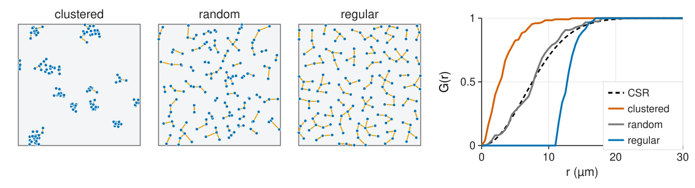
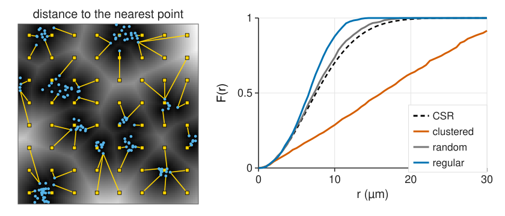
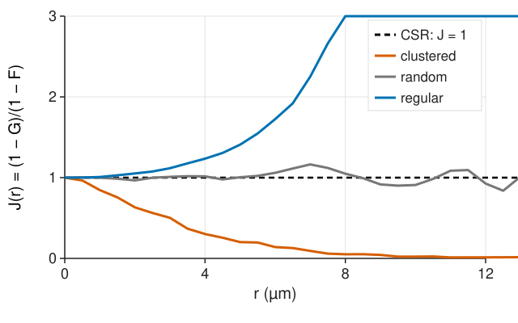
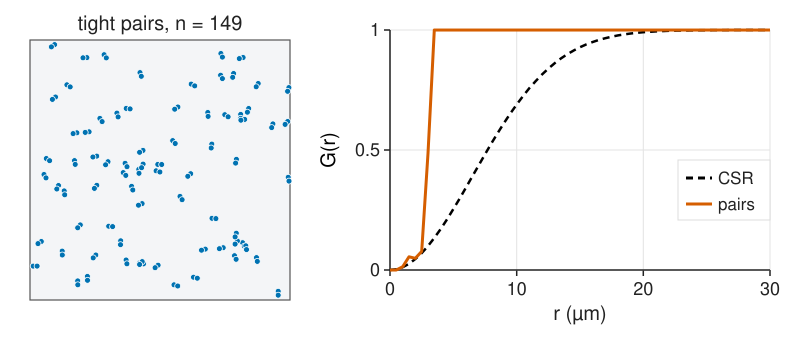
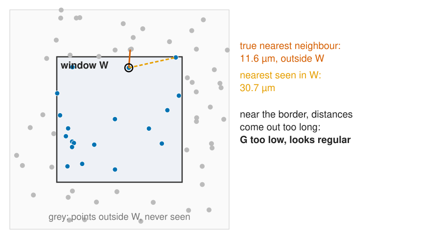
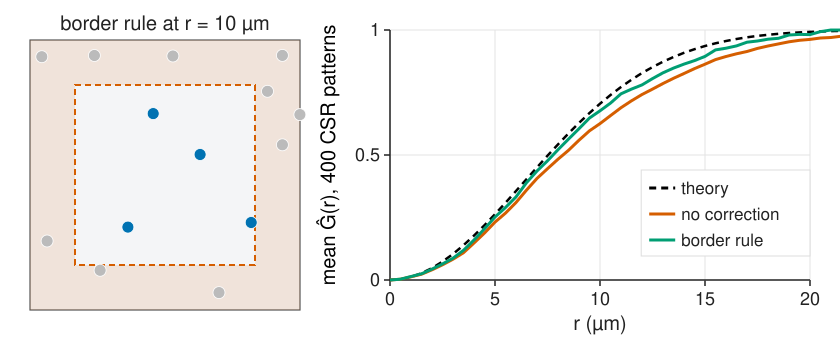

## About this lecture

Quadrats look at one scale. Distances look at all of them: how far is the **nearest neighbour** of each point, and how far is the nearest point from an **empty location**?

- **G(r)**: the distribution of nearest-neighbour distances, against its CSR curve.
- **F(r)**: the distance from random locations to the nearest point (the distance transform).
- **J(r)**: G and F combined; no intensity needed.
- What G cannot see.
- The **edge effect** and the **border correction**.

*Slides titled **The math** give the formulas and proofs; the ideas are complete without them.*

::: notes
Second unit of the spatial statistics day. Builds on the relations unit of the measurements day (nearest-neighbour histogram, the Poisson nearest-neighbour law, Clark–Evans, a guard zone). Demo: gfj, which uses the same pattern source as csrplay (same models, seeds and presets). Window 200 × 200 µm unless said otherwise.
:::

## Recall: Clark–Evans

From the [relations unit](../relations/lec.qmd) of the measurements day:

- the histogram of **nearest-neighbour distances**, against the curve for a random (Poisson) pattern of the same density;
- the **Clark–Evans ratio** $R = \bar d_\text{obs} / \bar d_\text{random}$ with $\bar d_\text{random} = 0.5/\sqrt\rho$: $R < 1$ clustered, $R > 1$ regular.

$R$ is **one number**: it hides **at which distance** the pattern differs from random. Today the whole distribution, as a function of $r$.

## G: the nearest-neighbour function

{width="100%" fig-alt="Three patterns of 154 points with an orange line from each point to its nearest neighbour: clustered (short lines inside groups), random (mixed lengths), regular (lines of similar length). Right: G(r) for each against the dashed CSR curve. Clustered rises early and reaches 0.88 at 6 µm; random follows the CSR curve; regular is 0 up to 11 µm and then rises steeply."}

$G(r)$ = the **fraction of points whose nearest neighbour is within r**: the cumulative histogram of the nearest-neighbour distances (recall cumulative histograms from the [histogram unit](../histogram/lec.qmd)).

- CSR: $G(r) = 1 - e^{-\rho\pi r^2}$.
- **Clustered**: G rises **early** (neighbours are close). **Regular**: G is 0 up to the minimum spacing, then rises **steeply**.

## The math: G under CSR {.math}

Take a typical point of a Poisson process. By **Slivnyak's theorem**, the other points seen from it are again a Poisson process of intensity ρ. So

$$1 - G(r) = P(\text{no other point in the disc } b(\mathbf x, r)) = e^{-\rho\pi r^2}.$$

- Density of the nearest-neighbour distance: $g_D(r) = 2\pi\rho r\,e^{-\rho\pi r^2}$ (the curve of the [relations unit](../relations/lec.qmd)).
- Mean: $E[D] = \int_0^\infty (1 - G(r))\,dr = \int_0^\infty e^{-\rho\pi r^2}dr = \dfrac{1}{2\sqrt\rho}$: the Clark–Evans denominator.
- Clark–Evans is G summarised by its mean.
- In 3D: $1 - G(r) = e^{-\rho\frac43\pi r^3}$.

## F: the empty-space function

{width="100%" fig-alt="Left: the clustered pattern over its distance map (dark near points, bright far away), with an 8 × 8 grid of yellow test locations, each joined to its nearest point. Right: F(r) for the three archetypes against the CSR curve: regular rises earliest, random follows CSR, clustered rises late and slowly because of large empty gaps."}

$F(r)$: from a random **location** (not a point), the fraction whose nearest point is within $r$.

- It is the histogram of the **distance transform** of the point image (recall [morphology](../morph-openclose/lec.qmd)), over the window.
- CSR: **the same curve** as G.
- **Clustered**: big empty gaps, F rises **late**. **Regular**: no big gaps, F rises **early**.

## J: G and F together

:::: {.columns}
::: {.column width="55%"}
{width="100%" fig-alt="J(r) from 0 to 12 µm: the CSR line at 1; the random pattern stays near 1; the clustered pattern falls from 1 towards 0 (0.30 at 4 µm); the regular pattern rises above 1 (1.23 at 4 µm, beyond 3 at 8 µm)."}
:::
::: {.column width="45%"}
G and F move in **opposite directions**. Their ratio

$$J(r) = \frac{1 - G(r)}{1 - F(r)}$$

- **J = 1** under CSR, **J < 1** clustered, **J > 1** regular.
- Needs **no estimate of ρ**: the CSR reference is the constant 1.
- Noisy at large r, where both $1 - G$ and $1 - F$ are close to 0.
:::
::::

## The math: F and J {.math}

From a fixed location $\mathbf u$ (not a point of the process), the points are Poisson by definition:

$$1 - F(r) = P(N(b(\mathbf u, r)) = 0) = e^{-\rho\pi r^2} = 1 - G(r) \quad\Rightarrow\quad J(r) \equiv 1.$$

- For a **cluster** process (Thomas), a typical point has extra neighbours from its own cluster, so $1 - G < 1 - F$ and $J < 1$ at every r; J decreases to a constant (van Lieshout & Baddeley, 1996).
- For a **hard-core** process at distance h: $G(r) = 0$ for $r < h$, so $J(r) = 1/(1 - F(r)) > 1$.
- F is estimated on a grid of test locations: one distance transform of the point image gives all of them.

## Try it: G, F and J

```{=html}
<link rel="stylesheet" href="../demos/dist/demo.css">
<div data-demo="gfj" data-preset="clusters"></div>
<script src="../demos/dist/gfj.js"></script>
```

::: notes
Left: the pattern; tab G shows each point's nearest-neighbour link (orange when shorter than r), tab F a grid of test locations over the distance map with links to the nearest point (yellow when within r). Right: the estimate against the CSR curve; the dashed red line is r. Tour (border correction on): "CSR: G = F = theory": 150 points, at r = 6 µm CSR 0.346, Ĝ 0.375, F̂ 0.345, Ĵ 0.95; Clark–Evans 1.06. "clusters: G up, F down" (Thomas, 229 points): Ĝ 0.940, F̂ 0.234 against 0.477; Ĵ 0.08; Clark–Evans 0.40. "regular" (hard core 10 µm): Ĝ 0, F̂ 0.410 against 0.346; Ĵ 1.70. "J needs no ρ": the same clusters on the J tab.
:::

## What G cannot see

:::: {.columns}
::: {.column width="45%"}
{width="100%" fig-alt="Left: 149 points in tight pairs 3 µm apart, the pairs scattered at random. Right: G(r) jumps from near 0 to 1 at 3 µm and stays at 1, far above the CSR curve."}
:::
::: {.column width="55%"}
- G uses only the **nearest** neighbour.
- Tight **pairs** scattered at random: every point has its partner at 3 µm, so G jumps to 1 at 3 µm. Beyond that, G has nothing more to say: is the pattern random at 20 µm? Clustered at 50?
- G cannot tell the **size** of a cluster, nor whether clusters are themselves clustered.
- Unit 3 counts **all** neighbours at every distance (Ripley's K).
:::
::::

## The edge effect

:::: {.columns}
::: {.column width="55%"}
{width="100%" fig-alt="A square window inside a larger random pattern. Points outside the window are grey and never seen. A point near the top of the window has its true nearest neighbour 11.6 µm away, outside the window; the nearest point seen inside the window is 30.7 µm away."}
:::
::: {.column width="45%"}
We only see points inside $W$. Near the border the **true** nearest neighbour may lie outside:

- observed nearest distances are **too long**, Ĝ is biased **down**: the pattern looks **more regular** than it is;
- the bias grows with $r$ and with the share of points near the border: **small windows**, few points, **elongated or irregular** tissue masks.
- A 20 µm wide strip of tissue: at r = 5 µm, half of the area is within r of the border; in a 200 µm square, 10 %.

The same worry as the counting frame of [label measurement](../label-measure/lec.qmd), now for distances.
:::
::::

## The border correction

{width="100%" fig-alt="Left: a 60 × 60 µm window with 14 random points; the band within 10 µm of the border is shaded red and the 10 points in it are grey; 4 points remain. Right: mean Ĝ of 400 random patterns of 14 points in this window: without correction it lies well below the theoretical curve (0.63 against 0.71 at 10 µm); with the border rule it is close (0.68)."}

**Border rule** (reduced sample, the guard zone of the [relations unit](../relations/lec.qmd)): estimate $G(r)$ only from points at least $r$ from the border, whose disc of radius r lies fully inside $W$. Unbiased, but it throws data away, more at large $r$.

## The math: the reduced-sample estimator {.math}

With $d_i$ the nearest-neighbour distance and $b_i$ the distance from $\mathbf x_i$ to the border of $W$:

$$\hat G(r) = \frac{\#\{i : d_i \le r,\ b_i \ge r\}}{\#\{i : b_i \ge r\}}.$$

- For a kept point the disc $b(\mathbf x_i, r)$ lies inside $W$, so "a neighbour within r" is fully observed: each term is unbiased, and so is the ratio (approximately, for a stationary pattern).
- The kept set changes with r, so $\hat G$ need **not** be monotone in r.
- F the same way: test locations with $b(\mathbf u) \ge r$.
- Without a correction, a point at distance $b < r$ from a straight border sees only part of its disc: the part outside has area $r^2\arccos(b/r) - b\sqrt{r^2 - b^2}$. Summed over the window the loss is of order $\text{perimeter} \cdot r / \text{area}$.
- Other corrections: **Kaplan–Meier** (treat the border distance as censoring, as in survival analysis); for pair functions, translation and isotropic weights (unit 3).

## Try it: the edge effect

```{=html}
<link rel="stylesheet" href="../demos/dist/demo.css">
<div data-demo="gfj" data-preset="small"></div>
<script src="../demos/dist/gfj.js"></script>
```

::: notes
"small window, no correction": a 60 × 60 µm window with 14 random points; tick "average of 100 CSR patterns": the mean uncorrected Ĝ (red) lies below the theory (dashed), the border-corrected mean (green) close to it (at 10 µm: 0.61 vs 0.67 vs 0.71). "border correction": the guard zone is shaded; only 4 of the 14 points are kept at r = 10. "thin tissue band" (CSR, 57 points in a band 30 µm wide, area 5730 µm²): at r = 8, 77 % of the points are within r of the border; mean Ĝ(8) uncorrected 0.81 against 0.87. Click a point to see its distance to the border and whether the border rule keeps it.
:::

## Practical notes

- Measure distances in **µm**, not pixels: anisotropic pixels and z-steps in a stack ([3D volumes](../volumes3d/lec.qmd)) distort pixel distances.
- **Toroidal wrap** (opposite edges glued) removes the edge in a simulated rectangle. Never for real tissue: the other side of the image is not a neighbour.
- Use the **tissue mask** as $W$, with its own border distances (one distance transform of the mask).
- G and F are quick and easy to explain; K ([next unit](../ripley-k/lec.qmd)) uses more of the data.

## Where this leads

- **[Unit 3](../ripley-k/lec.qmd)**: count **all** neighbours within r: Ripley's K, the L function and the pair correlation g; corrections for pairs.
- **[Unit 4](../envelopes/lec.qmd)**: is $\hat G$ outside what CSR gives by chance? Simulation envelopes.
- The same comparison in time: the mean squared displacement of [track analysis](../track-analysis/lec.qmd) against a random walk.

## Summary

- **G(r)**: share of points with a neighbour within r; CSR $1 - e^{-\rho\pi r^2}$; early rise = clustered, late steep rise = regular.
- **F(r)**: share of empty locations with a point within r (the distance transform); the opposite reaction.
- **J = (1 − G)/(1 − F)**: 1 for CSR, < 1 clustered, > 1 regular; no ρ needed.
- G sees only the **nearest** neighbour: it cannot tell the size of clusters.
- **Edge effect**: distances near the border are too long, G too low (looks regular). The **border rule** fixes it at the cost of data.
