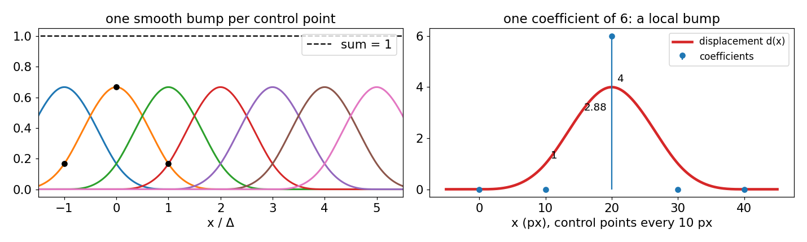
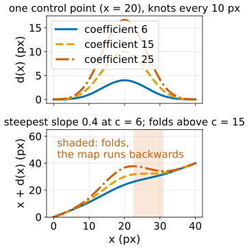
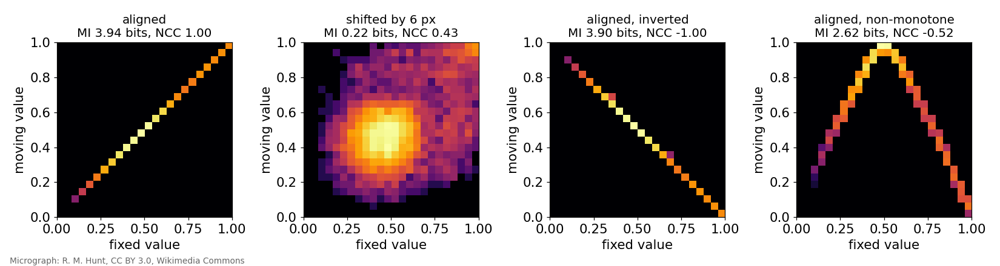
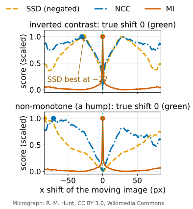
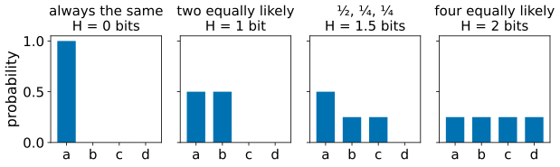
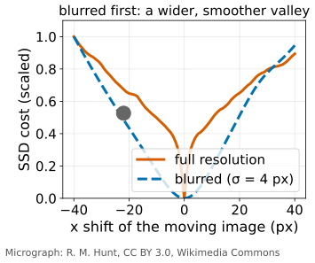

## About this lecture

Optical flow assumed small motion between two nearly identical frames. Registration aligns images that may differ a lot: hours apart, two animals, a live and a fixed sample, two stains.

- A **deformation field**: a vector per pixel, like a flow, but from a **smooth family** of deformations.
- The **B-spline free-form deformation**: a coarse grid of control points.
- Keeping it physical: **no folding** (the Jacobian determinant), a **bending** penalty.
- **Similarity measures**: SSD, NCC, and **mutual information** for images with different contrast.
- Optimisation by **gradient descent**, coarse to fine; applications and honest limits.

*Slides titled **The math** give the formulas and proofs; the ideas are complete without them.*

::: notes
Owner of non-rigid (intensity-based) registration and of mutual information as a similarity measure. Recalls: rigid/affine registration (FFT registration day, images unit), NCC (FFT registration), the two-channel scatter plot (coloc), regularisation (deconvolution day), entropy (compression elective, defined here self-contained), gradient descent (backprop, defined here self-contained). B-spline theory belongs to the splines elective (planned); here the cubic B-spline is only "a smooth bump per control point".
:::

## From flow to registration

| | optical flow | non-rigid registration |
|---|---|---|
| images | two frames a moment apart | any two images of "the same" thing |
| motion | small | possibly large |
| contrast | the same (brightness constancy) | may differ (another stain, another modality) |
| result | a vector per pixel | a vector per pixel: the **deformation field** |
| found by | local constraints + smoothness | optimising a **similarity score** over a smooth family |

Pipeline: first a rigid or affine alignment ([FFT registration](../phasecorr/lec.qmd), [affine maps](../images/lec.qmd)), then the non-rigid correction.

Convention: the **fixed** image stays put; the **moving** image is sampled at $\mathbf x + \mathbf d(\mathbf x)$ to bring it onto the fixed one.

## A smooth family: free-form deformation

{width="85%" fig-align="center"}

Put a coarse **grid of control points** over the image (every 8 to 32 pixels). Each carries a displacement vector. The displacement of every pixel is a **smooth blend** of the control points nearby.

- Each control point acts through a smooth bump (the cubic **B-spline**), 4 grid spacings wide.
- Moving one control point changes only a **local** patch; all moved equally = a translation.
- Grid spacing = how local the deformation can be. B-splines in depth: the splines elective. Landmark-based alternative (matching chosen points): thin-plate splines, and [Procrustes](../shape-models/lec.qmd) for the rigid part.

## The math: B-spline FFD {.math}

With control points every Δ pixels and coefficients $\mathbf c_{kl}$:
$$\mathbf d(\mathbf x) = \sum_{k,l} \mathbf c_{kl}\,\beta^3\!\Big(\frac{x}{\Delta} - k\Big)\,\beta^3\!\Big(\frac{y}{\Delta} - l\Big),\qquad
\beta^3(t) = \begin{cases}\tfrac23 - t^2 + \tfrac12|t|^3 & |t| < 1\\ \tfrac16(2 - |t|)^3 & 1 \le |t| < 2\\ 0 & \text{else.}\end{cases}$$

- At the knots: $\beta^3(0) = \tfrac46$, $\beta^3(\pm1) = \tfrac16$; and $\sum_k \beta^3(t - k) = 1$ for every $t$ (**partition of unity**: equal coefficients give a translation).
- 1D example (knots every 10 px, coefficients $0, 0, 6, 0, 0$): $d = 4$ at the moved knot, 1 at its neighbours, $6\,\beta^3(0.5) = 2.875$ half way.
- $\mathbf d$ is **linear in the coefficients**, so the gradient of any cost with respect to $\mathbf c_{kl}$ is a B-spline-weighted sum of per-pixel gradients.

## Keeping it physical: no folding

:::: {.columns}
::: {.column width="58%"}
The map $\mathbf x \mapsto \mathbf x + \mathbf d(\mathbf x)$ must not turn space inside out. Its local area change is the **Jacobian determinant**:

- $> 1$: the region is larger in the moving image (growth, expansion),
- $< 1$: smaller (compression),
- $\le 0$: **folding**: two places map onto one, physically impossible.

In 1D: the map $x + d(x)$ folds where $d$ drops faster than 1 pixel per pixel. In the example above the steepest slope is $0.4$: safe; the coefficient 6 could grow to 15 before folding.

Regularise: add λ · **bending energy** (how strongly the field curves) to the cost, as in the [regularisation unit](../regularise/lec.qmd). Pointers: diffeomorphic methods guarantee no folding by composing many small steps; the "demons" algorithm smooths a flow-like force each iteration, much like Horn–Schunck.
:::
::: {.column width="42%"}
{width="100%" fig-alt="Top: the displacement d(x) of one control point at x = 20 with coefficients 6, 15 and 25. Bottom: the map x + d(x); it rises for 6, is flat at one point for 15, and runs backwards between about x = 23 and 31 for 25 (shaded: folding)."}
:::
::::

## What does "aligned" mean? The joint histogram

{width="100%" fig-align="center"}

For every pixel, plot (value in fixed, value in moving): the [colocalisation scatter plot](../coloc/lec.qmd), now used to **align** rather than to measure overlap. Aligned images give a **tight** pattern; misaligned ones a **cloud**.

## Three similarity measures

:::: {.columns}
::: {.column width="55%"}
- **SSD** (sum of squared differences): the pattern should be the **diagonal**: same contrast, e.g. two frames of a time-lapse.
- **NCC** (normalised cross-correlation, from [template matching](../matching/lec.qmd)): the pattern should be a **straight line**: any gain and offset. An inverted copy gives NCC = −1: perfectly related, yet a cost that wants +1 pushes away from it.
- **Mutual information** (MI): the pattern should be **any tight pattern**: inverted contrast, two stains, two modalities, even a non-monotone relation. MI measures how much knowing one image's value tells you about the other's.
:::
::: {.column width="45%"}
{width="100%" fig-alt="SSD, NCC and MI against the x shift, each scaled to 0 to 1. Inverted contrast: MI peaks sharply at the true shift 0, SSD is best at -27 and NCC also far away. Non-monotone contrast: again only MI peaks at 0."}
:::
::::

## Entropy in one slide

How many yes/no questions do you need, on average, to guess a pixel's value?

- A value that is always the same: 0 questions. Two equally likely values: 1 bit. Four: 2 bits. Probabilities $\tfrac12, \tfrac14, \tfrac14$: 1.5 bits.
- **Entropy** $H$ = that average number of questions; the sharper the histogram, the lower $H$ ([compression elective](../entropy/lec.qmd), if taken).

Mutual information = questions saved about the moving value once you know the fixed value:
$$\mathrm{MI} = H(\text{fixed}) + H(\text{moving}) - H(\text{fixed, moving}).$$
A tight joint histogram has a small joint entropy: high MI.

{width="62%" fig-align="center" fig-alt="Four bar charts of probabilities: one value always (0 bits); two equally likely (1 bit); one half, one quarter, one quarter (1.5 bits); four equally likely (2 bits)."}

## The math: mutual information {.math}

From the joint histogram, normalised to probabilities $p(a, b)$, with marginals $p(a)$, $p(b)$:
$$H(A) = -\sum_a p(a)\log_2 p(a),\qquad H(A, B) = -\sum_{a,b} p(a, b)\log_2 p(a, b),$$
$$\mathrm{MI} = H(A) + H(B) - H(A, B) = \sum_{a,b} p(a, b)\,\log_2\frac{p(a, b)}{p(a)\,p(b)} \;\ge 0 .$$

- MI = 0 iff the two are independent; $\mathrm{MI} \le \min(H(A), H(B))$, with equality when one image determines the other.
- Example (8 pixels): $A = (0,0,0,0,1,1,1,1)$, $B = 1 - A$: $H(A) = H(B) = H(A, B) = 1$ bit, MI = 1 bit (NCC = −1). Counts $\begin{pmatrix}2&2\\2&2\end{pmatrix}$: $H(A, B) = 2$, MI = 0.
- To make MI differentiable in the deformation, spread each value over two neighbouring bins (linear binning).
- Pitfalls: too many bins for the number of pixels (MI becomes noisy); a **small overlap** can give a spuriously high MI (normalised MI as a pointer); local optima.

## Try it: joint histogram and similarity

```{=html}
<link rel="stylesheet" href="../demos/dist/demo.css">
<div data-demo="jointhist" data-preset="inverted"></div>
<script src="../demos/dist/jointhist.js"></script>
```

::: notes
Fixed: a 96² crop of the micrograph; moving: the same crop with its contrast mapped, plus noise 0.03. Middle: the joint histogram (log counts) of the overlapping pixels; bottom: SSD (negated), NCC and MI against the x shift, each scaled to its own range. Tour: "aligned": a thin diagonal, NCC 0.986, MI 2.06 bits. "Misaligned" (6, 3): a cloud, MI 0.20 bits. "Inverted": an anti-diagonal: NCC −0.986, MI 2.04 bits (as high as aligned), SSD best at a shift of −27: SSD is fooled. "Non-monotone": a hump; SSD and NCC peak far away, only MI peaks at 0. "Too many bins" (128): the histogram is speckle, and the MI curve's maximum moves to the largest shift, where the overlap is smallest. "Tiny overlap" (shift 80, 64 bins): MI rises again towards the edges of the range.
:::

## Optimisation: walk downhill

:::: {.columns}
::: {.column width="55%"}
Registration = find the control-point coefficients that minimise **cost = dissimilarity + λ · bending**.

- **Gradient descent**: picture a ball on the cost landscape; compute which way is downhill for all coefficients at once (the gradient), take a step, repeat. ([Backpropagation](../backprop/lec.qmd) uses the same idea for networks.)
- **Coarse to fine** in both the image (blurred first) and the grid (start coarse, then halve the spacing).
- **Local optima** and capture range: gradient descent finds the nearest valley; start from a good rigid alignment.
:::
::: {.column width="45%"}
{width="100%" fig-alt="SSD cost of the micrograph against the x shift of the moving copy. At full resolution the valley at 0 is narrow and sharp with shallow, kinked slopes; after blurring with sigma 4 the valley is wide and smooth. A grey ball sits on the slope at -22."}
:::
::::

## Try it: free-form registration

```{=html}
<link rel="stylesheet" href="../demos/dist/demo.css">
<div data-demo="ffdreg" data-preset="drag"></div>
<script src="../demos/dist/ffdreg.js"></script>
```

::: notes
Fixed: a 128² crop of the micrograph; moving: the fixed image deformed by a known smooth random field (mean displacement 2.3 px, at most 4.4 px), so the readout can give the error against the true field (2.41 px for no deformation). "Drag one control point": one coefficient of 9 px; the cyan grid shows where the fixed grid samples the moving image: a local bump. "Optimise with SSD" (grid 16 px, coarse to fine): error 0.05 px. "Inverted contrast": SSD folds the grid into nonsense (error 30 px, 4786 folded pixels); switch to mutual information: 0.07 px. "Fine grid, λ = 0" (grid 6 px, noise 0.25): 57 folded pixels in the Jacobian tab; λ = 1 removes the folding. "Too free": a blob that really grows between the images; with a fine grid and λ = 0 the registration shrinks it away (Jacobian 3.3 at the blob).
:::

## Applications and honest limits

- Aligning the frames of an embryo time-lapse while the tissue deforms; correcting breathing and heartbeat motion in intravital imaging.
- Registering live imaging to fixed immunostaining of the same sample; serial sections into a 3D volume; brains to an atlas.

Limits:

- A deformation that is too free **explains away real biology**: a growing structure is "registered away". Check the Jacobian map, and keep the deformation as smooth as the question allows.
- Check with **held-out landmarks**: points you did not use, whose distance after registration you measure.
- Similarity is not correctness: MI can be high for the wrong alignment (small overlaps, repeated texture).

## Summary

- Non-rigid registration finds a smooth **deformation field** that makes the moving image look like the fixed one.
- **B-spline free-form deformation**: control points every Δ pixels, each a smooth local bump; equal coefficients = translation.
- Keep it physical: Jacobian determinant > 0 (no folding), λ · bending energy.
- Similarity: **SSD** (same contrast), **NCC** (gain and offset), **mutual information** (any consistent relation, e.g. two stains).
- Gradient descent, coarse to fine, from a good rigid start; check the Jacobian and held-out landmarks.
