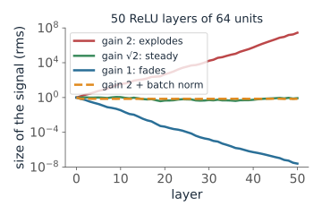
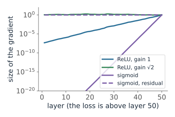
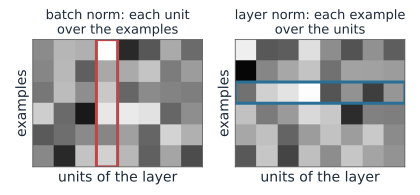
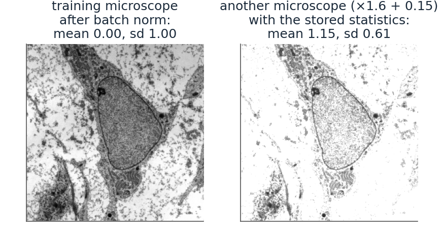
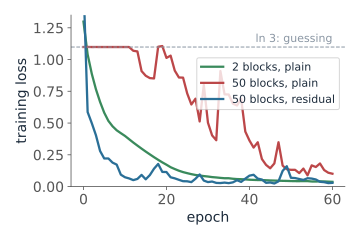
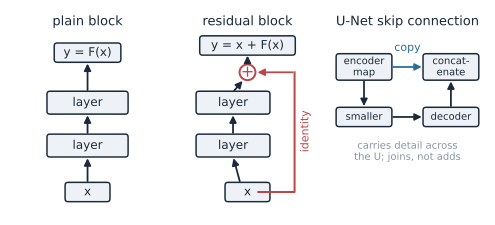
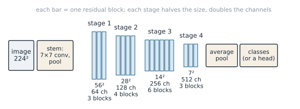

## About this lecture

Deep networks are hard to train for a reason that has nothing to do with the data: through many layers, signals and gradients **shrink or explode**. Three fixes, used in almost every modern network:

- sensible **initial weights** (variance ∝ 1/fan-in);
- **normalisation layers**: batch norm and layer norm, and the **batch-statistics trap** at test time;
- **residual connections**: $y = x + F(x)$, the idea behind ResNet and every deep network since.

*Slides titled **The math** give the formulas and proofs; the ideas are complete without them.*

::: notes
Demo tour: deepstack, presets "ReLU, gain 1: fades", "gain √2: steady", "gain 2: explodes", "tanh, gain 3: saturates", "sigmoid", "gain 2 + batch norm", "gain 1 + layer norm", then "plain, gain √2, 50 layers" vs "residual, gain √2, 50 layers" and "sigmoid: plain vs residual". The demo does not train: it pushes one random batch up the stack and one random gradient down, which is what the first training step sees. The training comparison (plain vs residual) is from the coding exercise (training/src/normalisation/).
:::

## A deep stack: the signal shrinks or explodes

:::: {.columns}
::: {.column width="45%"}
50 dense layers of 64 ReLU units, random weights, a batch of 64 random inputs of size 1. The size (root mean square) of each layer's output:

- weights a bit **too small** (gain 1): $10^{-8}$ after 50 layers;
- a bit **too large** (gain 2): $3 \times 10^{7}$;
- **just right** (gain $\sqrt2$): stays near 1.

A factor of $\sqrt2$ in the initial weights decides between a network that trains and one that cannot.
:::
::: {.column width="55%"}
{fig-alt="Size of the signal against the layer, log scale from 1e-8 to 1e8, for 50 ReLU layers. Gain 2: rises steadily to about 1e7. Gain square root of 2: stays near 1. Gain 1: falls steadily to about 1e-8. Gain 2 with batch norm (dashed): flat at 0.7." width="100%"}
:::
::::

## Each layer multiplies the size

A layer multiplies the size of its input by (roughly) a fixed factor; 50 layers multiply it by that factor 50 times.

| factor per layer | after 10 layers | after 50 layers |
|---|---|---|
| 0.5 | 0.001 | $10^{-15}$ |
| 0.71 | 0.03 | $3 \times 10^{-8}$ |
| 1 | 1 | 1 |
| 1.41 | 32 | $3 \times 10^{7}$ |

- Linear layers with weights of standard deviation $g/\sqrt{n_\text{in}}$ multiply the size by $g$ (the **gain**).
- A ReLU sets half the values to 0: it divides the mean square by 2, the size by $\sqrt2$. So ReLU layers need gain $\sqrt2$ to keep the size.
- Bounded bends (tanh, sigmoid) cannot explode, but they **saturate**: with large weights tanh is $\pm1$ almost everywhere.

## The gradient takes the same road back

:::: {.columns}
::: {.column width="45%"}
Backpropagation multiplies the gradient by each layer's weights (transposed) and local slopes, layer after layer from the loss down.

- Gain 1 with ReLU: the gradient at layer 1 is $5 \times 10^{-8}$ of the one at the top: the first layers **do not learn** (vanishing gradients).
- Sigmoid: slope at most 0.25 per layer: $2 \times 10^{-31}$ at layer 1.
- Too large weights: **exploding** gradients, steps that throw the weights anywhere.
- Gain $\sqrt2$ with ReLU: about 1 everywhere.
:::
::: {.column width="55%"}
{fig-alt="Size of the gradient against the layer, log scale, with the loss above layer 50. ReLU gain square root of 2: flat near 1. ReLU gain 1: falls from 1 at layer 50 to about 1e-7 at layer 1. Sigmoid: falls steeply to below 1e-20 by layer 18. Sigmoid with residual connections (dashed): flat at 1." width="100%"}
:::
::::

## Sensible initial weights

Draw each weight at random (normal, mean 0) with standard deviation

$$\text{sd} = \frac{\text{gain}}{\sqrt{\text{fan-in}}}, \qquad \text{fan-in} = \text{number of inputs of the unit}$$

| bend | gain | name |
|---|---|---|
| none, tanh | 1 | LeCun / Xavier (Glorot uses $2/(n_\text{in} + n_\text{out})$ for the variance) |
| ReLU | $\sqrt2$ | He (Kaiming) |

- A convolution with a $3\times3$ kernel and 64 input channels has fan-in $9 \cdot 64 = 576$: sd $= \sqrt2/24 = 0.059$.
- Biases start at 0. Random, so that units differ (equal weights would stay equal forever).
- Every network library does this by default; it matters when you build something new, or very deep.

## The math: the variance of a layer {.math}

Unit $j$ of a layer: $z_j = \sum_{i=1}^{n} W_{ji}a_i$, with independent weights of mean 0 and variance $\sigma^2$, independent of the inputs:

$$\operatorname{Var}(z_j) = \sum_i \mathbb E[W_{ji}^2]\,\mathbb E[a_i^2] = n\,\sigma^2\,\mathbb E[a^2]$$

- Linear ($a = z$ of the layer below, mean 0): keeping $\operatorname{Var}(z)$ needs $n\sigma^2 = 1$, $\sigma = 1/\sqrt n$.
- ReLU: for $z$ symmetric about 0, $\mathbb E[\text{ReLU}(z)^2] = \tfrac12\mathbb E[z^2]$, so $n\sigma^2 = 2$: $\sigma = \sqrt{2/n}$ (He et al., 2015).
- Backwards, $\delta_i = \sum_j W_{ji}\delta_j\,\varphi'(z_i)$: the same argument with the fan-**out**. Glorot and Bengio (2010) compromise with $\sigma^2 = 2/(n_\text{in} + n_\text{out})$.
- These keep the size only on average and at the start; training changes the weights. Hence normalisation layers.

## Try it: a deep stack

```{=html}
<link rel="stylesheet" href="../demos/dist/demo.css">
<div data-demo="deepstack" data-preset="small"></div>
<script src="../demos/dist/deepstack.js"></script>
```

::: notes
Default depth 30. "ReLU, gain 1: fades": activations 1.6e-5, gradients at layer 1 2.6e-5 of the top. "gain √2": steady. "gain 2: explodes": 1.7e4. "tanh, gain 0.5": shrinks to 1e-9. "tanh, gain 3: saturates": size stays 0.84 but the gradient at layer 1 is 6000 times the top (exploding). "sigmoid": activations fine (0.52), gradient at layer 1 1e-18. "gain 2 + batch norm": every layer 0.71. The histograms: values beyond ±3 pile up in the red end bins.
:::

## Batch normalisation

:::: {.columns}
::: {.column width="45%"}
Do not hope the size stays right: **make** it right, in every layer. Batch norm takes each unit's sums $z$ over the examples of the mini-batch and

1. subtracts their mean, divides by their standard deviation;
2. then multiplies by a learned scale $\gamma$ and adds a learned shift $\beta$.

Now the initial gain hardly matters: gain 1 and gain 2 give the same size, 0.71, at every layer (slide 2, dashed).
:::
::: {.column width="55%"}
{fig-alt="Two grey matrices with examples as rows and units of the layer as columns. Left, batch norm: one column is framed in red: each unit is normalised over the examples of the batch. Right, layer norm: one row is framed in blue: each example is normalised over the units of the layer." width="100%"}
:::
::::

## The math: batch norm {.math}

For one unit, batch $z_1, \dots, z_m$:

$$\mu = \frac1m\sum_n z_n, \quad \sigma^2 = \frac1m\sum_n (z_n - \mu)^2, \quad \hat z_n = \frac{z_n - \mu}{\sqrt{\sigma^2 + \epsilon}}, \quad y_n = \gamma\hat z_n + \beta$$

- During training $\mu$ and $\sigma^2$ come from the **batch**; a running average ($\mu_\text{run} \leftarrow 0.9\mu_\text{run} + 0.1\mu$) is kept for **test time**, when the stored values are used instead.
- Backpropagation goes through $\mu$ and $\sigma$ too: $\partial\mathcal L/\partial z_n = \frac{1}{\sigma}\big(g_n - \bar g - \hat z_n\,\overline{g\hat z}\big)$ with $g_n = \partial\mathcal L/\partial\hat z_n$, bars = batch means.
- Scale invariance: $W \to cW$ changes $z \to cz$, $\mu \to c\mu$, $\sigma \to c\sigma$: $\hat z$ is unchanged (Ioffe and Szegedy, 2015).

## Why training gets easier

- Every layer sees inputs of a fixed size, whatever the layers below do while they learn.
- The scale of the weights no longer matters for the forward pass, so larger learning rates are safe and bad initial gains are forgiven.
- The noise of the batch statistics acts as a mild regulariser.

Not a cure for everything: in the demo, gain 2 with batch norm keeps the activations at 0.71, but the gradient still grows by about $10^4$ from layer 50 down to layer 1. Very deep networks need more: **residual connections** (below).

## Layer normalisation

:::: {.columns}
::: {.column width="50%"}
Normalise each **example** over the units of the layer instead (blue row): mean and standard deviation of one example's values.

- Needs **no batch**: the same computation at training and at test time, for a batch of one.
- The standard in transformers (the [attention unit](../attention/lec.qmd)).
- Image networks also use **group norm** (groups of channels, per example) and **instance norm** (each channel of each image separately).

An example: the values $(1, 3, 5)$ become $(-1.22, 0, 1.22)$; so do $(9, 13, 17)$: layer norm removes brightness and contrast of the whole example.
:::
::: {.column width="50%"}
{fig-alt="The same two matrices: batch norm normalises a column (one unit over the batch), layer norm a row (one example over its units)." width="100%"}
:::
::::

## The batch-statistics trap

:::: {.columns}
::: {.column width="45%"}
A batch-norm layer on $8 \times 8$ patches of the micrograph, statistics stored from 500 training patches.

- New patches, **stored** statistics: mean 0.03, sd 0.98. Fine.
- **One** image in training mode (a batch of 1): every output is 0. The image normalised away.
- **Another microscope** (grey values ×1.6 + 0.15): mean 1.15, sd 0.61. Every later layer sees inputs it never saw in training.
- Statistics **re-estimated** on 50 patches of the new microscope: mean 0.08, sd 1.03 again.
:::
::: {.column width="55%"}
{fig-alt="Two versions of the cell micrograph. Left: as used for training; after batch norm the outputs have mean 0.00 and standard deviation 1.00. Right: the same cells as from another microscope, brighter and lower in contrast (grey values times 1.6 plus 0.15, clipped at white); with the stored statistics the outputs have mean 1.15 and standard deviation 0.61." width="100%"}
:::
::::

<small>Image: transmission electron micrograph of a mesenchymal stem cell, Robert M. Hunt, CC BY 3.0, via Wikimedia Commons.</small>

## Rules at test time

- Put the network in **evaluation mode**: batch norm uses the stored statistics, not those of the test batch. A forgotten switch gives results that change with the batch size and with the other images in the batch.
- Stored statistics belong to the **training data**. A new microscope, stain or camera shifts them: the classic way a network "fails on our new images".
- Remedies: normalise the input images the same way (the [contrast unit](../contrast/lec.qmd)), augment with intensity changes (the [augmentation unit](../augmentation/lec.qmd)), or **re-estimate** the statistics on unlabelled images of the new setting (no retraining).
- Layer, group and instance norm have no stored statistics: no trap, at the cost of removing more of the information in the absolute intensities.

## Batch normalisation as pseudocode

```
training (a batch z[n][j], n = example, j = unit):
    for every unit j:
        mean = average over n of z[n][j]
        var  = average over n of (z[n][j] − mean)²
        z[n][j] = gamma[j] · (z[n][j] − mean) / sqrt(var + eps) + beta[j]
        stored_mean[j] = 0.9 · stored_mean[j] + 0.1 · mean      (the same for var)
test (any number of examples, even one):
    z[n][j] = gamma[j] · (z[n][j] − stored_mean[j]) / sqrt(stored_var[j] + eps) + beta[j]
```

Layer norm: the same, but the averages run over $j$ for each $n$, and nothing is stored.

::: notes
The coding exercise (training/src/normalisation/) writes init_weights, batch_norm, layer_norm and signal_sizes (the numbers of slide 2 and 3), then shows the trap with patches of the micrograph and trains plain and residual networks.
:::

## Deeper is not always better

:::: {.columns}
::: {.column width="45%"}
More layers can represent more. But a deeper **plain** network often trains **worse**, even on the training data: the **degradation problem** (He et al., 2016). Not overfitting: the training loss itself is higher.

The course code, a narrow network (16 units) on a three-class spiral, 60 epochs:

| | training loss after 60 epochs |
|---|---|
| 2 blocks, plain | 0.037 |
| 20 blocks, plain | 0.131 |
| 50 blocks, plain | 0.101 (stuck at ln 3 for 12 epochs) |
| 20 blocks, **residual** | **0.022** |
| 50 blocks, **residual** | **0.029** |
:::
::: {.column width="55%"}
{fig-alt="Training loss against the epoch. 2 plain blocks (green): falls smoothly to 0.04. 50 plain blocks (red): stays at ln 3, guessing, for about 12 epochs, then falls in jumps and ends near 0.1. 50 residual blocks (blue): falls to about 0.1 within 10 epochs and ends near 0.03." width="100%"}
:::
::::

## The residual block: $y = x + F(x)$

:::: {.columns}
::: {.column width="45%"}
Instead of replacing $x$ by $F(x)$, a block **adds** a change to it: $y = x + F(x)$. The layers inside learn the **change** (the residual), not the whole new representation.

- Doing nothing is easy: $F = 0$ is the identity. A deep residual network is never worse than a shallower one, because extra blocks can stay close to 0.
- Each block starts small (its weights scaled down, or its last layer at 0), so at the start the network is almost the identity, and the signal arrives intact at the top.
:::
::: {.column width="55%"}
{fig-alt="Three diagrams. Plain block: x through two layers gives y = F(x). Residual block: x through two layers, plus an identity path drawn in red from x around the layers to a plus node: y = x + F(x). U-Net skip connection: an encoder map is copied across to the decoder, where it is concatenated with the upsampled smaller map; it joins, it does not add." width="100%"}
:::
::::

## Why gradients pass through many blocks

:::: {.columns}
::: {.column width="45%"}
Backwards through $y = x + F(x)$: the gradient reaching $x$ is the gradient at $y$ **plus** what comes back through $F$. The identity path passes it on unchanged.

- Through 50 blocks there is a direct path from the loss to every layer, with no multiplications by small slopes.
- Demo: 30 sigmoid layers, plain: gradient at layer 1 is $10^{-18}$ of the top. With residual connections: 1.0.
- Course code, first batch, 50 blocks: gradient at the first block $10^{-4}$ (plain) against $0.14$ (residual).
:::
::: {.column width="55%"}
{fig-alt="Size of the gradient against the layer, as before: the plain sigmoid stack loses the gradient within 20 layers, the same stack with residual connections (dashed) keeps it at 1 through all 50." width="100%"}
:::
::::

## The math: gradients through residual blocks {.math}

Blocks $\mathbf x_{l+1} = \mathbf x_l + F_l(\mathbf x_l)$, $l = 0, \dots, L-1$. Then

$$\mathbf x_L = \mathbf x_l + \sum_{k=l}^{L-1} F_k(\mathbf x_k), \qquad \frac{\partial\mathcal L}{\partial\mathbf x_l} = \frac{\partial\mathcal L}{\partial\mathbf x_L}\prod_{k=l}^{L-1}\big(I + J_{F_k}\big)$$

- Expanding the product: the identity term gives $\partial\mathcal L/\partial\mathbf x_L$ itself; the gradient reaches every block **directly**, plus corrections through the blocks. A plain stack has only $\prod_k J_{F_k}$, which shrinks or grows geometrically.
- With small blocks ($\|J_{F_k}\| \ll 1$, e.g. weights scaled by $1/\sqrt L$) the product stays close to $I$.
- Each $F_k$ only has to learn the change $\mathbf x_{k+1} - \mathbf x_k$; near-identity mappings are easy to reach from small weights.

## Try it: plain against residual

```{=html}
<link rel="stylesheet" href="../demos/dist/demo.css">
<div data-demo="deepstack" data-preset="ressig"></div>
<script src="../demos/dist/deepstack.js"></script>
```

::: notes
"sigmoid: plain vs residual": with the box ticked, the gradient at layer 1 is 1.0 of the top; untick it: 1e-18. "plain, gain √2, 50 layers" vs "residual, gain √2, 50 layers": both keep a gradient, but the residual signal grows (each ReLU block adds a positive change: 41 at layer 50), which is why real residual networks put a normalisation in every block.
:::

## ResNet in one picture

{fig-alt="The ResNet architecture: an image of 224 by 224 pixels, a stem (7 by 7 convolution and pooling), then four stages of residual blocks drawn as bars: stage 1 at 56 by 56 with 64 channels and 3 blocks, stage 2 at 28 by 28 with 128 channels and 4 blocks, stage 3 at 14 by 14 with 256 channels and 6 blocks, stage 4 at 7 by 7 with 512 channels and 3 blocks; then average pooling and the classes or another head." width="100%"}

- Each block: two $3\times3$ convolutions with batch norm and ReLU, plus the identity. The first block of a stage halves the size and doubles the channels; its shortcut is a $1\times1$ convolution with stride 2, so that $x$ and $F(x)$ match.
- Deeper versions (50, 101, 152 layers) use **bottleneck** blocks: $1\times1$ conv down to fewer channels, $3\times3$ conv, $1\times1$ conv back up: cheaper per layer.
- ResNet won the 2015 image classification challenge with 152 layers; before, about 20 layers was the practical limit.

## Residual networks everywhere

- **Feature encoders**: a pretrained ResNet is the encoder (backbone) of many segmentation and detection networks; the [cell networks](../cellnets-compare/lec.qmd) day uses such encoders, and Cellpose's U-Net has residual blocks.
- **Transformers** ([attention unit](../attention/lec.qmd)): every attention part and every per-token network is wrapped in a residual connection with layer norm, $x + F(\text{LN}(x))$; that is what lets them be stacked 12, 24 or more times.
- **Diffusion models** ([diffusion day](../diffusion/lec.qmd)): their U-Nets are built from residual blocks.
- The rule of thumb: if a network has more than about 20 layers, it has residual connections.

## Residual vs U-Net skip connections

:::: {.columns}
::: {.column width="45%"}
Both are called "skip connections"; they do different things.

| | residual | U-Net skip |
|---|---|---|
| connects | input and output of **one block** | encoder and decoder at the **same resolution**, far apart |
| combines | **adds**: $x + F(x)$ | **concatenates** channels |
| purpose | gradients flow; learn changes | bring back **fine detail** lost by downsampling |

A modern U-Net has both: residual blocks inside, skips across ([segmentation networks](../unet/lec.qmd)).
:::
::: {.column width="55%"}
{fig-alt="The three diagrams again: plain block, residual block (adds the identity around the layers), and a U-Net skip connection (copies an encoder map across to the decoder and concatenates)." width="100%"}
:::
::::

## Summary

| Idea | In one line |
|---|---|
| Deep stacks | each layer multiplies the size; 50 layers turn 0.7 into $10^{-8}$ |
| Initial weights | sd = gain/√fan-in: gain 1 (linear, tanh), $\sqrt2$ (ReLU) |
| Vanishing gradients | the gradient shrinks the same way going back; sigmoids are worst |
| Batch norm | each unit over the batch: mean 0, sd 1, then learned scale and shift |
| Test-time trap | stored statistics; a batch of one, or a new microscope, breaks them |
| Layer norm | each example over its units: no batch, no stored statistics |
| Degradation | a deeper plain network can train worse, not only test worse |
| Residual block | $y = x + F(x)$: learn the change; gradients pass through the identity |
| ResNet | stages of residual blocks; the backbone of many later networks |

Next: the data side of training: overfitting on small data sets, and augmentation.
