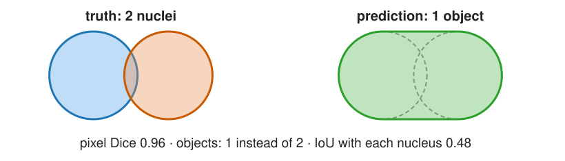
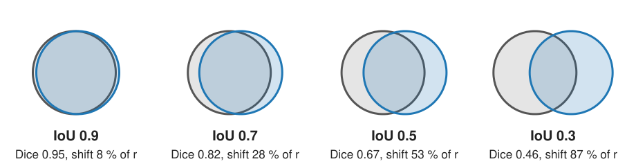
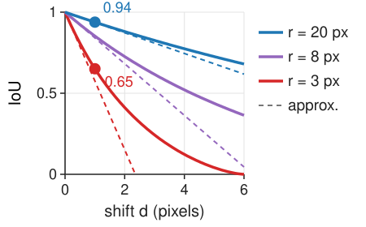
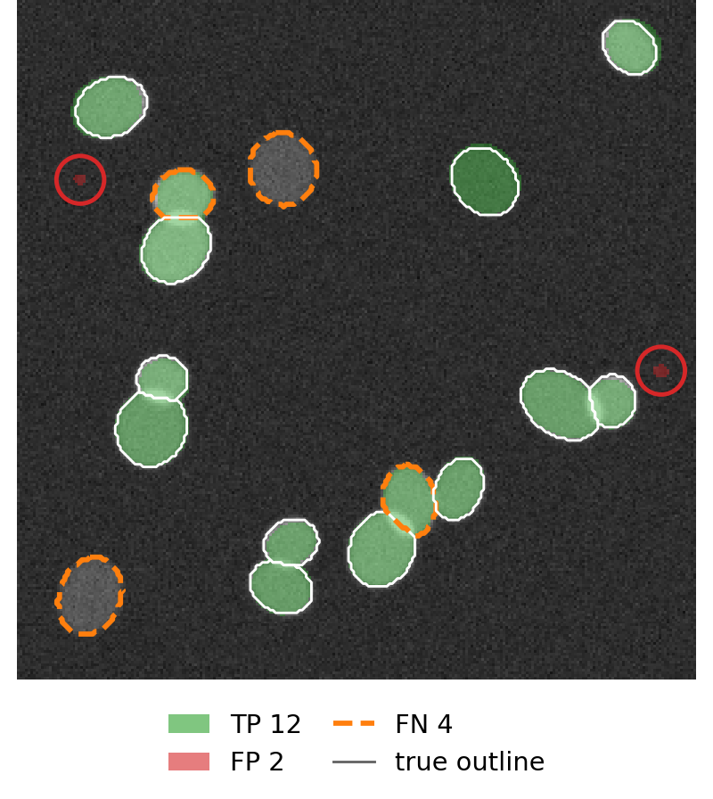
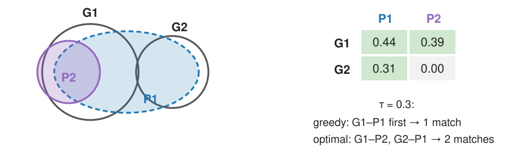
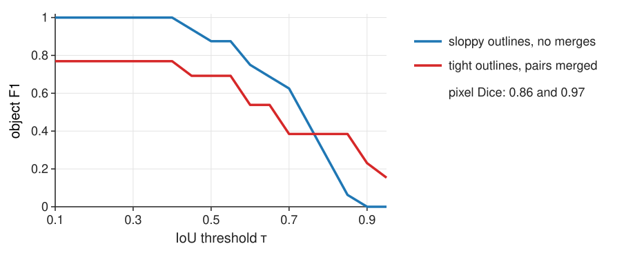
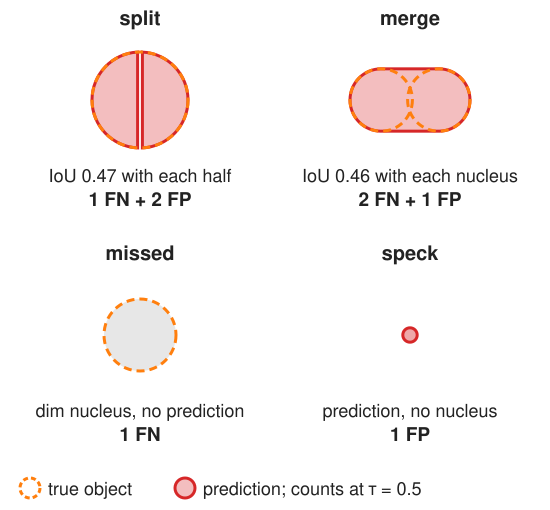
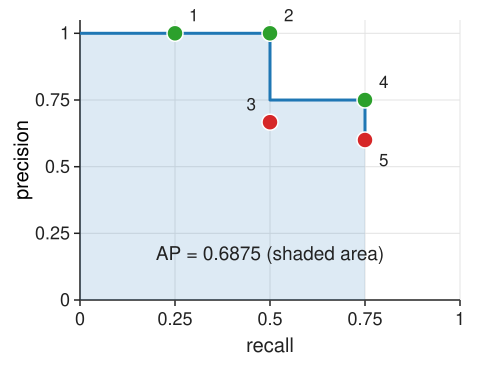
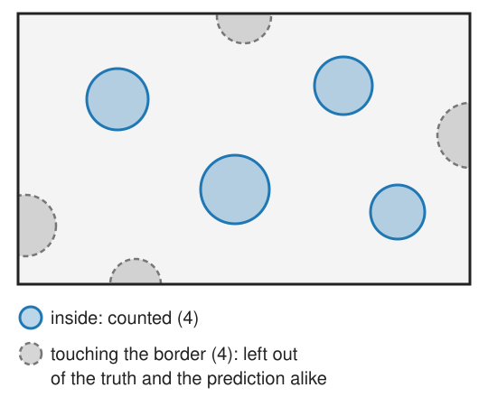

## About this lecture

A segmentation is usually used to **count and measure objects**. Pixel scores (the [thresholding day](../seg-eval/lec.qmd)) do not see objects. Today we score objects:

- **IoU** of two objects, and what an IoU of 0.5 looks like.
- **Matching** predicted to true objects, one to one, at an IoU threshold $\tau$: true positives, false positives, false negatives.
- **Precision, recall, F1** of objects, and **F1 as a function of $\tau$**.
- **Splits and merges**: the errors that cost most.
- Scored predictions: the **precision–recall curve** and **average precision**, and a naming trap.

*Slides titled **The math** give the formulas and proofs; the ideas are complete without them.*

## Recall: pixel scores cannot see objects

From the [thresholding day](../seg-eval/lec.qmd): compare a predicted mask with the true mask pixel by pixel. TP, FP, FN pixels; **Dice** $= 2\,TP/(2\,TP + FP + FN)$, **IoU** (Jaccard) $= TP/(TP + FP + FN)$.

{width=80%}

Two touching nuclei predicted as **one** object: almost every pixel is right (Dice 0.96), but the count is 1 instead of 2, and the area of "the nucleus" is doubled. We have to decide **which predicted object is which true object**.

## IoU of two objects

The **intersection over union** of a true object $G$ and a predicted object $P$: the overlap divided by the area covered by either.

{width=95%}

- IoU 1: identical. IoU 0: no overlap.
- **IoU 0.5 is already sloppy**: the same disc shifted by about half its radius.
- **Small objects lose IoU fast**: a one-pixel shift of a disc of radius 3 px gives IoU 0.65; of radius 20 px, 0.94.

## The math: IoU and Dice {.math}

For pixel sets $A$ (truth) and $B$ (prediction):

$$\text{IoU}(A, B) = \frac{|A \cap B|}{|A \cup B|}, \qquad \text{Dice}(A, B) = \frac{2|A \cap B|}{|A| + |B|}.$$

With $|A \cup B| = |A| + |B| - |A \cap B|$, writing $J$ for IoU and $D$ for Dice:

$$D = \frac{2J}{1 + J}, \qquad J = \frac{D}{2 - D}.$$

Both are monotone in each other, so they rank results the same way; IoU is the stricter number (IoU 0.5 ⇔ Dice 0.67, IoU 0.9 ⇔ Dice 0.95).

:::: {.columns}
::: {.column width="60%"}
Disc of radius $r$ shifted by $d$: $|A \cap B| = 2r^2\arccos\frac{d}{2r} - \frac d2\sqrt{4r^2 - d^2}$. For $d \ll r$ the overlap loses about $2rd$ and the union gains $2rd$, so IoU $\approx 1 - \frac{4d}{\pi r}$: the loss per pixel of shift scales with $1/r$.
:::
::: {.column width="40%"}
{fig-alt="IoU of a disc and its copy shifted by d pixels, for radii 3, 8 and 20 px (solid: exact; dashed: the approximation 1 − 4d/(πr), labelled approx.). At d = 1: 0.65 for r = 3, 0.94 for r = 20." width=100%}
:::
::::

## Matching: one to one, at a threshold

:::: {.columns}
::: {.column width="56%"}
Choose an IoU threshold $\tau$ (often 0.5). A true object and a predicted object may be **matched** only if their IoU $\ge \tau$, and every object takes **at most one** partner.

- matched pair: a **true positive** (TP);
- predicted object without partner: a **false positive** (FP);
- true object without partner: a **false negative** (FN).

There are no true-negative objects: the background is not made of objects. So no "accuracy" and no ROC curve for objects.
:::
::: {.column width="44%"}
{fig-alt="Synthetic nuclei with predictions matched at τ = 0.5: 12 green true positives, 2 tiny red specks as false positives, 4 orange dashed missed nuclei (two dim ones, and the second nucleus of each of two merged pairs)." width=100%}
:::
::::

::: notes
The picture is the "a typical result" preset of the demo below: TP 12, FP 2, FN 4, F1 0.80. Two of the four FN are merges: the green object covers both nuclei of a touching pair and is matched to one of them.
:::

## The IoU table

Rows: true objects, columns: predicted objects; most entries are 0 (objects far apart do not overlap).

|        | P1   | P2   | P3   | P4   |
|--------|------|------|------|------|
| **G1** | **0.82** | 0.05 | 0    | 0    |
| **G2** | 0.10 | 0.45 | 0.38 | 0    |
| **G3** | 0    | 0    | 0    | **0.62** |

At $\tau = 0.5$: TP 2 (G1–P1, G3–P4), FP 2 (P2, P3), FN 1 (G2). G2 is **split** into P2 and P3: neither half is good enough.

**Above $\tau = 0.5$ there is nothing to choose**: every object has at most one partner with IoU above 0.5, so "take every pair with IoU > 0.5" *is* the matching.

## The math: matching is forced above 0.5 {.math}

**Claim.** If $B_1 \cap B_2 = \emptyset$, then IoU$(A, B_1) > \frac12$ and IoU$(A, B_2) > \frac12$ cannot both hold.

**Proof.** IoU$(A, B) > \frac12$ means $|A \cap B| > \frac12|A \cup B| \ge \frac12|A|$. Two disjoint predictions would cover more than $\frac12|A| + \frac12|A| = |A|$ pixels of $A$: impossible. $\square$

The same holds with the roles of truth and prediction swapped (true objects do not overlap either). So for $\tau > \frac12$ each row and each column of the IoU table has at most one entry $\ge \tau$, and the matching is unique.

At exactly $\frac12$ it fails: $A$ cut into two equal halves $B_1$, $B_2$ gives IoU $\frac12$ with both.

## Below 0.5: greedy can lose a match

{width=78%}

- **Greedy**: take the largest IoU first, then the next largest among free objects, … Here: G1–P1 (0.44); then G2 and P2 have no free partner. **1 match.**
- **Optimal**: the assignment with the most matches (then the largest total IoU): G1–P2, G2–P1. **2 matches.**
- Image libraries call the optimal solver the "Hungarian algorithm". Above $\tau = 0.5$ both give the same answer.

## The math: matching as a linear assignment problem {.math}

Unknowns $x_{ij} \in \{0, 1\}$: true object $i$ is matched to prediction $j$. Weights

$$M_{ij} = \begin{cases} 1 + \varepsilon\,\text{IoU}_{ij} & \text{IoU}_{ij} \ge \tau \\ 0 & \text{otherwise} \end{cases} \qquad (\varepsilon \text{ small: count matches first, then IoU}).$$

$$\max_x \sum_{i,j} M_{ij}\,x_{ij} \quad\text{s.t.}\quad \sum_j x_{ij} \le 1,\ \ \sum_i x_{ij} \le 1,\ \ x_{ij} \in \{0, 1\}.$$

- The constraint matrix is **totally unimodular**: the linear-programming relaxation $0 \le x_{ij} \le 1$ already has an integer optimum (stated without proof).
- The Hungarian algorithm solves it exactly in $O(n^3)$ for $n$ objects (pad the table with zeros to a square).
- With $M_{ij} = \text{IoU}_{ij}$ instead, it maximises the total IoU; that can prefer fewer, better matches.

## Precision, recall and F1 of objects

The pixel formulas, but each **object** counts one, big or small:

$$\text{precision} = \frac{TP}{TP + FP} \quad \text{("how many of my objects are real")}$$
$$\text{recall} = \frac{TP}{TP + FN} \quad \text{("how many real objects did I find")}$$
$$\text{F1} = \frac{2\,TP}{2\,TP + FP + FN}$$

The table above at $\tau = 0.5$: precision $2/4 = 0.5$, recall $2/3 = 0.67$, F1 $= 4/7 = 0.57$. At $\tau = 0.3$: G2–P2 also matches, F1 $= 6/7 = 0.86$.

## F1 as a function of $\tau$

{width=80%}

Sweep $\tau$ from 0.1 to 0.95. **Sloppy outlines** (blue): F1 0.88 at 0.5, 0.25 at 0.8. **Merged pairs** (red): a lower plateau (0.69 at 0.5) but tight outlines, so 0.38 at 0.8. Their pixel Dice says the opposite (0.86 vs 0.97). Report the **curve**, or at least two $\tau$ values, never one number.

## The math: F1 against $\tau$ {.math}

Write $n_G$ and $n_P$ for the numbers of true and predicted objects. Every object is either matched or not, so $FP = n_P - TP$ and $FN = n_G - TP$:

$$\text{F1}(\tau) = \frac{2\,TP(\tau)}{2\,TP(\tau) + FP(\tau) + FN(\tau)} = \frac{2\,TP(\tau)}{n_G + n_P}.$$

The denominator does not depend on $\tau$; F1 is the number of matches, scaled. Raising $\tau$ only removes allowed pairs, so the largest possible number of matches cannot grow: $\text{F1}(\tau)$ is **non-increasing**. (Also for greedy matching: at a higher $\tau$ it walks the same list of pairs, just stops earlier.)

The matching accuracy $TP/(TP + FP + FN) = TP/(n_G + n_P - TP)$ moves with F1: $\text{acc} = \text{F1}/(2 - \text{F1})$, the same relation as IoU and Dice.

## Splits, merges, misses, specks

:::: {.columns}
::: {.column width="57%"}
Read from the IoU table:

- **Split**: one true object, two predictions with IoU around 0.4 each. At $\tau = 0.5$: **1 FN + 2 FP**.
- **Merge**: two true objects, one prediction. At best 1 TP + 1 FN; often (IoU < 0.5 with both) **2 FN + 1 FP**.
- **Missed** dim objects: FN. **Spurious specks**: FP.

One merge costs more F1 than many slightly wrong outlines. Count splits and merges and report them on their own: they say what to fix (the seeds of a watershed, a threshold, a minimum size).

Watershed segmentation (the [watershed day](../ws-distance/lec.qmd)) produces exactly these errors when its markers are wrong.
:::
::: {.column width="43%"}
{fig-alt="The four object errors at τ = 0.5: a nucleus split into two halves (IoU 0.47 each: 1 FN + 2 FP); two nuclei merged into one object (IoU 0.46 with each: 2 FN + 1 FP); a missed dim nucleus (1 FN); a speck (1 FP)." width=100%}
:::
::::

## Try it: matching objects

```{=html}
<link rel="stylesheet" href="../demos/dist/demo.css">
<div data-demo="objmatch" data-panels="image,curve,controls"></div>
<script src="../demos/dist/objmatch.js"></script>
```

::: notes
Synthetic nuclei, 16 true objects (white outlines). Predictions are filled green (TP) or red (FP); missed true objects have dashed orange outlines. Tour: "a typical result" at τ = 0.5: TP 12, FP 2, FN 4, F1 0.80, pixel Dice 0.86; two merges are labelled. "Dice high, count wrong": Dice 0.97, but 5 merges, F1 0.69. "Sloppy outlines": F1 0.88 at 0.5, drag τ to 0.8: 0.25. "One split": TP 15, FP 2, FN 1. "Greedy loses a match" (τ = 0.3): switch the IoU table on the exercise page, or compare greedy (TP 15) and optimal (TP 16) with the buttons. "Specks": precision 0.57, F1 0.73, but the PR tab shows AP 1.00: the specks have low scores. "vs a second annotator": the grey band is above annotator B's agreement with A.
:::

## Scores and average precision

Many methods give each object a **confidence score**. Sort the predictions by score and walk down the list; each one is a TP or an FP (at $\tau$). After each step write down (recall, precision).

:::: {.columns}
::: {.column width="52%"}
4 true objects, 5 predictions by score: TP, TP, FP, TP, FP.

| step | 1 | 2 | 3 | 4 | 5 |
|---|---|---|---|---|---|
| recall | 0.25 | 0.5 | 0.5 | 0.75 | 0.75 |
| precision | 1 | 1 | 0.67 | 0.75 | 0.6 |

**Average precision** (AP) = area under the precision–recall curve, with precision made "never decreasing from the right": $0.25 \cdot 1 + 0.25 \cdot 1 + 0.25 \cdot 0.75 = 0.6875$.
:::
::: {.column width="48%"}
{width=100%}
:::
::::

Low-scored specks come last: they lower precision at the end of the list but hardly change AP. Averaging AP over $\tau = 0.5, 0.55, \dots, 0.95$ also rewards good outlines.

## The math: average precision {.math}

Predictions sorted by decreasing score; after the first $k$ of them, $P_k = TP_k / k$ and $R_k = TP_k / n_G$.

Interpolated precision: $P^{\text{interp}}(R_k) = \max_{k' \ge k} P_{k'}$ (the best precision at this or a higher recall).

$$\text{AP} = \sum_k (R_k - R_{k-1})\,P^{\text{interp}}(R_k), \qquad R_0 = 0.$$

Only steps that add a TP raise the recall, so FPs at the end of the list ($R_k = R_{k-1}$) add nothing. AP over thresholds: $\frac{1}{10}\sum_{\tau \in \{0.5, 0.55, \dots, 0.95\}} \text{AP}(\tau)$.

For AP the matching is done in score order: each prediction takes the free true object with the largest IoU $\ge \tau$.

## A naming trap: "AP" is two different things

Many cell-segmentation papers report "AP at $\tau$" meaning

$$\frac{TP}{TP + FP + FN} \quad \text{at one } \tau, \text{ without any scores.}$$

That is **not** the area under a precision–recall curve. In the example: AP (area) = 0.6875, but $TP/(TP+FP+FN) = 3/(3 + 2 + 1) = 0.5$.

In this course we call $TP/(TP + FP + FN)$ the **matching accuracy**, and say that papers sometimes call it AP. Always check the definition before comparing numbers between papers.

## Two practical rules

:::: {.columns}
::: {.column width="52%"}
- **Border objects**: an object cut by the image border cannot match well. Decide once whether objects touching the border count, and apply the same rule to truth and prediction (the unbiased counting frame of the [labelling day](../label-connectivity/lec.qmd) is one consistent choice).
- **Report enough to reproduce**: $\tau$ (or the F1-vs-$\tau$ curve), the matching rule, how many objects, and the numbers of splits and merges, next to any single score.
:::
::: {.column width="48%"}
{fig-alt="An image with eight objects: four inside are counted (blue), four touching the border (grey, dashed) are left out of both the truth and the prediction." width=100%}
:::
::::

## Summary

- **IoU** of two objects: overlap / union. IoU 0.5 is already sloppy; small objects lose IoU fast.
- **Matching**: one to one, IoU $\ge \tau$. TP = matched pairs, FP = unmatched predictions, FN = unmatched true objects; no TN.
- Above $\tau = 0.5$ the matching is **forced**; below, use the **optimal** assignment, not greedy.
- Object **precision, recall, F1**: the pixel formulas, counting objects. Report **F1 against $\tau$**.
- **Splits and merges** cost most; count them.
- **AP** = area under the precision–recall curve of scored predictions; $TP/(TP+FP+FN)$ is the **matching accuracy**, which some papers also call AP.
